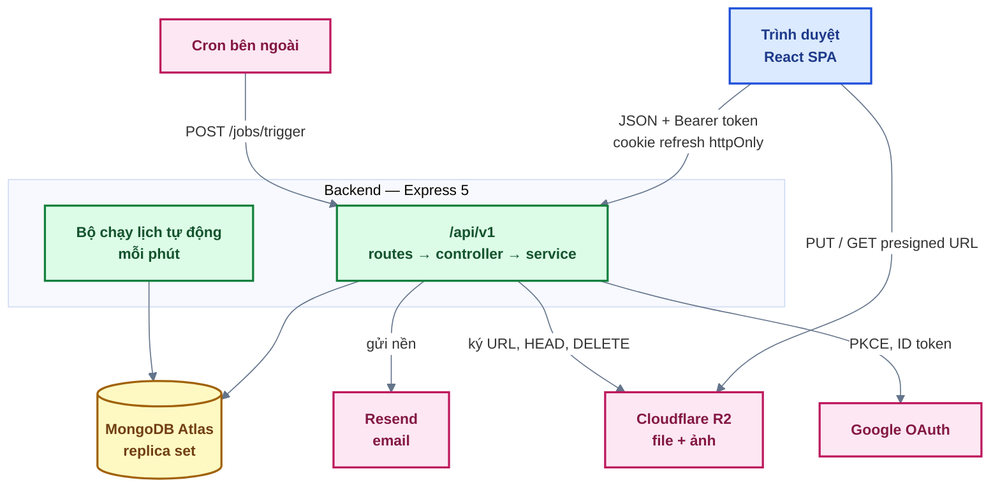
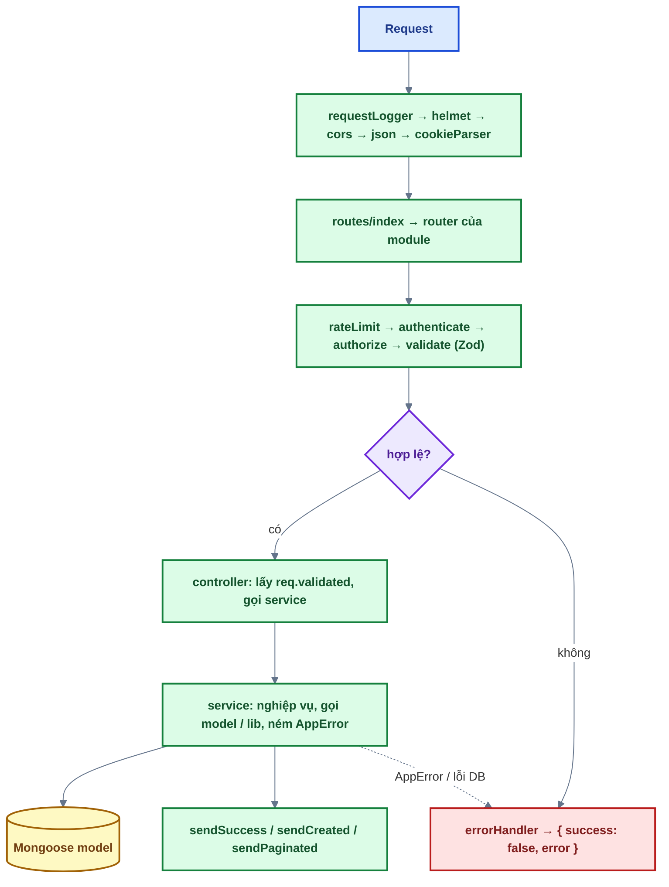
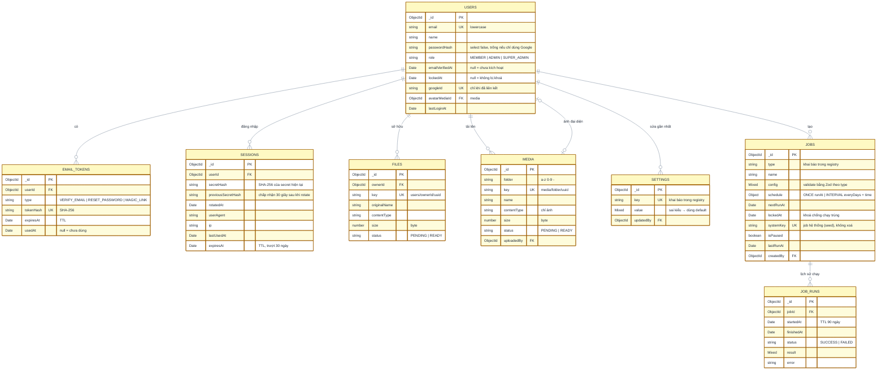

# 01 — Kiến trúc

Source base MERN fullstack JavaScript (ESM): phần lõi dùng chung cho nhiều dự án — auth, phiên
đăng nhập, user & phân quyền, system settings, storage, email, media, lịch tự động. Tài liệu đọc
theo thứ tự `01` → `08`.

## 0. Tổng quan

### 0.1 Thành phần



- **Monorepo** npm workspaces: `backend/` và `frontend/` độc lập về code (không có
  `packages/shared`); Zod schema khai báo riêng mỗi phía.
- File người dùng đi **thẳng** trình duyệt ↔ R2 bằng presigned URL — API chỉ cấp quyền và kiểm tra.
- Email **gửi nền**: request của người dùng không chờ nhà cung cấp email.

### 0.2 Backend — luồng một request



| Tầng              | Được làm                                                         | Không được làm                             |
| ----------------- | ---------------------------------------------------------------- | ------------------------------------------ |
| `*.routes.js`     | Khai báo path + middleware, gọi controller                       | Logic nghiệp vụ                            |
| `*.controller.js` | Lấy dữ liệu đã validate, gọi service, trả qua response helper    | Truy vấn DB, `res.status().json()` tự dựng |
| `*.service.js`    | Nghiệp vụ, gọi model / lib / service module khác, ném `AppError` | Biết về `req` / `res`                      |
| `*.model.js`      | Schema, validation, index (khai báo lại index của migration)     | Nghiệp vụ                                  |
| `*.schema.js`     | Zod cho body / params / query                                    | —                                          |
| `shared/`         | Config, middleware, lib bọc thư viện ngoài, utils thuần, errors  | Import từ `modules/`                       |

Module không import nội bộ module khác — gọi qua service / hằng số được export
(`usersService`, `users.constants.js`...). Ngoại lệ có chủ đích: `authenticate` nằm ở
`modules/auth/auth.middleware.js` vì phải tra session + user.

**Module backend**: `health`, `auth` (đăng ký, đăng nhập, token email, OAuth), `sessions`,
`users` (hồ sơ + quản trị), `settings`, `email` (template), `files`, `media`, `jobs`, `stats`.

### 0.3 Frontend

```text
src/
├── app/            providers (QueryClient, Toaster, SessionRestorer, nối http ↔ auth), router + guards
├── layouts/        ClientLayout, AccountLayout, AuthLayout, AdminLayout (breadcrumb từ route handle)
├── pages/          MỎNG: chỉ ghép component của feature
├── features/<tên>/ api/ (hàm gọi API + query key), hooks/, components/, schemas, store, index.js
└── shared/         components/ui (primitives), hooks, lib (http, queryClient, format...), constants
```

- **State**: dữ liệu server → TanStack Query (mỗi endpoint một hook, query key factory,
  `invalidateQueries` sau mutation); phiên đăng nhập → Zustand (chỉ bộ nhớ); bộ lọc / trang →
  URL search params; form → react-hook-form + Zod.
- **Một http client** (`shared/lib/http.js`): gắn access token, 401 → refresh đúng 1 lần (gộp
  refresh đồng thời) → gửi lại; lỗi chuẩn hoá thành `ApiError` (rẽ nhánh theo `error.code`).
- **Guard** ở router (`ProtectedRoute`, `GuestOnly`, `RoleGuard`); quyền thật luôn do backend kiểm tra.
- Feature chỉ import feature khác qua `index.js`.
- **Giao diện**: chỉ dùng design token + primitive trong `shared/components/ui`, theo khuôn trang
  ở [docs 09](09-giao-dien.md).

## 1. Mô hình dữ liệu

### 1.1 Nguyên tắc

- **Model nằm trong module sở hữu** (`modules/<tên>/<tên>.model.js`). Module khác cần dữ liệu thì
  gọi qua service được export, không import model của module khác để truy vấn.
- **Reference thay vì embed** cho mọi quan hệ ở đây: các collection con (token, phiên, file, lịch
  sử chạy job) đều tăng không giới hạn và được truy vấn độc lập. Chỉ `jobs.schedule` là object
  nhúng (thuộc riêng job, kích thước cố định).
- **API luôn trả `id`** (string), không trả `_id`/`__v`; trường `select: false` (như
  `passwordHash`) không bao giờ xuất hiện trong JSON.
- **Index được tạo bằng migration** (`backend/migrations/`). Schema khai báo lại đúng index đó
  (cùng tên) để người đọc model thấy được; test `Model.diffIndexes()` phát hiện khi hai nơi lệch
  nhau.
- **Token và secret chỉ lưu dạng hash** (SHA-256 cho token ngẫu nhiên, bcrypt cho mật khẩu).
- **Thời gian lưu UTC** (`Date`); múi giờ chỉ dùng khi tính lịch job (`JOBS_TIMEZONE`).
- Collection được tạo theo phase cần đến (xem cột "Phase" bên dưới) — sơ đồ này là thiết kế đích.

### 1.2 Sơ đồ quan hệ



Mọi collection đều có `createdAt`, `updatedAt` (`timestamps: true`), trừ `job_runs` dùng
`startedAt`/`finishedAt`.

### 1.3 Chi tiết từng collection

| Collection     | Phase | Index (tên — mục đích)                                                                                                                                                                                                                                                                                                                |
| -------------- | ----- | ------------------------------------------------------------------------------------------------------------------------------------------------------------------------------------------------------------------------------------------------------------------------------------------------------------------------------------- |
| `users`        | 1, 10 | `email_unique` — email không trùng · `googleId_unique` (partial: chỉ khi có googleId) · `role_single_super_admin` (partial unique trên `role` khi `role = SUPER_ADMIN`) — **đúng 1 Super Admin** · Phase 10: `createdAt_desc`, `role_createdAt` — danh sách admin · Phase 12: `avatarMediaId` (partial) — resolver nơi dùng của media |
| `email_tokens` | 2     | `tokenHash_unique` — tra token · `userId_type` — xoá token cũ cùng loại · TTL trên `expiresAt`                                                                                                                                                                                                                                        |
| `sessions`     | 3     | `userId` — liệt kê/thu hồi phiên · TTL trên `expiresAt`                                                                                                                                                                                                                                                                               |
| `settings`     | 8     | `key_unique`                                                                                                                                                                                                                                                                                                                          |
| `files`        | 11    | `key_unique` · `ownerId_createdAt` — danh sách tệp của tôi · `status_createdAt` — job dọn upload dở                                                                                                                                                                                                                                   |
| `media`        | 12    | `key_unique` · `folder_createdAt` — thư viện theo folder · `status_createdAt` — job dọn upload dở                                                                                                                                                                                                                                     |
| `jobs`         | 13    | `isPaused_nextRunAt` — bộ chạy tìm job đến hạn · `systemKey_unique` (partial) — job hệ thống do seed tạo                                                                                                                                                                                                                              |
| `job_runs`     | 13    | `jobId_startedAt` — lịch sử chạy của job · TTL 90 ngày trên `startedAt`                                                                                                                                                                                                                                                               |

Ghi chú thiết kế:

- **Trạng thái user** không lưu thành một trường riêng mà suy ra: chưa kích hoạt
  (`emailVerifiedAt = null`), bị khoá (`lockedAt ≠ null`), hoạt động (còn lại). Tránh hai nguồn
  sự thật mâu thuẫn nhau.
- **Đúng 1 Super Admin** được đảm bảo ở tầng DB bằng partial unique index, không chỉ ở code.
- **TTL** của MongoDB chạy khoảng 60 giây/lần nên document hết hạn có thể còn tồn tại một lúc —
  code vẫn luôn kiểm tra `expiresAt` trong điều kiện truy vấn, TTL chỉ để dọn rác.
- **Token email dùng 1 lần**: tiêu thụ bằng một lệnh `findOneAndUpdate` có điều kiện
  `usedAt: null` và còn hạn, nên hai request cùng lúc chỉ một request thành công.

### 1.4 Toàn vẹn tham chiếu (MongoDB không có khoá ngoại)

MongoDB không tự chặn hay xoá theo khi document cha bị xoá. Dự án xử lý ở tầng service:

| Khi xoá / thay đổi                                                     | Xử lý                                                                                                                   |
| ---------------------------------------------------------------------- | ----------------------------------------------------------------------------------------------------------------------- |
| User (chỉ job dọn tài khoản chưa kích hoạt; **không có API xoá user**) | Xoá `email_tokens` của user trong cùng transaction. User chưa kích hoạt không đăng nhập được nên không có session/file. |
| Media đang được dùng (vd. làm avatar)                                  | **Chặn xoá**: 409 `MEDIA_IN_USE`, `details` liệt kê nơi dùng (resolver theo từng loại tài nguyên).                      |
| Đổi avatar                                                             | Ảnh cũ thành **mồ côi** (không còn nơi dùng) — job dọn ảnh mồ côi xoá sau.                                              |
| Job                                                                    | Xoá `job_runs` của job trong cùng transaction; job hệ thống không xoá được, chỉ tạm dừng.                               |
| Khoá user / reset mật khẩu                                             | Xoá các `sessions` của user (thu hồi phiên).                                                                            |

Giới hạn cần biết: nếu dữ liệu bị sửa trực tiếp trên DB (không qua service), tham chiếu có thể
bị treo (vd. `avatarMediaId` trỏ tới media không còn). Code đọc dữ liệu phải chịu được trường hợp
này (coi như không có avatar).
