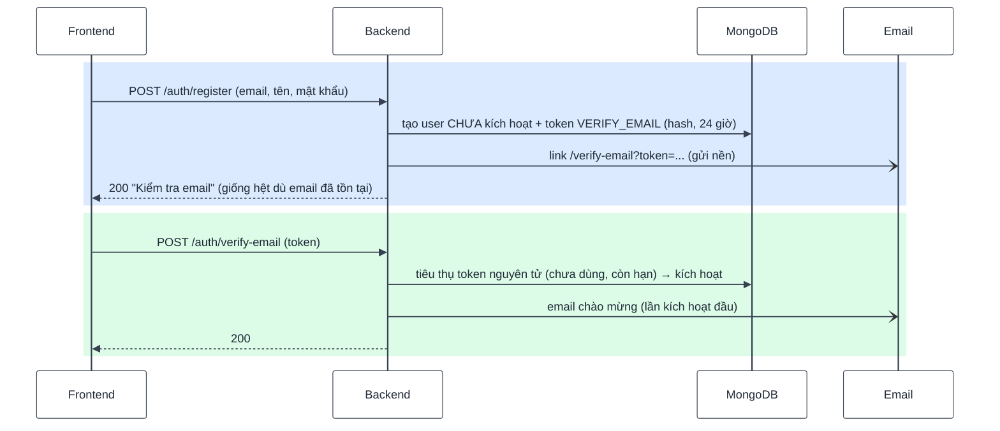
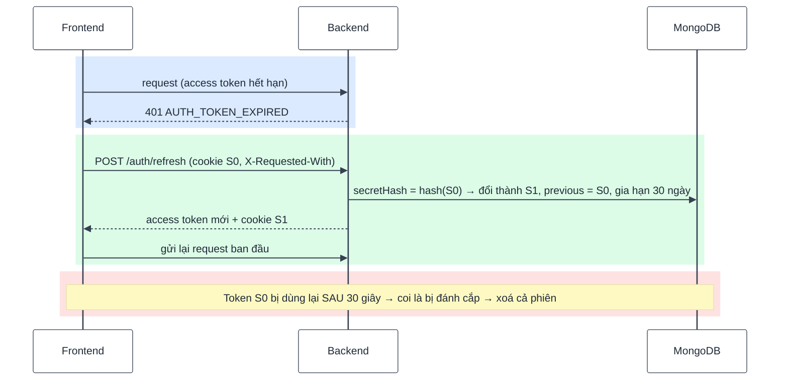
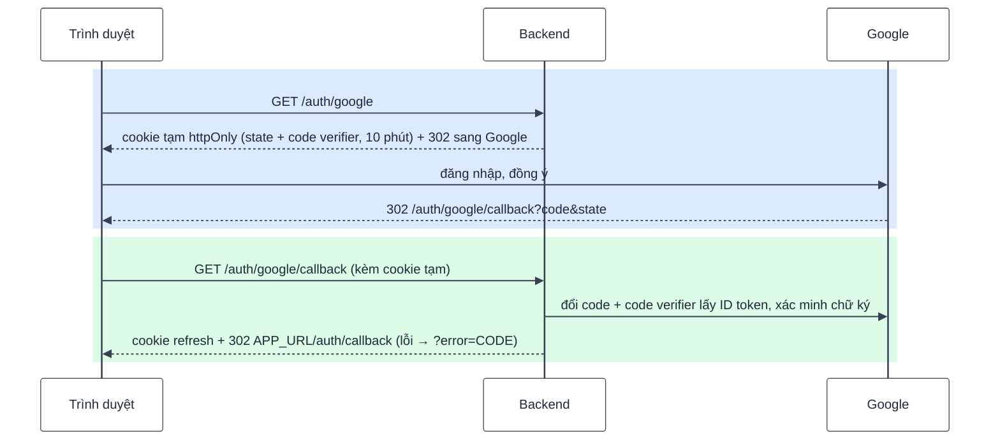

# 03 — Xác thực & phiên đăng nhập

## 1. Token

|            | Access token                                              | Refresh token                                     |
| ---------- | --------------------------------------------------------- | ------------------------------------------------- |
| Dạng       | JWT HS256, payload chỉ `sub` (userId) + `sid` (sessionId) | `<sessionId>.<secret>` ngẫu nhiên 256 bit         |
| Thời hạn   | 15 phút                                                   | 30 ngày, **trượt** (mỗi lần refresh gia hạn)      |
| Ở frontend | Chỉ trong **bộ nhớ** (Zustand) — không localStorage       | Cookie `httpOnly`, `path=/api/v1/auth`            |
| Ở server   | Không lưu                                                 | Collection `sessions` chỉ lưu **hash** của secret |

- `authenticate` kiểm tra **chữ ký JWT + session + user trong DB ở mọi request**: thu hồi phiên,
  khoá tài khoản, đổi role có hiệu lực ngay, không chờ token hết hạn.
- **401 chỉ dùng cho access/refresh token không hợp lệ** (frontend sẽ tự refresh). Lỗi nghiệp vụ
  khác (sai mật khẩu hiện tại, không đủ quyền...) dùng 400 / 403.
- Tải lại trang: `SessionRestorer` gọi `/auth/refresh` (cookie) để lấy lại access token trước khi
  render route.

## 2. Đăng ký & kích hoạt

- **Response đăng ký luôn giống nhau** → không dò được email nào đã có tài khoản. Mật khẩu luôn
  được hash (kể cả khi không dùng) để thời gian phản hồi không lộ thông tin.
- Email đã tồn tại: đã kích hoạt → gửi mail "bạn đã có tài khoản"; **chưa kích hoạt → huỷ link
  kích hoạt cũ, gửi link đặt mật khẩu** (chống _pre-account takeover_: kẻ gian đăng ký trước bằng
  email nạn nhân rồi chờ nạn nhân bấm link).
- Token email (xác thực, đặt lại mật khẩu, magic link): 1 collection, lưu hash SHA-256, có hạn,
  **dùng 1 lần**, phát hành mới thì huỷ token cũ cùng loại, TTL index dọn rác.
- Tài khoản không kích hoạt sau 7 ngày bị job hệ thống xoá (docs 08).

## 3. Đăng nhập

- Sai email hay sai mật khẩu → **cùng** lỗi `INVALID_CREDENTIALS`; email không tồn tại vẫn chạy
  bcrypt với hash giả (chống dò email bằng thời gian).
- Chỉ **sau khi mật khẩu đúng** mới báo `ACCOUNT_LOCKED` / `EMAIL_NOT_VERIFIED`.
- Rate limit: đăng nhập 10 lần / 15 phút / IP; các route gửi email 20 lần / 15 phút / IP;
  đổi mật khẩu khi đang đăng nhập 5 lần / 15 phút / **user** (kẻ có access token đổi được IP).

## 4. Xoay vòng refresh token

| Refresh bằng                                     | Kết quả                                                                                   |
| ------------------------------------------------ | ----------------------------------------------------------------------------------------- |
| Secret hiện tại                                  | Secret mới + cookie mới (thao tác nguyên tử có điều kiện)                                 |
| Secret ngay trước đó, trong 30 giây sau lần xoay | Access token mới, **không** đặt lại cookie (tab khác vừa xoay; các tab dùng chung cookie) |
| Secret ngay trước đó, quá 30 giây                | Thu hồi cả phiên → 401                                                                    |
| Secret lạ                                        | 401, **không** thu hồi (tránh kẻ đoán sessionId đăng xuất người khác)                     |

- `/auth/refresh` và `/auth/logout` dùng cookie → bắt buộc header `X-Requested-With:
XMLHttpRequest` (chống CSRF). CORS chỉ cho origin trong `CORS_ORIGINS`, kèm credentials.
- Frontend: nhiều request cùng nhận 401 → **chỉ 1 lần refresh**, tất cả chờ chung rồi gửi lại;
  refresh thất bại → dọn phiên, về trang đăng nhập.

## 5. Quản lý phiên

- `GET /sessions`: thiết bị đang đăng nhập (trình duyệt, hệ điều hành, loại thiết bị — parse
  User-Agent tự viết), IP, lần dùng cuối, đánh dấu phiên hiện tại.
- Thu hồi 1 phiên khác / mọi phiên khác. Phiên của người khác → 404 (điều kiện truy vấn có userId).

## 6. Mật khẩu

| Luồng                         | Thu hồi phiên      | Ghi chú                                                                                                 |
| ----------------------------- | ------------------ | ------------------------------------------------------------------------------------------------------- |
| Quên / đặt lại (link 60 phút) | **Mọi** phiên      | Transaction: tiêu thụ token + đặt mật khẩu + kích hoạt (nếu chưa) + thu hồi phiên; email sau khi commit |
| Đổi khi đang đăng nhập        | Mọi phiên **khác** | Sai mật khẩu hiện tại → 400 (không phải 401); tài khoản chỉ dùng Google → `PASSWORD_NOT_SET`            |

Mật khẩu: ≥ 8 ký tự, ≤ 72 byte UTF-8 (giới hạn của bcrypt — vượt quá bcrypt cắt bớt im lặng),
bcrypt cost `BCRYPT_COST` (mặc định 12).

## 7. Magic link

- Chỉ gửi cho tài khoản đã tồn tại (response chung), hạn 15 phút, dùng 1 lần.
- Bật / tắt bằng setting `auth.magicLinkEnabled`; tắt thì link đã gửi cũng vô hiệu.
- Tài khoản chưa kích hoạt: bấm link = chứng minh sở hữu email → kích hoạt luôn **và xoá mật khẩu
  cũ** (`usersService.activateByEmailProof`, cùng quy tắc với liên kết Google).

**Vì sao magic link xoá mật khẩu còn `verify-email` thì không?** Đây là hai kênh khác nhau:

| Luồng           | Ai bấm link                                                 | Mật khẩu cũ                                           |
| --------------- | ----------------------------------------------------------- | ----------------------------------------------------- |
| `verify-email`  | Chính người vừa đăng ký (link gửi ngay trong luồng đăng ký) | **Giữ** — người đặt mật khẩu và người bấm link là một |
| Magic link      | Chủ hộp thư, có thể **không phải** người đã đăng ký         | **Xoá**                                               |
| Liên kết Google | Chủ hộp thư (Google xác nhận)                               | **Xoá**                                               |

Không xoá ở magic link → _pre-account takeover_: kẻ gian đăng ký trước bằng `victim@mail.com` với
mật khẩu P (không kích hoạt được). Nạn nhân sau đó chọn "Đăng nhập bằng liên kết email" — response
chung nên không hề biết mình "đã có tài khoản" — bấm link, tài khoản kích hoạt **kèm mật khẩu P**.
Kẻ gian đăng nhập bằng P và đọc được mọi dữ liệu nạn nhân tạo về sau. Sau khi kích hoạt bằng magic
link, người dùng đặt mật khẩu qua luồng "Quên mật khẩu" nếu muốn.

## 8. Google OAuth (Authorization Code + PKCE, không Passport)

- Kiểm tra `state` với cookie tạm (so sánh timing-safe) → chống CSRF đăng nhập.
- Tìm user theo `googleId` → liên kết theo email (**chỉ tin email Google đã xác minh**; tài khoản
  local chưa kích hoạt bị **xoá mật khẩu cũ** khi liên kết) → tạo mới (bị chặn khi tắt đăng ký).
- Trang `/auth/callback` là lần tải trang mới → `SessionRestorer` đổi cookie lấy access token.
- Thiếu một trong 3 biến `GOOGLE_*` → lỗi khởi động; trống cả 3 → tắt (endpoint 404, ẩn nút).
