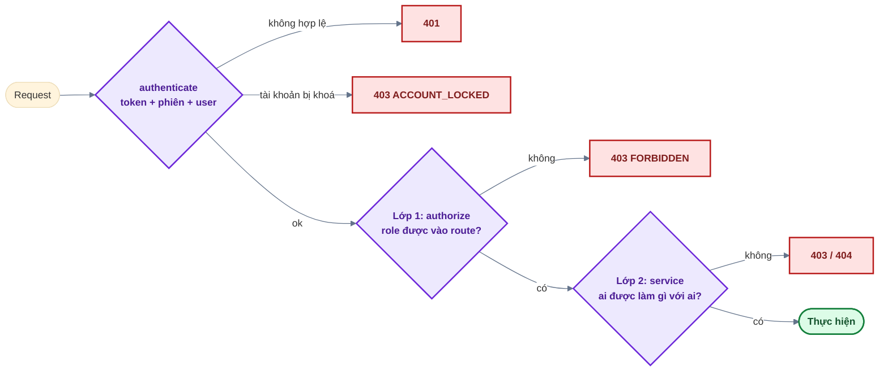

# 04 — Phân quyền (RBAC)

## 1. Vai trò

| Role          | Hiển thị         | Ghi chú                                                                      |
| ------------- | ---------------- | ---------------------------------------------------------------------------- |
| `MEMBER`      | Thành viên       | Mặc định khi đăng ký / đăng nhập Google lần đầu                              |
| `ADMIN`       | Quản trị viên    | Vào khu `/admin`                                                             |
| `SUPER_ADMIN` | Quản trị cấp cao | **Đúng 1 người**, tạo bằng `npm run db:seed`; không ai gán / đổi / khoá được |

Role đọc từ DB ở **mỗi request** (`authenticate`) → đổi role, khoá tài khoản có hiệu lực ngay.
Hằng số role: `backend/src/modules/users/users.constants.js` ↔ `frontend/src/shared/constants/roles.js`
(giữ khớp nhau).

## 2. Hai lớp kiểm tra ở backend

- **Lớp 1 — route** (`authorize(...roles)` trong `*.routes.js`): chặn sớm theo role, đọc route là
  biết ai được gọi.
- **Lớp 2 — service**: quy tắc phụ thuộc dữ liệu (đối tượng bị thao tác là ai, của ai). Service tự
  kiểm tra lại, **không tin** vào việc route đã chặn — service có thể được gọi từ nơi khác (job,
  script).
- Tài nguyên thuộc sở hữu (file, phiên): điều kiện truy vấn **luôn có `ownerId` / `userId`** → tài
  nguyên của người khác trả **404** (không lộ là tồn tại).

## 3. Ma trận quyền

| Chức năng                   | Route                             |    MEMBER     |     ADMIN     |  SUPER_ADMIN  |
| --------------------------- | --------------------------------- | :-----------: | :-----------: | :-----------: |
| Hồ sơ, avatar, đổi mật khẩu | `/users/me*`                      |      ✅       |      ✅       |      ✅       |
| Phiên đăng nhập của mình    | `/sessions`                       |      ✅       |      ✅       |      ✅       |
| Tệp của tôi                 | `/files`                          | ✅ (của mình) | ✅ (của mình) | ✅ (của mình) |
| Trang tổng quan quản trị    | `/admin/stats`                    |      ❌       |      ✅       |      ✅       |
| Danh sách người dùng        | `GET /admin/users`                |      ❌       |      ✅       |      ✅       |
| Khoá / mở khoá              | `/admin/users/:id/lock`, `unlock` |      ❌       |    MEMBER     | MEMBER, ADMIN |
| Đổi role MEMBER ↔ ADMIN     | `/admin/users/:id/role`           |      ❌       |      ❌       |      ✅       |
| Thư viện ảnh hệ thống       | `/admin/media`                    |      ❌       |      ✅       |      ✅       |
| Lịch tự động                | `/admin/jobs`                     |      ❌       |      ❌       |      ✅       |
| Cấu hình hệ thống           | `/admin/settings`                 |      ❌       |      ❌       |      ✅       |

Quy tắc của lớp 2 khi quản lý người dùng (`usersAdmin.service.js`):

| Tình huống                                            | Kết quả                                          |
| ----------------------------------------------------- | ------------------------------------------------ |
| Tự thao tác trên chính mình                           | 403 `CANNOT_MODIFY_SELF`                         |
| Đối tượng là Super Admin, hoặc gán role `SUPER_ADMIN` | 403 `CANNOT_MODIFY_SUPER_ADMIN`                  |
| ADMIN khoá ADMIN khác                                 | 403 `INSUFFICIENT_PERMISSION`                    |
| Role / trạng thái đối tượng vừa bị người khác đổi     | 409 `USER_STATE_CHANGED` (cập nhật có điều kiện) |

Khoá tài khoản = đặt `lockedAt` + **thu hồi mọi phiên** trong 1 transaction, rồi gửi email thông báo.

## 4. Frontend

Guard ở frontend **chỉ phục vụ trải nghiệm** (ẩn menu, không cho vào trang vô ích); bảo mật luôn
nằm ở backend.

| Guard                     | Vị trí                       | Hành vi                                                                                                                  |
| ------------------------- | ---------------------------- | ------------------------------------------------------------------------------------------------------------------------ |
| `ProtectedRoute`          | `app/router/guards/`         | Chưa đăng nhập → `/login?redirect=<trang đang mở>`                                                                       |
| `GuestOnly`               | trang đăng nhập / đăng ký... | Đã đăng nhập → về `?redirect=` (chỉ nhận đường dẫn nội bộ) hoặc `/dashboard` — nơi **duy nhất** điều hướng sau đăng nhập |
| `RoleGuard roles={[...]}` | bên trong `ProtectedRoute`   | Sai role → trang 403                                                                                                     |

- `admin.routes.jsx`: cả nhóm `/admin` cần `ADMIN_ROLES`; `/admin/jobs`, `/admin/settings` bọc thêm
  `RoleGuard` Super Admin — **khớp đúng** `authorize` ở backend.
- Sidebar quản trị lọc mục theo role (`AdminLayout.jsx`).
- Nút thao tác trên từng người dùng (khoá, đổi role) ẩn / hiện theo cùng quy tắc lớp 2, backend
  vẫn kiểm tra lại.

## 5. Hướng dẫn nhanh theo vai trò

| Vai trò          | Trang dùng được                                                                                         |
| ---------------- | ------------------------------------------------------------------------------------------------------- |
| Khách            | Trang chủ, đăng ký, đăng nhập (mật khẩu / magic link / Google), quên mật khẩu                           |
| Thành viên       | `/dashboard`; **Tài khoản**: hồ sơ + ảnh đại diện, tệp của tôi, bảo mật (đổi mật khẩu), phiên đăng nhập |
| Quản trị viên    | Như thành viên + `/admin`: tổng quan, người dùng (tìm, lọc, khoá thành viên), thư viện ảnh              |
| Quản trị cấp cao | Như quản trị viên + đổi vai trò, khoá quản trị viên, lịch tự động, cấu hình hệ thống                    |

## 6. Thêm một quyền mới

1. Backend: thêm `authorize(...)` vào route; quy tắc phụ thuộc dữ liệu → viết trong service.
2. Viết test cho **từng role** (được phép / bị chặn) — xem `backend/tests/modules/usersAdmin.test.js`.
3. Frontend: bọc route bằng `RoleGuard`, thêm mục sidebar với cùng danh sách role.
4. Cập nhật ma trận ở mục 3 và `docs/openapi.yaml`.
