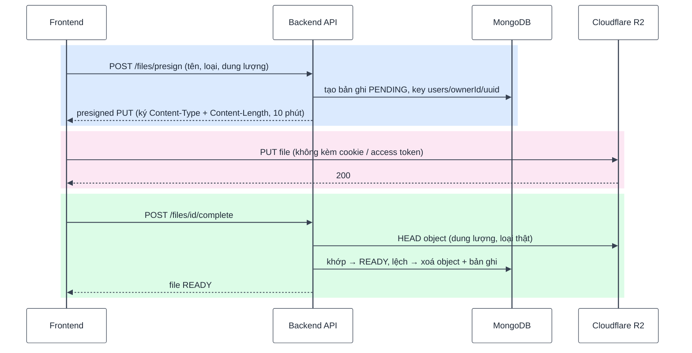
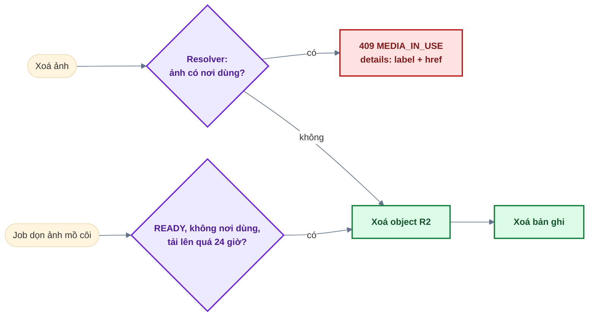
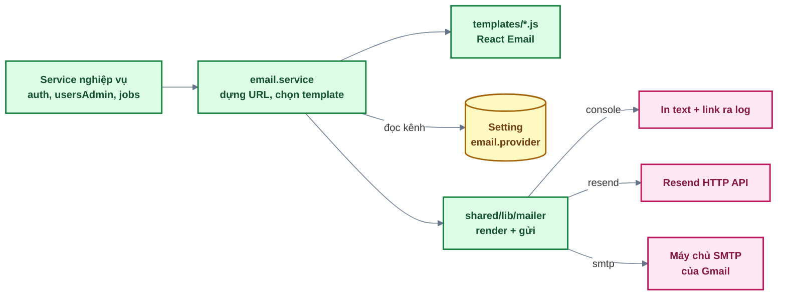

# 05 — Storage & Email

Ba phần: **tệp cá nhân** (`files`) và **thư viện ảnh hệ thống** (`media`) cùng lưu trên
Cloudflare R2; **email** giao dịch gửi qua kênh do Super Admin chọn (console / Resend / SMTP),
template viết bằng React Email.

## 1. Lưu trữ file (Cloudflare R2)

### 1.1 Luồng upload 3 bước

File đi thẳng giữa trình duyệt và R2 — server không nhận nội dung file (không tốn băng thông,
không giới hạn bởi body size của API), chỉ cấp quyền và kiểm tra.



- **Whitelist**: JPEG, PNG, WebP, GIF, PDF; tối đa 10MB — kiểm tra ở 3 lớp: form frontend, Zod ở
  `presign`, chữ ký presigned URL (R2 từ chối nếu `Content-Type`/`Content-Length` khác lúc ký).
- **Không tin client**: bước `complete` đọc thông tin object THẬT trên R2 bằng `HEAD`.
- **Chỉ chủ sở hữu** thao tác: mọi truy vấn có điều kiện `ownerId` → file người khác trả 404.
- **Tải về** bằng presigned GET hết hạn sau 5 phút, kèm tên file gốc (`Content-Disposition`).
- **Upload dở** (PENDING quá lâu — người dùng đóng tab giữa chừng) được job dọn định kỳ (Phase 13).

#### Giới hạn tiêu thụ tài nguyên

Tài khoản tạo được miễn phí, nên nếu không chặn thì một người tải lên vô hạn file 10MB (chi phí R2)
hoặc xin URL liên tục để sinh hàng loạt bản ghi PENDING (OWASP API4).

| Lớp chặn               | Mức                         | Nơi cài                                                                                                           |
| ---------------------- | --------------------------- | ----------------------------------------------------------------------------------------------------------------- |
| Tần suất xin URL       | 30 lần / 15 phút / **user** | `presignRateLimiter` — gắn sau `authenticate` ở `/files/presign`, `/media/avatar/presign`, `/admin/media/presign` |
| Số file / user         | 100                         | `filesService.requestUpload` → 403 `STORAGE_QUOTA_EXCEEDED`                                                       |
| Tổng dung lượng / user | 200MB                       | như trên                                                                                                          |

Quota **tính cả bản ghi PENDING**: nếu chỉ tính READY thì chỉ cần xin URL rồi bỏ ngang là lách được.
Đổi mức trong `files.constants.js` (`MAX_FILES_PER_USER`, `MAX_TOTAL_SIZE_BYTES_PER_USER`).
Ảnh đại diện và thư viện ảnh admin chỉ chặn bằng tần suất: avatar ≤ 2MB và ảnh cũ thành mồ côi được
job dọn, còn thư viện ảnh chỉ ADMIN trở lên mới vào được.

### 1.2 Cấu hình

1. Cloudflare Dashboard → **R2** → tạo bucket (vd. `mern-base-dev`).
2. **Manage R2 API Tokens** → tạo token quyền _Object Read & Write_, giới hạn cho bucket đó.
3. Điền 4 biến vào `backend/.env` (đủ cả 4 = bật, trống cả 4 = tắt, endpoint `/files` trả 404
   và frontend ẩn chức năng):

   | Biến                   | Lấy ở đâu                                        |
   | ---------------------- | ------------------------------------------------ |
   | `R2_ACCOUNT_ID`        | Account ID trong trang R2                        |
   | `R2_ACCESS_KEY_ID`     | Access Key ID của API token                      |
   | `R2_SECRET_ACCESS_KEY` | Secret Access Key của API token (chỉ hiện 1 lần) |
   | `R2_BUCKET`            | Tên bucket                                       |

### 1.3 CORS của bucket (bắt buộc)

Trình duyệt PUT thẳng lên R2 → bucket phải cho phép origin của frontend. Bucket → **Settings →
CORS Policy**:

```json
[
  {
    "AllowedOrigins": ["http://localhost:5173", "https://app.example.com"],
    "AllowedMethods": ["PUT", "GET", "HEAD"],
    "AllowedHeaders": ["Content-Type"],
    "MaxAgeSeconds": 3600
  }
]
```

Thiếu CORS: upload báo lỗi mạng ở trình duyệt (Console có dòng "blocked by CORS policy") dù
presign thành công.

- **Không được bỏ `AllowedHeaders`**: PUT gửi `Content-Type: image/...` nên trình duyệt gửi
  preflight (OPTIONS) kèm `Access-Control-Request-Headers: content-type`. Rule không khai báo
  header này → R2 trả `403 CORS not configured for this bucket` (thông báo dễ gây hiểu nhầm là
  chưa cấu hình CORS).
- `AllowedOrigins` chỉ cần origin của **frontend**; backend gọi R2 từ server nên không chịu CORS.
- Kiểm tra nhanh không cần trình duyệt: lấy `upload.url` từ response presign rồi chạy
  `curl -i -X OPTIONS "<url>" -H 'Origin: http://localhost:5173' -H 'Access-Control-Request-Method: PUT' -H 'Access-Control-Request-Headers: content-type'`
  → phải trả `204` kèm `Access-Control-Allow-Origin`.

## 2. Thư viện ảnh (media)

Tách với tệp cá nhân: **media là ảnh dùng trong hệ thống** (avatar, ảnh nội dung...), không thuộc
riêng ai; `files` là tệp riêng của từng người.

|            | Tệp của tôi (`files`)             | Thư viện ảnh (`media`)                                       |
| ---------- | --------------------------------- | ------------------------------------------------------------ |
| Ai quản lý | Chủ sở hữu                        | ADMIN, SUPER_ADMIN (`/admin/media`)                          |
| Loại       | Ảnh + PDF, ≤ 10MB                 | JPEG, PNG, WebP, GIF, ≤ 10MB (avatar ≤ 2MB)                  |
| Xem        | Presigned GET 5 phút (chủ sở hữu) | Công khai: `GET /media/:id/content` → 302 sang presigned GET |
| Tổ chức    | Danh sách phẳng                   | Thư mục đơn cấp (`[a-z0-9-]`), vd. `avatars`, `banners`      |

- **Thư mục** là bản ghi thật (collection `media_folders`) → thư mục rỗng tồn tại được: quản trị
  viên tạo thư mục trước (`POST /admin/media/folders`), rồi mới tải ảnh vào. Xin URL tải vào
  thư mục chưa tạo → 404; xoá thư mục còn ảnh → 409 `FOLDER_NOT_EMPTY`.
- **Thư mục hệ thống** (`SYSTEM_FOLDERS`, hiện có `avatars`): luôn hiện, không tạo / xoá / tải
  tay; ảnh vào qua luồng riêng (người dùng đổi ảnh đại diện).
- Giao diện 2 cấp: `/admin/media` là lưới thư mục (ảnh bìa, số ảnh, dung lượng) + lối tắt "Tất
  cả ảnh" / "Ảnh mồ côi"; bấm vào thư mục → `/admin/media/folders/:name` (kéo thả nhiều ảnh, bộ
  lọc gọn, thao tác trong menu ⋯).
- Upload cùng luồng 3 bước ở mục 1.1 (`/admin/media/presign`, `/media/avatar/presign` →
  `/media/:id/complete`).
- `/media/:id/content` đặt `Cache-Control` để trình duyệt không xin URL mới ở mỗi lần hiển thị.
- **Avatar**: người dùng chỉ gán được ảnh do **chính mình** tải lên, trong folder `avatars`, đã
  READY, ≤ 2MB — không lấy ảnh người khác làm avatar.

### 2.1 "Nơi dùng" — thay cho khoá ngoại

MongoDB không có khoá ngoại → module media hỏi từng loại tài nguyên xem ảnh nào đang được dùng
qua các **resolver** trong `backend/src/modules/media/media.usages.js`.



- Xoá ảnh đang dùng → 409 kèm danh sách nơi dùng (`label`, `href`) để quản trị viên bấm tới và gỡ.
- Trang thư viện lọc được theo "đang dùng / mồ côi".
- **Thêm loại tài nguyên dùng ảnh** (vd. ảnh bài viết): thêm 1 resolver trả
  `{ mediaId, label, href }` — không phải sửa code xoá / dọn / thống kê.

## 3. Email

### 3.1 Kiến trúc



- **Kênh gửi chọn lúc chạy**: `email.service` đọc setting `email.provider` (trang Quản trị →
  Cấu hình) rồi truyền cho `mailer.deliver({ ..., provider })`. Chưa chọn → kênh mặc định
  `EMAIL_DELIVERY`. Biến môi trường chỉ chứa **thông tin đăng nhập** của từng kênh; kênh nào
  thiếu biến thì không chọn được (lưu → 400), và nếu kênh đã lưu bị gỡ biến sau đó thì hệ thống
  tự quay về kênh mặc định.
- **Gửi nền, không chờ**: `mailer.runInBackground()` không `await` nhà cung cấp → request của
  người dùng không chậm / không lỗi theo dịch vụ email; lỗi gửi chỉ ghi log. Việc đọc setting cũng
  nằm trong phần chạy nền. Khi tắt server, `mailer.waitForPending()` chờ các email đang gửi.
  Job `SEND_EMAIL` và nút "Gửi email thử" thì **chờ** kết quả (`deliver`) để báo lỗi.
- **Gửi sau khi commit**: trong luồng có transaction, email gửi **sau** khi transaction thành công
  (không gửi thông báo cho thay đổi bị rollback).
- Template là **hàm trả React element** (viết bằng `createElement`, alias `h` — không cần JSX ở
  backend), nhận dữ liệu đã chuẩn bị sẵn, không tự đọc DB / env. Khung chung:
  `backend/src/shared/emails/EmailLayout.js`. Mỗi email có cả bản HTML và bản text.
- Link trong email dựng từ `APP_URL` + đường dẫn frontend (`APP_PATHS` trong `email.service.js`).

### 3.2 Danh sách email

| Email                       | Khi nào                                               |
| --------------------------- | ----------------------------------------------------- |
| Xác thực email              | Đăng ký, gửi lại link xác thực                        |
| Chào mừng                   | Kích hoạt lần đầu (link xác thực, magic link, Google) |
| Email đã có tài khoản       | Đăng ký trùng email đã kích hoạt                      |
| Đặt mật khẩu để kích hoạt   | Đăng ký trùng email **chưa** kích hoạt (docs 03)      |
| Đặt lại mật khẩu            | Quên mật khẩu                                         |
| Mật khẩu vừa thay đổi       | Đặt lại / đổi mật khẩu                                |
| Liên kết đăng nhập          | Magic link                                            |
| Tài khoản bị khoá / mở khoá | Quản trị viên khoá / mở khoá                          |
| Vai trò thay đổi            | Super Admin đổi role                                  |
| Thông báo                   | Job `SEND_EMAIL` (docs 08)                            |
| Email thử                   | Super Admin bấm "Gửi email thử" ở trang Cấu hình      |

### 3.3 Cấu hình kênh gửi

#### Chọn kênh nào?

| Kênh      | Cần gì                                    | Phù hợp khi                                                                                            |
| --------- | ----------------------------------------- | ------------------------------------------------------------------------------------------------------ |
| `console` | Không cần gì                              | Học / phát triển local: email (kèm link) in ra terminal chạy backend                                   |
| `smtp`    | Tài khoản Gmail + App Password (miễn phí) | **Chưa có domain riêng**, muốn nhận email thật — chạy local, VPS, hoặc gói deploy không chặn cổng SMTP |
| `resend`  | Domain riêng đã xác minh + API key Resend | Sản phẩm thật: người gửi mang tên domain, không bị nền tảng chặn cổng                                  |

Cả ba kênh đều chạy **mọi** tính năng email của app (email tự động khi đăng ký / quên mật khẩu /
magic link / khoá tài khoản, job `SEND_EMAIL` gửi hàng loạt, lịch tự động) — code không phân biệt
kênh. Khác nhau ở **hạn mức** và **độ chuyên nghiệp** (người gửi là `@gmail.com` hay domain riêng,
có thống kê / báo thư trả về hay không).

> **Không có domain thì chỉ có Gmail SMTP.** Các dịch vụ gửi email giao dịch (như Resend)
> đều yêu cầu domain riêng đã xác thực (SPF, DKIM) mới gửi đàng hoàng được — địa chỉ
> `@gmail.com` không xác thực được ở các dịch vụ đó.

Điền biến vào `backend/.env` → khởi động lại backend → đăng nhập Super Admin → **Quản trị →
Cấu hình → Kênh gửi email** → chọn kênh → **Gửi email thử** (gửi tới email của bạn, báo lỗi ngay
nếu cấu hình sai) → **Lưu cấu hình**.

#### Biến chung

| Biến             | Ý nghĩa                                                                                                                                                             |
| ---------------- | ------------------------------------------------------------------------------------------------------------------------------------------------------------------- |
| `EMAIL_DELIVERY` | Kênh **mặc định** khi Super Admin chưa chọn: `console` \| `resend` \| `smtp`. Bỏ trống: `console` ở dev/test; production dùng `resend` nếu có key, không thì `smtp` |
| `EMAIL_FROM`     | Người gửi, dạng `Tên <email>`. Bắt buộc khi có Resend. Chỉ dùng SMTP thì bỏ trống được (= `MERN Base <SMTP_USER>`)                                                  |
| `APP_URL`        | URL frontend để dựng link trong email; bắt buộc ở production                                                                                                        |

> Production **không** cho chọn `console` ở trang Cấu hình (email chứa link đăng nhập / đặt lại
> mật khẩu, in ra log production là lộ token) — trừ khi chủ động đặt `EMAIL_DELIVERY=console`.

#### SMTP bằng Gmail (miễn phí, không cần domain)

1. Vào <https://myaccount.google.com/security> → bật **Xác minh 2 bước** (2-Step Verification).
   Chưa bật thì không tạo được mật khẩu ứng dụng.
2. Vào <https://myaccount.google.com/apppasswords> → đặt tên (vd. `mern-base`) → **Create** →
   Google hiện mật khẩu 16 ký tự (chỉ hiện **một lần**, chép ngay; khoảng trắng bỏ hay giữ đều
   được).
3. Điền vào `backend/.env`:

   ```bash
   SMTP_HOST=smtp.gmail.com
   SMTP_USER=ban@gmail.com
   SMTP_PASS=abcdefghijklmnop   # App Password, KHÔNG phải mật khẩu đăng nhập Gmail
   # SMTP_PORT bỏ trống = 587 (STARTTLS). Hoặc SMTP_PORT=465 (TLS ngay từ đầu).
   ```

| Biến          | Ý nghĩa                                                                                   |
| ------------- | ----------------------------------------------------------------------------------------- |
| `SMTP_HOST`   | Địa chỉ máy chủ SMTP — Gmail: `smtp.gmail.com`                                            |
| `SMTP_USER`   | Tài khoản đăng nhập SMTP — địa chỉ Gmail của bạn                                          |
| `SMTP_PASS`   | App Password 16 ký tự ở bước 2. **Bí mật** — không commit                                 |
| `SMTP_PORT`   | `587` (mặc định, kết nối thường rồi nâng lên TLS bằng STARTTLS) · `465` (TLS ngay từ đầu) |
| `SMTP_SECURE` | `true` = TLS ngay từ đầu. Bỏ trống = tự suy từ cổng (`465` → `true`, `587` → `false`)     |

Lưu ý về Gmail:

- Gmail **luôn gửi dưới địa chỉ Gmail của bạn** (tự thay phần email trong `EMAIL_FROM`, giữ tên
  hiển thị).
- Tài khoản cá nhân giới hạn khoảng **500 người nhận/ngày**; vượt thì Google tạm khoá việc gửi.
  Job `SEND_EMAIL` gửi tối đa 200 người/lượt, nghỉ 600ms giữa hai email → đủ cho lớp học và demo,
  **không** dùng cho gửi marketing số lượng lớn.
- Không có thống kê mở thư / báo thư trả về (bounce) như dịch vụ chuyên dụng.
- Email từ ứng dụng mới dễ rơi vào **Spam** — kiểm tra thư mục Spam khi thử.
- Lỗi `Invalid login: 535 ... Username and Password not accepted` → đang dùng mật khẩu Gmail thay
  vì App Password, hoặc App Password đã bị thu hồi (đổi mật khẩu Google sẽ thu hồi hết).

#### Deploy: Gmail SMTP chỉ chạy khi nền tảng không chặn cổng SMTP

**Render gói free chặn kết nối ra ngoài tới cổng 25, 465, 587** (từ 09/2025 —
[changelog Render](https://render.com/changelog/free-web-services-will-no-longer-allow-outbound-traffic-to-smtp-ports)),
nên Gmail SMTP **không gửi được** từ backend deploy trên Render free. Dấu hiệu: "Gửi email thử" báo
lỗi `Connection timeout` sau khoảng 10 giây, dù chạy local thì gửi được.

| Tình huống                                | Làm gì                                                                                                                                                             |
| ----------------------------------------- | ------------------------------------------------------------------------------------------------------------------------------------------------------------------ |
| Chạy local / VPS / gói trả phí của Render | Gmail SMTP chạy bình thường                                                                                                                                        |
| Render free, **chưa có domain**           | Không gửi được email thật. Đặt `EMAIL_DELIVERY=console` để app vẫn chạy (email + link in ra log Render — **chỉ dùng cho demo**, ai đọc được log là dùng được link) |
| Render free, **có domain**                | Dùng **Resend** (gửi qua HTTPS cổng 443, không bị chặn)                                                                                                            |

Nền tảng khác có chính sách riêng — bấm "Gửi email thử" sau khi deploy để kiểm tra.

#### Resend (khi đã có domain)

1. <https://resend.com> → **Domains** → thêm domain → tạo các bản ghi DNS (SPF, DKIM) Resend đưa
   ra ở nhà cung cấp domain → chờ trạng thái _Verified_. Chưa xác minh chỉ gửi được tới email của
   chính tài khoản Resend.
2. **API Keys** → **Create API Key** (quyền _Sending access_) → điền `RESEND_API_KEY`.
3. `EMAIL_FROM=Tên <no-reply@domain-cua-ban.com>` (bắt buộc, phải thuộc domain đã xác minh).

### 3.4 Thêm một email mới

1. Viết template trong `backend/src/modules/email/templates/` (dùng `EmailLayout`, `ActionButton`).
2. Thêm hàm `sendXxxEmail({ user, ... })` vào `emailService` — gọi `send(...)` (gửi nền) hoặc
   `deliver(...)` (chờ kết quả) nội bộ của file, không gọi thẳng `mailer`: hai hàm này tự lấy kênh
   gửi hiện hành.
3. Gọi từ service nghiệp vụ (sau transaction nếu có).
4. Test: spy `mailer.deliver` rồi `await mailer.waitForPending()`, kiểm tra người nhận / tiêu đề /
   link / kênh (xem `backend/tests/modules/email.test.js`).

### 3.5 Thêm một kênh gửi mới

1. `env.js`: thêm giá trị vào `EMAIL_PROVIDERS` + biến môi trường của kênh (nhóm "đủ cả hoặc trống
   cả").
2. `features.isEmailProviderAvailable`: khi nào kênh dùng được.
3. `mailer.js`: thêm một mục vào `TRANSPORTS` (nhận `{ to, subject, html, text }`).
4. `settings.registry.js`: thêm nhãn vào `EMAIL_PROVIDER_LABELS`. Trang Cấu hình tự có lựa chọn
   mới.
