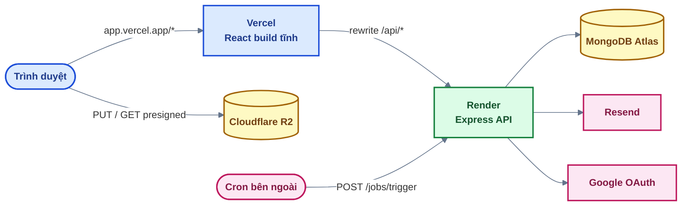

# 07 — Tạo dự án mới & deploy

## 1. Tạo dự án mới từ source base

1. Tạo repo mới từ source base (GitHub → **Use this template**, hoặc clone rồi đổi remote).
2. Đổi tên ứng dụng — tìm chuỗi `MERN Base` / `mern-base`:

   | Nơi                                                                                             | Nội dung                                                     |
   | ----------------------------------------------------------------------------------------------- | ------------------------------------------------------------ |
   | `backend/src/shared/emails/EmailLayout.js`                                                      | `APP_NAME` — tên trong mọi email                             |
   | `frontend/src/shared/constants/app.js` (`APP_NAME`), `frontend/index.html`, `layouts/Brand.jsx` | Tên, tiêu đề tab, logo (sửa kèm test `tests/app/*.test.jsx`) |
   | `frontend/src/index.css` (`--primary*`...)                                                      | Màu thương hiệu, font — xem docs 09                          |
   | `render.yaml` (`name`), `frontend/vercel.json` (`destination`)                                  | Tên service Render → domain API                              |
   | `README.md`, `docs/openapi.yaml` (`title`)                                                      |                                                              |

3. Làm theo docs 02 để chạy local (database riêng cho dự án mới).
4. Thêm tính năng theo cấu trúc module (docs 01), quy ước API (docs 06), phân quyền (docs 04).

Điểm mở rộng có sẵn — thêm mục mới, không sửa phần lõi:

| Muốn thêm                             | Sửa ở                                                            |
| ------------------------------------- | ---------------------------------------------------------------- |
| Cấu hình hệ thống bật / tắt được      | `backend/src/modules/settings/settings.registry.js`              |
| Loại job                              | `backend/src/modules/jobs/jobs.registry.js` (docs 08)            |
| Tài nguyên dùng ảnh (ảnh bài viết...) | `backend/src/modules/media/media.usages.js` (docs 05)            |
| Email                                 | `backend/src/modules/email/` (docs 05)                           |
| Index / đổi dữ liệu                   | Migration mới trong `backend/migrations/` (docs 02)              |
| Mục menu quản trị / trang tài khoản   | `layouts/AdminLayout.jsx`, `layouts/AccountLayout.jsx` (docs 09) |

## 2. Kiến trúc production



**Vì sao proxy `/api` qua Vercel?** Trình duyệt thấy frontend và API **cùng domain** → cookie
refresh là cookie first-party, `SameSite=Lax` là đủ; không bị trình duyệt chặn cookie bên thứ ba
(Safari, Chrome ẩn danh). Gọi thẳng `*.onrender.com` từ `*.vercel.app` là khác site → phải dùng
`SameSite=None` và vẫn có thể bị chặn.

## 3. MongoDB Atlas

1. Tạo cluster (M0 miễn phí), **database user** riêng cho production (quyền readWrite).
2. **Network Access**: Render gói free không có IP cố định → cho phép `0.0.0.0/0` (bảo vệ bằng
   mật khẩu mạnh của database user). Gói trả phí: dùng IP tĩnh của Render.
3. URI có tên database riêng, vd. `.../mern_base_prod?retryWrites=true&w=majority`.

## 4. Backend trên Render

1. Push repo lên GitHub. Render → **New → Blueprint** → chọn repo → Render đọc `render.yaml`.
2. Điền các biến `sync: false` (bảng mục 7). `JWT_ACCESS_SECRET`, `JOBS_TRIGGER_SECRET` được
   Render tự sinh.
3. Deploy: build = `npm ci` + **migration**; start = `npm run start -w backend`; health check
   `/api/v1/health` (trả 503 khi mất kết nối DB → Render không chuyển traffic sang bản lỗi).
4. Tạo Super Admin + job hệ thống — chạy seed **từ máy local** trỏ vào DB production (gói free
   không có Shell). Biến truyền trên dòng lệnh được ưu tiên hơn `backend/.env`:

   ```bash
   MONGODB_URI='<uri production>' SEED_SUPER_ADMIN_EMAIL='admin@example.com' \
   SEED_SUPER_ADMIN_PASSWORD='<mật khẩu mạnh>' npm run db:seed
   ```

   Đăng nhập rồi **đổi mật khẩu ngay**. Chạy lại seed an toàn (đã có thì bỏ qua).

Gói free: server **ngủ sau 15 phút** không có request, request đầu tiên chờ ~1 phút. Cron ở mục 6
vừa chạy job vừa giữ server thức.

## 5. Frontend trên Vercel

1. Sửa `destination` trong `frontend/vercel.json` thành domain Render thật
   (`https://<service>.onrender.com/api/:path*`) — Vercel không đọc biến môi trường trong file này.
2. Vercel → **Add New Project** → chọn repo → **Root Directory: `frontend`** (framework Vite, tự
   nhận). Vercel cài theo `package-lock.json` ở gốc repo (npm workspaces).
3. Environment Variables: `VITE_API_URL` = **`/api/v1`** (đường dẫn tương đối → đi qua rewrite).
4. `vercel.json` còn có: fallback mọi đường dẫn về `index.html` (React Router), cache 1 năm cho
   `/assets/*` (tên file có hash).

> **Build đỏ ở bước `npm install` với `sh: husky: command not found` / `exited with 127`?**
> Vercel đặt `NODE_ENV=production` khi cài, npm vì thế bỏ qua `devDependencies` — nhưng script
> `prepare` ở `package.json` gốc vẫn chạy và gọi `husky` (một devDependency). Script đã đổi thành
> `husky || true` nên bỏ qua được khi không có husky. Git hook chỉ cần trên máy lập trình viên,
> không cần trên máy build.

## 6. Dịch vụ ngoài

| Dịch vụ           | Việc cần làm                                                                                                                                                                                                                                                                                                                      |
| ----------------- | --------------------------------------------------------------------------------------------------------------------------------------------------------------------------------------------------------------------------------------------------------------------------------------------------------------------------------- |
| **Google OAuth**  | Google Cloud Console → Credentials → OAuth Client: _Authorized redirect URI_ = `https://<app>.vercel.app/api/v1/auth/google/callback` (qua domain Vercel để cookie cùng site); đặt đúng giá trị này vào `GOOGLE_REDIRECT_URI`. OAuth consent screen: chuyển sang _In production_                                                  |
| **Cloudflare R2** | Bucket riêng cho production; CORS `AllowedOrigins` thêm `https://<app>.vercel.app` (docs 05)                                                                                                                                                                                                                                      |
| **Email**         | Có domain: Resend — xác minh domain (SPF, DKIM), `EMAIL_FROM` dùng domain đó. Chưa có domain: Gmail SMTP — nhưng **Render free chặn cổng 25/465/587** nên không gửi được; khi đó đặt `EMAIL_DELIVERY=console` (chỉ demo) hoặc dùng gói trả phí (docs 05 §3.3). Sau deploy: Quản trị → Cấu hình → Kênh gửi email → "Gửi email thử" |
| **Cron**          | Vd. [cron-job.org](https://cron-job.org) (miễn phí): `POST https://<app>.vercel.app/api/v1/jobs/trigger` (hoặc thẳng domain Render), header `X-Jobs-Secret: <JOBS_TRIGGER_SECRET>`, mỗi 10 phút                                                                                                                                   |

## 7. Checklist biến môi trường production

| Biến                                          | Giá trị                                                                                          |
| --------------------------------------------- | ------------------------------------------------------------------------------------------------ |
| `NODE_ENV`                                    | `production`                                                                                     |
| `MONGODB_URI`                                 | URI Atlas production (DB riêng)                                                                  |
| `JWT_ACCESS_SECRET`                           | Tự sinh, ≥ 32 ký tự, **khác** dev                                                                |
| `APP_URL`                                     | `https://<app>.vercel.app`                                                                       |
| `CORS_ORIGINS`                                | `https://<app>.vercel.app`                                                                       |
| `TRUST_PROXY`                                 | `2` (Vercel + proxy Render) — xem kiểm tra ở mục 8                                               |
| `COOKIE_SAME_SITE` / `COOKIE_SECURE`          | `lax` / tự bật ở production                                                                      |
| `RESEND_API_KEY` + `EMAIL_FROM` hoặc `SMTP_*` | Ít nhất một kênh gửi thật (docs 05 §3.3)                                                         |
| `EMAIL_DELIVERY`                              | Bỏ trống = Resend nếu có key, không thì SMTP. Render free + chưa có domain: `console` (chỉ demo) |
| `JOBS_TRIGGER_SECRET`                         | Tự sinh; dùng cho cron                                                                           |
| `GOOGLE_*`, `R2_*`                            | Đủ cả nhóm hoặc bỏ trống cả nhóm                                                                 |
| Vercel: `VITE_API_URL`                        | `/api/v1`                                                                                        |

App **không khởi động** nếu thiếu / sai biến (log Render liệt kê tên biến).

## 8. Kiểm tra sau khi deploy

1. `https://<app>.vercel.app/api/v1/health` → `{ "success": true, ... }` (đi qua proxy Vercel).
2. Đăng ký → nhận email thật → kích hoạt → đăng nhập.
3. **Tải lại trang vẫn đăng nhập** (cookie refresh hoạt động qua proxy).
4. Trang **Phiên đăng nhập** hiện đúng IP công cộng của bạn. Hiện IP của Vercel / Render → sửa
   `TRUST_PROXY` (sai IP thì rate limit tính chung cho mọi người dùng).
5. Upload ảnh đại diện (R2 + CORS), đăng nhập Google (nếu bật).
6. `/admin/jobs`: job hệ thống có lần chạy kế tiếp; bấm "Chạy ngay" 1 job → lịch sử có SUCCESS.
7. `/api/docs` trả 404 (Swagger chỉ bật ở development).

## 9. Vận hành

| Việc                             | Cách làm                                                                                                                                                               |
| -------------------------------- | ---------------------------------------------------------------------------------------------------------------------------------------------------------------------- |
| Xem log                          | Render → service → **Logs**. Log dạng JSON (pino): mỗi request 1 dòng (method, path, status, thời gian — không ghi body / query); lỗi 500 kèm stack trace              |
| Sao lưu                          | Atlas M0 không có backup tự động → định kỳ `mongodump --uri '<uri production>' --out backup-<ngày>` (lưu nơi an toàn). Gói trả phí: bật Cloud Backup                   |
| Khôi phục                        | `mongorestore --uri '<uri>' --drop backup-<ngày>` — thử trên DB tạm trước khi đè DB thật                                                                               |
| Hoàn tác migration               | `MONGODB_URI='<uri>' npm run db:migrate:down` (từng migration một, mới nhất trước)                                                                                     |
| Hoàn tác bản deploy lỗi          | Render → **Deploys** → _Rollback_ bản trước; Vercel → **Deployments** → _Promote_ bản trước                                                                            |
| Người dùng bị đăng xuất liên tục | Kiểm tra `APP_URL`, `CORS_ORIGINS`, rewrite `/api` (mục 5), cookie `Secure` cần HTTPS                                                                                  |
| Không nhận email                 | Cấu hình → "Gửi email thử" hiện lý do ngay; hoặc log dòng "Gửi email thất bại" (Resend: domain chưa xác minh, sai key; SMTP: sai App Password, cổng bị chặn → timeout) |
| Job không chạy                   | `/admin/jobs`: job có bị tạm dừng? Server free đang ngủ → kiểm tra cron (mục 6)                                                                                        |
| Đổi secret JWT                   | Đổi `JWT_ACCESS_SECRET` → access token cũ vô hiệu, người dùng tự refresh lại (phiên không mất)                                                                         |

## 10. CI

`.github/workflows/ci.yml` chạy khi push `main` / mở pull request: `npm ci` → `format:check` → `check` →
`npm test` (MongoDB in-memory, binary được cache) → `npm run build`. Không có bước lint. Render và
Vercel tự deploy khi `main` thay đổi — nên bật **branch protection** yêu cầu CI xanh trước khi
merge.
