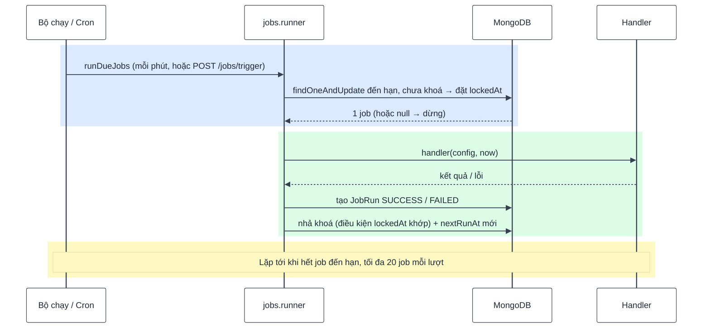

# 08 — Lịch tự động (scheduled jobs)

Super Admin tạo / sửa / tạm dừng / chạy ngay các job tại `/admin/jobs`. Không dùng thư viện cron
hay hàng đợi ngoài — lịch lưu trong MongoDB, tính giờ bằng `Intl` có sẵn của Node.

## 1. Thành phần

| File (`backend/src/modules/jobs/`) | Vai trò                                                                          |
| ---------------------------------- | -------------------------------------------------------------------------------- |
| `jobs.registry.js`                 | **Nơi duy nhất khai báo loại job**: Zod schema của config, mô tả ô nhập, handler |
| `jobs.schedule.js`                 | Toán lịch: giờ địa phương ↔ UTC, lần chạy đầu, lần chạy kế tiếp                  |
| `jobs.runner.js`                   | Nhận job đến hạn (khoá nguyên tử), chạy handler, ghi lịch sử                     |
| `jobs.service.js`                  | CRUD, job hệ thống (`ensureSystemJobs`), thống kê                                |
| `jobs.model.js`                    | `Job` (định nghĩa + lịch + khoá) và `JobRun` (lịch sử, TTL 90 ngày)              |

## 2. Lịch

| `kind`     | Trường                                                      | Ý nghĩa                                                                       |
| ---------- | ----------------------------------------------------------- | ----------------------------------------------------------------------------- |
| `ONCE`     | `runAt`                                                     | Chạy 1 lần tại thời điểm (phải ở tương lai); chạy xong thì `nextRunAt = null` |
| `INTERVAL` | `everyDays` (1–365), `time` `HH:mm`, `startDate` (tuỳ chọn) | Mỗi N ngày lúc `time`, chu kỳ neo ở `startDate`                               |

- Giờ `HH:mm` hiểu theo **`JOBS_TIMEZONE`** (mặc định `Asia/Ho_Chi_Minh`), không theo giờ máy chủ
  (Render chạy UTC).
- **Đúng giờ mùa hè (DST)**: tính theo ngày lịch địa phương rồi mới đổi sang UTC → "03:00" luôn là
  03:00 địa phương, kể cả qua ngày đổi giờ (xem test `jobs.schedule.test.js`).
- **Neo theo mốc đã lên lịch**, không theo lúc chạy thực tế → chạy trễ vài phút không làm trôi giờ.
- **Chạy bù tối đa 1 lần**: server ngủ 5 ngày → thức dậy chạy 1 lần, lần kế tiếp là mốc đầu tiên
  trong tương lai (không chạy dồn 5 lần).
- Sửa lịch → tính lại lần chạy đầu tiên. "Chạy ngay" **không** làm thay đổi lịch.

## 3. Chạy và khoá



- **Không chạy trùng**: nhận job bằng 1 lệnh `findOneAndUpdate` có điều kiện → nhiều tiến trình /
  bộ chạy + cron cùng lúc thì mỗi job chỉ một bên nhận được. "Chạy ngay" hoặc xoá khi job đang chạy →
  409 `JOB_RUNNING`.
- **Khoá quá hạn**: giữ khoá quá 15 phút = tiến trình đã chết → bên khác được lấy lại. Nhả khoá có
  điều kiện `lockedAt` đúng giá trị mình đặt → không ghi đè trạng thái của bên đã lấy lại.
- Handler lỗi: ghi `FAILED` + thông báo lỗi vào lịch sử, lịch vẫn tiếp tục. Trang tổng quan quản
  trị hiện 5 lần chạy lỗi gần nhất.
- Tắt server: `jobsRunner.stop()` chờ lượt đang chạy xong.

### 3.1 Hai cách kích hoạt

| Cách                                                           | Khi nào dùng                                                                                                                                   |
| -------------------------------------------------------------- | ---------------------------------------------------------------------------------------------------------------------------------------------- |
| Bộ chạy trong tiến trình (`JOBS_RUNNER_ENABLED`, mặc định bật) | Server chạy liên tục                                                                                                                           |
| `POST /api/v1/jobs/trigger` + header `X-Jobs-Secret`           | Nền tảng "ngủ" server khi không có request (Render free) — dịch vụ cron bên ngoài gọi mỗi 5–15 phút, vừa đánh thức server vừa chạy job đến hạn |

`/jobs/trigger`: không đặt `JOBS_TRIGGER_SECRET` → 404; sai secret → 403; rate limit 10 lần / phút.
Bật cả hai cùng lúc vẫn an toàn nhờ khoá. Cấu hình cron: docs 07.

## 4. Job có sẵn

| Loại                       | Job hệ thống (seed)        | Lịch mặc định        | Việc làm                                                                                  |
| -------------------------- | -------------------------- | -------------------- | ----------------------------------------------------------------------------------------- |
| `CLEANUP_ORPHAN_MEDIA`     | `cleanup-orphan-media`     | Hằng ngày 03:00      | Xoá ảnh không nơi dùng, tải lên quá 24 giờ                                                |
| `CLEANUP_PENDING_UPLOADS`  | `cleanup-pending-uploads`  | Hằng ngày 03:30      | Xoá file / ảnh PENDING quá N giờ (mặc định 24)                                            |
| `CLEANUP_UNVERIFIED_USERS` | `cleanup-unverified-users` | Hằng ngày 04:00      | Xoá tài khoản chưa kích hoạt quá N ngày (mặc định 7) kèm token email, trong 1 transaction |
| `SEND_EMAIL`               | —                          | Quản trị viên tự tạo | Gửi email thông báo tới người dùng đang hoạt động theo vai trò / danh sách                |

- **Job hệ thống** có `systemKey`, tạo bởi `npm run db:seed` (chạy lại không ghi đè cấu hình đã
  sửa); **không xoá được** (403 `SYSTEM_JOB_PROTECTED`), chỉ tạm dừng / sửa lịch / config.
- Loại `isSystemOnly` không tạo mới được từ giao diện.

### Gửi email hàng loạt (`SEND_EMAIL`)

Gửi **tuần tự**, chờ từng email xong mới gửi tiếp, nghỉ 600ms giữa hai email khi kênh gửi hiện
hành (trang Cấu hình) là `resend` hoặc `smtp` (gói Resend free ~2 email/giây; Gmail chặn khi gửi dồn
dập; kênh `console` chỉ in ra log nên không nghỉ). Gửi song song không giới hạn sẽ vượt hạn mức của nhà cung cấp và **mất email âm thầm**.

- Tối đa **200 người nhận mỗi lượt chạy**; phần dư nằm ở `skippedCount`, đi ở lượt kế tiếp.
- Kết quả lưu vào lịch sử chạy: `{ recipientCount, sentCount, failedCount, skippedCount }`.
- Một phần lỗi → vẫn `SUCCESS` kèm `failedCount` (lỗi từng email ghi vào log).
  **Mọi** email đều lỗi → handler ném lỗi → lịch sử chạy ghi `FAILED`.
- Cần hàng nghìn người nhận thì chuyển sang hàng đợi thật (Resend batch API).

## 5. Thêm một loại job

1. Handler gọi **service export** của module liên quan (vd. `usersService.xxx`), không import
   model của module khác.
2. Thêm 1 mục vào `JOB_DEFINITIONS` trong `jobs.registry.js`:

   ```js
   [JOB_TYPES.MY_JOB]: {
     label: 'Tên hiển thị',
     description: 'Mô tả ngắn cho quản trị viên.',
     isSystemOnly: false,
     configSchema: z.object({ days: z.number().int().min(1).max(30).default(7) }),
     configFields: [{ name: 'days', label: 'Số ngày', input: 'number', min: 1, max: 30 }],
     handler: async ({ days }, { now }) => ({ processedCount: await someService.run({ days, now }) }),
   },
   ```

3. Frontend **tự sinh form** từ `configFields` (`GET /admin/jobs/types`) — không phải sửa giao diện
   với các kiểu ô `text`, `textarea`, `number`, `roles`.
4. Kết quả handler trả về (object nhỏ) được lưu vào lịch sử chạy — trả số lượng, không trả dữ
   liệu lớn.
5. Cần job hệ thống → thêm vào `SYSTEM_JOBS` trong `jobs.service.js`, chạy lại `npm run db:seed`.
6. Test handler với `now` giả (xem `backend/tests/modules/jobs.test.js`).
