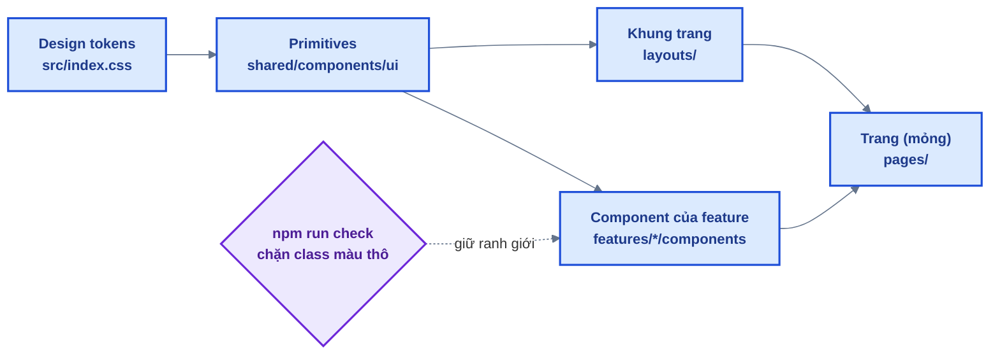

# 09 — Giao diện: design system & khuôn trang

Source base là **nền móng** cho nhiều dự án sau này. Giao diện ở đây không nhằm "đẹp một lần",
mà để dự án mới **dựng màn hình nhanh, đúng và thống nhất** mà không phải gánh một phong cách
chắp vá. Tài liệu này ghi triết lý, các khối dựng sẵn và khuôn cho từng loại màn hình.

## 1. Triết lý



1. **Token → component → màn hình.** Màu khai báo MỘT lần bằng tên theo vai trò (`primary`,
   `surface`, `fg-muted`...). Đổi thương hiệu = sửa `src/index.css`, không sửa component.
2. **Feature chỉ ghép primitive, không tự viết style** cho nút, ô nhập, bảng, hộp thoại.
   `npm run check` chặn class màu thô (`bg-blue-600`, `text-white`...) trong `frontend/src`, và
   bảng màu gốc của Tailwind đã bị gỡ khỏi theme — lỡ viết cũng không sinh ra CSS.
3. **Mỗi loại màn hình có một khuôn** (mục 4). Module mới làm theo khuôn, không thiết kế lại.
4. **Khung trang lấy từ khai báo route.** Breadcrumb và tiêu đề tab đọc từ `handle.crumb` của
   route — trang không tự dựng. Admin và khu người dùng dùng **chung một menu tài khoản**: quản
   trị viên cũng là người dùng.
5. **Khối dữ liệu nào cũng đủ 4 trạng thái**: đang tải (Skeleton), rỗng (EmptyState có hướng
   dẫn), lỗi (ErrorState có "Thử lại"), có dữ liệu.
6. **Mỗi vùng một hành động chính.** Hành động phá huỷ nằm trong menu ⋯ (tông đỏ) và luôn qua
   hộp thoại xác nhận — không đặt nút đỏ to trên từng dòng/thẻ.
7. **Truy cập được bằng bàn phím và trình đọc màn hình là điều kiện nghiệm thu.** Nút chỉ có
   icon luôn có `aria-label`; test tìm phần tử theo role + nhãn nên đổi giao diện không vỡ test.
8. **Không thêm thư viện UI.** Icon tự viết (nét từ Lucide, ISC), hộp thoại / menu / công tắc
   tự viết trên phần tử gốc của trình duyệt — ít phụ thuộc, dễ đọc cho người học.

## 2. Design tokens

Khai báo ở `frontend/src/index.css`: giá trị ở `:root` (và `[data-theme='dark']`), ánh xạ sang
Tailwind trong `@theme inline`.

| Token                                  | Vai trò                                   | Class thường dùng                    |
| -------------------------------------- | ----------------------------------------- | ------------------------------------ |
| `canvas`                               | Nền trang                                 | `bg-canvas`                          |
| `surface`                              | Nền thẻ, bảng, hộp thoại, header          | `bg-surface`                         |
| `subtle`                               | Nền phụ: hover, ô icon, skeleton          | `bg-subtle`, `hover:bg-subtle`       |
| `line`, `line-strong`                  | Viền, đường kẻ / viền khi hover           | `border-line`, `divide-line`         |
| `fg`, `fg-muted`, `fg-subtle`          | Chữ chính / chữ phụ / chữ mờ, placeholder | `text-fg`, `text-fg-muted`           |
| `primary`, `primary-hover`             | Màu thương hiệu: nút chính, link, focus   | `bg-primary`, `text-primary`         |
| `primary-soft`, `on-primary`           | Nền nhạt của mục đang chọn / chữ trên nền | `bg-primary-soft`, `text-on-primary` |
| `danger`, `success`, `warning`, `info` | Trạng thái (kèm bản `-soft` làm nền)      | `text-danger`, `bg-success-soft`     |
| `overlay`                              | Lớp phủ sau hộp thoại / ngăn kéo          | `bg-overlay`                         |

- **Đổi thương hiệu:** sửa `--primary*` (và các màu khác nếu cần) trong `:root`, đổi
  `APP_NAME` ở `shared/constants/app.js`, đổi dấu hiệu logo ở `layouts/Brand.jsx`.
- **Font:** Be Vietnam Pro (đủ dấu tiếng Việt) tải từ Google Fonts trong `index.html`; không
  tải được thì rơi về font hệ thống. Đổi font = sửa link + `--font-sans`.
- **Dark mode:** token đã có bộ giá trị tối, bật bằng `<html data-theme="dark">`. Chưa có nút
  chuyển — khi cần, thêm một nút đặt/gỡ thuộc tính này (và lưu lựa chọn vào `localStorage`).
- Độ trong suốt dùng modifier: `bg-primary/10`, `border-danger/20`.

## 3. Primitives (`frontend/src/shared/components/ui`)

| Nhóm      | Component                                                                          | Dùng khi                                                                          |
| --------- | ---------------------------------------------------------------------------------- | --------------------------------------------------------------------------------- |
| Hành động | `Button`, `ButtonLink`, `buttonClassName()`                                        | Nút (`primary` / `secondary` / `ghost` / `danger` / `danger-ghost`), link như nút |
|           | `DropdownMenu`                                                                     | Menu ⋯ của dòng / thẻ, menu tài khoản                                             |
|           | `FileButton`, `DropZone`                                                           | Chọn file; kéo thả (luôn đi kèm nút chọn file)                                    |
| Form      | `TextField`, `PasswordField`, `TextareaField`, `SelectField`, `Field`              | Trường có nhãn + gợi ý + lỗi, gắn `{...register()}`                               |
|           | `Select`, `Checkbox`, `Switch`                                                     | Ô chọn trong thanh công cụ, checkbox / radio, công tắc bật tắt                    |
|           | `FormError`                                                                        | Lỗi chung của cả form                                                             |
| Danh sách | `Toolbar`, `SearchInput`, `SegmentedControl`                                       | Thanh lọc: tìm kiếm tự áp dụng, lựa chọn nhanh 2–5 giá trị                        |
|           | `Table` (+ `TableHeaderCell`, `TableCell`), `Pagination`                           | Bảng dữ liệu, phân trang theo `meta` của API                                      |
| Bố cục    | `PageHeader`, `Card`, `Breadcrumbs`, `NavList`                                     | Đầu trang (h1 + hành động), khối nội dung, điều hướng                             |
| Phản hồi  | `Alert`, `Badge`, `EmptyState`, `ErrorState`, `Skeleton`, `Spinner`, `ProgressBar` | Thông báo trong trang, nhãn trạng thái, 4 trạng thái dữ liệu                      |
| Lớp phủ   | `Dialog`, `ConfirmDialog`                                                          | Form phụ (tạo job, thư mục mới...), xác nhận thao tác nguy hiểm                   |
| Khác      | `Avatar`, `TextLink`, `icons.jsx`                                                  | Ảnh đại diện, link trong câu, bộ icon                                             |

Thêm primitive mới khi **ít nhất hai feature** cần cùng một mẫu; dưới mức đó để trong feature.

## 4. Khuôn trang

### 4.1 Trang danh sách (Người dùng, Lịch tự động, Tệp của tôi)

```jsx
<div className="space-y-6">
  <PageHeader title="Người dùng" description="..." actions={<Button icon={PlusIcon}>Tạo</Button>} />
  <Toolbar label="Lọc người dùng" isFiltered={...} onReset={...}>
    <SearchInput label="Tên hoặc email" value={params.q} onSearch={(q) => update({ q })} />
    <Select aria-label="Trạng thái" value={params.status} options={...} onChange={...} />
  </Toolbar>
  {isPending && <Skeleton />} {isError && <ErrorState onRetry />} {isEmpty && <EmptyState />}
  <Table caption="Danh sách người dùng" head={...}>...</Table>
  <Pagination meta={meta} onPageChange={...} />
</div>
```

- Bộ lọc lưu trên URL (`useListSearchParams`), **áp dụng ngay** — không có nút "Tìm".
- Cột cuối là menu ⋯ (`DropdownMenu`, `label="Thao tác với <tên>"`). Tối đa MỘT hành động hay
  dùng được hiện thẳng trên dòng (vd. "Chạy ngay"); thao tác không được phép → không hiện mục.

### 4.2 Trang form / cấu hình (Hồ sơ, Bảo mật, Cấu hình hệ thống)

`PageHeader` + các `Card` theo nhóm; nút lưu ở cuối form, khoá khi chưa có thay đổi. Form dài
nhiều mục (Cấu hình) dùng thanh lưu dính đáy báo "N thay đổi chưa lưu" + "Huỷ thay đổi".

### 4.3 Trang dạng thư mục (Thư viện ảnh)

Cấp 1 là lưới thư mục (thẻ có ảnh bìa, số lượng); cấp 2 là nội dung một thư mục (breadcrumb
`Thư viện ảnh › <tên>`, kéo thả để tải lên, bộ lọc gọn). Hành động tạo mới mở `Dialog`.

### 4.4 Tiêu đề và thông báo

- Mỗi trang đúng một `h1` (qua `PageHeader`); tiêu đề tab tự lấy từ breadcrumb.
- Kết quả thao tác nhanh → toast (`sonner`); kết quả cần đọc lâu / còn thao tác tiếp → `Alert`.

## 5. Khung trang & điều hướng

| Việc                        | Làm ở                                                                                                      |
| --------------------------- | ---------------------------------------------------------------------------------------------------------- |
| Breadcrumb + tiêu đề tab    | `handle: { crumb: 'Tên' }` trên route (`app/router/*.routes.jsx`); crumb động: `(match) => match.params.x` |
| Mục menu quản trị           | `SIDEBAR_GROUPS` trong `layouts/AdminLayout.jsx` (kèm `roles`, khớp `RoleGuard`)                           |
| Trang tài khoản mới         | Route con của `ROUTES.ACCOUNT.ROOT` + mục trong `layouts/AccountLayout.jsx`                                |
| Mục menu tài khoản (avatar) | `features/auth/components/UserMenu.jsx`                                                                    |

Khu quản trị: sidebar cố định từ `lg`, dưới `lg` là ngăn kéo mở bằng nút ☰; topbar có
breadcrumb + menu tài khoản. Khu tài khoản: menu con cột trái từ `md`, dạng tab cuộn ngang trên
mobile.

## 6. Checklist khi thêm màn hình

- [ ] Chọn khuôn ở mục 4; chỉ dùng primitive + token (`npm run check` xanh).
- [ ] Route có `handle.crumb`; trang có `PageHeader`.
- [ ] Đủ 4 trạng thái dữ liệu; hành động phá huỷ qua menu + `ConfirmDialog`.
- [ ] Dùng được bằng bàn phím; nút icon có `aria-label`; thử ở độ rộng 390px.
- [ ] Lưới luôn khai báo cột ở mobile (`grid grid-cols-1 sm:grid-cols-2`) — Tailwind v4 dùng
      `minmax(0, 1fr)`, thiếu nó thì chữ `truncate` đẩy thẻ tràn ngang.
- [ ] Test tìm theo role + nhãn (xem `tests/utils.jsx` → `selectMenuItem` cho menu ⋯).
