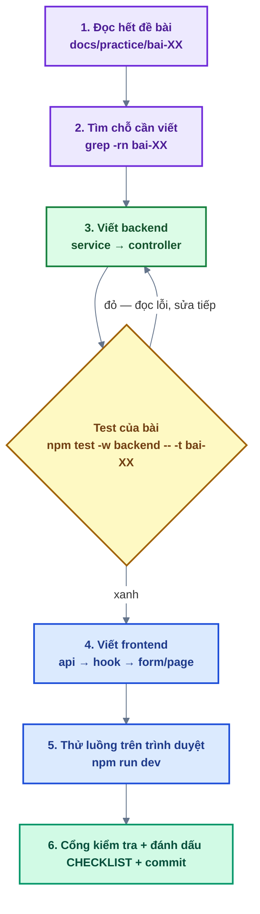

# Bài thực hành — dựng lại source base MERN

Bộ bài theo phương pháp **project-based learning**: bạn nhận một dự án đã có sẵn giao diện, hạ
tầng và bộ test, nhưng **phần logic nghiệp vụ đã bị xoá**. Mỗi bài hoàn thiện một tính năng từ
backend tới frontend. Làm xong bài nào, tính năng đó chạy được trên trình duyệt và test của bài
đó chuyển xanh.

> **Yêu cầu: tự code, không dùng AI sinh code.** Được đọc tài liệu chính thức (Express, Mongoose,
> Zod, TanStack Query, React Hook Form, React Email…) và toàn bộ `docs/01` → `docs/09` của dự án.
> Lời giải do giảng viên cung cấp sau khi bạn nộp bài hoặc khi khoá học kết thúc — dùng nó để
> đối chiếu **sau khi** đã tự làm, không phải trước.

## 1. Cách học một bài



1. **Đọc hết đề bài trước khi code**: mục tiêu, đặc tả API, tiêu chí hoàn thành, các file cần sửa.
2. **Tìm chỗ cần viết**: `grep -rn "bai-02" backend/src frontend/src` (thay số bài). Đây là danh
   sách việc còn lại của bài.
3. **Làm backend trước**, chạy test của bài cho tới khi xanh.
4. **Làm frontend**, thử lại luồng trên trình duyệt.
5. Chỉ mở **Gợi ý** ở cuối bài khi đã thử tự làm ít nhất 15–20 phút. Gợi ý có 3 cấp, mở lần lượt.
6. Chạy cổng kiểm tra rồi commit (xem mục 5).

## 2. Quy ước trong code

| Dấu hiệu                          | Ý nghĩa                                                                                                                          |
| --------------------------------- | -------------------------------------------------------------------------------------------------------------------------------- |
| JSDoc `[BÀI 02] ...` trên hàm     | Hợp đồng của hàm: làm gì, tham số, giá trị trả về, lỗi ném ra, **các bước**. Đọc kỹ trước khi viết.                              |
| `return notImplemented('bai-02')` | Thân hàm đã bị xoá. Gọi vào sẽ ra lỗi `501 NOT_IMPLEMENTED` ("Chức năng chưa được hoàn thành"). Thay **cả dòng** bằng code thật. |
| `// TODO(bai-02): ...`            | Chỗ cần viết thêm trong component / hook / schema (handler, effect, rule Zod…).                                                  |
| Import chưa dùng tới              | **Cố ý** — đó là gợi ý: lời giải cần đúng những thứ đó. Làm xong bài thì chúng được dùng hết.                                    |
| File / hàm **không** có đánh dấu  | Hạ tầng dùng chung, đã hoàn chỉnh. Được đọc và gọi, **không cần sửa**.                                                           |

> **Bấm vào tính năng chưa làm thì thấy gì?** Toast vàng "Tính năng chưa được thực hiện" kèm
> đường dẫn file đề bài (vd. `docs/practice/bai-04-dang-nhap.md`) — áp dụng cho cả stub frontend
> lẫn lỗi 501 từ backend. Riêng TODO kiểu "thêm `onSuccess`" thì **không** báo gì: thao tác vẫn
> thành công, chỉ là danh sách không tự làm mới / store không cập nhật. Toast tự hết khi bạn làm
> xong bài, không cần gỡ.

**Không cần sửa**: model Mongoose + migration + seed, `shared/config`, `shared/lib`,
`shared/utils`, `*.routes.js`, `*.schema.js` (Zod backend), `shared/components/ui`, layout,
`ROUTES`, `ERROR_CODES`, và **toàn bộ thư mục test**. Ngoại lệ duy nhất: bài 15 sửa
`shared/lib/mailer.js` (viết kênh gửi SMTP).

> Vì có import cố ý để trống, `npm run check` bỏ qua quy ước "không để import thừa" cho những file
> đó (nhờ dòng chú thích `check-conventions: allow-unused-imports` ở đầu file). Khi bạn viết xong,
> có thể xoá dòng chú thích đó để script kiểm lại giúp bạn.

## 3. Chạy test của một bài

Mỗi nhóm test được gắn nhãn `[bai-XX]`:

```bash
npm test -w backend  -- -t "bai-02"
npm test -w frontend -- -t "bai-02"
```

- Test backend là **integration test thật**: gọi HTTP vào app và ghi vào database.
- Database test là **MongoDB in-memory** (`mongodb-memory-server`) — tự bật, tự xoá, **không đụng
  vào Atlas của bạn**. Mỗi file test dùng một database riêng.
- Test frontend dùng **MSW** giả lập backend, nên chạy được kể cả khi backend đang tắt.
- **Không chạy 2 lệnh test cùng lúc** (2 terminal) — chúng tranh nhau tài nguyên và báo lỗi ngẫu
  nhiên.
- Bài đọc hiểu (bài 01) có test **xanh sẵn**: nó kiểm phần hạ tầng. Nếu đỏ → môi trường của bạn có
  vấn đề, xem lại [Bài 00](bai-00-chuan-bi-moi-truong.md).

## 4. Lộ trình

Các bài nối tiếp nhau — bài sau dùng code của bài trước. **Làm theo thứ tự.** Bài 15 là phần mở
rộng, làm được ngay sau bài 09 nếu bạn muốn nhận email thật sớm (miễn phí, không cần domain).

| Bài | Chủ đề                                                                        | Kiến thức chính                                                           | Độ khó |
| --- | ----------------------------------------------------------------------------- | ------------------------------------------------------------------------- | ------ |
| 00  | [Chuẩn bị môi trường](bai-00-chuan-bi-moi-truong.md)                          | Node 22, npm workspaces, MongoDB Atlas, `.env`                            | ★      |
| 01  | [Đọc hiểu kiến trúc](bai-01-doc-hieu-kien-truc.md)                            | Vòng đời request, `validate`, `errorHandler`, response chuẩn, http client | ★      |
| 02  | [Đăng ký tài khoản](bai-02-dang-ky-tai-khoan.md)                              | bcrypt, Mongoose `create`, `AppError`, `useMutation`, RHF + Zod           | ★★     |
| 03  | [Email & xác thực tài khoản](bai-03-email-va-xac-thuc-tai-khoan.md)           | React Email, gửi nền, token dùng 1 lần, cập nhật nguyên tử                | ★★★    |
| 04  | [Đăng nhập](bai-04-dang-nhap.md)                                              | JWT access token, session + cookie refresh httpOnly                       | ★★     |
| 05  | [Bảo vệ route & phân quyền](bai-05-bao-ve-route-va-phan-quyen.md)             | `authenticate`, `authorize`, guard phía client, hồ sơ                     | ★★     |
| 06  | [Refresh token & đăng xuất](bai-06-refresh-token-va-dang-xuat.md)             | Xoay vòng token, cửa sổ ân hạn, chống CSRF                                | ★★★    |
| 07  | [Quản lý phiên đăng nhập](bai-07-quan-ly-phien-dang-nhap.md)                  | Truy vấn có điều kiện sở hữu, chống IDOR, parse User-Agent                | ★★     |
| 08  | [Quên / đặt lại / đổi mật khẩu](bai-08-quen-dat-lai-doi-mat-khau.md)          | Transaction, thu hồi phiên, không lộ email                                | ★★     |
| 09  | [System settings & magic link](bai-09-system-settings-va-magic-link.md)       | Setting có kiểu, đăng nhập không mật khẩu                                 | ★★     |
| 10  | [Google OAuth](bai-10-google-oauth.md)                                        | Authorization Code + PKCE, liên kết tài khoản                             | ★★★    |
| 11  | [Quản lý người dùng & phân quyền](bai-11-quan-ly-nguoi-dung-va-phan-quyen.md) | Phân quyền 2 lớp, phân trang, escape regex                                | ★★★    |
| 12  | [Storage R2](bai-12-storage-r2.md)                                            | Presigned URL, upload 3 bước, quota                                       | ★★★    |
| 13  | [Media hệ thống & ảnh đại diện](bai-13-media-he-thong-va-anh-dai-dien.md)     | "Nơi dùng" thay khoá ngoại, ảnh mồ côi                                    | ★★★    |
| 14  | [Lịch tự động & trang thống kê](bai-14-lich-tu-dong-va-thong-ke.md)           | Tính lịch theo múi giờ, khoá chống chạy trùng, aggregate                  | ★★★    |
| 15  | [Gửi email qua SMTP & chọn kênh gửi](bai-15-gui-email-qua-smtp.md)            | Nodemailer, App Password, cấu hình lúc chạy, lỗi dịch vụ phía sau (502)   | ★★     |

Theo dõi tiến độ của bạn trong [CHECKLIST.md](../../CHECKLIST.md) ở thư mục gốc.

## 5. Cổng kiểm tra trước khi commit

```bash
npm test && npm run build && npm run format:check && npm run check
```

`npm test` chạy **toàn bộ** test, nên trước khi làm hết 16 bài thì vẫn còn test đỏ của các bài
chưa làm — điều đó bình thường. Cái cần xanh là **test của bài bạn vừa làm** và tất cả bài trước
đó.

Gợi ý commit: `feat(auth): bài 02 — đăng ký tài khoản`.

## 6. Khi bị kẹt

1. Đọc lại **JSDoc `[BÀI XX]`** trên hàm — phần "các bước" gần như là pseudo-code.
2. Đọc **thông điệp lỗi của test**: nó nói rõ đang mong đợi gì.
3. Đọc tài liệu kiến trúc liên quan: [docs/01](../01-kien-truc.md) (vòng đời request),
   [docs/03](../03-auth-va-phien.md) (auth & phiên), [docs/04](../04-phan-quyen.md),
   [docs/05](../05-storage-va-email.md), [docs/06](../06-api.md),
   [docs/08](../08-lich-tu-dong.md), [docs/09](../09-giao-dien.md) (giao diện: primitives, khuôn trang).
4. Mở **gợi ý cấp 1** (định hướng) → thử tiếp 10 phút → **cấp 2** (pseudo-code) → cuối cùng mới
   **cấp 3** (code tham khảo).
5. Ghi lại chỗ kẹt vào phần "Ghi chú / vướng mắc" của `CHECKLIST.md` để hỏi mentor.
