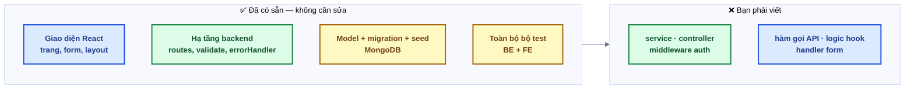

# Bài 00 — Chuẩn bị môi trường

> Mục lục: [README](README.md) · Tiếp: [Bài 01 — Đọc hiểu kiến trúc](bai-01-doc-hieu-kien-truc.md)

|               |                                                                                        |
| ------------- | -------------------------------------------------------------------------------------- |
| **Mục tiêu**  | Chạy được dự án ở máy: backend, frontend, database, và **bộ test xanh ở phần hạ tầng** |
| **Thời gian** | 1–2 giờ (lần đầu, phần lớn là chờ tải)                                                 |
| **Độ khó**    | ★                                                                                      |
| **Kiến thức** | Node 22 + nvm, npm workspaces, MongoDB Atlas, biến môi trường                          |
| **Test**      | Chưa có test riêng — bài này xong khi `npm run dev` chạy và `/api/v1/health` trả `ok`  |

## 1. Bạn đang có gì trong tay

Một dự án MERN fullstack hoàn chỉnh về **khung**, rỗng về **ruột**:



Bài này chưa viết dòng code nghiệp vụ nào — chỉ dựng môi trường để các bài sau chạy được.

## 2. Các bước

### 2.1. Node.js 22

```bash
nvm install && nvm use     # đọc .nvmrc
node -v                    # phải là v22.x
npm -v                     # ≥ 10
```

Chưa có `nvm`? Cài theo hướng dẫn tại <https://github.com/nvm-sh/nvm>, hoặc tải Node 22 LTS từ
<https://nodejs.org>.

### 2.2. Khởi tạo git

Bộ source bạn nhận là file zip, **không kèm lịch sử git**. Giải nén, mở terminal ở thư mục vừa
giải nén rồi tạo repo của riêng bạn:

```bash
git init
git add -A
git commit -m "chore: source khởi đầu"
```

Làm bước này **trước** `npm install`: lúc cài, husky gắn hook pre-commit (tự format code mỗi lần
commit) vào repo — chưa có repo thì hook không được gắn. Lỡ cài trước thì chạy lại `npm install`.

Từ đây, xong mỗi bài thì commit một lần. Commit khởi đầu này là mốc để bạn xem lại toàn bộ những gì
mình đã viết: `git diff <hash-commit-khởi-đầu>`.

### 2.3. Cài dependency

```bash
npm install
```

Chạy **ở thư mục gốc**, không chạy riêng trong `backend/` hay `frontend/` — đây là monorepo
npm workspaces, một lần `npm install` cài cho cả hai.

### 2.4. Database — MongoDB Atlas (miễn phí)

Dự án dùng **transaction**, mà transaction chỉ chạy trên **replica set**. Cách nhanh nhất là
cluster Atlas gói **M0** (miễn phí, đã là replica set sẵn):

1. Tạo tài khoản tại <https://www.mongodb.com/cloud/atlas> → **Create** → gói **M0 Free**.
2. **Database Access** → tạo user + mật khẩu (nhớ lại, lát nữa điền vào URI).
3. **Network Access** → **Add IP Address** → `Allow access from anywhere` (0.0.0.0/0) cho tiện khi
   học, hoặc thêm đúng IP máy bạn.
4. **Connect** → **Drivers** → copy chuỗi kết nối, dạng:
   `mongodb+srv://<user>:<password>@<cluster>.mongodb.net/?retryWrites=true&w=majority`
5. **Thêm tên database vào URI**, ngay trước dấu `?`:
   `mongodb+srv://<user>:<password>@<cluster>.mongodb.net/mern_practice?retryWrites=true&w=majority`

> Muốn chạy MongoDB ngay trên máy thay vì Atlas? Được, nhưng **phải bật replica set 1 node** —
> xem [docs/02 §3.1](../02-chay-local.md). MongoDB cài mặc định (không replica set) sẽ báo
> `Transaction numbers are only allowed on a replica set`.

### 2.5. Biến môi trường

```bash
cp backend/.env.example backend/.env
cp frontend/.env.example frontend/.env
```

Mở `backend/.env`, điền tối thiểu 4 biến:

| Biến                        | Giá trị                                                           |
| --------------------------- | ----------------------------------------------------------------- |
| `MONGODB_URI`               | Chuỗi kết nối Atlas ở bước 2.4 (đã có tên database)               |
| `JWT_ACCESS_SECRET`         | Chuỗi ngẫu nhiên ≥ 32 ký tự — sinh bằng `openssl rand -base64 48` |
| `SEED_SUPER_ADMIN_EMAIL`    | Email bạn dùng để đăng nhập tài khoản quản trị                    |
| `SEED_SUPER_ADMIN_PASSWORD` | Mật khẩu ≥ 8 ký tự cho tài khoản đó                               |

Các biến còn lại (`R2_*`, `GOOGLE_*`, `RESEND_API_KEY`, `SMTP_*`) **để trống** — tính năng tương
ứng tự tắt, phần còn lại vẫn chạy bình thường. Bạn chỉ cần chúng ở bài 10, 12 và 15, và ngay cả khi
đó vẫn làm bài được nhờ test (test dùng dịch vụ giả). Email ở development in ra terminal nên không
cần tài khoản email nào; muốn nhận email thật miễn phí (Gmail) xem bài 15.

Mọi biến được kiểm bằng Zod lúc khởi động. Thiếu hay sai định dạng → backend dừng ngay và **liệt kê
đủ tên biến sai**, không chạy nửa vời.

### 2.6. Tạo index và dữ liệu ban đầu

```bash
npm run db:migrate    # tạo index (unique, TTL…) — chạy lại an toàn
npm run db:seed       # tài khoản Super Admin + job hệ thống — chạy lại an toàn
```

### 2.7. Chạy dự án

```bash
npm run dev
```

| Địa chỉ                               | Kỳ vọng                                                                |
| ------------------------------------- | ---------------------------------------------------------------------- |
| <http://localhost:5173>               | Trang chủ hiện ra, thẻ "Trạng thái hệ thống" báo API + database **ok** |
| <http://localhost:4000/api/v1/health> | JSON `{"success":true,"data":{"status":"ok",...}}`                     |
| <http://localhost:4000/api/docs>      | Swagger UI — đặc tả toàn bộ API bạn sắp viết                           |

Bấm thử **Đăng ký**: form hiện ra, validate phía client chạy, nhưng khi gửi sẽ báo
_"Chức năng chưa được hoàn thành — xem docs/practice (bai-02)"_. **Đúng như mong đợi** — đó là
việc của bài 02.

### 2.8. Chạy thử bộ test

Chạy **lần lượt**, không chạy song song:

```bash
npm test -w backend
npm test -w frontend
```

Lần đầu chạy test backend sẽ tải binary MongoDB (~80MB) — chờ một lát.

**Nhiều test sẽ đỏ** — đó là test của các bài bạn chưa làm. Cái cần xanh lúc này là test hạ tầng
của [bài 01](bai-01-doc-hieu-kien-truc.md):

```bash
npm test -w backend  -- -t "bai-01"
npm test -w frontend -- -t "bai-01"
```

Hai lệnh này **phải xanh hết**. Nếu đỏ → môi trường có vấn đề, xem mục 4.

> Test backend dùng MongoDB **in-memory**, hoàn toàn tách khỏi Atlas của bạn — chạy test không làm
> mất dữ liệu dev. Test frontend dùng MSW giả lập backend nên chạy được cả khi backend đang tắt.

## 3. Tiêu chí hoàn thành

- [ ] `node -v` ra v22.x
- [ ] `git log` có commit khởi đầu
- [ ] `npm run dev` chạy, không lỗi đỏ trong terminal
- [ ] <http://localhost:5173> hiện trang chủ, thẻ trạng thái báo API + database **ok**
- [ ] `npm run db:migrate` và `npm run db:seed` chạy xong không lỗi
- [ ] `npm test -w backend -- -t "bai-01"` và `npm test -w frontend -- -t "bai-01"` xanh hết
- [ ] `npm run format:check` và `npm run check` sạch
- [ ] Đánh dấu `[x] Bài 00` trong [CHECKLIST.md](../../CHECKLIST.md)

## 4. Sự cố thường gặp

| Hiện tượng                                              | Nguyên nhân / cách xử lý                                                                                                                    |
| ------------------------------------------------------- | ------------------------------------------------------------------------------------------------------------------------------------------- |
| `Biến môi trường không hợp lệ` kèm danh sách tên biến   | Đọc đúng danh sách đó, sửa `backend/.env`. Thường là quên `JWT_ACCESS_SECRET` hoặc để nó ngắn hơn 32 ký tự                                  |
| `MongoServerSelectionError`                             | Sai `MONGODB_URI`, hoặc IP máy chưa nằm trong **Network Access** của Atlas. Mật khẩu có ký tự đặc biệt (`@`, `/`, `:`) phải được URL-encode |
| `Transaction numbers are only allowed on a replica set` | Đang dùng MongoDB tự cài mà chưa bật replica set — xem [docs/02 §3.1](../02-chay-local.md)                                                  |
| Test backend treo ở lần chạy đầu                        | Đang tải binary MongoDB. Chờ, hoặc kiểm tra mạng                                                                                            |
| Frontend báo lỗi CORS                                   | Thêm `http://localhost:5173` vào `CORS_ORIGINS` trong `backend/.env`                                                                        |
| Cổng 4000 / 5173 đã bị chiếm                            | Tắt tiến trình cũ (`lsof -i :4000`), hoặc đổi `PORT` trong `backend/.env`                                                                   |
| `npm install` báo lỗi engine                            | Đang dùng Node khác 22 — chạy `nvm use`                                                                                                     |

## 5. Trước khi sang bài 01

Đọc lướt một lượt để biết **có những gì ở đâu** (chưa cần hiểu sâu):

- [README.md](../../README.md) — tính năng và cấu trúc thư mục.
- [docs/01 — Kiến trúc](../01-kien-truc.md) — vòng đời một request. Bài 01 sẽ đào kỹ phần này.

---

> Mục lục: [README](README.md) · Tiếp: [Bài 01 — Đọc hiểu kiến trúc](bai-01-doc-hieu-kien-truc.md)
