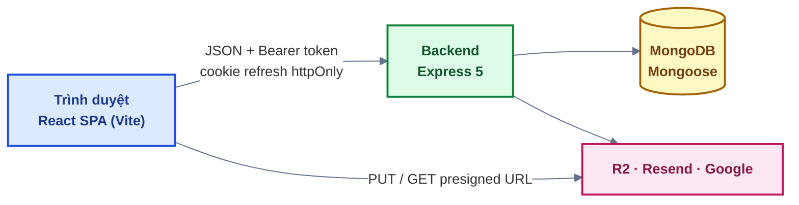
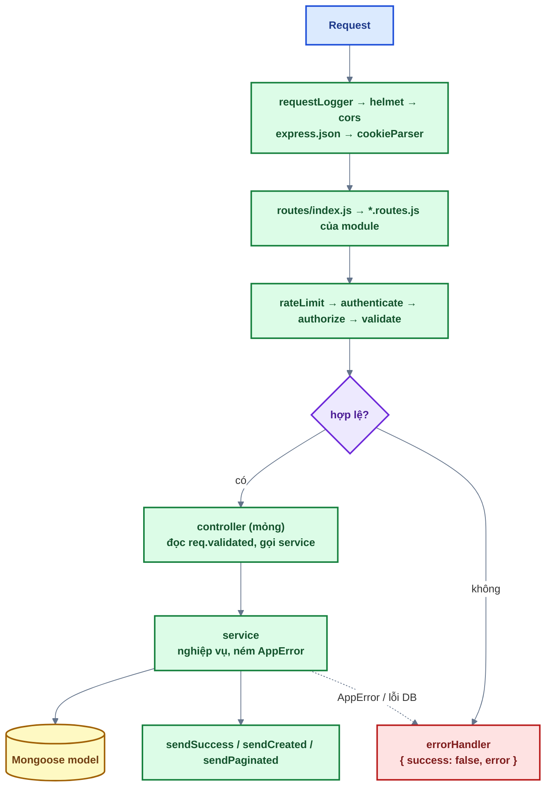
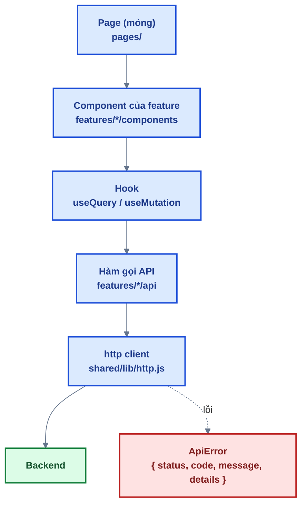

# Bài 01 — Đọc hiểu kiến trúc

> Trước: [Bài 00](bai-00-chuan-bi-moi-truong.md) · Mục lục: [README](README.md) · Tiếp: [Bài 02 — Đăng ký tài khoản](bai-02-dang-ky-tai-khoan.md)

|               |                                                                                                                                                                               |
| ------------- | ----------------------------------------------------------------------------------------------------------------------------------------------------------------------------- |
| **Mục tiêu**  | Hiểu đường đi của một request từ trình duyệt tới database và ngược lại — để 13 bài sau chỉ còn là điền vào chỗ trống                                                          |
| **Thời gian** | 2–3 giờ (đọc + trả lời câu hỏi)                                                                                                                                               |
| **Độ khó**    | ★                                                                                                                                                                             |
| **Kiến thức** | Middleware Express, `validate` (Zod), `errorHandler`, response chuẩn, http client + interceptor                                                                               |
| **Test**      | `npm test -w backend -- -t "bai-01"` (**66 test**) · `npm test -w frontend -- -t "bai-01"` (**15 test**)                                                                      |
| **Đặc biệt**  | **Bài này không viết code.** Toàn bộ test đã **xanh sẵn** — chúng kiểm phần hạ tầng bạn sắp dùng. Đỏ = môi trường có vấn đề, xem lại [bài 00](bai-00-chuan-bi-moi-truong.md). |

Đây là bài **đọc hiểu**. Mỗi mục có câu hỏi; tự trả lời trước rồi mới mở đáp án ở mục 7. Điều quan
trọng không phải thuộc lòng, mà là **biết tìm ở đâu** khi bí.

## 1. Toàn cảnh



Đọc kỹ: [docs/01 — Kiến trúc](../01-kien-truc.md). Dưới đây là phần bạn **bắt buộc** phải nắm để
làm được bài 02.

## 2. Backend — một request đi qua những gì



### 2.1. Bốn tầng, mỗi tầng một việc

| Tầng       | File              | Việc                                           | **Không** được làm     |
| ---------- | ----------------- | ---------------------------------------------- | ---------------------- |
| Route      | `*.routes.js`     | Khai báo đường dẫn + xâu chuỗi middleware      | Nghiệp vụ              |
| Controller | `*.controller.js` | Lấy `req.validated`, gọi service, trả response | Nghiệp vụ, truy vấn DB |
| Service    | `*.service.js`    | Toàn bộ nghiệp vụ, ném `AppError`              | Biết tới `req` / `res` |
| Model      | `*.model.js`      | Cấu trúc dữ liệu + ràng buộc                   | Nghiệp vụ              |

> Service **không được biết `req`/`res`**. Nhờ vậy test gọi thẳng service được (bài 11 làm nhiều),
> và cùng một service dùng lại được cho job chạy nền (bài 14).

**Đọc ngay:** `backend/src/modules/health/` — module nhỏ nhất, đủ cả 3 tầng.

> ❓ **Câu hỏi 1.** Vì sao controller phải đọc `req.validated` chứ không đọc thẳng `req.body`?

### 2.2. `validate` — chốt chặn dữ liệu vào

`backend/src/shared/middlewares/validate.js` nhận schema Zod cho `params` / `query` / `body`, parse
cả ba, **gom hết lỗi vào một lần** rồi ném `ZodError`. Dữ liệu đã parse nằm ở `req.validated`.

```js
usersRouter.patch(
  '/me',
  authenticate,
  validate({ body: updateMeBodySchema }),
  usersController.updateMe,
);
```

Hai việc quan trọng nó làm cho bạn:

- **Ép kiểu + loại bỏ trường thừa**: client gửi thêm `role: 'SUPER_ADMIN'` cũng không lọt qua
  (chống _mass assignment_ — có test ở bài 02).
- **Chặn NoSQL injection**: client gửi `{"email": {"$ne": null}}` — một object thay cho chuỗi — bị
  Zod từ chối trước khi tới Mongoose.

> ❓ **Câu hỏi 2.** Không có body (quên `Content-Type: application/json`) thì `validate` báo lỗi
> chung "thiếu body", hay báo lỗi từng trường? Vì sao lại chọn như vậy?
> _(Gợi ý: đọc dòng `req[part] ?? {}`.)_

### 2.3. `errorHandler` — nơi duy nhất sinh ra response lỗi

`backend/src/shared/middlewares/errorHandler.js` gắn **cuối cùng** trong `app.js` và nhận đủ 4 tham
số (`err, req, res, next`) — đó là cách Express nhận diện error middleware.

Nó dịch mọi loại lỗi sang một dạng duy nhất:

| Lỗi ném ra                                | → status   | → code                                     |
| ----------------------------------------- | ---------- | ------------------------------------------ |
| `AppError`                                | giữ nguyên | giữ nguyên                                 |
| `ZodError`                                | 400        | `VALIDATION_ERROR` + `details` từng trường |
| `jwt.TokenExpiredError`                   | 401        | `AUTH_TOKEN_EXPIRED`                       |
| `mongoose.Error.CastError` (ObjectId sai) | 400        | `VALIDATION_ERROR`                         |
| Mongo `code: 11000` (trùng unique)        | 409        | `DUPLICATE_VALUE`                          |
| Bất kỳ thứ gì khác                        | 500        | `INTERNAL_ERROR` + thông điệp chung        |

Nhờ vậy, trong service bạn **chỉ cần `throw`** — không bao giờ phải `try/catch` để trả response:

```js
// Trích từ backend/src/modules/auth/auth.service.js
throw new AppError({
  statusCode: 403,
  code: ERROR_CODES.ACCOUNT_LOCKED,
  message: 'Tài khoản đã bị khoá. Vui lòng liên hệ quản trị viên',
});
```

Express 5 tự bắt lỗi của hàm `async` và chuyển tới error handler, nên controller cũng không cần
`try/catch`.

> ❓ **Câu hỏi 3.** Vì sao nhánh cuối cùng trả thông điệp chung "Đã có lỗi xảy ra" thay vì
> `err.message`?

> ❓ **Câu hỏi 4.** `TokenExpiredError` được kiểm tra **trước** `JsonWebTokenError`. Nếu đảo thứ tự
> thì chuyện gì xảy ra?

### 2.4. Định dạng response — chỉ có hai dạng

```jsonc
// Thành công — sendSuccess / sendCreated
{ "success": true, "message": "Đã tạo tài khoản", "data": { "id": "..." } }

// Danh sách có phân trang — sendPaginated
{ "success": true, "data": [ ... ], "meta": { "page": 1, "limit": 20, "total": 42, "totalPages": 3 } }

// Lỗi — LUÔN do errorHandler sinh ra
{ "success": false, "error": { "code": "VALIDATION_ERROR", "message": "Dữ liệu không hợp lệ",
  "details": [ { "field": "email", "message": "Email không hợp lệ" } ] } }
```

Frontend **rẽ nhánh theo `error.code`**, không theo HTTP status và không theo `message` —
`message` để hiện cho người dùng và có thể đổi bất cứ lúc nào. Mọi mã lỗi khai báo tập trung ở
`backend/src/shared/errors/errorCodes.js`.

> ❓ **Câu hỏi 5.** `401` trong dự án này **chỉ** dùng cho access/refresh token không hợp lệ. Vậy
> "sai mật khẩu hiện tại khi đổi mật khẩu" trả status nào? Vì sao không dùng 401?

## 3. Frontend — dữ liệu đi từ đâu ra màn hình



| Việc               | Ở đâu                                       | Quy ước                                         |
| ------------------ | ------------------------------------------- | ----------------------------------------------- |
| Gọi API            | `features/<tên>/api/*.api.js`               | Mỗi endpoint một hàm; kèm **query key factory** |
| Server state       | TanStack Query (`useQuery` / `useMutation`) | Không nhét dữ liệu server vào Zustand           |
| Client state       | Zustand — chỉ phiên đăng nhập               | Access token **chỉ trong bộ nhớ**               |
| Bộ lọc, phân trang | **URL** (`useSearchParams`)                 | Copy link ra là ra đúng màn hình đó             |
| Đường dẫn          | `shared/constants/routes.js` (`ROUTES`)     | Không viết chuỗi `'/login'` rải rác             |

**Đọc ngay:** `frontend/src/features/health/` — feature nhỏ nhất, đủ api → hook → component.

### 3.1. `shared/lib/http.js` — một cửa duy nhất

Mọi lời gọi API đi qua đây (ngoại lệ duy nhất: PUT thẳng lên R2 bằng presigned URL ở bài 12). Nó lo:

- gửi cookie refresh (`withCredentials`), gắn header `X-Requested-With` (backend dùng chặn CSRF);
- gắn `Authorization: Bearer <accessToken>` nếu đang đăng nhập;
- gặp **401 → gọi refresh đúng một lần** (nhiều request cùng 401 thì chờ chung) → gửi lại request;
- chuẩn hoá **mọi** lỗi thành `ApiError` (`status`, `code`, `message`, `details`) — kể cả khi mất
  mạng (`NETWORK_ERROR`, status 0) hay proxy trả HTML (`UNKNOWN_ERROR`).

`shared/` không được biết gì về feature `auth`, nên tầng `app/providers.jsx` mới là nơi nối hai
bên bằng `configureHttpAuth({ getAccessToken, refreshSession, onSessionExpired })`.

> ❓ **Câu hỏi 6.** Access token để trong bộ nhớ (Zustand) chứ không để `localStorage`. Đổi lại,
> mỗi lần F5 phải gọi `/auth/refresh` để lấy lại. Đánh đổi này được gì?

> ❓ **Câu hỏi 7.** Vì sao `refreshSessionOnce()` phải gộp nhiều lời gọi refresh thành một?
> Chuyện gì xảy ra nếu 5 request cùng hết hạn và mỗi request tự gọi refresh?
> _(Gợi ý: bài 06 — refresh token **xoay vòng**, dùng lại token cũ bị coi là bị đánh cắp.)_

## 4. Ranh giới không được vượt

Bốn quy tắc này được `npm run check` kiểm tự động:

1. Không `console.*` trong code ứng dụng — backend dùng `logger`.
2. Backend import `z` từ `shared/lib/zod.js`, **không** từ `'zod'` (nơi đó cấu hình tiếng Việt).
3. `backend/src/shared/` **không** import `modules/`; `frontend/src/shared/` **không** import
   `features/`. Tầng dùng chung không được biết về tầng tính năng.
4. Không để import thừa (trong bộ bài này có ngoại lệ — xem [README](README.md#2-quy-ước-trong-code)).

Thêm hai quy tắc con người tự giữ:

- Module / feature **không import nội bộ của nhau** — chỉ dùng qua service / public API.
- `authenticate` nằm trong `modules/auth/` (nó cần tra session + user), còn `authorize(...roles)`
  nằm ở `shared/middlewares/` (chỉ so vai trò, không chạm DB).

> ❓ **Câu hỏi 8.** Vì sao `authenticate` **không** đặt cùng chỗ với `authorize`?

## 5. Việc cần làm

1. Đọc [docs/01 — Kiến trúc](../01-kien-truc.md) từ đầu đến cuối.
2. Đọc **trọn** 3 file hạ tầng: `validate.js`, `errorHandler.js`, `shared/utils/response.js`.
3. Đọc module `health` (BE) và feature `health` (FE) — đường đi đầy đủ, ngắn nhất.
4. Chạy và đọc **thông điệp** của test:

   ```bash
   npm test -w backend  -- -t "bai-01" --reporter=verbose
   npm test -w frontend -- -t "bai-01" --reporter=verbose
   ```

   66 + 15 test này là **đặc tả bằng lời** của phần hạ tầng. Đọc tên từng test — nhiều câu hỏi ở
   trên có đáp án nằm ngay trong đó.

5. Mở Swagger UI <http://localhost:4000/api/docs> và bấm thử `GET /health`.
6. Trả lời 8 câu hỏi, rồi mở đáp án ở mục 7 đối chiếu.

## 6. Tiêu chí hoàn thành

- [ ] `npm test -w backend -- -t "bai-01"` → 65 test xanh
- [ ] `npm test -w frontend -- -t "bai-01"` → 11 test xanh
- [ ] Trả lời được 8 câu hỏi **bằng lời của mình** (không cần trùng câu chữ đáp án)
- [ ] Chỉ ra được, trong module `health`, dòng nào thuộc tầng route / controller / service
- [ ] Đánh dấu `[x] Bài 01` trong [CHECKLIST.md](../../CHECKLIST.md)

## 7. Đáp án

<details>
<summary><b>Câu 1 — Vì sao controller đọc <code>req.validated</code> chứ không phải <code>req.body</code>?</b></summary>

`req.body` là dữ liệu **thô** do client gửi: có thể thừa trường, sai kiểu, hoặc chứa object thay
cho chuỗi. `req.validated.body` là dữ liệu đã qua Zod: đúng kiểu, **chỉ còn những trường được khai
báo trong schema**.

Đây chính là lớp chống _mass assignment_: người dùng gửi kèm `role: 'SUPER_ADMIN'` khi đăng ký thì
trường đó bị loại, không bao giờ tới được `User.create()`. Có test cho đúng tình huống này ở bài 02
("không tự gán được role qua body").

Thêm một lý do kỹ thuật: Express 5 **không cho ghi đè `req.query`**, nên không thể gán dữ liệu đã
parse trở lại `req.query` — phải có chỗ riêng, và `req.validated` là chỗ đó.

</details>

<details>
<summary><b>Câu 2 — Không có body thì báo lỗi thế nào?</b></summary>

Báo **lỗi từng trường**. `validate` dùng `schemas[part].safeParse(req[part] ?? {})` — không có body
thì parse một object rỗng, nên Zod báo "thiếu `email`", "thiếu `password`"… thay vì một lỗi chung
"thiếu body".

Lý do: frontend gắn lỗi vào đúng ô input nhờ `error.details[].field`. Một lỗi chung thì form không
biết tô đỏ ô nào. Có test cho việc này: _"không có body → báo lỗi theo từng trường thay vì lỗi
chung"_.

</details>

<details>
<summary><b>Câu 3 — Vì sao lỗi không nhận diện được trả thông điệp chung?</b></summary>

`err.message` của lỗi không lường trước thường lộ chi tiết nội bộ: tên collection, câu truy vấn,
đường dẫn file, phiên bản thư viện. Đó là thông tin quý cho người tấn công và vô nghĩa với người
dùng.

Chi tiết thật **không bị mất** — `errorHandler` ghi đầy đủ vào log (kèm `method`, `url`) khi
`statusCode >= 500`. Lập trình viên đọc log, người dùng đọc thông điệp chung.

</details>

<details>
<summary><b>Câu 4 — Vì sao kiểm <code>TokenExpiredError</code> trước <code>JsonWebTokenError</code>?</b></summary>

`TokenExpiredError` **kế thừa** `JsonWebTokenError`. Nếu kiểm nhánh cha trước thì token hết hạn
cũng rơi vào nhánh cha và trả `AUTH_TOKEN_INVALID` — nhánh con không bao giờ chạy tới.

Hậu quả thật sự: frontend phân biệt hai mã này. `AUTH_TOKEN_EXPIRED` → tự gọi refresh và gửi lại
request (người dùng không thấy gì). `AUTH_TOKEN_INVALID` → coi như phiên hỏng. Đảo thứ tự thì mọi
access token hết hạn đều đá người dùng ra trang đăng nhập sau đúng 15 phút.

Quy tắc chung: khi kiểm bằng `instanceof`, **lớp con luôn đứng trước lớp cha**.

</details>

<details>
<summary><b>Câu 5 — "Sai mật khẩu hiện tại" trả status nào?</b></summary>

**400** kèm code `INVALID_CURRENT_PASSWORD` (bài 08).

Trong dự án này 401 có một nghĩa duy nhất: _"access/refresh token của bạn không dùng được"_. Đó là
tín hiệu để http client **tự gọi refresh rồi thử lại**. Nếu "sai mật khẩu hiện tại" cũng trả 401,
frontend sẽ đi refresh token (vô nghĩa, vì token vẫn tốt), rồi gửi lại request, rồi lại 401 — và
cuối cùng đá người dùng ra trang đăng nhập chỉ vì họ gõ nhầm mật khẩu cũ.

Có test cho đúng tình huống này ở bài 08: _"sai mật khẩu hiện tại (400, không phải 401) → lỗi ngay
tại ô, không đăng xuất"_.

</details>

<details>
<summary><b>Câu 6 — Access token trong bộ nhớ đổi lại được gì?</b></summary>

Chống **XSS**. `localStorage` đọc được bằng JavaScript, nên chỉ cần một script độc lọt vào trang
(thư viện npm bị chiếm, quảng cáo, extension) là token bị lấy và dùng ở nơi khác. Biến trong bộ nhớ
JS của tab hiện tại khó lấy hơn nhiều, và **mất ngay khi đóng tab**.

Refresh token thì nằm trong cookie `httpOnly` — JavaScript **không đọc được**, chỉ trình duyệt tự
gửi kèm. Nên cái tồn tại lâu (30 ngày) là cái JS không chạm tới được, còn cái JS chạm tới được thì
chỉ sống 15 phút và mất khi F5.

Giá phải trả: mỗi lần tải trang phải gọi `/auth/refresh` một lần trước khi render
(`SessionRestorer`) — đó là lý do có màn hình loading rất ngắn lúc mở app.

</details>

<details>
<summary><b>Câu 7 — Vì sao phải gộp nhiều lời gọi refresh thành một?</b></summary>

Refresh token **xoay vòng**: mỗi lần refresh thành công, server cấp secret mới và **huỷ secret cũ**
(bài 06). Dùng lại secret cũ quá 30 giây bị coi là token bị đánh cắp → server **thu hồi cả phiên**.

Nếu 5 request cùng hết hạn và mỗi request tự gọi refresh, cả 5 cùng gửi **cùng một** secret cũ.
Cái đầu tiên thành công và xoay token; bốn cái sau gửi secret vừa bị huỷ → server nghĩ có kẻ đánh
cắp → đăng xuất người dùng. Đang dùng bình thường bỗng bị văng ra, và lỗi chỉ xuất hiện khi trang
gọi nhiều API cùng lúc — rất khó tái hiện.

`refreshSessionOnce()` giữ đúng một promise: request đầu gọi refresh, những request sau `await`
chung promise đó, rồi tất cả gửi lại với token mới. Có test cho việc này ở bài 06: _"nhiều request
cùng nhận 401 → chỉ gọi refresh 1 lần"_.

</details>

<details>
<summary><b>Câu 8 — Vì sao <code>authenticate</code> không nằm cùng <code>authorize</code>?</b></summary>

Vì ranh giới tầng: **`shared/` không được import `modules/`**.

`authenticate` phải tra **session** và **user** trong database ở mỗi request (để thu hồi phiên,
khoá tài khoản, đổi vai trò có hiệu lực ngay, không phải chờ token hết hạn). Tức là nó cần
`modules/auth` và `modules/users` — nếu đặt ở `shared/` thì `shared/` sẽ phụ thuộc ngược vào
`modules/`, và `npm run check` báo lỗi `layer-boundary`.

`authorize(...roles)` thì chỉ so `req.auth.role` với danh sách vai trò cho phép — không chạm
database, không cần biết module nào — nên nó thuộc về `shared/middlewares/`.

</details>

---

> Trước: [Bài 00](bai-00-chuan-bi-moi-truong.md) · Mục lục: [README](README.md) · Tiếp: [Bài 02 — Đăng ký tài khoản](bai-02-dang-ky-tai-khoan.md)
