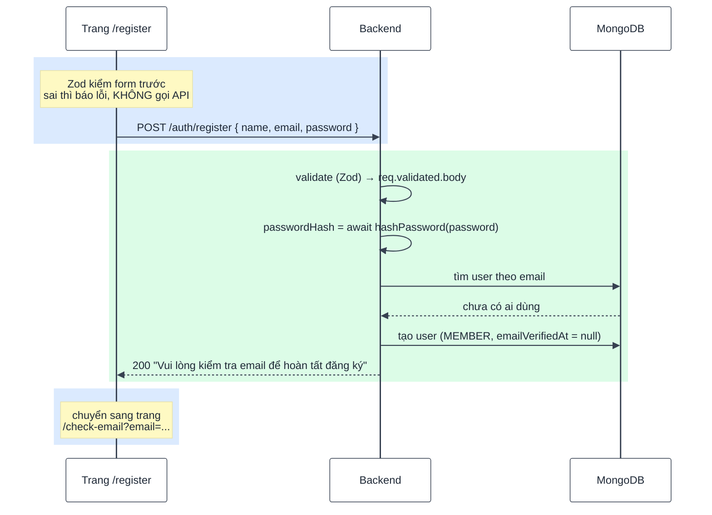
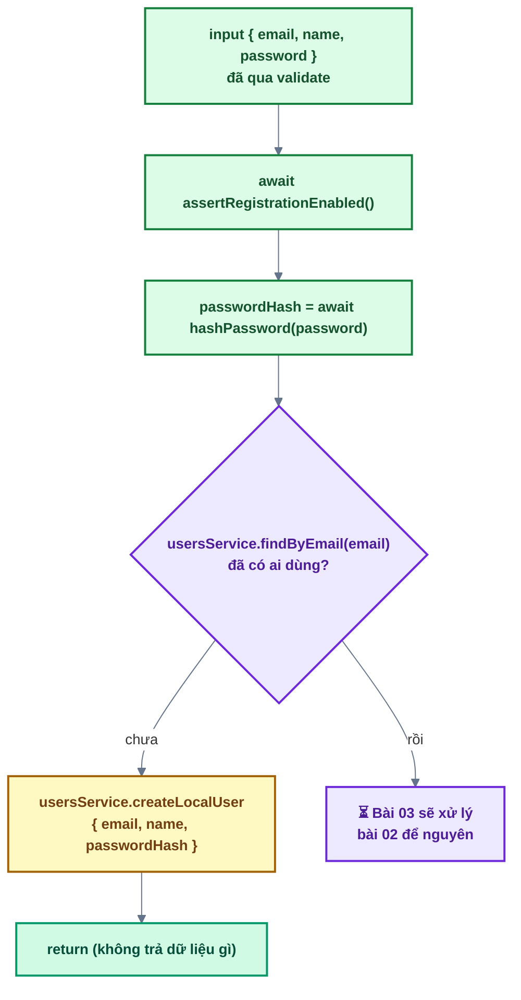

# Bài 02 — Đăng ký tài khoản

> Trước: [Bài 01](bai-01-doc-hieu-kien-truc.md) · Mục lục: [README](README.md) · Tiếp: [Bài 03 — Email & xác thực tài khoản](bai-03-email-va-xac-thuc-tai-khoan.md)

|                        |                                                                                                                                         |
| ---------------------- | --------------------------------------------------------------------------------------------------------------------------------------- |
| **Mục tiêu**           | Khách tạo được tài khoản bằng tên + email + mật khẩu; tài khoản ở trạng thái **chưa kích hoạt**                                         |
| **Thời gian**          | 2–3 giờ                                                                                                                                 |
| **Độ khó**             | ★★                                                                                                                                      |
| **Kiến thức**          | bcrypt · Mongoose `findOne` / `create` · `AppError` · TanStack `useMutation` · React Hook Form + Zod `.refine()`                        |
| **Test BE**            | `npm test -w backend -- -t "bai-02"` — **16 test**, trong đó **2 test cần bạn làm**, 14 test đã xanh sẵn (model, schema, util mật khẩu) |
| **Test FE**            | `npm test -w frontend -- -t "bai-02"` — **5 test**, trong đó **4 test cần bạn làm**                                                     |
| **Chưa làm ở bài này** | Gửi email kích hoạt và xử lý email đã tồn tại → [Bài 03](bai-03-email-va-xac-thuc-tai-khoan.md)                                         |

## 1. Mô tả tính năng

> _Là khách, tôi muốn đăng ký bằng tên + email + mật khẩu để có tài khoản trong hệ thống._

Tài khoản mới luôn **chưa kích hoạt** (`emailVerifiedAt = null`) — chưa đăng nhập được cho tới khi
xác thực email ở bài 03. Bài này chỉ lo phần **tạo tài khoản an toàn**.

### 1.1. Luồng tổng quan



### 1.2. Chi tiết — `authService.register` ở bài 02



> **Vì sao hash mật khẩu TRƯỚC khi tra email?** bcrypt chậm có chủ đích (~200ms). Nếu chỉ hash ở
> nhánh "email mới", thì nhánh "email đã tồn tại" trả về nhanh hơn hẳn — kẻ tấn công bấm giờ là
> biết email nào đã đăng ký, dù response giống hệt nhau. Hash ở cả hai nhánh → thời gian bằng nhau.

## 2. Kiến thức cần nắm trước

| Chủ đề                     | Điểm cốt lõi                                                                                                                                            |
| -------------------------- | ------------------------------------------------------------------------------------------------------------------------------------------------------- |
| **Hash mật khẩu (bcrypt)** | Không bao giờ lưu mật khẩu gốc. `hashPassword` / `verifyPassword` có sẵn ở `backend/src/shared/utils/password.js`. Hash dạng `$2b$12$...` (đã kèm salt) |
| **Mongoose**               | `User.findOne({ email })` trả `null` nếu không có; `User.create({ ... })` trả document vừa tạo. Xem `users.model.js` để biết trường nào có mặc định     |
| **Mass assignment**        | Liệt kê **từng trường** khi `create`, không truyền nguyên object của người gọi                                                                          |
| **`AppError`**             | `throw new AppError({ statusCode, code, message })` — `errorHandler` tự dịch thành JSON (bài 01)                                                        |
| **`useMutation`**          | Hook TanStack Query cho thao tác ghi: `mutate(vars, { onSuccess, onError })`, trạng thái `isPending`                                                    |
| **RHF + Zod**              | `zodResolver(schema)` chặn submit khi form sai; `.refine()` cho quy tắc liên quan nhiều ô                                                               |
| **Validate 2 phía**        | Frontend validate để trải nghiệm tốt; backend validate lại vì client có thể bị bỏ qua hoàn toàn                                                         |

Đọc `backend/src/modules/users/users.model.js` — đặc biệt là `select: false` của `passwordHash` và
`toJSON` (vì sao API không bao giờ lộ hash).

## 3. Các file cần sửa

Tìm nhanh: `grep -rn "bai-02" backend/src frontend/src`

| Phía | File                                        | Việc cần làm                       |
| ---- | ------------------------------------------- | ---------------------------------- |
| BE   | `modules/users/users.service.js`            | `createLocalUser`                  |
| BE   | `modules/auth/auth.service.js`              | `register` (chỉ nhánh "email mới") |
| BE   | `modules/auth/auth.controller.js`           | `register`                         |
| FE   | `features/auth/api/auth.api.js`             | `register`                         |
| FE   | `features/auth/schemas/auth.schemas.js`     | `registerSchema`                   |
| FE   | `features/auth/components/RegisterForm.jsx` | `onSubmit`                         |

**Đọc thêm (không sửa):** `auth.routes.js`, `auth.schema.js` + `users.schema.js` (Zod backend),
`shared/utils/password.js`, `shared/lib/form.js` (`applyServerErrors`), `useRegister.js`.

## 4. Đặc tả API

| Endpoint                     | Body                        | Thành công                                                                                      | Lỗi                                                                       |
| ---------------------------- | --------------------------- | ----------------------------------------------------------------------------------------------- | ------------------------------------------------------------------------- |
| `POST /api/v1/auth/register` | `{ name, email, password }` | **200** `{ success: true, message: 'Vui lòng kiểm tra email để hoàn tất đăng ký', data: null }` | 400 `VALIDATION_ERROR` · 403 `REGISTRATION_DISABLED` · 429 `RATE_LIMITED` |

- Email **không phân biệt hoa thường**: `An@Example.COM` và `an@example.com` là một (schema backend
  đã `toLowerCase` + `trim`).
- **Response giống hệt nhau** dù email đã tồn tại hay chưa — không dò được email nào đã đăng ký. Đó
  là lý do endpoint trả `data: null` chứ không trả `user`.
- Chi tiết: `docs/openapi.yaml`, hoặc Swagger UI ở <http://localhost:4000/api/docs>.

## 5. Các bước thực hiện

### Phần A — Backend

Chạy sau mỗi bước: `npm test -w backend -- -t "bai-02"`.

> Ngay từ đầu, test **"dữ liệu sai → 400 VALIDATION_ERROR với lỗi từng trường"** đã xanh. Vì sao,
> khi bạn chưa viết dòng nào? (gợi ý: bài 01, mục 2.2)

**A1. `usersService.createLocalUser`** — `User.create` với đúng 3 trường được liệt kê.

**A2. `authService.register`** — làm theo sơ đồ 1.2. Chỉ nhánh "email mới"; nhánh còn lại để nguyên
cho bài 03.

**A3. `authController.register`** — gọi service, trả 200 bằng `sendSuccess`.

✅ Cả **2 test đỏ** của bài 02 chuyển xanh (16/16).

✅ Thử bằng `curl` (chạy `npm run dev` ở terminal khác):

```bash
curl -s -X POST localhost:4000/api/v1/auth/register \
  -H 'Content-Type: application/json' \
  -d '{"name":"Nguyễn An","email":"An@Example.com","password":"mat-khau-an-toan"}'
```

Kiểm trong MongoDB (Atlas UI hoặc Compass): bản ghi mới có `email` đã **viết thường**,
`role: "MEMBER"`, `emailVerifiedAt` trống, `passwordHash` bắt đầu bằng `$2b$`.

> Chạy lại lệnh trên lần 2 với **cùng email**: bài 02 chưa xử lý nhánh này nên sẽ không có gì xảy
> ra (hoặc lỗi trùng email ở tầng DB). Bài 03 sẽ làm cho đúng.

### Phần B — Frontend

`npm run dev`, mở <http://localhost:5173/register>. Chạy test: `npm test -w frontend -- -t "bai-02"`.

**B1. `registerSchema`** — bổ sung quy tắc theo chú thích trong file. Thử bỏ trống tên, nhập mật
khẩu 3 ký tự, nhập lại mật khẩu khác nhau → lỗi hiện dưới đúng ô và **không có request nào gửi đi**
(mở tab Network để kiểm chứng).

**B2. `authApi.register`** — xem 3 hàm ngay bên dưới nó trong cùng file làm mẫu.

**B3. `RegisterForm.onSubmit`** — gọi mutation, điều hướng khi thành công, gắn lỗi server vào ô khi
thất bại.

✅ Cả **4 test đỏ** của bài 02 chuyển xanh (5/5).

✅ Trên trình duyệt: đăng ký thành công → chuyển sang màn hình "Kiểm tra email" có sẵn email vừa
nhập. **Chưa có email nào được gửi thật**, và nút "Gửi lại email kích hoạt" vẫn báo "chưa hoàn
thành" — đó là bài 03.

## 6. Tiêu chí hoàn thành

- [ ] `npm test -w backend -- -t "bai-02"` → 16/16 xanh
- [ ] `npm test -w frontend -- -t "bai-02"` → 5/5 xanh
- [ ] `npm test -w backend -- -t "bai-01"` và FE tương tự vẫn xanh (không làm hỏng hạ tầng)
- [ ] `npm run build && npm run format:check && npm run check` sạch
- [ ] Trên trình duyệt: đăng ký thành công → màn hình "Kiểm tra email" kèm đúng email
- [ ] Lỗi form (tên trống, mật khẩu < 8 ký tự, nhập lại không khớp) hiện đúng ô, không gửi request
- [ ] Trong database: `passwordHash` bắt đầu bằng `$2b$`, `emailVerifiedAt` trống, `role` là `MEMBER`
- [ ] Đánh dấu `[x] Bài 02` trong [CHECKLIST.md](../../CHECKLIST.md) rồi commit

## 7. Câu hỏi & thử thách mở rộng

1. Đã có Zod ở frontend rồi, vì sao backend vẫn phải validate lại?
2. Hai request đăng ký **cùng một email** gửi tới **cùng lúc**: cả hai đều thấy "chưa tồn tại" rồi
   cùng `create`. Chuyện gì xảy ra? Điều gì trong database chặn được?
3. Thử gửi bằng `curl` kèm `"role": "SUPER_ADMIN"` trong body. Kết quả? Hai lớp nào đã chặn nó?
4. Thử thách: trong `createLocalUser`, đổi `User.create({ email, name, passwordHash })` thành
   `User.create(input)` (nhận nguyên object). Test nào đỏ? Vì sao đây là lỗ hổng?

## 8. Gợi ý

Mở lần lượt, chỉ mở cấp sau khi đã thật sự bí với cấp trước.

<details>
<summary><b>Cấp 1 — Định hướng</b></summary>

- **`createLocalUser`**: đúng một dòng `return User.create({ ... })`. Không cần `await` vì đã
  `return` một Promise.
- **`register`**: thứ tự trong sơ đồ 1.2 quan trọng — `assertRegistrationEnabled` trước, rồi
  `hashPassword`, rồi mới tra email. `hashPassword` trả **Promise**, nhớ `await`.
- **`controller.register`**: `req.validated.body` (không phải `req.body`), `await` service, rồi
  `sendSuccess(res, null, '...')`. Không cần `try/catch`.
- **FE api**: xem `verifyEmail` ngay bên dưới — cùng một khuôn.
- **`registerSchema`**: `z.object({...}).refine(...)`. `newPasswordSchema` ở cuối file là mẫu gần
  như y hệt cho phần `.refine`.
- **`onSubmit`**: `handleSubmit` chỉ gọi khi form hợp lệ, nên tham số nhận được đã sạch. `mutate`
  nhận tham số thứ hai là object `{ onSuccess, onError }`.

</details>

<details>
<summary><b>Cấp 2 — Pseudo-code</b></summary>

```text
createLocalUser({ email, name, passwordHash }):
  return User.create({ email, name, passwordHash })

register({ email, name, password }):
  await assertRegistrationEnabled()
  passwordHash = await hashPassword(password)
  existingUser = await usersService.findByEmail(email)
  nếu KHÔNG có existingUser:
     await usersService.createLocalUser({ email, name, passwordHash })
     return
  // bài 03 viết tiếp từ đây

controller.register(req, res):
  await authService.register(req.validated.body)
  sendSuccess(res, null, 'Vui lòng kiểm tra email để hoàn tất đăng ký')

api.register(body):
  response = await http.post('/auth/register', body)
  return response.data

registerSchema = object {
    name: string, trim, min 1 'Vui lòng nhập tên', max NAME_MAX_LENGTH
    email: emailSchema
    password: passwordSchema
    confirmPassword: string, min 1 'Vui lòng nhập lại mật khẩu'
  }.refine(values => values.password === values.confirmPassword,
           { path: ['confirmPassword'], message: 'Mật khẩu nhập lại không khớp' })

onSubmit({ name, email, password }):
  registerMutation.mutate({ name, email, password }, {
    onSuccess: () => navigate(CHECK_EMAIL + '?' + new URLSearchParams({ email })),
    onError: (error) => applyServerErrors(error, setError, FIELD_NAMES),
  })
```

</details>

<details>
<summary><b>Cấp 3 — Code tham khảo (backend)</b></summary>

```js
// users.service.js
async function createLocalUser({ email, name, passwordHash }) {
  return User.create({ email, name, passwordHash });
}
```

```js
// auth.service.js — phần của bài 02 (bài 03 viết tiếp sau chỗ `return`)
async function register({ email, name, password }) {
  await assertRegistrationEnabled();
  const passwordHash = await hashPassword(password);
  const existingUser = await usersService.findByEmail(email);

  if (!existingUser) {
    const user = await usersService.createLocalUser({ email, name, passwordHash });
    // Bài 03: gửi email xác thực cho `user` tại đây.
    return;
  }

  // Bài 03: xử lý email đã tồn tại.
}
```

```js
// auth.controller.js
async function register(req, res) {
  await authService.register(req.validated.body);
  sendSuccess(res, null, 'Vui lòng kiểm tra email để hoàn tất đăng ký');
}
```

</details>

<details>
<summary><b>Cấp 3 — Code tham khảo (frontend)</b></summary>

```js
// features/auth/api/auth.api.js
export async function register(body) {
  const response = await http.post('/auth/register', body);
  return response.data;
}
```

```js
// features/auth/schemas/auth.schemas.js
export const registerSchema = z
  .object({
    name: z
      .string()
      .trim()
      .min(1, 'Vui lòng nhập tên')
      .max(NAME_MAX_LENGTH, `Tên tối đa ${NAME_MAX_LENGTH} ký tự`),
    email: emailSchema,
    password: passwordSchema,
    confirmPassword: z.string().min(1, 'Vui lòng nhập lại mật khẩu'),
  })
  .refine((values) => values.password === values.confirmPassword, {
    path: ['confirmPassword'],
    message: 'Mật khẩu nhập lại không khớp',
  });
```

```jsx
// features/auth/components/RegisterForm.jsx
const onSubmit = ({ name, email, password }) => {
  registerMutation.mutate(
    { name, email, password },
    {
      onSuccess: () => {
        const params = new URLSearchParams({ email });
        navigate(`${ROUTES.AUTH.CHECK_EMAIL}?${params}`);
      },
      onError: (error) => applyServerErrors(error, setError, FIELD_NAMES),
    },
  );
};
```

</details>

<details>
<summary><b>Đáp án câu hỏi mục 7</b></summary>

**1.** Validate ở frontend chỉ để **trải nghiệm** (báo lỗi ngay khi gõ, không tốn một vòng mạng).
Bất kỳ ai cũng gọi thẳng API bằng `curl` / Postman, bỏ qua hoàn toàn frontend — nên backend là chốt
chặn **duy nhất đáng tin**. Hai schema cố ý **tách riêng** (không dùng chung một file): chúng phục
vụ hai mục đích khác nhau và chạy ở hai môi trường khác nhau.

**2.** Cả hai cùng thấy `findByEmail` trả `null` rồi cùng `create`. Chặn lại là **index `unique`
trên `email`** ở tầng database (tạo bằng migration — xem `backend/migrations/`). MongoDB từ chối
bản ghi thứ hai với lỗi `code: 11000`, và `errorHandler` dịch nó thành **409 `DUPLICATE_VALUE`**
(bài 01, bảng ở mục 2.3). Tình huống này hiếm nên response 409 ở đây chấp nhận được — điều quan
trọng là **không bao giờ có hai tài khoản cùng email**, và điều đó do database bảo đảm chứ không
phải do đoạn `if` trong service.

**3.** Trường `role` bị loại bỏ, tài khoản vẫn là `MEMBER`. Hai lớp chặn:

- `validate` + Zod: `registerBodySchema` chỉ khai báo `name`, `email`, `password`, nên
  `req.validated.body` **không còn** `role`.
- `createLocalUser`: liệt kê từng trường khi `create`, nên dù có lọt qua lớp trên cũng không ghi
  vào database.

Một lớp là đủ để chặn, nhưng giữ cả hai vì chúng hỏng vì những lý do khác nhau: ai đó thêm trường
vào schema Zod, hoặc ai đó gọi `createLocalUser` từ một chỗ mới không qua `validate`.

**4.** Test **"không tự gán được role qua body (mass assignment)"** sẽ đỏ nếu lớp Zod cũng bị nới
ra. Với `User.create(input)`, mọi trường trong `input` đều được ghi — kẻ tấn công tự phong
`SUPER_ADMIN` cho mình ngay lúc đăng ký, hoặc đặt `emailVerifiedAt` để bỏ qua bước xác thực email.
Đây là lỗ hổng OWASP API3 (Broken Object Property Level Authorization).

</details>

---

> Trước: [Bài 01](bai-01-doc-hieu-kien-truc.md) · Mục lục: [README](README.md) · Tiếp: [Bài 03 — Email & xác thực tài khoản](bai-03-email-va-xac-thuc-tai-khoan.md)
