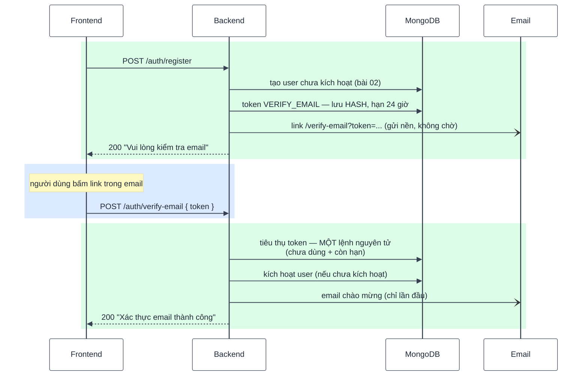
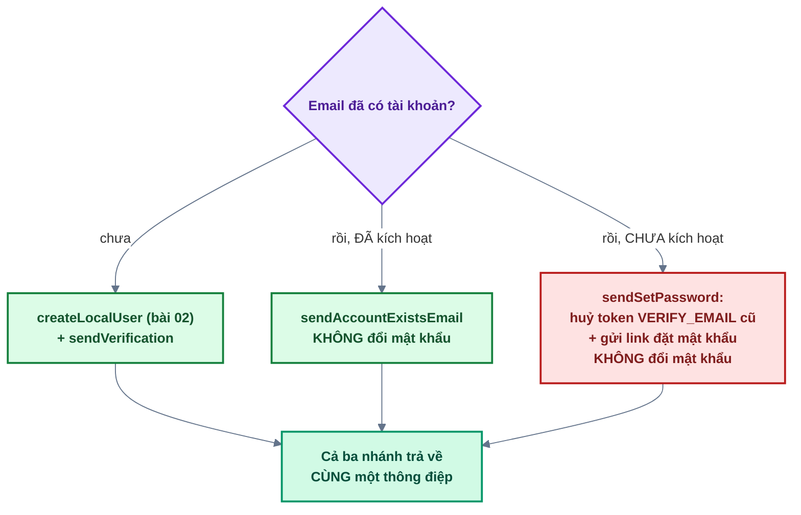

# Bài 03 — Email & xác thực tài khoản

> Trước: [Bài 02](bai-02-dang-ky-tai-khoan.md) · Mục lục: [README](README.md) · Tiếp: [Bài 04 — Đăng nhập](bai-04-dang-nhap.md)

|                        |                                                                                                                                             |
| ---------------------- | ------------------------------------------------------------------------------------------------------------------------------------------- |
| **Mục tiêu**           | Người đăng ký nhận email kèm link kích hoạt, bấm link là tài khoản dùng được; đăng ký trùng email không chiếm được tài khoản của người khác |
| **Thời gian**          | 4–5 giờ                                                                                                                                     |
| **Độ khó**             | ★★★                                                                                                                                         |
| **Kiến thức**          | React Email · gửi chạy nền · token dùng 1 lần (lưu hash) · cập nhật nguyên tử · `useRef` chống Strict Mode gọi 2 lần                        |
| **Test BE**            | `npm test -w backend -- -t "bai-03"` — **18 test**, trong đó **12 test cần bạn làm**                                                        |
| **Test FE**            | `npm test -w frontend -- -t "bai-03"` — **4 test**, trong đó **3 test cần bạn làm**                                                         |
| **Dùng lại ở bài sau** | `emailTokensService` dùng cho đặt lại mật khẩu (bài 08) và magic link (bài 09); `useConsumeTokenOnce` dùng lại ở bài 09                     |

Bài khó nhất trong ba bài đầu, và là bài nhiều **bẫy bảo mật** nhất. Đọc hết mục 1 trước khi code.

## 1. Mô tả tính năng

> _Là người vừa đăng ký, tôi nhận được email có link kích hoạt; bấm vào là tài khoản dùng được._
>
> _Là người sở hữu một địa chỉ email, tôi muốn chắc chắn rằng ai đó đăng ký trước bằng email của
> tôi thì cũng không chiếm được tài khoản đó._

### 1.1. Luồng đăng ký đầy đủ (bài 02 + bài 03)



### 1.2. Ba nhánh của `register` — và vì sao chúng khác nhau



**Nhánh đỏ là phần quan trọng nhất của bài này.** Kịch bản tấn công _pre-account takeover_:

1. Kẻ gian đăng ký `nan-nhan@mail.com` với mật khẩu **P**. Hắn không có hộp thư đó nên không kích
   hoạt được — nhưng bản ghi user **đã tồn tại**, và link kích hoạt nằm trong hộp thư nạn nhân.
2. Ít lâu sau, nạn nhân tự đăng ký bằng chính email của mình, đặt mật khẩu **Q**.
3. Nếu backend **ghi đè** mật khẩu thành Q rồi gửi link kích hoạt: nạn nhân bấm link, tài khoản
   kích hoạt. Nhưng kẻ gian vẫn còn **link kích hoạt cũ** từ bước 1 — hoặc tệ hơn, nếu ta không
   ghi đè mà giữ P thì hắn đăng nhập thẳng bằng P.

Cách xử lý đúng, làm cả hai việc:

- **Không ghi đè mật khẩu** — mật khẩu Q không được áp dụng, vì ta chưa biết ai là chủ thật.
- **Huỷ mọi token `VERIFY_EMAIL` cũ**, rồi gửi link **đặt mật khẩu** (`RESET_PASSWORD`). Chỉ người
  đọc được hộp thư mới đặt được mật khẩu, và link cũ của kẻ gian chết.

### 1.3. Token trong email — ba quy tắc

| Quy tắc                                                     | Vì sao                                                     |
| ----------------------------------------------------------- | ---------------------------------------------------------- |
| **Chỉ lưu hash** (SHA-256), gửi đi bản gốc                  | Database lọt ra ngoài cũng không dựng lại được link hợp lệ |
| **Dùng đúng một lần**, tiêu thụ bằng **một** lệnh nguyên tử | Hai request cùng lúc thì chỉ một thành công                |
| **Phát hành mới ⇒ huỷ token cũ cùng loại**                  | Gửi lại email lần 2 thì link lần 1 phải chết               |

Ba quy tắc này nằm trong `emailTokensService` và được dùng lại ở bài 08 (đặt lại mật khẩu) và bài
09 (magic link) — viết cẩn thận một lần, ba bài sau hưởng.

> Token còn có **TTL index** trên `expiresAt` (tạo bằng migration): MongoDB tự xoá bản ghi hết hạn,
> không cần job dọn. Bạn không phải làm gì — chỉ cần biết là có.

## 2. Kiến thức cần nắm trước

| Chủ đề                   | Điểm cốt lõi                                                                                                                                                                                                                  |
| ------------------------ | ----------------------------------------------------------------------------------------------------------------------------------------------------------------------------------------------------------------------------- |
| **Gửi email chạy nền**   | `send(...)` (hàm nội bộ của `email.service.js`) **không** trả Promise cần `await` và **không** ném lỗi ra ngoài — lỗi chỉ ghi log. Người dùng không phải chờ dịch vụ email, và đăng ký không thất bại vì dịch vụ đó trục trặc |
| **React Email**          | Template viết bằng `createElement` (alias `h`), **không JSX** ở backend. Xem `shared/emails/`                                                                                                                                 |
| **Link về frontend**     | `buildAppUrl(APP_PATHS.VERIFY_EMAIL, { token })` → `https://<frontend>/verify-email?token=...`. Người dùng bấm link là mở **trang web**, không phải gọi API                                                                   |
| **Cập nhật nguyên tử**   | `findOneAndUpdate(filter, update)` — điều kiện nằm trong `filter`, không nằm ở câu `if` phía trước                                                                                                                            |
| **`mongoose.trusted`**   | Operator do server tự dựng (`{ $gt: ... }`) phải bọc lại, vì `sanitizeFilter` chặn mọi object có key `$` (chống NoSQL injection)                                                                                              |
| **Strict Mode**          | React chạy effect 2 lần ở development. Token dùng 1 lần + effect chạy 2 lần = lần thứ hai báo lỗi. `useRef` sống xuyên qua hai lần đó                                                                                         |
| **Lấy token trong test** | Không cần hộp thư thật: `vi.spyOn(emailService, 'sendVerifyEmail')` rồi đọc `spy.mock.calls[0][0].token`. Xem `registerAndCaptureToken` trong file test                                                                       |

## 3. Các file cần sửa

Tìm nhanh: `grep -rn "bai-03" backend/src frontend/src`

| Phía | File                                                  | Hàm                                                                                                     |
| ---- | ----------------------------------------------------- | ------------------------------------------------------------------------------------------------------- |
| BE   | `modules/auth/emailTokens.service.js`                 | `issue`, `consume`, `revokeAll`                                                                         |
| BE   | `modules/email/email.service.js`                      | `sendVerifyEmail`, `sendSetPasswordEmail`                                                               |
| BE   | `modules/auth/auth.service.js`                        | `sendVerification`, `sendSetPassword`, `verifyEmail`, `resendVerification`, **và viết tiếp `register`** |
| BE   | `modules/users/users.service.js`                      | `markEmailVerified`                                                                                     |
| BE   | `modules/auth/auth.controller.js`                     | `verifyEmail`, `resendVerification`                                                                     |
| FE   | `features/auth/api/auth.api.js`                       | `verifyEmail`, `resendVerification`                                                                     |
| FE   | `features/auth/hooks/useConsumeTokenOnce.js`          | thân `useEffect`                                                                                        |
| FE   | `features/auth/components/ResendVerificationForm.jsx` | `onSubmit`                                                                                              |

> `register` **không** có đánh dấu `bai-03` trong code (bạn đã viết nó ở bài 02). Mục 5 nói rõ
> phần cần viết thêm.

**Đọc thêm (không sửa):** `emailTokens.model.js` (TTL index, `usedAt`), `shared/utils/token.js`
(`generateToken`, `hashToken`), `shared/emails/` (template), `mailer.js`, hàm `send` / `deliver` ở
đầu `email.service.js` (gửi qua kênh Super Admin chọn — bài 15), `auth.constants.js`
(các hằng số TTL), `VerifyEmailStatus.jsx`, `CheckEmailNotice.jsx`.

## 4. Đặc tả API

| Endpoint                                | Body        | Thành công                                                                          | Lỗi                                          |
| --------------------------------------- | ----------- | ----------------------------------------------------------------------------------- | -------------------------------------------- |
| `POST /api/v1/auth/verify-email`        | `{ token }` | 200 `'Xác thực email thành công, tài khoản đã được kích hoạt'`                      | 400 `VALIDATION_ERROR` · 400 `TOKEN_INVALID` |
| `POST /api/v1/auth/resend-verification` | `{ email }` | 200 `'Nếu email thuộc một tài khoản chưa kích hoạt, chúng tôi đã gửi lại liên kết'` | 400 `VALIDATION_ERROR` · 429 `RATE_LIMITED`  |

**Một mã lỗi `TOKEN_INVALID` cho cả ba trường hợp** (token sai, hết hạn, đã dùng). Phân biệt rõ
từng trường hợp là xác nhận cho kẻ dò rằng token đó từng tồn tại.

Thời hạn: link kích hoạt **24 giờ**, link đặt mật khẩu **60 phút** (hằng số ở `auth.constants.js`).

## 5. Các bước thực hiện

### Phần A — Hạ tầng token (làm trước, mọi thứ khác phụ thuộc vào nó)

**A1. `emailTokensService.issue` / `consume` / `revokeAll`** — làm theo JSDoc trong file.

Chưa có test nào xanh sau bước này (không test trực tiếp service), nhưng làm sai thì cả bài sai.
Tự kiểm bằng cách đọc lại ba quy tắc ở mục 1.3.

### Phần B — Email

**B1. `emailService.sendVerifyEmail` và `sendSetPasswordEmail`** — xem `sendWelcomeEmail` /
`sendMagicLinkEmail` trong cùng file làm mẫu (đã viết sẵn).

✅ 2 test `[bai-03] emailService — nội dung email` chuyển xanh.

### Phần C — Nghiệp vụ

**C1. `authService.sendVerification`** và **`sendSetPassword`** — theo JSDoc.

**C2. Viết tiếp `authService.register`** — bổ sung vào code bài 02 của bạn:

- sau khi `createLocalUser` thành công → `await sendVerification(user)`;
- nhánh `existingUser.emailVerifiedAt` (đã kích hoạt) → `emailService.sendAccountExistsEmail({ user: existingUser })` rồi `return`;
- nhánh còn lại (chưa kích hoạt) → `await sendSetPassword(existingUser)`.

**C3. `usersService.markEmailVerified`** — cập nhật nguyên tử có điều kiện.

**C4. `authService.verifyEmail`** và **`resendVerification`**, rồi 2 hàm controller tương ứng.

✅ **12 test đỏ** của backend chuyển xanh (18/18).

✅ Thử bằng `curl` (`npm run dev`) — ở development email **in ra terminal** kèm link, không cần
hộp thư thật:

```bash
curl -s -X POST localhost:4000/api/v1/auth/register \
  -H 'Content-Type: application/json' \
  -d '{"name":"Nguyễn An","email":"an@example.com","password":"mat-khau-an-toan"}'
```

Nhìn terminal chạy backend → copy `token` trong link → xác thực:

```bash
curl -s -X POST localhost:4000/api/v1/auth/verify-email \
  -H 'Content-Type: application/json' -d '{"token":"<dán token vào đây>"}'
```

Gọi lại lần 2 với **cùng token** → phải nhận `400 TOKEN_INVALID`.

Thử nốt nhánh đỏ: đăng ký lần nữa bằng email **chưa kích hoạt** với mật khẩu khác → terminal hiện
email **đặt mật khẩu** (không phải email kích hoạt), và link kích hoạt cũ không dùng được nữa.

### Phần D — Frontend

**D1. `authApi.verifyEmail` / `resendVerification`** — cùng khuôn bài 02.

**D2. `useConsumeTokenOnce`** — thân `useEffect`.

**D3. `ResendVerificationForm.onSubmit`**.

✅ **3 test đỏ** của frontend chuyển xanh (4/4).

✅ Trên trình duyệt: đăng ký → mở link trong terminal → trang `/verify-email` báo thành công.
Bấm **F5** trên chính trang đó → lần này báo lỗi "liên kết không hợp lệ" (token đã dùng) kèm đường
dẫn tới trang gửi lại email. Đó là hành vi đúng.

## 6. Tiêu chí hoàn thành

- [ ] `npm test -w backend -- -t "bai-03"` → 18/18 xanh
- [ ] `npm test -w frontend -- -t "bai-03"` → 4/4 xanh
- [ ] Test của bài 01 và 02 vẫn xanh
- [ ] `npm run build && npm run format:check && npm run check` sạch
- [ ] Trên trình duyệt: đăng ký → bấm link trong terminal → kích hoạt thành công → F5 báo token đã dùng
- [ ] Trong database, collection `emailtokens`: **không có** cột nào chứa token dạng gốc; bản ghi
      đã dùng có `usedAt`
- [ ] Đăng ký lại bằng email chưa kích hoạt với mật khẩu khác → mật khẩu trong DB **không đổi**
- [ ] Đánh dấu `[x] Bài 03` trong [CHECKLIST.md](../../CHECKLIST.md) rồi commit

## 7. Câu hỏi & thử thách mở rộng

1. Vì sao `send` **không** được `await` trong `sendVerification`? Chuyện gì xảy ra với
   người dùng nếu Resend đang chậm 30 giây?
2. Trong `verifyEmail`, vì sao email chào mừng chỉ gửi khi `markEmailVerified` trả về user, thay vì
   gửi ngay sau khi `consume` thành công?
3. Thử thách: trong `consume`, thay `findOneAndUpdate` bằng `findOne` → `if (!token.usedAt)` →
   `updateOne`. Test nào đỏ? Vì sao?
4. Thử thách: xoá `hasStartedRef` trong `useConsumeTokenOnce` và để mảng phụ thuộc rỗng `[]`. Mở
   trang `/verify-email?token=...` ở development. Chuyện gì xảy ra, và vì sao chỉ xảy ra ở
   development?
5. `resendVerification` trả về im lặng khi email không tồn tại. Nếu thay bằng `404 NOT_FOUND` thì
   kẻ tấn công làm được gì?

## 8. Gợi ý

<details>
<summary><b>Cấp 1 — Định hướng</b></summary>

- **`issue`**: 3 lệnh — `deleteMany` (token cũ cùng loại), `generateToken()`, `create` với
  `tokenHash: hashToken(token)`. Nhớ `return token` (bản **gốc**).
- **`consume`**: đúng **một** lệnh `findOneAndUpdate`. Điều kiện gồm 4 thứ: `tokenHash`, `type`,
  `usedAt: null`, `expiresAt` còn hạn. Bọc `mongoose.trusted({ $gt: new Date() })`.
- **`sendVerifyEmail`**: copy khuôn của `sendMagicLinkEmail` ngay trong file, đổi template, subject
  và `APP_PATHS`.
- **`register`**: bạn đã có phần bài 02; chỉ thêm một dòng vào nhánh "email mới" và viết hai nhánh
  còn lại. Cả ba nhánh `return` mà không trả dữ liệu.
- **`verifyEmail`**: `consume` → `null` thì `throw AppError` → `markEmailVerified` → `if` mới gửi
  email chào mừng.
- **`useConsumeTokenOnce`**: 2 câu `if` (hoặc một câu với `||`) rồi gán cờ **trước** khi `mutate`.

</details>

<details>
<summary><b>Cấp 2 — Pseudo-code</b></summary>

```text
issue({ userId, type, ttlMs }):
  await EmailToken.deleteMany({ userId, type })
  token = generateToken()
  await EmailToken.create({ userId, type,
                            tokenHash: hashToken(token),
                            expiresAt: bây giờ + ttlMs })
  return token

consume({ token, type, session }):
  return EmailToken.findOneAndUpdate(
    { tokenHash: hashToken(token), type, usedAt: null,
      expiresAt: mongoose.trusted({ $gt: bây giờ }) },
    { $set: { usedAt: bây giờ } },
    { returnDocument: 'after', runValidators: true, session })

revokeAll({ userId, type }):
  await EmailToken.deleteMany({ userId, type })

sendVerification(user):
  token = await emailTokensService.issue({ userId: user._id,
                                           type: VERIFY_EMAIL,
                                           ttlMs: VERIFY_EMAIL_TTL_MS })
  emailService.sendVerifyEmail({ user, token, expiresInHours: VERIFY_EMAIL_TTL_HOURS })

sendSetPassword(user):
  await emailTokensService.revokeAll({ userId: user._id, type: VERIFY_EMAIL })
  token = await emailTokensService.issue({ userId: user._id,
                                           type: RESET_PASSWORD,
                                           ttlMs: RESET_PASSWORD_TTL_MS })
  emailService.sendSetPasswordEmail({ user, token,
                                      expiresInMinutes: RESET_PASSWORD_TTL_MINUTES })

register(...):  // viết tiếp code bài 02
  nếu KHÔNG có existingUser:
     user = await createLocalUser(...)
     await sendVerification(user); return
  nếu existingUser.emailVerifiedAt:
     emailService.sendAccountExistsEmail({ user: existingUser }); return
  await sendSetPassword(existingUser)

markEmailVerified(userId, { session }):
  return User.findOneAndUpdate(
    { _id: userId, emailVerifiedAt: null },
    { $set: { emailVerifiedAt: bây giờ } },
    { returnDocument: 'after', runValidators: true, session })

verifyEmail({ token }):
  emailToken = await consume({ token, type: VERIFY_EMAIL })
  nếu !emailToken → throw AppError(400, TOKEN_INVALID, 'Liên kết xác thực không hợp lệ hoặc đã hết hạn')
  activatedUser = await markEmailVerified(emailToken.userId)
  nếu activatedUser → emailService.sendWelcomeEmail({ user: activatedUser })

resendVerification({ email }):
  user = await findByEmail(email)
  nếu !user hoặc user.emailVerifiedAt → return
  await sendVerification(user)

useEffect:
  nếu !token hoặc hasStartedRef.current → return
  hasStartedRef.current = true
  mutate({ token })
```

</details>

<details>
<summary><b>Cấp 3 — Code tham khảo (backend)</b></summary>

```js
// emailTokens.service.js
async function issue({ userId, type, ttlMs }) {
  await EmailToken.deleteMany({ userId, type });

  const token = generateToken();
  await EmailToken.create({
    userId,
    type,
    tokenHash: hashToken(token),
    expiresAt: new Date(Date.now() + ttlMs),
  });
  return token;
}

async function consume({ token, type, session }) {
  return EmailToken.findOneAndUpdate(
    {
      tokenHash: hashToken(token),
      type,
      usedAt: null,
      // sanitizeFilter bọc mọi object có key `$` → operator do server tự dựng phải trusted().
      expiresAt: mongoose.trusted({ $gt: new Date() }),
    },
    { $set: { usedAt: new Date() } },
    { returnDocument: 'after', runValidators: true, session },
  );
}

async function revokeAll({ userId, type }) {
  await EmailToken.deleteMany({ userId, type });
}
```

```js
// email.service.js
function sendVerifyEmail({ user, token, expiresInHours }) {
  send({
    to: user.email,
    subject: 'Xác thực email của bạn',
    element: h(VerifyEmail, {
      name: user.name,
      verifyUrl: buildAppUrl(APP_PATHS.VERIFY_EMAIL, { token }),
      expiresInHours,
    }),
  });
}

function sendSetPasswordEmail({ user, token, expiresInMinutes }) {
  send({
    to: user.email,
    subject: 'Đặt mật khẩu để kích hoạt tài khoản',
    element: h(SetPasswordEmail, {
      name: user.name,
      resetUrl: buildAppUrl(APP_PATHS.RESET_PASSWORD, { token }),
      expiresInMinutes,
    }),
  });
}
```

```js
// auth.service.js
async function sendVerification(user) {
  const token = await emailTokensService.issue({
    userId: user._id,
    type: EMAIL_TOKEN_TYPES.VERIFY_EMAIL,
    ttlMs: VERIFY_EMAIL_TTL_MS,
  });
  emailService.sendVerifyEmail({ user, token, expiresInHours: VERIFY_EMAIL_TTL_HOURS });
}

async function sendSetPassword(user) {
  await emailTokensService.revokeAll({ userId: user._id, type: EMAIL_TOKEN_TYPES.VERIFY_EMAIL });
  const token = await emailTokensService.issue({
    userId: user._id,
    type: EMAIL_TOKEN_TYPES.RESET_PASSWORD,
    ttlMs: RESET_PASSWORD_TTL_MS,
  });
  emailService.sendSetPasswordEmail({
    user,
    token,
    expiresInMinutes: RESET_PASSWORD_TTL_MINUTES,
  });
}

async function register({ email, name, password }) {
  await assertRegistrationEnabled();
  const passwordHash = await hashPassword(password);
  const existingUser = await usersService.findByEmail(email);

  if (!existingUser) {
    const user = await usersService.createLocalUser({ email, name, passwordHash });
    await sendVerification(user);
    return;
  }

  if (existingUser.emailVerifiedAt) {
    emailService.sendAccountExistsEmail({ user: existingUser });
    return;
  }

  await sendSetPassword(existingUser);
}

async function verifyEmail({ token }) {
  const emailToken = await emailTokensService.consume({
    token,
    type: EMAIL_TOKEN_TYPES.VERIFY_EMAIL,
  });

  if (!emailToken) {
    throw new AppError({
      statusCode: 400,
      code: ERROR_CODES.TOKEN_INVALID,
      message: 'Liên kết xác thực không hợp lệ hoặc đã hết hạn',
    });
  }

  const activatedUser = await usersService.markEmailVerified(emailToken.userId);
  if (activatedUser) emailService.sendWelcomeEmail({ user: activatedUser });
}

async function resendVerification({ email }) {
  const user = await usersService.findByEmail(email);
  if (!user || user.emailVerifiedAt) return;

  await sendVerification(user);
}
```

```js
// users.service.js
async function markEmailVerified(userId, { session } = {}) {
  return User.findOneAndUpdate(
    { _id: userId, emailVerifiedAt: null },
    { $set: { emailVerifiedAt: new Date() } },
    { returnDocument: 'after', runValidators: true, session },
  );
}
```

```js
// auth.controller.js
async function verifyEmail(req, res) {
  await authService.verifyEmail(req.validated.body);
  sendSuccess(res, null, 'Xác thực email thành công, tài khoản đã được kích hoạt');
}

async function resendVerification(req, res) {
  await authService.resendVerification(req.validated.body);
  sendSuccess(
    res,
    null,
    'Nếu email thuộc một tài khoản chưa kích hoạt, chúng tôi đã gửi lại liên kết',
  );
}
```

</details>

<details>
<summary><b>Cấp 3 — Code tham khảo (frontend)</b></summary>

```js
// features/auth/api/auth.api.js
export async function verifyEmail(body) {
  const response = await http.post('/auth/verify-email', body);
  return response.data;
}

export async function resendVerification(body) {
  const response = await http.post('/auth/resend-verification', body);
  return response.data;
}
```

```js
// features/auth/hooks/useConsumeTokenOnce.js
useEffect(() => {
  if (!token || hasStartedRef.current) return;
  hasStartedRef.current = true;
  mutate({ token });
}, [token, mutate]);
```

```jsx
// features/auth/components/ResendVerificationForm.jsx
const onSubmit = (values) => {
  resendMutation.mutate(values, {
    onSuccess: (body) => toast.success(body.message),
    onError: (error) => applyServerErrors(error, setError, ['email']),
  });
};
```

</details>

<details>
<summary><b>Đáp án câu hỏi mục 7</b></summary>

**1.** `send` cố ý **không** trả Promise để người gọi chờ (bên trong nó gọi
`mailer.runInBackground`). Nếu `await` nó, thời gian trả về
của `POST /auth/register` phụ thuộc vào Resend: Resend chậm 30 giây thì người dùng nhìn nút xoay 30
giây, và nếu Resend lỗi thì request đăng ký **thất bại** dù tài khoản đã được tạo trong database —
người dùng bấm đăng ký lại và rơi vào nhánh "email đã tồn tại". Gửi nền thì tài khoản vẫn được tạo,
lỗi email ghi vào log, và người dùng luôn có nút "Gửi lại email xác thực" để thử lại.

Đổi lại: không biết được email có gửi thành công hay không ngay lúc đó. Chấp nhận được với email
giao dịch một-lần; còn job gửi **hàng loạt** (bài 14) thì cần biết, nên ở đó dùng `deliver`
(có chờ) và đếm số gửi thành công / thất bại.

**2.** Vì `consume` thành công **không** đồng nghĩa với "tài khoản vừa được kích hoạt". Tài khoản
có thể đã được kích hoạt từ trước bằng đường khác — ví dụ bài 08: đặt lại mật khẩu cũng kích hoạt
tài khoản, hoặc bài 09: magic link. Khi đó `markEmailVerified` trả `null` (filter
`emailVerifiedAt: null` không khớp) và ta **không** gửi email chào mừng lần nữa.

Nói cách khác, giá trị trả về của `markEmailVerified` chính là câu trả lời cho "đây có phải lần
kích hoạt đầu không?", và đó là câu hỏi quyết định có gửi email chào mừng hay không.

**3.** Test **"2 request cùng lúc với cùng token → đúng 1 request thành công"** sẽ đỏ.

Với ba bước tách rời, hai request đến gần nhau cùng chạy `findOne`, cả hai cùng thấy
`usedAt: null`, cả hai cùng đi tiếp và cùng kích hoạt. Khoảng thời gian giữa lúc **đọc** và lúc
**ghi** là cửa sổ để một luồng khác chen vào — lỗi TOCTOU (time-of-check to time-of-use). Với một
lệnh `findOneAndUpdate`, MongoDB bảo đảm kiểm tra và ghi xảy ra như một thao tác duy nhất trên cùng
document: request thứ hai không khớp filter nữa nên nhận `null`.

Cùng một nguyên tắc xuất hiện lại ở bài 06 (xoay refresh token), bài 11 (đổi vai trò khi có tranh
chấp) và bài 14 (khoá job).

**4.** Trang sẽ báo **"Liên kết xác thực không hợp lệ hoặc đã hết hạn"** dù token hoàn toàn tốt:
Strict Mode chạy effect hai lần, lần một tiêu thụ token thành công, lần hai nhận `null` và trang
hiển thị kết quả của lần cuối cùng.

Chỉ xảy ra ở development vì Strict Mode chỉ chạy đúp effect ở đó — production chạy một lần. Đây
chính là điều Strict Mode muốn báo cho bạn: effect này **không chịu được việc chạy lại**, và trong
thực tế nó cũng chạy lại khi component re-mount (điều hướng qua lại, Fast Refresh). Cờ `useRef`
sống xuyên qua các lần chạy đó nên xử lý được cả hai tình huống.

**5.** Endpoint trở thành công cụ **dò email**: gửi thử hàng loạt địa chỉ, cái nào trả 200 là địa
chỉ đã đăng ký hệ thống này. Danh sách đó dùng để tấn công nhồi mật khẩu (credential stuffing) hoặc
lừa đảo có mục tiêu. Cùng lý do đó, `register` trả cùng một thông điệp cho cả ba nhánh, và
`forgot-password` ở bài 08 cũng vậy.

</details>

---

> Trước: [Bài 02](bai-02-dang-ky-tai-khoan.md) · Mục lục: [README](README.md) · Tiếp: [Bài 04 — Đăng nhập](bai-04-dang-nhap.md)
