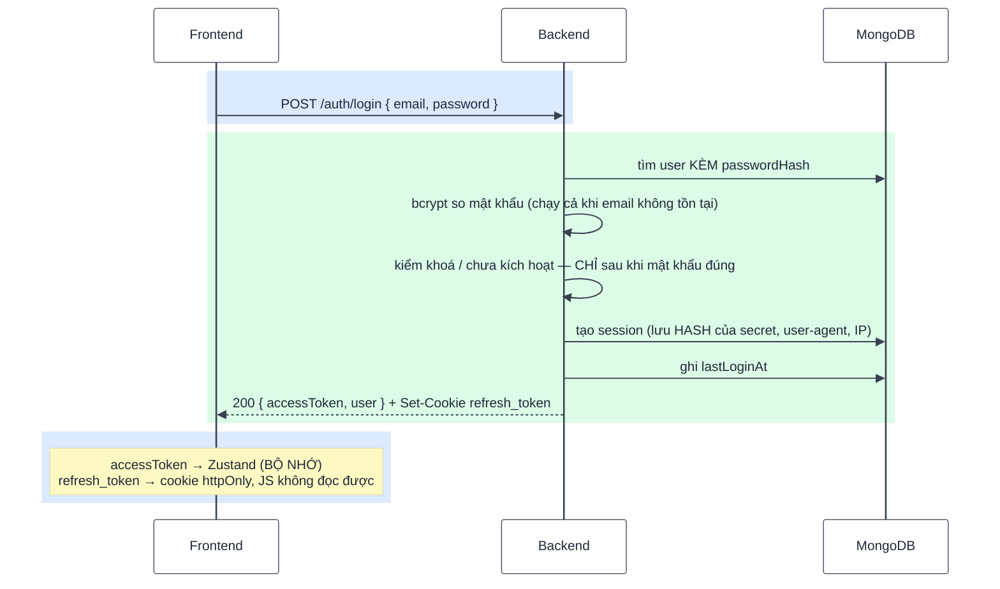
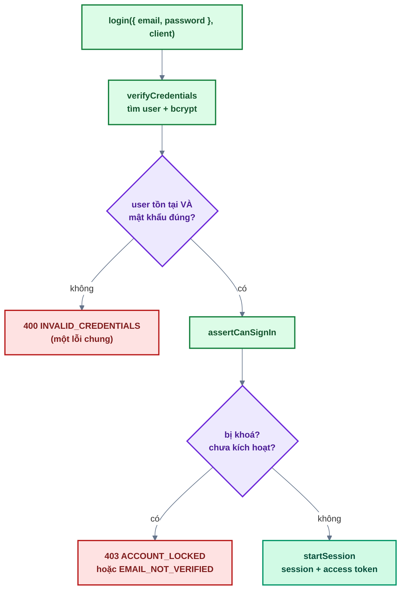

# Bài 04 — Đăng nhập

> Trước: [Bài 03](bai-03-email-va-xac-thuc-tai-khoan.md) · Mục lục: [README](README.md) · Tiếp: [Bài 05 — Bảo vệ route & phân quyền](bai-05-bao-ve-route-va-phan-quyen.md)

|                        |                                                                                                                                         |
| ---------------------- | --------------------------------------------------------------------------------------------------------------------------------------- |
| **Mục tiêu**           | Người dùng đã kích hoạt đăng nhập được: nhận access token (bộ nhớ) + refresh token (cookie httpOnly), và phiên xuất hiện trong database |
| **Thời gian**          | 3–4 giờ                                                                                                                                 |
| **Độ khó**             | ★★                                                                                                                                      |
| **Kiến thức**          | bcrypt verify · chống dò email bằng thời gian · JWT access token · session lưu hash · cookie httpOnly                                   |
| **Test BE**            | `npm test -w backend -- -t "bai-04"` — **7 test**, trong đó **6 test cần bạn làm**                                                      |
| **Test FE**            | `npm test -w frontend -- -t "bai-04"` — **6 test**, trong đó **5 test cần bạn làm**                                                     |
| **Chưa làm ở bài này** | Route riêng tư chưa được bảo vệ (bài 05); F5 vẫn mất phiên (bài 06)                                                                     |

## 1. Mô tả tính năng

> _Là người dùng đã kích hoạt, tôi đăng nhập bằng email + mật khẩu và vào được khu vực của mình._

### 1.1. Hai loại token, hai nơi cất



|            | Access token                         | Refresh token                                     |
| ---------- | ------------------------------------ | ------------------------------------------------- |
| Dạng       | JWT HS256, payload chỉ `sub` + `sid` | `<sessionId>.<secret>` ngẫu nhiên                 |
| Hạn        | 15 phút                              | 30 ngày (trượt)                                   |
| Ở frontend | **Bộ nhớ** (Zustand) — mất khi F5    | Cookie `httpOnly`, `path=/api/v1/auth`            |
| Ở server   | Không lưu                            | Collection `sessions` chỉ lưu **hash** của secret |

Vì sao chia đôi như vậy: xem lại [bài 01, câu 6](bai-01-doc-hieu-kien-truc.md#7-đáp-án).

### 1.2. Thứ tự kiểm tra trong `login` — chỗ dễ sai nhất



Hai quy tắc chống **dò email** trong sơ đồ này:

1. **Sai email và sai mật khẩu trả CÙNG một lỗi** `INVALID_CREDENTIALS`. Nếu tách thành "email
   không tồn tại" / "mật khẩu sai", kẻ tấn công dò ra danh sách email đã đăng ký.
2. **Chỉ báo `ACCOUNT_LOCKED` / `EMAIL_NOT_VERIFIED` sau khi mật khẩu đúng.** Nếu báo trước, bất kỳ
   ai cũng biết email đó có tài khoản và đang ở trạng thái nào.

Còn một quy tắc nữa không nhìn thấy trong sơ đồ: **luôn chạy bcrypt**, kể cả khi email không tồn
tại (so với một hash giả). bcrypt mất ~200ms; thoát sớm thì email lạ trả về trong ~1ms và **thời
gian phản hồi** trở thành kênh rò rỉ thông tin.

## 2. Kiến thức cần nắm trước

| Chủ đề                | Điểm cốt lõi                                                                                                           |
| --------------------- | ---------------------------------------------------------------------------------------------------------------------- |
| **`select: false`**   | `passwordHash` không được đọc ở truy vấn thường; phải dùng `findByEmailWithPassword`                                   |
| **Hash giả**          | `getDummyPasswordHash()` — hash của một chuỗi cố định, chỉ để tốn đúng bằng thời gian bcrypt thật                      |
| **JWT**               | `signAccessToken({ userId, sessionId })` → `sub` + `sid`. **Không** nhét role vào token                                |
| **Session**           | Bản ghi trong DB chỉ lưu **hash** của secret. Xoá bản ghi = thu hồi phiên ngay lập tức                                 |
| **Cookie httpOnly**   | `setRefreshTokenCookie(res, token)` — JS không đọc được, trình duyệt tự gửi kèm; `path=/api/v1/auth` giới hạn nơi nhận |
| **`skipAuthRefresh`** | Option của http client: endpoint này trả 401 thì **đừng** đi refresh rồi thử lại                                       |

## 3. Các file cần sửa

Tìm nhanh: `grep -rn "bai-04" backend/src frontend/src`

| Phía | File                                     | Hàm                                                             |
| ---- | ---------------------------------------- | --------------------------------------------------------------- |
| BE   | `modules/auth/auth.service.js`           | `verifyCredentials`, `assertCanSignIn`, `startSession`, `login` |
| BE   | `modules/sessions/sessions.service.js`   | `create`                                                        |
| BE   | `modules/auth/auth.controller.js`        | `login`                                                         |
| FE   | `features/auth/api/auth.api.js`          | `login`                                                         |
| FE   | `features/auth/hooks/useLogin.js`        | `onSuccess`                                                     |
| FE   | `features/auth/components/LoginForm.jsx` | `onSubmit`                                                      |

**Đọc thêm (không sửa):** `sessions.model.js`, `shared/utils/token.js` (`signAccessToken`),
`shared/utils/password.js`, `shared/utils/cookies.js`, `shared/lib/http.js` (chỗ gắn header
`Authorization`), `authStore.js`.

## 4. Đặc tả API

| Endpoint                  | Body                  | Thành công                                                              | Lỗi                                                                                                                       |
| ------------------------- | --------------------- | ----------------------------------------------------------------------- | ------------------------------------------------------------------------------------------------------------------------- |
| `POST /api/v1/auth/login` | `{ email, password }` | 200 `{ accessToken, user }` + `Set-Cookie: refresh_token=...; HttpOnly` | 400 `VALIDATION_ERROR` · 400 `INVALID_CREDENTIALS` · 403 `ACCOUNT_LOCKED` · 403 `EMAIL_NOT_VERIFIED` · 429 `RATE_LIMITED` |

- Rate limit: **10 lần / 15 phút / IP** (đã gắn sẵn ở route).
- `user` không bao giờ chứa `passwordHash` — `toJSON` của model đã loại bỏ.

## 5. Các bước thực hiện

### Phần A — Backend

Chạy sau mỗi bước: `npm test -w backend -- -t "bai-04"`.

> Test **"chặn NoSQL operator injection ở email/mật khẩu"** đã xanh sẵn — Zod ở `validate` từ chối
> object thay cho chuỗi trước khi tới service (bài 01, mục 2.2).

**A1. `sessionsService.create`** — làm trước, vì `startSession` cần nó.

**A2. `authService.verifyCredentials`** — đọc kỹ ba quy tắc ở mục 1.2.

**A3. `authService.assertCanSignIn`**.

**A4. `authService.startSession`** — dùng lại ở bài 09 và 10.

**A5. `authService.login`** — ba dòng, đúng thứ tự.

**A6. `authController.login`** — nhớ đặt cookie.

✅ 6 test đỏ chuyển xanh (7/7).

✅ Thử bằng `curl` — `-i` để nhìn header `Set-Cookie`:

```bash
curl -i -s -X POST localhost:4000/api/v1/auth/login \
  -H 'Content-Type: application/json' \
  -d '{"email":"an@example.com","password":"mat-khau-an-toan"}'
```

Kỳ vọng: `Set-Cookie: refresh_token=...; Path=/api/v1/auth; HttpOnly`, body có `accessToken` và
`user`, **không** có `passwordHash`.

Thử ba nhánh lỗi: sai mật khẩu, email không tồn tại (cả hai phải ra **cùng** `INVALID_CREDENTIALS`
và mất thời gian **xấp xỉ bằng nhau** — thêm `-w '\n%{time_total}s\n'` để đo), và tài khoản chưa
kích hoạt.

Kiểm trong database: collection `sessions` có bản ghi mới với `secretHash`, `userAgent`, `ip`;
user có `lastLoginAt`.

### Phần B — Frontend

**B1. `authApi.login`** — khác hai hàm trước ở `skipAuthRefresh` và `response.data.data`.

**B2. `useLogin`** — thêm `onSuccess`.

**B3. `LoginForm.onSubmit`**.

✅ 5 test đỏ chuyển xanh (6/6).

✅ Trên trình duyệt: đăng nhập → vào dashboard, header hiện menu người dùng. Mở DevTools:

- **Application → Cookies**: có `refresh_token`, cột **HttpOnly** được tích.
- **Console**: gõ `document.cookie` → **không** thấy `refresh_token` (đó là ý nghĩa của httpOnly).
- **Network**: request tiếp theo có header `Authorization: Bearer ...`.

> **F5 bây giờ sẽ đá bạn về trang đăng nhập** — access token nằm trong bộ nhớ nên mất khi tải lại
> trang. Khôi phục phiên là việc của [bài 06](bai-06-refresh-token-va-dang-xuat.md).

## 6. Tiêu chí hoàn thành

- [ ] `npm test -w backend -- -t "bai-04"` → 7/7 xanh; frontend → 6/6 xanh
- [ ] Test bài 01–03 vẫn xanh
- [ ] `npm run build && npm run format:check && npm run check` sạch
- [ ] Sai mật khẩu và email không tồn tại → **cùng** `INVALID_CREDENTIALS`, thời gian xấp xỉ nhau
- [ ] Tài khoản chưa kích hoạt → `EMAIL_NOT_VERIFIED`, và trang đăng nhập hiện link gửi lại email
- [ ] Cookie `refresh_token` có `HttpOnly`; `document.cookie` không thấy nó
- [ ] Trong `sessions`: có `secretHash`, **không** có secret dạng gốc
- [ ] Đánh dấu `[x] Bài 04` trong [CHECKLIST.md](../../CHECKLIST.md) rồi commit

## 7. Câu hỏi & thử thách mở rộng

1. Thử thách: trong `verifyCredentials`, thêm `if (!user) throw ...` ngay sau khi tìm user (thoát
   sớm, không chạy bcrypt). Test nào đỏ? Nếu không có test đó, bạn sẽ phát hiện lỗi bằng cách nào?
2. Vì sao access token chỉ chứa `sub` và `sid`, mà không nhét luôn `role` vào cho đỡ phải truy vấn?
3. Cookie refresh có `path=/api/v1/auth` thay vì `/`. Được gì?
4. Thử thách: bỏ `skipAuthRefresh: true` trong `authApi.login`, rồi đăng nhập sai mật khẩu vài
   lần. Mở tab Network — bạn thấy gì?
5. `startSession` lưu `hashToken(secret)` chứ không lưu `secret`. Nhưng refresh token vẫn nằm
   trong cookie của người dùng. Vậy lưu hash chặn được kẻ tấn công nào?

## 8. Gợi ý

<details>
<summary><b>Cấp 1 — Định hướng</b></summary>

- **`sessionsService.create`**: 3 bước — sinh secret, `Session.create`, trả object. Nhớ
  `.slice(0, USER_AGENT_MAX_LENGTH)`.
- **`verifyCredentials`**: tìm user → chọn hash (thật hoặc giả) → `verifyPassword` → **một** câu
  `if` gộp cả ba trường hợp lỗi → trả user. Chú ý `user?.passwordHash` (optional chaining).
- **`assertCanSignIn`**: hai câu `if`, không trả gì.
- **`startSession`**: `sessionsService.create` → `usersService.recordLogin` → trả object có
  `signAccessToken({ userId, sessionId })`.
- **`login`**: ba dòng.
- **`controller.login`**: destructure ba giá trị, `setRefreshTokenCookie`, `sendSuccess` với
  **chỉ** `{ accessToken, user }`.
- **FE**: `login` có option thứ ba và trả `response.data.data`; `useLogin` thêm `onSuccess`;
  `onSubmit` chỉ cần `onError`.

</details>

<details>
<summary><b>Cấp 2 — Pseudo-code</b></summary>

```text
sessions.create({ userId, userAgent, ip }):
  secret = generateToken(); now = bây giờ
  session = await Session.create({ userId,
                                   secretHash: hashToken(secret),
                                   userAgent: cắt còn USER_AGENT_MAX_LENGTH,
                                   ip, lastUsedAt: now,
                                   expiresAt: now + REFRESH_TOKEN_TTL_MS })
  return { session, refreshToken: buildRefreshToken(session._id, secret) }

verifyCredentials(email, password):
  user = await findByEmailWithPassword(email)
  passwordHash = user?.passwordHash ?? await getDummyPasswordHash()
  isPasswordValid = await verifyPassword(password, passwordHash)
  nếu !user?.passwordHash HOẶC !isPasswordValid
     → throw AppError(400, INVALID_CREDENTIALS, 'Email hoặc mật khẩu không đúng')
  return user

assertCanSignIn(user):
  nếu user.lockedAt → throw AppError(403, ACCOUNT_LOCKED, ...)
  nếu !user.emailVerifiedAt → throw AppError(403, EMAIL_NOT_VERIFIED, ...)

startSession(user, { userAgent, ip }):
  { session, refreshToken } = await sessionsService.create({ userId: user._id, userAgent, ip })
  signedInUser = await usersService.recordLogin(user._id)
  return { accessToken: signAccessToken({ userId: user._id, sessionId: session._id }),
           refreshToken, user: signedInUser }

login({ email, password }, client):
  user = await verifyCredentials(email, password)
  assertCanSignIn(user)
  return startSession(user, client)

controller.login(req, res):
  { accessToken, refreshToken, user } = await authService.login(req.validated.body, getClientInfo(req))
  setRefreshTokenCookie(res, refreshToken)
  sendSuccess(res, { accessToken, user }, 'Đăng nhập thành công')

api.login(body):
  response = await http.post('/auth/login', body, { skipAuthRefresh: true })
  return response.data.data

useLogin: useMutation({ mutationFn: login, onSuccess: (session) => setSession(session) })

onSubmit(values):
  loginMutation.mutate(values, { onError: (e) => applyServerErrors(e, setError, FIELD_NAMES) })
```

</details>

<details>
<summary><b>Cấp 3 — Code tham khảo (backend)</b></summary>

```js
// sessions.service.js
async function create({ userId, userAgent = '', ip = '' }) {
  const secret = generateToken();
  const now = new Date();

  const session = await Session.create({
    userId,
    secretHash: hashToken(secret),
    userAgent: userAgent.slice(0, USER_AGENT_MAX_LENGTH),
    ip,
    lastUsedAt: now,
    expiresAt: new Date(now.getTime() + REFRESH_TOKEN_TTL_MS),
  });

  return { session, refreshToken: buildRefreshToken(session._id, secret) };
}
```

```js
// auth.service.js
async function verifyCredentials(email, password) {
  const user = await usersService.findByEmailWithPassword(email);
  const passwordHash = user?.passwordHash ?? (await getDummyPasswordHash());
  const isPasswordValid = await verifyPassword(password, passwordHash);

  // Tài khoản chỉ đăng nhập bằng Google (chưa có mật khẩu) cũng rơi vào đây.
  if (!user?.passwordHash || !isPasswordValid) {
    throw new AppError({
      statusCode: 400,
      code: ERROR_CODES.INVALID_CREDENTIALS,
      message: 'Email hoặc mật khẩu không đúng',
    });
  }
  return user;
}

function assertCanSignIn(user) {
  if (user.lockedAt) {
    throw new AppError({
      statusCode: 403,
      code: ERROR_CODES.ACCOUNT_LOCKED,
      message: 'Tài khoản đã bị khoá. Vui lòng liên hệ quản trị viên',
    });
  }
  if (!user.emailVerifiedAt) {
    throw new AppError({
      statusCode: 403,
      code: ERROR_CODES.EMAIL_NOT_VERIFIED,
      message: 'Tài khoản chưa được kích hoạt. Vui lòng xác thực email',
    });
  }
}

async function startSession(user, { userAgent, ip }) {
  const { session, refreshToken } = await sessionsService.create({
    userId: user._id,
    userAgent,
    ip,
  });
  const signedInUser = await usersService.recordLogin(user._id);

  return {
    accessToken: signAccessToken({ userId: user._id, sessionId: session._id }),
    refreshToken,
    user: signedInUser,
  };
}

async function login({ email, password }, client) {
  const user = await verifyCredentials(email, password);
  assertCanSignIn(user);
  return startSession(user, client);
}
```

```js
// auth.controller.js
async function login(req, res) {
  const { accessToken, refreshToken, user } = await authService.login(
    req.validated.body,
    getClientInfo(req),
  );
  setRefreshTokenCookie(res, refreshToken);
  sendSuccess(res, { accessToken, user }, 'Đăng nhập thành công');
}
```

</details>

<details>
<summary><b>Cấp 3 — Code tham khảo (frontend)</b></summary>

```js
// features/auth/api/auth.api.js
export async function login(body) {
  const response = await http.post('/auth/login', body, { skipAuthRefresh: true });
  return response.data.data;
}
```

```js
// features/auth/hooks/useLogin.js
return useMutation({
  mutationFn: login,
  onSuccess: (session) => setSession(session),
});
```

```jsx
// features/auth/components/LoginForm.jsx
const onSubmit = (values) => {
  loginMutation.mutate(values, {
    onError: (error) => applyServerErrors(error, setError, FIELD_NAMES),
  });
};
```

</details>

<details>
<summary><b>Đáp án câu hỏi mục 7</b></summary>

**1.** Test **"sai mật khẩu và email không tồn tại → cùng một lỗi, không tạo session"** vẫn xanh —
nó chỉ kiểm mã lỗi, không đo thời gian. Lỗi rò rỉ qua **thời gian phản hồi** rất khó viết test tự
động cho ổn định (phụ thuộc tải máy), nên ở đây nó được giữ bằng **code review + chú thích trong
code**, không phải bằng test.

Phát hiện bằng tay: gọi `curl` hai lần với `-w '%{time_total}'`, một lần email có thật + mật khẩu
sai, một lần email không tồn tại. Nếu chênh nhau khoảng một bậc độ lớn (~1ms so với ~200ms) là có
lỗ hổng. Đây là lý do chú thích "hash cả khi không dùng" phải nằm ngay trong code — người sửa sau
này không có test nào chặn họ.

**2.** Vì **thu hồi quyền phải có hiệu lực ngay**. Role nằm trong token thì token đã phát ra vẫn
mang role cũ cho tới khi hết hạn: admin hạ quyền một người lúc 10:00, người đó vẫn vào được khu
quản trị tới 10:15. Tương tự với khoá tài khoản và thu hồi phiên.

Đọc role từ database mỗi request (bài 05) tốn thêm một truy vấn, nhưng đổi lại mọi thay đổi có
hiệu lực tức thì. Với quy mô source base này, đó là đánh đổi đúng. Ở quy mô rất lớn người ta dùng
token ngắn hạn + danh sách thu hồi, nhưng phức tạp hơn nhiều.

**3.** Trình duyệt chỉ gửi cookie kèm request có đường dẫn khớp `path`. Với `path=/api/v1/auth`,
refresh token **không** được gửi kèm hàng trăm request thường (`/users/me`, `/files`, …) — nó chỉ
xuất hiện ở đúng ba endpoint cần nó (`/auth/refresh`, `/auth/logout`, và khi đăng nhập).

Bề mặt tấn công nhỏ lại: mỗi lần token đi qua mạng hay qua log của proxy là một cơ hội lộ. Ít đi
là tốt hơn. Đây là nguyên tắc đặc quyền tối thiểu áp cho cookie.

**4.** Mỗi lần đăng nhập sai sẽ sinh **thêm** một request `POST /auth/refresh`: http client thấy
401 và tưởng access token hết hạn nên đi làm mới. Refresh cũng thất bại (chưa có phiên), rồi
interceptor gọi `onSessionExpired` → dọn phiên phía client và có thể hiện toast "Phiên đăng nhập
đã hết hạn" — một thông báo vô nghĩa với người vừa gõ sai mật khẩu.

`skipAuthRefresh: true` nói với client: "endpoint này là nơi _lấy_ phiên, 401 ở đây là câu trả lời
cuối cùng, đừng thử lại". Cùng lý do đó, `refreshSession` và `logout` cũng gắn cờ này.

**5.** Chặn kẻ **đọc được database** nhưng không chạm vào trình duyệt người dùng: bản backup lọt ra
ngoài, một lỗ hổng cho phép truy vấn, hoặc một nhân viên có quyền đọc DB. Với hash, họ thấy
`secretHash` nhưng không dựng lại được cookie hợp lệ.

Nó **không** chặn kẻ đã lấy được cookie từ máy nạn nhân — chuyện đó do `httpOnly`, `Secure`,
`SameSite` và cơ chế phát hiện token bị dùng lại (bài 06) lo. Mỗi lớp chặn một hướng tấn công
khác nhau; đó là lý do cần nhiều lớp.

</details>

---

> Trước: [Bài 03](bai-03-email-va-xac-thuc-tai-khoan.md) · Mục lục: [README](README.md) · Tiếp: [Bài 05 — Bảo vệ route & phân quyền](bai-05-bao-ve-route-va-phan-quyen.md)
