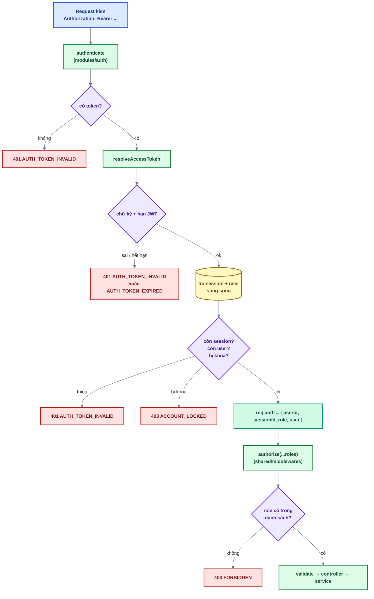
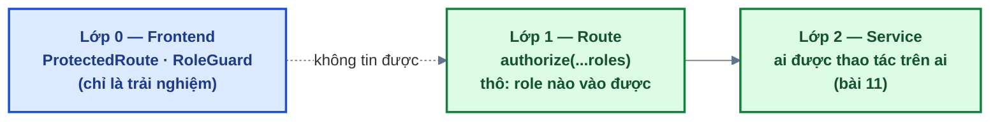

# Bài 05 — Bảo vệ route & phân quyền

> Trước: [Bài 04](bai-04-dang-nhap.md) · Mục lục: [README](README.md) · Tiếp: [Bài 06 — Refresh token & đăng xuất](bai-06-refresh-token-va-dang-xuat.md)

|               |                                                                                                                                                            |
| ------------- | ---------------------------------------------------------------------------------------------------------------------------------------------------------- |
| **Mục tiêu**  | Mọi route riêng tư chỉ nhận access token hợp lệ; khu quản trị chặn theo vai trò; frontend đưa khách về trang đăng nhập. Phần thưởng: trang Hồ sơ chạy được |
| **Thời gian** | 3–4 giờ                                                                                                                                                    |
| **Độ khó**    | ★★                                                                                                                                                         |
| **Kiến thức** | Middleware Express · middleware factory · phân quyền 2 lớp · guard phía client · thu hồi quyền có hiệu lực ngay                                            |
| **Test BE**   | `npm test -w backend -- -t "bai-05"` — **19 test**, **tất cả cần bạn làm**                                                                                 |
| **Test FE**   | `npm test -w frontend -- -t "bai-05"` — **8 test**, trong đó **4 test cần bạn làm**                                                                        |
| **Mở khoá**   | Từ bài này trở đi, **mọi** route có `authenticate` bắt đầu hoạt động. Đây là cổng gác của tất cả các bài sau                                               |

## 1. Mô tả tính năng

> _Là hệ thống, tôi chỉ phục vụ API riêng tư cho người đã đăng nhập, và chỉ phục vụ API quản trị
> cho đúng vai trò — kể cả khi người dùng vừa bị khoá hay vừa bị đăng xuất từ xa một phút trước._

### 1.1. Dây chuyền middleware của một route riêng tư



**Điểm cốt lõi: `resolveAccessToken` tra database ở MỌI request**, dù JWT còn hạn.

Token đã phát ra thì không thu hồi được — nó là một tờ giấy có chữ ký, ai cầm cũng dùng được cho
tới khi hết hạn. Tra database mỗi request làm ba việc có hiệu lực **ngay lập tức**:

| Việc                | Xảy ra ở | Không tra DB thì sao                                      |
| ------------------- | -------- | --------------------------------------------------------- |
| Thu hồi phiên từ xa | bài 07   | Thiết bị bị "đăng xuất" vẫn dùng được thêm tối đa 15 phút |
| Khoá tài khoản      | bài 11   | Người bị khoá vẫn thao tác được thêm 15 phút              |
| Đổi vai trò         | bài 11   | Người vừa bị hạ quyền vẫn vào khu quản trị thêm 15 phút   |

Giá phải trả là hai truy vấn nhỏ mỗi request (chạy song song bằng `Promise.all`, đều theo index).
Với quy mô source base này, đổi như vậy là đúng.

### 1.2. Phân quyền hai lớp



- **Lớp 0 (frontend)** chỉ để người dùng không nhìn thấy nút mình không bấm được. Ai cũng sửa được
  state trong trình duyệt, nên nó **không phải** lớp bảo mật.
- **Lớp 1 (`authorize`)** chặn thô theo vai trò, ngay ở route.
- **Lớp 2 (service)** trả lời câu hỏi chi tiết "ADMIN này có được khoá ADMIN kia không?" — bài 11.

Bài này làm lớp 0 và lớp 1.

### 1.3. `authorize` là một **factory** — bẫy lớn nhất của bài

```js
adminUsersRouter.use(authenticate, authorize(...ADMIN_ROLES));
//                                 ^^^^^^^^^^^^^^^^^^^^^^^^^
//                                 chạy NGAY khi file routes được import
```

`authorize('ADMIN')` **không** xử lý request — nó chạy **một lần lúc nạp module** và phải trả về
một middleware. Mọi kiểm tra chỉ được đặt **bên trong** middleware đó.

Nếu bạn ném lỗi ngay trong thân `authorize` (ngoài middleware), lỗi xảy ra lúc `import` → **toàn
bộ backend không khởi động được**, không phải một request lỗi. Cùng cái bẫy đó xuất hiện lại ở
`create*Routes()` (frontend) và ở registry của bài 14.

## 2. Kiến thức cần nắm trước

| Chủ đề                              | Điểm cốt lõi                                                                                                                                |
| ----------------------------------- | ------------------------------------------------------------------------------------------------------------------------------------------- |
| **Middleware Express**              | `(req, res, next)`. **Phải gọi `next()`** khi cho đi tiếp, nếu không request treo tới timeout                                               |
| **Middleware factory**              | Hàm trả về middleware, để "cấu hình" nó lúc khai báo route (`authorize('ADMIN')`)                                                           |
| **`req.auth`**                      | Do `authenticate` đặt: `{ userId, sessionId, role, user }`. Mọi controller lấy danh tính từ đây, **không** từ body                          |
| **Lỗi lập trình vs lỗi người dùng** | Đặt `authorize` trước `authenticate` là lỗi của lập trình viên → `Error` thường → 500 + log. Sai vai trò là lỗi người dùng → `AppError` 403 |
| **`Promise.all`**                   | Hai truy vấn độc lập chạy song song thay vì nối tiếp                                                                                        |
| **`<Outlet />`**                    | Chỗ React Router render route con. Guard trả `<Outlet />` = cho đi tiếp                                                                     |
| **`<Navigate replace />`**          | Chuyển trang **và** thay thế mục lịch sử — không có `replace` thì bấm Back sẽ kẹt vòng lặp                                                  |

## 3. Các file cần sửa

Tìm nhanh: `grep -rn "bai-05" backend/src frontend/src`

| Phía | File                                          | Hàm                       |
| ---- | --------------------------------------------- | ------------------------- |
| BE   | `modules/auth/auth.middleware.js`             | `authenticate`            |
| BE   | `modules/auth/auth.service.js`                | `resolveAccessToken`      |
| BE   | `modules/sessions/sessions.service.js`        | `findActive`              |
| BE   | `shared/middlewares/authorize.js`             | `authorize` (**factory**) |
| BE   | `modules/users/users.service.js`              | `updateProfile`           |
| BE   | `modules/users/users.controller.js`           | `getMe`, `updateMe`       |
| FE   | `app/router/guards/ProtectedRoute.jsx`        | thân component            |
| FE   | `app/router/guards/RoleGuard.jsx`             | thân component            |
| FE   | `features/account/api/account.api.js`         | `updateMe`                |
| FE   | `features/account/hooks/useUpdateProfile.js`  | `onSuccess`               |
| FE   | `features/account/components/ProfileForm.jsx` | `onSubmit`                |

**Đọc thêm (không sửa):** `app/router/guards/GuestOnly.jsx` — guard đối xứng, **đã viết sẵn làm
mẫu**; `shared/constants/roles.js`; `users.routes.js` (thứ tự middleware); `shared/lib/redirect.js`
(`getSafeRedirect`).

## 4. Đặc tả API

| Endpoint                 | Thành công                                           | Lỗi                          |
| ------------------------ | ---------------------------------------------------- | ---------------------------- |
| `GET /api/v1/users/me`   | 200 `{ data: user }`                                 | 401 · 403 `ACCOUNT_LOCKED`   |
| `PATCH /api/v1/users/me` | 200 `{ data: user }` + `'Cập nhật hồ sơ thành công'` | 400 `VALIDATION_ERROR` · 401 |

Quy ước mã lỗi của bài này (xem lại [bài 01, mục 2.4](bai-01-doc-hieu-kien-truc.md)):

| Tình huống                               | Status  | Code                                                                  |
| ---------------------------------------- | ------- | --------------------------------------------------------------------- |
| Không có header / token rác / sai chữ ký | 401     | `AUTH_TOKEN_INVALID`                                                  |
| Token hết hạn                            | 401     | `AUTH_TOKEN_EXPIRED` (frontend dựa vào mã này để tự refresh ở bài 06) |
| Phiên bị thu hồi / user bị xoá           | 401     | `AUTH_TOKEN_INVALID`                                                  |
| Tài khoản bị khoá                        | **403** | `ACCOUNT_LOCKED`                                                      |
| Sai vai trò                              | **403** | `FORBIDDEN`                                                           |

> Tài khoản bị khoá trả **403 chứ không phải 401**. 401 nghĩa là "token của bạn không dùng được,
> hãy làm mới" — frontend sẽ đi refresh và thử lại vô ích. 403 nghĩa là "token tốt, nhưng bạn
> không được phép".

## 5. Các bước thực hiện

### Phần A — Backend

Chạy sau mỗi bước: `npm test -w backend -- -t "bai-05"`.

**A1. `sessionsService.findActive`** — ba điều kiện, đừng quên `userId`.

**A2. `authService.resolveAccessToken`** — theo sơ đồ 1.1.

**A3. `authenticate`** — nhớ `next()`.

✅ 11 test `authenticate` chuyển xanh.

**A4. `authorize`** — đọc kỹ mục 1.3 trước khi viết.

✅ 4 test `authorize` chuyển xanh.

**A5. `usersService.updateProfile`** và **A6. `usersController.getMe` / `updateMe`**.

✅ Cả 19 test `[bai-05]` xanh.

✅ Thử bằng `curl` — lấy access token từ bước đăng nhập ở bài 04:

```bash
TOKEN=$(curl -s -X POST localhost:4000/api/v1/auth/login \
  -H 'Content-Type: application/json' \
  -d '{"email":"an@example.com","password":"mat-khau-an-toan"}' \
  | sed -E 's/.*"accessToken":"([^"]*)".*/\1/')

curl -s localhost:4000/api/v1/users/me -H "Authorization: Bearer $TOKEN"   # 200
curl -s localhost:4000/api/v1/users/me                                      # 401
curl -s localhost:4000/api/v1/users/me -H "Authorization: Bearer rac"       # 401
curl -s localhost:4000/api/v1/admin/users -H "Authorization: Bearer $TOKEN" # 403 (MEMBER)
```

Thử nốt việc **thu hồi có hiệu lực ngay**: xoá bản ghi trong collection `sessions` (Atlas UI /
Compass) rồi gọi lại `/users/me` với **cùng** token → phải nhận 401 ngay, không chờ 15 phút.

### Phần B — Frontend

**B1. `ProtectedRoute`** và **B2. `RoleGuard`** — `GuestOnly.jsx` là mẫu.

**B3–B5.** `accountApi.updateMe`, `useUpdateProfile`, `ProfileForm.onSubmit`.

✅ 4 test đỏ chuyển xanh (8/8).

✅ Trên trình duyệt:

- Chưa đăng nhập, mở thẳng `/account/profile` → về `/login?redirect=%2Faccount%2Fprofile`. Đăng
  nhập xong → quay lại đúng trang hồ sơ.
- Đăng nhập bằng tài khoản MEMBER, mở `/admin` → trang 403 (không phải trang trắng).
- Đổi tên ở trang Hồ sơ → toast thành công, **tên trên header đổi ngay** không cần F5.

> F5 vẫn còn đá bạn về trang đăng nhập — đó là bài 06.

## 6. Tiêu chí hoàn thành

- [ ] `npm test -w backend -- -t "bai-05"` → 19/19 xanh; frontend → 8/8 xanh
- [ ] Test bài 01–04 vẫn xanh
- [ ] `npm run build && npm run format:check && npm run check` sạch
- [ ] Xoá session trong DB → request tiếp theo với token cũ nhận 401 **ngay**
- [ ] MEMBER gọi `/admin/users` → 403 `FORBIDDEN`; không đăng nhập gọi → **401** (không lộ 403)
- [ ] Khách mở trang riêng tư → về `/login?redirect=...`, đăng nhập xong quay lại đúng trang
- [ ] Đổi tên ở trang Hồ sơ → header cập nhật ngay
- [ ] Đánh dấu `[x] Bài 05` trong [CHECKLIST.md](../../CHECKLIST.md) rồi commit

## 7. Câu hỏi & thử thách mở rộng

1. Thử thách: trong `authorize`, chuyển câu lệnh ném `AppError` ra **ngoài** middleware (đặt ngay
   trong thân `authorize`). Chạy `npm run dev`. Chuyện gì xảy ra, và vì sao nó tệ hơn một lỗi
   thường rất nhiều?
2. Thử thách: bỏ `userId` khỏi filter của `findActive`. Test nào đỏ? Mô tả cuộc tấn công.
3. Người **chưa đăng nhập** gọi `/admin/users` nhận 401, còn MEMBER **đã đăng nhập** nhận 403. Vì
   sao không trả 403 cho cả hai?
4. Guard phía frontend có thể bị vô hiệu hoàn toàn bằng DevTools. Vậy giữ nó làm gì?
5. Thử thách: trong `authenticate`, xoá `next()`. Gọi `/users/me`. Bạn thấy gì, và vì sao lỗi kiểu
   này khó tìm?

## 8. Gợi ý

<details>
<summary><b>Cấp 1 — Định hướng</b></summary>

- **`findActive`**: một `Session.findOne` với ba điều kiện.
- **`resolveAccessToken`**: `verifyAccessToken` trả `{ sub, sid }` — nhớ đổi tên khi destructure.
  `Promise.all` hai truy vấn. Hai câu `if`. Trả object với `String(...)` cho hai id.
- **`authenticate`**: `req.get('authorization') ?? ''`, `startsWith` + `slice`, một `if`, rồi gán
  `req.auth` và `next()`.
- **`authorize`**: **giữ nguyên** `return (req, _res, next) => { ... }`; chỉ viết phần trong thân.
- **`updateProfile`**: giống `markEmailVerified` bài 03 nhưng dùng `findByIdAndUpdate`, không có
  điều kiện thêm.
- **`getMe`**: một dòng, không truy vấn.
- **Guard FE**: xem `GuestOnly.jsx`.

</details>

<details>
<summary><b>Cấp 2 — Pseudo-code</b></summary>

```text
findActive({ sessionId, userId }):
  return Session.findOne({ _id: sessionId, userId,
                           expiresAt: mongoose.trusted({ $gt: bây giờ }) })

resolveAccessToken(accessToken):
  { sub: userId, sid: sessionId } = verifyAccessToken(accessToken)
  [session, user] = await Promise.all([ findActive({ sessionId, userId }),
                                        usersService.findById(userId) ])
  nếu !session hoặc !user → throw AppError(401, AUTH_TOKEN_INVALID,
                                           'Phiên đăng nhập đã hết hạn hoặc bị thu hồi')
  nếu user.lockedAt → throw AppError(403, ACCOUNT_LOCKED, ...)
  return { userId: String(user._id), sessionId: String(session._id), role: user.role, user }

authenticate(req, _res, next):
  header = req.get('authorization') ?? ''
  accessToken = header bắt đầu bằng BEARER_PREFIX ? phần sau : ''
  nếu !accessToken → throw AppError(401, AUTH_TOKEN_INVALID, 'Vui lòng đăng nhập')
  req.auth = await authService.resolveAccessToken(accessToken)
  next()

authorize(...allowedRoles):
  return (req, _res, next) => {
    nếu !req.auth → throw new Error('authorize() phải được đặt sau authenticate')
    nếu !allowedRoles.includes(req.auth.role) → throw AppError(403, FORBIDDEN, ...)
    next()
  }

updateProfile(userId, { name }):
  return User.findByIdAndUpdate(userId, { $set: { name } },
                                { returnDocument: 'after', runValidators: true })

getMe(req, res):  sendSuccess(res, req.auth.user)
updateMe(req, res):
  user = await usersService.updateProfile(req.auth.userId, req.validated.body)
  sendSuccess(res, user, 'Cập nhật hồ sơ thành công')

ProtectedRoute:
  nếu !currentUser:
     redirect = location.pathname + location.search
     return <Navigate to={LOGIN + '?' + new URLSearchParams({ redirect })} replace />
  return <Outlet />

RoleGuard({ roles }):
  nếu !currentUser hoặc !roles.includes(currentUser.role) → return <ForbiddenPage />
  return <Outlet />
```

</details>

<details>
<summary><b>Cấp 3 — Code tham khảo (backend)</b></summary>

```js
// sessions.service.js
async function findActive({ sessionId, userId }) {
  return Session.findOne({
    _id: sessionId,
    userId,
    expiresAt: mongoose.trusted({ $gt: new Date() }),
  });
}
```

```js
// auth.service.js
async function resolveAccessToken(accessToken) {
  const { sub: userId, sid: sessionId } = verifyAccessToken(accessToken);

  const [session, user] = await Promise.all([
    sessionsService.findActive({ sessionId, userId }),
    usersService.findById(userId),
  ]);

  if (!session || !user) {
    throw new AppError({
      statusCode: 401,
      code: ERROR_CODES.AUTH_TOKEN_INVALID,
      message: 'Phiên đăng nhập đã hết hạn hoặc bị thu hồi',
    });
  }
  if (user.lockedAt) {
    throw new AppError({
      statusCode: 403,
      code: ERROR_CODES.ACCOUNT_LOCKED,
      message: 'Tài khoản đã bị khoá. Vui lòng liên hệ quản trị viên',
    });
  }

  return { userId: String(user._id), sessionId: String(session._id), role: user.role, user };
}
```

```js
// auth.middleware.js
export async function authenticate(req, _res, next) {
  const header = req.get('authorization') ?? '';
  const accessToken = header.startsWith(BEARER_PREFIX) ? header.slice(BEARER_PREFIX.length) : '';

  if (!accessToken) {
    throw new AppError({
      statusCode: 401,
      code: ERROR_CODES.AUTH_TOKEN_INVALID,
      message: 'Vui lòng đăng nhập',
    });
  }

  req.auth = await authService.resolveAccessToken(accessToken);
  next();
}
```

```js
// shared/middlewares/authorize.js
export function authorize(...allowedRoles) {
  return (req, _res, next) => {
    if (!req.auth) {
      throw new Error('authorize() phải được đặt sau authenticate');
    }
    if (!allowedRoles.includes(req.auth.role)) {
      throw new AppError({
        statusCode: 403,
        code: ERROR_CODES.FORBIDDEN,
        message: 'Bạn không có quyền thực hiện thao tác này',
      });
    }
    next();
  };
}
```

```js
// users.service.js
async function updateProfile(userId, { name }) {
  return User.findByIdAndUpdate(
    userId,
    { $set: { name } },
    { returnDocument: 'after', runValidators: true },
  );
}
```

```js
// users.controller.js
async function getMe(req, res) {
  sendSuccess(res, req.auth.user);
}

async function updateMe(req, res) {
  const user = await usersService.updateProfile(req.auth.userId, req.validated.body);
  sendSuccess(res, user, 'Cập nhật hồ sơ thành công');
}
```

</details>

<details>
<summary><b>Cấp 3 — Code tham khảo (frontend)</b></summary>

```jsx
// app/router/guards/ProtectedRoute.jsx
export function ProtectedRoute() {
  const currentUser = useCurrentUser();
  const location = useLocation();

  if (!currentUser) {
    const redirect = `${location.pathname}${location.search}`;
    const params = new URLSearchParams({ redirect });
    return <Navigate to={`${ROUTES.AUTH.LOGIN}?${params}`} replace />;
  }

  return <Outlet />;
}
```

```jsx
// app/router/guards/RoleGuard.jsx
export function RoleGuard({ roles }) {
  const currentUser = useCurrentUser();

  if (!currentUser || !roles.includes(currentUser.role)) return <ForbiddenPage />;

  return <Outlet />;
}
```

```js
// features/account/api/account.api.js
export async function updateMe(body) {
  const response = await http.patch('/users/me', body);
  return response.data;
}
```

```js
// features/account/hooks/useUpdateProfile.js
return useMutation({
  mutationFn: updateMe,
  onSuccess: (body) => setUser(body.data),
});
```

```jsx
// features/account/components/ProfileForm.jsx
const onSubmit = (values) => {
  updateMutation.mutate(values, {
    onSuccess: (body) => toast.success(body.message),
    onError: (error) => applyServerErrors(error, setError, ['name']),
  });
};
```

</details>

<details>
<summary><b>Đáp án câu hỏi mục 7</b></summary>

**1.** `npm run dev` **không khởi động được**: backend tắt ngay lúc import `*.routes.js`, trước khi
mở cổng. Không có request nào chạy, `/health` cũng không trả lời.

Tệ hơn lỗi thường ở hai điểm. Một là **phạm vi**: một lỗi lúc xử lý request chỉ hỏng request đó,
còn lỗi lúc nạp module hỏng cả ứng dụng. Hai là **chẩn đoán**: log không chỉ vào route nào, chỉ có
một stack trace lúc import — bạn không biết bắt đầu tìm từ đâu.

Đây là lý do mọi factory (`authorize`, `create*Routes()`, registry của bài 14) phải **chỉ trả về**
thứ gì đó, và dồn mọi việc có thể thất bại vào bên trong hàm được trả về.

**2.** Test **"session của user khác không dùng được (sub và sid phải khớp)"** sẽ đỏ.

Cuộc tấn công: `sid` là ObjectId của session, không phải bí mật — nó nằm trong access token của
chính kẻ tấn công, và ObjectId của MongoDB có phần timestamp nên đoán được các giá trị lân cận.
Nếu `findActive` chỉ lọc theo `_id`, kẻ tấn công ký... không, hắn không ký được JWT (không có
secret). Nhưng kịch bản thật là **chính chủ session cũ**: một người có hai tài khoản, dùng `sid`
của tài khoản A ghép với `sub` của tài khoản B — và nếu ở đâu đó trong hệ thống có chỗ phát token
lỏng lẻo hơn, sự bất khớp đó lọt qua. Nguyên tắc chung: **mọi truy vấn theo id do client cung cấp
đều phải kèm điều kiện sở hữu**. Bài 07 áp đúng nguyên tắc này để chống IDOR.

**3.** Vì hai tình huống cần hai hành động khác nhau ở phía client.

- **401** = "tôi không biết bạn là ai" → frontend đi refresh token (bài 06), và nếu vẫn hỏng thì
  đưa về trang đăng nhập. Đó là việc đúng cho người chưa đăng nhập.
- **403** = "tôi biết bạn là ai, và bạn không được phép" → hiển thị trang 403. Đi refresh ở đây là
  vô ích: token vẫn tốt.

Trả 403 cho khách sẽ khiến trang hiện "Bạn không có quyền" thay vì mời đăng nhập — và có test cho
đúng điều đó: _"chưa đăng nhập mở khu quản trị → về đăng nhập (không lộ trang 403)"_.

**4.** Vì guard giải quyết vấn đề **trải nghiệm**, không phải vấn đề bảo mật — và đó là hai việc
khác nhau, cần hai giải pháp khác nhau.

Không có guard: khách mở `/admin` sẽ thấy khung trang admin hiện ra, rồi hàng loạt API trả 401, rồi
một mớ thông báo lỗi. Có guard: một lần chuyển hướng gọn tới trang đăng nhập.

Điều quan trọng là **không được đổi vai**: guard biến mất thì hệ thống xấu đi về trải nghiệm chứ
không mất an toàn, vì backend vẫn kiểm tra mọi request. Nếu xoá guard mà dữ liệu bị lộ, thì lỗi
nằm ở backend.

**5.** Request **treo** — trình duyệt quay vòng tới khi hết thời gian chờ (15 giây với http client
của dự án). Không có lỗi, không có log, không có status.

Khó tìm vì mọi tín hiệu quen thuộc đều im lặng: không exception, không stack trace, không dòng log
nào; test thì báo "timeout" chứ không chỉ ra dòng code sai. Express không thể biết bạn _định_ gọi
`next()` — với nó, một middleware không gọi `next()` và không trả response là chuyện hợp lệ (ví dụ
đang chờ xử lý bất đồng bộ). Quy tắc: mọi nhánh của một middleware phải kết thúc bằng **một trong
ba**: `next()`, `next(err)`, hoặc gửi response.

</details>

---

> Trước: [Bài 04](bai-04-dang-nhap.md) · Mục lục: [README](README.md) · Tiếp: [Bài 06 — Refresh token & đăng xuất](bai-06-refresh-token-va-dang-xuat.md)
