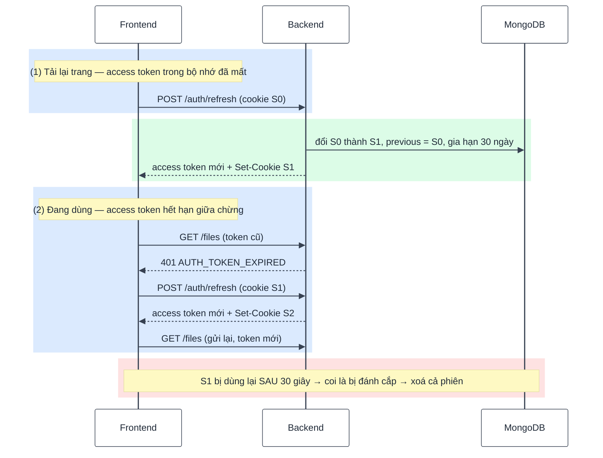
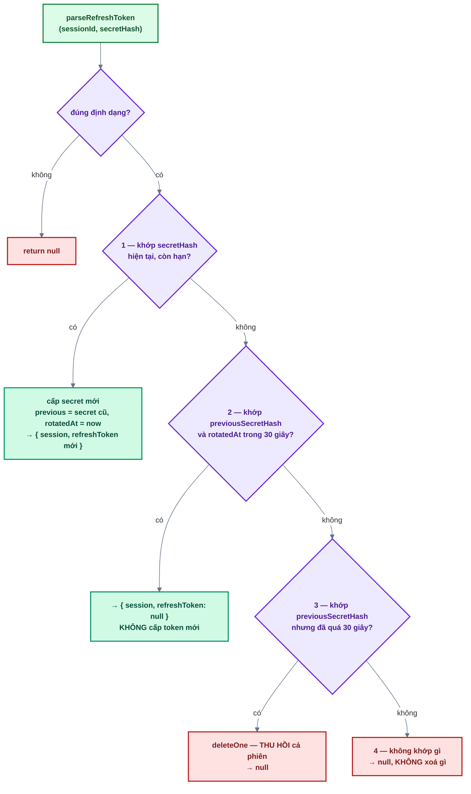

# Bài 06 — Refresh token & đăng xuất

> Trước: [Bài 05](bai-05-bao-ve-route-va-phan-quyen.md) · Mục lục: [README](README.md) · Tiếp: [Bài 07 — Quản lý phiên đăng nhập](bai-07-quan-ly-phien-dang-nhap.md)

|               |                                                                                                                                       |
| ------------- | ------------------------------------------------------------------------------------------------------------------------------------- |
| **Mục tiêu**  | F5 không còn bị đăng xuất; access token hết hạn được làm mới âm thầm; token bị đánh cắp thì phiên bị thu hồi; nút Đăng xuất hoạt động |
| **Thời gian** | 4–5 giờ                                                                                                                               |
| **Độ khó**    | ★★★                                                                                                                                   |
| **Kiến thức** | Xoay vòng refresh token · phát hiện token dùng lại · cửa sổ ân hạn · gộp refresh đồng thời · chống CSRF                               |
| **Test BE**   | `npm test -w backend -- -t "bai-06"` — **15 test**, trong đó **14 test cần bạn làm**                                                  |
| **Test FE**   | `npm test -w frontend -- -t "bai-06"` — **11 test**, trong đó **10 test cần bạn làm**                                                 |

Bài khó nhất từ đầu tới giờ. Phần `sessionsService.rotate` có bốn nhánh và mỗi nhánh có lý do
bảo mật riêng — đọc hết mục 1 trước khi mở editor.

## 1. Mô tả tính năng

> _Là người dùng, tôi không muốn bị đăng xuất mỗi 15 phút, cũng không muốn phải đăng nhập lại mỗi
> lần tải lại trang._
>
> _Là hệ thống, nếu refresh token của ai đó bị đánh cắp, tôi muốn phát hiện và thu hồi phiên._

### 1.1. Hai luồng dùng refresh token



Luồng (1) do `SessionRestorer` lo (đã viết sẵn), luồng (2) do interceptor của http client lo.
Cả hai gọi chung `renewSession`.

### 1.2. `rotate` — bốn nhánh



| Nhánh | Vì sao cần                                                                                                                                               |
| ----- | -------------------------------------------------------------------------------------------------------------------------------------------------------- |
| **1** | Xoay vòng: mỗi token chỉ dùng một lần. Token cũ bị lộ về sau cũng vô dụng                                                                                |
| **2** | Nhiều tab cùng mở, cả hai cùng refresh trong tích tắc. Không có cửa sổ ân hạn thì chính chủ bị đăng xuất oan                                             |
| **3** | Token cũ xuất hiện **sau** cửa sổ ân hạn ⇒ có bản sao thứ hai đang lưu hành ⇒ thu hồi để cắt đường của kẻ trộm                                           |
| **4** | `sessionId` **không phải bí mật** (nó là nửa đầu của token). Nếu "secret sai" cũng thu hồi phiên, ai đoán được `sessionId` sẽ đăng xuất người khác từ xa |

Nhánh 2 **không cấp token mới**: cookie của trình duyệt đã được request "thắng" cập nhật thành S1
rồi. Đặt lại cookie bằng S0 ở đây sẽ ghi đè mất S1 — và lần refresh sau sẽ rơi vào nhánh 3.

### 1.3. Chống CSRF cho hai route dùng cookie

`/auth/refresh` và `/auth/logout` xác thực bằng **cookie**, nên trình duyệt tự gửi kèm ngay cả khi
request xuất phát từ một trang web khác. Vì vậy hai route này bắt buộc phải có header
`X-Requested-With: XMLHttpRequest` (đã gắn sẵn ở route backend và ở http client — bạn không phải
viết). Header tuỳ chỉnh chỉ thêm được bằng JavaScript cùng origin, còn form HTML từ trang lạ thì
không.

## 2. Kiến thức cần nắm trước

| Chủ đề                               | Điểm cốt lõi                                                                                           |
| ------------------------------------ | ------------------------------------------------------------------------------------------------------ |
| **Xoay vòng token**                  | Mỗi lần dùng cấp token mới, huỷ token cũ. Token cũ tái xuất hiện = tín hiệu bị đánh cắp                |
| **Cập nhật nguyên tử**               | `findOneAndUpdate` với điều kiện — hai request đồng thời không thể cùng thắng (giống `consume` bài 03) |
| **`onSettled` vs `onSuccess`**       | `onSettled` chạy cả khi request lỗi. Đăng xuất phải dùng `onSettled`                                   |
| **Gộp promise**                      | `refreshPromise ??= ...` — nhiều request 401 chờ chung một lời gọi refresh                             |
| **Interceptor axios**                | Bắt response lỗi, refresh rồi **gửi lại** request gốc; cờ `hasRetriedAfterRefresh` chặn lặp vô hạn     |
| **`useRef` trong `SessionRestorer`** | Strict Mode chạy effect 2 lần — chỉ refresh một lần (đã viết sẵn, đọc để hiểu)                         |

## 3. Các file cần sửa

Tìm nhanh: `grep -rn "bai-06" backend/src frontend/src`

| Phía | File                                   | Hàm                              |
| ---- | -------------------------------------- | -------------------------------- |
| BE   | `modules/sessions/sessions.service.js` | `rotate`, `revokeByRefreshToken` |
| BE   | `modules/auth/auth.service.js`         | `refresh`, `logout`              |
| BE   | `modules/auth/auth.controller.js`      | `refresh`, `logout`              |
| FE   | `features/auth/api/auth.api.js`        | `refreshSession`, `logout`       |
| FE   | `features/auth/session.js`             | `renewSession`, `expireSession`  |
| FE   | `shared/lib/http.js`                   | `refreshSessionOnce`             |
| FE   | `features/auth/hooks/useLogout.js`     | `onSettled`                      |

**Đọc thêm (không sửa):** `sessions.model.js` (`previousSecretHash`, `rotatedAt`),
`parseRefreshToken`, `REFRESH_REUSE_GRACE_MS`, `shared/utils/cookies.js`,
`SessionRestorer.jsx` (**đã viết sẵn**), phần interceptor của `http.js`, `app/providers.jsx`.

## 4. Đặc tả API

| Endpoint                    | Gửi lên                                            | Thành công                                               | Lỗi                                                                                      |
| --------------------------- | -------------------------------------------------- | -------------------------------------------------------- | ---------------------------------------------------------------------------------------- |
| `POST /api/v1/auth/refresh` | cookie `refresh_token` + header `X-Requested-With` | 200 `{ accessToken, user }`, thường kèm `Set-Cookie` mới | 401 `AUTH_TOKEN_INVALID` (+ **xoá cookie**) · 403 `ACCOUNT_LOCKED` · 403 `CSRF_REJECTED` |
| `POST /api/v1/auth/logout`  | như trên                                           | 200 `'Đã đăng xuất'` + xoá cookie                        | 403 `CSRF_REJECTED`                                                                      |

- `/auth/logout` **luôn 200**, kể cả khi không có cookie (idempotent).
- Refresh thất bại phải **xoá cookie hỏng**, nếu không trình duyệt gửi lại nó mãi.

## 5. Các bước thực hiện

### Phần A — Backend

**A1. `sessionsService.rotate`** — bốn nhánh theo sơ đồ 1.2. Viết xong đọc lại bảng lý do.

**A2. `sessionsService.revokeByRefreshToken`** — nhớ điều kiện `$or` trên secret.

**A3. `authService.refresh`** và **A4. `authService.logout`**.

**A5. `authController.refresh`** — controller duy nhất cần `try/catch`; và **A6. `logout`**.

✅ 14 test đỏ chuyển xanh (15/15).

✅ Thử bằng `curl`, dùng cookie jar để mô phỏng trình duyệt:

```bash
# Đăng nhập, lưu cookie vào file
curl -s -c /tmp/cookie.txt -X POST localhost:4000/api/v1/auth/login \
  -H 'Content-Type: application/json' \
  -d '{"email":"an@example.com","password":"mat-khau-an-toan"}' > /dev/null

# Refresh lần 1 — nhận access token mới + cookie mới
curl -s -b /tmp/cookie.txt -c /tmp/cookie.txt -X POST localhost:4000/api/v1/auth/refresh \
  -H 'X-Requested-With: XMLHttpRequest'

# Thiếu header chống CSRF → 403
curl -s -b /tmp/cookie.txt -X POST localhost:4000/api/v1/auth/refresh
```

Thử nhánh 3 (phát hiện token bị đánh cắp): lưu lại nội dung `/tmp/cookie.txt` **trước** khi
refresh, refresh một lần, đợi hơn 30 giây, rồi refresh lại bằng **cookie cũ** → 401, và bản ghi
trong `sessions` biến mất.

### Phần B — Frontend

**B1. `authApi.refreshSession` / `logout`** → **B2. `session.js`** → **B3. `refreshSessionOnce`**
→ **B4. `useLogout`**.

✅ 9 test đỏ chuyển xanh (11/11).

✅ Trên trình duyệt — đây là lúc mọi thứ "khớp" vào nhau:

- Đăng nhập rồi **F5** → vẫn ở trong, chỉ chớp một màn hình loading rất ngắn.
- Mở tab Network, lọc `refresh`: mỗi lần tải lại trang có **đúng một** request refresh.
- Bấm Đăng xuất → về trang đăng nhập, `document.cookie` sạch, bấm Back không vào lại được.

## 6. Tiêu chí hoàn thành

- [ ] `npm test -w backend -- -t "bai-06"` → 15/15 xanh; frontend → 11/11 xanh
- [ ] Test bài 01–05 vẫn xanh
- [ ] `npm run build && npm run format:check && npm run check` sạch
- [ ] F5 không bị đăng xuất; mỗi lần tải trang chỉ có **một** request `/auth/refresh`
- [ ] Refresh bằng cookie cũ sau > 30 giây → 401 **và** phiên biến mất khỏi `sessions`
- [ ] Refresh thiếu header `X-Requested-With` → 403 `CSRF_REJECTED`
- [ ] Đăng xuất khi backend đang tắt → vẫn về được trang đăng nhập
- [ ] Đánh dấu `[x] Bài 06` trong [CHECKLIST.md](../../CHECKLIST.md) rồi commit

## 7. Câu hỏi & thử thách mở rộng

1. Thử thách: bỏ nhánh 2 (cửa sổ ân hạn) trong `rotate`. Test nào đỏ? Mô tả tình huống người dùng
   thật gặp phải.
2. Thử thách: ở nhánh 4, đổi thành `deleteOne({ _id: sessionId })` (xoá theo mỗi `sessionId`).
   Test nào đỏ? Mô tả cuộc tấn công mới mở ra.
3. Vì sao nhánh 2 trả `refreshToken: null` thay vì cấp một token mới cho chắc?
4. Thử thách: trong `refreshSessionOnce`, bỏ `.finally(() => { refreshPromise = null; })`. Test
   nào đỏ? Vì sao lỗi này chỉ lộ ra ở lần hết hạn **thứ hai**?
5. `useLogout` dùng `onSettled`. Nếu đổi thành `onSuccess` thì người dùng gặp chuyện gì khi mất
   mạng?
6. Controller `refresh` xoá cookie khi lỗi rồi **ném lại** lỗi thay vì tự trả response. Vì sao vẫn
   giữ được header `Set-Cookie` trong response lỗi?

## 8. Gợi ý

<details>
<summary><b>Cấp 1 — Định hướng</b></summary>

- **`rotate`**: `parseRefreshToken` → `findOneAndUpdate` (nhánh 1) → `findOne` (nhánh 2) →
  `deleteOne` (nhánh 3 + 4 gộp làm một, vì filter có `previousSecretHash` nên nhánh 4 không xoá
  gì). Đặt sẵn `const notExpired = mongoose.trusted({ $gt: now })` để dùng lại.
- **`revokeByRefreshToken`**: một `deleteOne` với `$or` hai điều kiện.
- **`authService.refresh`**: `rotate` → `if (!rotation)` → `findById` → `if (!user || lockedAt)`
  (nhớ `revoke` **trước khi** ném) → trả ba trường.
- **`controller.refresh`**: `try` / `catch`, trong `catch` gọi `clearRefreshTokenCookie` rồi
  `throw err`.
- **`renewSession`**: 3 dòng. **`expireSession`**: 3 dòng.
- **`refreshSessionOnce`**: 2 dòng với `??=`.
- **`useLogout`**: thêm `onSettled` vào `useMutation`.

</details>

<details>
<summary><b>Cấp 2 — Pseudo-code</b></summary>

```text
rotate({ refreshToken, userAgent, ip }):
  parsed = parseRefreshToken(refreshToken); nếu !parsed → return null
  { sessionId, secretHash } = parsed; now = bây giờ
  notExpired = mongoose.trusted({ $gt: now })
  newSecret = generateToken()

  rotated = await Session.findOneAndUpdate(
     { _id: sessionId, secretHash, expiresAt: notExpired },
     { $set: { secretHash: hashToken(newSecret), previousSecretHash: secretHash,
               rotatedAt: now, lastUsedAt: now,
               expiresAt: now + REFRESH_TOKEN_TTL_MS,
               userAgent: cắt bớt, ip } },
     { returnDocument: 'after', runValidators: true })
  nếu rotated → return { session: rotated, refreshToken: buildRefreshToken(sessionId, newSecret) }

  graceStart = now - REFRESH_REUSE_GRACE_MS
  withinGrace = await Session.findOne({ _id: sessionId, previousSecretHash: secretHash,
                                        rotatedAt: mongoose.trusted({ $gt: graceStart }),
                                        expiresAt: notExpired })
  nếu withinGrace → return { session: withinGrace, refreshToken: null }

  await Session.deleteOne({ _id: sessionId, previousSecretHash: secretHash })
  return null

revokeByRefreshToken(refreshToken):
  parsed = parseRefreshToken(refreshToken); nếu !parsed → return
  await Session.deleteOne({ _id: parsed.sessionId,
                            $or: [{ secretHash: parsed.secretHash },
                                  { previousSecretHash: parsed.secretHash }] })

authService.refresh(refreshToken, client):
  rotation = await sessionsService.rotate({ refreshToken, ...client })
  nếu !rotation → throw AppError(401, AUTH_TOKEN_INVALID, 'Phiên đăng nhập đã hết hạn, vui lòng đăng nhập lại')
  session = rotation.session
  user = await usersService.findById(session.userId)
  nếu !user hoặc user.lockedAt:
     await sessionsService.revoke(session._id)
     throw AppError(user ? 403 : 401, user ? ACCOUNT_LOCKED : AUTH_TOKEN_INVALID, ...)
  return { accessToken: signAccessToken({ userId: user._id, sessionId: session._id }),
           refreshToken: rotation.refreshToken, user }

authService.logout(refreshToken):
  nếu refreshToken → await sessionsService.revokeByRefreshToken(refreshToken)

controller.refresh(req, res):
  try:
     { accessToken, refreshToken, user } = await authService.refresh(req.cookies[REFRESH_TOKEN_COOKIE], getClientInfo(req))
     nếu refreshToken → setRefreshTokenCookie(res, refreshToken)
     sendSuccess(res, { accessToken, user })
  catch err:
     clearRefreshTokenCookie(res); throw err

renewSession():   session = await refreshSession(); setSession(session); return session.accessToken
expireSession():  wasSignedIn = Boolean(accessToken hiện tại); clearSession(); return wasSignedIn
refreshSessionOnce(): refreshPromise ??= refreshSession().finally(reset về null); return refreshPromise
useLogout: useMutation({ mutationFn: logout, onSettled: () => { clearSession(); queryClient.clear(); navigate(LOGIN, { replace: true }) } })
```

</details>

<details>
<summary><b>Cấp 3 — Code tham khảo (backend)</b></summary>

```js
// sessions.service.js
async function rotate({ refreshToken, userAgent = '', ip = '' }) {
  const parsed = parseRefreshToken(refreshToken);
  if (!parsed) return null;

  const { sessionId, secretHash } = parsed;
  const now = new Date();
  const notExpired = mongoose.trusted({ $gt: now });

  const newSecret = generateToken();
  const rotated = await Session.findOneAndUpdate(
    { _id: sessionId, secretHash, expiresAt: notExpired },
    {
      $set: {
        secretHash: hashToken(newSecret),
        previousSecretHash: secretHash,
        rotatedAt: now,
        lastUsedAt: now,
        expiresAt: new Date(now.getTime() + REFRESH_TOKEN_TTL_MS),
        userAgent: userAgent.slice(0, USER_AGENT_MAX_LENGTH),
        ip,
      },
    },
    { returnDocument: 'after', runValidators: true },
  );
  if (rotated) return { session: rotated, refreshToken: buildRefreshToken(sessionId, newSecret) };

  const graceStart = new Date(now.getTime() - REFRESH_REUSE_GRACE_MS);
  const withinGrace = await Session.findOne({
    _id: sessionId,
    previousSecretHash: secretHash,
    rotatedAt: mongoose.trusted({ $gt: graceStart }),
    expiresAt: notExpired,
  });
  if (withinGrace) return { session: withinGrace, refreshToken: null };

  // Secret cũ bị dùng lại sau thời gian ân hạn: ai đó đang giữ token cũ → thu hồi phiên.
  await Session.deleteOne({ _id: sessionId, previousSecretHash: secretHash });
  return null;
}

async function revokeByRefreshToken(refreshToken) {
  const parsed = parseRefreshToken(refreshToken);
  if (!parsed) return;

  await Session.deleteOne({
    _id: parsed.sessionId,
    $or: [{ secretHash: parsed.secretHash }, { previousSecretHash: parsed.secretHash }],
  });
}
```

```js
// auth.service.js
async function refresh(refreshToken, client) {
  const rotation = await sessionsService.rotate({ refreshToken, ...client });
  if (!rotation) {
    throw new AppError({
      statusCode: 401,
      code: ERROR_CODES.AUTH_TOKEN_INVALID,
      message: 'Phiên đăng nhập đã hết hạn, vui lòng đăng nhập lại',
    });
  }

  const { session } = rotation;
  const user = await usersService.findById(session.userId);
  if (!user || user.lockedAt) {
    await sessionsService.revoke(session._id);
    throw new AppError({
      statusCode: user ? 403 : 401,
      code: user ? ERROR_CODES.ACCOUNT_LOCKED : ERROR_CODES.AUTH_TOKEN_INVALID,
      message: user
        ? 'Tài khoản đã bị khoá. Vui lòng liên hệ quản trị viên'
        : 'Phiên đăng nhập đã hết hạn, vui lòng đăng nhập lại',
    });
  }

  return {
    accessToken: signAccessToken({ userId: user._id, sessionId: session._id }),
    refreshToken: rotation.refreshToken,
    user,
  };
}

async function logout(refreshToken) {
  if (refreshToken) await sessionsService.revokeByRefreshToken(refreshToken);
}
```

```js
// auth.controller.js
async function refresh(req, res) {
  try {
    const { accessToken, refreshToken, user } = await authService.refresh(
      req.cookies[REFRESH_TOKEN_COOKIE],
      getClientInfo(req),
    );
    if (refreshToken) setRefreshTokenCookie(res, refreshToken);
    sendSuccess(res, { accessToken, user });
  } catch (err) {
    // Refresh thất bại → xoá cookie hỏng để trình duyệt không gửi lại mãi; lỗi vẫn đi tiếp tới
    // errorHandler (header Set-Cookie giữ nguyên trong response lỗi).
    clearRefreshTokenCookie(res);
    throw err;
  }
}

async function logout(req, res) {
  await authService.logout(req.cookies[REFRESH_TOKEN_COOKIE]);
  clearRefreshTokenCookie(res);
  sendSuccess(res, null, 'Đã đăng xuất');
}
```

</details>

<details>
<summary><b>Cấp 3 — Code tham khảo (frontend)</b></summary>

```js
// features/auth/api/auth.api.js
export async function refreshSession() {
  const response = await http.post('/auth/refresh', null, { skipAuthRefresh: true });
  return response.data.data;
}

export async function logout() {
  await http.post('/auth/logout', null, { skipAuthRefresh: true });
}
```

```js
// features/auth/session.js
export async function renewSession() {
  const session = await refreshSession();
  useAuthStore.getState().setSession(session);
  return session.accessToken;
}

export function expireSession() {
  const wasSignedIn = Boolean(useAuthStore.getState().accessToken);
  useAuthStore.getState().clearSession();
  return wasSignedIn;
}
```

```js
// shared/lib/http.js
function refreshSessionOnce() {
  refreshPromise ??= authHandlers.refreshSession().finally(() => {
    refreshPromise = null;
  });
  return refreshPromise;
}
```

```js
// features/auth/hooks/useLogout.js
const mutation = useMutation({
  mutationFn: logout,
  onSettled: () => {
    clearSession();
    queryClient.clear();
    navigate(ROUTES.AUTH.LOGIN, { replace: true });
  },
});
```

</details>

<details>
<summary><b>Đáp án câu hỏi mục 7</b></summary>

**1.** Test **"dùng lại token cũ trong 30 giây (tab khác) → vẫn cấp access token, không đặt lại
cookie"** sẽ đỏ.

Tình huống thật: người dùng mở hai tab. Access token hết hạn gần như cùng lúc ở cả hai. Tab A
refresh trước và xoay cookie thành S1; tab B, chỉ chậm vài chục mili-giây, gửi đi S0 mà nó đã đọc
trước đó. Không có cửa sổ ân hạn, S0 rơi thẳng vào nhánh "bị đánh cắp" → **cả phiên bị thu hồi** →
người dùng bị văng ra khỏi cả hai tab dù không làm gì sai.

Cửa sổ 30 giây phân biệt "hai tab của chính chủ đua nhau" (chênh nhau mili-giây) với "kẻ trộm dùng
token cũ" (thường là phút, giờ, ngày sau).

**2.** Test **"secret lạ → 401, không thu hồi"** (trong nhóm refresh) sẽ đỏ.

Cuộc tấn công: refresh token có dạng `<sessionId>.<secret>`, và `sessionId` là ObjectId của
MongoDB — nó **không phải bí mật**, lại còn chứa timestamp nên các giá trị lân cận đoán được. Kẻ
tấn công không cần biết secret: chỉ cần gửi `<sessionId đoán được>.<secret bịa>` là xoá được phiên
của người khác. Cơ chế sinh ra để **chống trộm** trở thành công cụ **đăng xuất hàng loạt** từ xa.

Vì thế nhánh 3 phải có `previousSecretHash` trong filter: chỉ thu hồi khi kẻ gửi **thật sự từng
cầm** một secret hợp lệ của phiên đó.

**3.** Vì cookie của trình duyệt **đã** là S1 rồi — request thắng đã cập nhật nó. Cấp thêm S2 cho
tab đến sau sẽ ghi đè cookie thành S2, trong khi tab thắng vẫn tưởng mình đang giữ S1.

Hậu quả dây chuyền: lần refresh kế tiếp gửi S2; server đã xoay sang S2 với `previous = S1`, nên S2
khớp nhánh 1 — có vẻ ổn. Nhưng nếu hai tab lại đua tiếp, số lần xoay tăng gấp đôi mỗi vòng, và
`previousSecretHash` chỉ nhớ **một** đời. Chỉ cần một tab chậm hơn một nhịp là rơi vào nhánh 3 và
cả phiên bị thu hồi.

Trả `null` giữ đúng một sự thật: tại mỗi thời điểm chỉ có **một** token hợp lệ, và nó vừa được cấp
cho request thắng.

**4.** Test **"nhiều request cùng nhận 401 → chỉ gọi refresh 1 lần"** vẫn xanh (lần hết hạn đầu
tiên vẫn gộp đúng), nhưng test **"401 → refresh → gửi lại request với token mới"** sẽ đỏ nếu nó
chạy sau một test đã refresh — và trên thực tế lỗi lộ ra ở **lần hết hạn thứ hai**.

Lý do: `??=` chỉ gán khi giá trị là `null`/`undefined`. Không reset thì sau lần refresh đầu,
`refreshPromise` giữ mãi một promise **đã settled**. Lần 401 tiếp theo, `??=` thấy biến đã có giá
trị nên không gọi refresh nữa, chỉ trả lại access token **cũ** (đã hết hạn) → request gửi lại tiếp
tục 401 → người dùng bị đăng xuất.

Đây là dạng lỗi trạng thái toàn cục điển hình: lần đầu chạy đúng, lần sau mới sai — nên rất dễ lọt
qua kiểm thử bằng tay.

**5.** Mất mạng → request `/auth/logout` thất bại → `onSuccess` **không chạy** → phiên phía client
không bị dọn, không điều hướng. Người dùng bấm "Đăng xuất", màn hình không đổi gì, họ bấm lại vài
lần rồi bỏ cuộc — và tin rằng mình đã đăng xuất trong khi trình duyệt vẫn giữ phiên. Trên máy
dùng chung, đó là lỗ hổng thật.

`onSettled` chạy cả khi thành công lẫn thất bại. Cookie refresh có thể còn sót ở server (server
chưa nhận được yêu cầu), nhưng phía client sạch và người dùng thoát được — đúng thứ tự ưu tiên:
**ý muốn thoát của người dùng luôn được tôn trọng**.

**6.** Vì `clearRefreshTokenCookie(res)` chỉ đặt header `Set-Cookie` lên đối tượng `res`, **chưa**
gửi response đi. Header đã đặt vẫn nằm đó khi `errorHandler` gọi `res.status(...).json(...)` sau
này — Express gửi tất cả header đã tích luỹ cùng với body cuối cùng.

Nhờ vậy controller không phải tự dựng response lỗi (sẽ làm lệch định dạng lỗi chuẩn của dự án): nó
chỉ thêm một tác dụng phụ rồi để lỗi đi tiếp tới nơi duy nhất sinh ra response lỗi. Điều kiện duy
nhất là **chưa gửi response** — cũng chính là thứ `errorHandler` kiểm bằng `res.headersSent`.

</details>

---

> Trước: [Bài 05](bai-05-bao-ve-route-va-phan-quyen.md) · Mục lục: [README](README.md) · Tiếp: [Bài 07 — Quản lý phiên đăng nhập](bai-07-quan-ly-phien-dang-nhap.md)
