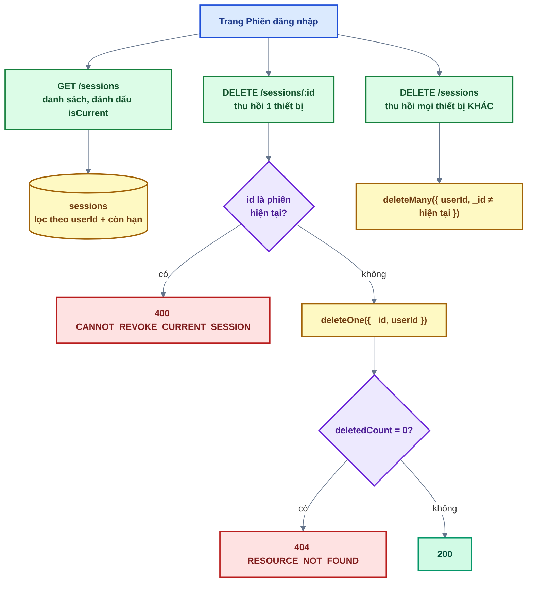

# Bài 07 — Quản lý phiên đăng nhập

> Trước: [Bài 06](bai-06-refresh-token-va-dang-xuat.md) · Mục lục: [README](README.md) · Tiếp: [Bài 08 — Quên / đặt lại / đổi mật khẩu](bai-08-quen-dat-lai-doi-mat-khau.md)

|               |                                                                                                                      |
| ------------- | -------------------------------------------------------------------------------------------------------------------- |
| **Mục tiêu**  | Người dùng xem được các thiết bị đang đăng nhập và đăng xuất từ xa từng thiết bị hoặc tất cả                         |
| **Thời gian** | 3–4 giờ                                                                                                              |
| **Độ khó**    | ★★                                                                                                                   |
| **Kiến thức** | Chống IDOR bằng điều kiện truy vấn · 404 thay vì 403 · `.lean()` + map `id` · `invalidateQueries` · parse User-Agent |
| **Test BE**   | `npm test -w backend -- -t "bai-07"` — **17 test**, **tất cả cần bạn làm**                                           |
| **Test FE**   | `npm test -w frontend -- -t "bai-07"` — **5 test**, trong đó **4 test cần bạn làm**                                  |

Bài này nhẹ hơn bài 06, nhưng chứa một nguyên tắc bạn sẽ dùng lại ở **mọi** bài còn lại: **truy vấn
theo id do client gửi lên luôn phải kèm điều kiện sở hữu**.

## 1. Mô tả tính năng

> _Là người dùng, tôi muốn thấy tài khoản của mình đang đăng nhập ở những thiết bị nào, và đăng
> xuất ngay một thiết bị lạ — hoặc tất cả thiết bị khác — mà không phải đổi mật khẩu._

Trang: **Menu avatar → Phiên đăng nhập** (`/account/sessions`). Mỗi dòng là một bản ghi trong
collection `sessions`, được tạo ở bài 04.

### 1.1. Ba thao tác



### 1.2. IDOR — lỗ hổng chính của bài

**IDOR** (Insecure Direct Object Reference) là khi server nhận một id từ client rồi thao tác thẳng
lên bản ghi đó mà không kiểm ai là chủ. Ở đây id nằm ngay trên URL:

```
DELETE /api/v1/sessions/6700a1b2c3d4e5f6a7b8c9d0
                        ^^^^^^^^^^^^^^^^^^^^^^^^ người dùng sửa được
```

Hai cách viết, một cách đúng:

```js
// ✗ SAI — tra trước rồi so sánh
const session = await Session.findById(sessionId);
if (String(session.userId) !== userId) throw forbidden();
await Session.deleteOne({ _id: sessionId });

// ✓ ĐÚNG — điều kiện sở hữu nằm TRONG filter
const { deletedCount } = await Session.deleteOne({ _id: sessionId, userId });
if (deletedCount === 0) throw notFound();
```

Cách đúng hơn ở ba điểm: **một** lượt đi database thay vì hai; **không có khoảng trống** giữa lúc
đọc và lúc ghi; và không thể quên kiểm tra ở một nhánh nào đó — điều kiện là một phần của chính
câu lệnh.

**Trả 404 chứ không phải 403** khi phiên thuộc về người khác. 403 nghĩa là "phiên này có thật, chỉ
là không phải của bạn" — kẻ dò id sẽ biết id nào tồn tại. 404 không tiết lộ gì.

Nguyên tắc này quay lại ở bài 12 (file cá nhân) và bài 13 (ảnh đại diện).

## 2. Kiến thức cần nắm trước

| Chủ đề                  | Điểm cốt lõi                                                                                                    |
| ----------------------- | --------------------------------------------------------------------------------------------------------------- |
| **IDOR**                | Điều kiện sở hữu (`userId`) nằm **trong filter**, không nằm ở câu `if` phía sau                                 |
| **`deletedCount`**      | Kết quả của `deleteOne`/`deleteMany`; `0` nghĩa là không có gì khớp — dùng nó thay cho một lần `findById`       |
| **`.lean()`**           | Trả object thuần, nhanh hơn — nhưng **phải** đi qua `mapLeanDocument` để có `id` thay cho `_id` (quy ước dự án) |
| **`mongoose.trusted`**  | Bắt buộc với mọi operator (`$ne`, `$gt`) do server tự dựng                                                      |
| **`invalidateQueries`** | Đánh dấu dữ liệu cũ → query đang mở tự tải lại. Dùng **query key factory**, không viết tay mảng key             |
| **Parse User-Agent**    | Luật khớp theo thứ tự — luật đầu tiên khớp thì thắng                                                            |

## 3. Các file cần sửa

Tìm nhanh: `grep -rn "bai-07" backend/src frontend/src`

| Phía | File                                          | Hàm                                                   |
| ---- | --------------------------------------------- | ----------------------------------------------------- |
| BE   | `shared/utils/userAgent.js`                   | `matchRule`, `detectDeviceType`, `parseUserAgent`     |
| BE   | `modules/sessions/sessions.service.js`        | `listForUser`, `revokeForUser`, `revokeOthers`        |
| BE   | `modules/sessions/sessions.controller.js`     | `list`, `revoke`, `revokeOthers`                      |
| FE   | `features/account/api/account.api.js`         | `getSessions`, `revokeSession`, `revokeOtherSessions` |
| FE   | `features/account/hooks/useSessions.js`       | `onSuccess` của hai mutation                          |
| FE   | `features/account/components/SessionList.jsx` | `handleConfirm`                                       |

**Đọc thêm (không sửa):** `sessions.model.js`, `shared/utils/mongo.js` (`mapLeanDocument`),
`BROWSER_RULES` / `OS_RULES` (đã cho sẵn), phần JSX của `SessionList.jsx`.

## 4. Đặc tả API

| Endpoint                      | Thành công                                                                                   | Lỗi                                                                                                              |
| ----------------------------- | -------------------------------------------------------------------------------------------- | ---------------------------------------------------------------------------------------------------------------- |
| `GET /api/v1/sessions`        | 200 mảng `{ id, device: { browser, os, deviceType }, ip, lastUsedAt, createdAt, isCurrent }` | 401                                                                                                              |
| `DELETE /api/v1/sessions/:id` | 200 `'Đã thu hồi phiên đăng nhập'`                                                           | 400 `VALIDATION_ERROR` (id sai định dạng) · 400 `CANNOT_REVOKE_CURRENT_SESSION` · 401 · 404 `RESOURCE_NOT_FOUND` |
| `DELETE /api/v1/sessions`     | 200 `{ revokedCount }` + `'Đã đăng xuất N thiết bị khác'`                                    | 401                                                                                                              |

Response **không bao giờ** chứa `secretHash` hay `previousSecretHash`.

## 5. Các bước thực hiện

### Phần A — Backend

**A1. `shared/utils/userAgent.js`** — ba hàm nhỏ. `BROWSER_RULES` và `OS_RULES` đã cho sẵn; việc
của bạn là dùng chúng đúng thứ tự.

✅ 10 test `parseUserAgent` chuyển xanh.

**A2. `sessionsService.listForUser`** — nhớ `.select(...)`, `mapLeanDocument`, `isCurrent`.

**A3. `revokeForUser`** — đọc lại mục 1.2 trước khi viết.

**A4. `revokeOthers`**.

**A5.** Ba hàm trong `sessions.controller.js`.

✅ Cả 17 test `[bai-07]` xanh.

✅ Thử bằng `curl` (`TOKEN` lấy như bài 05):

```bash
curl -s localhost:4000/api/v1/sessions -H "Authorization: Bearer $TOKEN"
```

Đăng nhập thêm một lần nữa (hoặc từ trình duyệt khác) rồi gọi lại — phải thấy **hai** phiên, đúng
một phiên có `isCurrent: true`.

Thử thu hồi phiên của **người khác**: đăng nhập bằng tài khoản thứ hai, lấy id phiên của nó, rồi
gọi `DELETE /sessions/<id đó>` bằng token của tài khoản đầu → phải nhận **404**, và phiên kia vẫn
còn nguyên trong database.

### Phần B — Frontend

**B1.** Ba hàm API → **B2.** hai `onSuccess` → **B3.** `handleConfirm`.

✅ 4 test đỏ chuyển xanh (5/5).

✅ Trên trình duyệt: mở `/account/sessions` ở hai trình duyệt khác nhau. Thu hồi phiên của trình
duyệt B từ trình duyệt A → danh sách ở A cập nhật **ngay** (không cần F5), và thao tác tiếp theo ở
B bị đá về trang đăng nhập (nhờ `authenticate` tra database mỗi request — bài 05).

## 6. Tiêu chí hoàn thành

- [ ] `npm test -w backend -- -t "bai-07"` → 17/17 xanh; frontend → 5/5 xanh
- [ ] Test bài 01–06 vẫn xanh
- [ ] `npm run build && npm run format:check && npm run check` sạch
- [ ] Danh sách hiện đúng thiết bị, đánh dấu đúng phiên hiện tại, **không** có nút thu hồi ở phiên
      hiện tại
- [ ] Thu hồi phiên của người khác → **404**, phiên đó vẫn còn trong database
- [ ] Response của `GET /sessions` không chứa `secretHash`
- [ ] Thu hồi xong danh sách tự cập nhật, không cần F5
- [ ] Đánh dấu `[x] Bài 07` trong [CHECKLIST.md](../../CHECKLIST.md) rồi commit

## 7. Câu hỏi & thử thách mở rộng

1. Thử thách: bỏ `userId` khỏi filter của `deleteOne` trong `revokeForUser`. Test nào đỏ? Viết ra
   các bước cụ thể một người dùng thật có thể làm để đăng xuất người khác.
2. Vì sao phiên của người khác trả **404** chứ không phải 403?
3. Vì sao không cho thu hồi **phiên hiện tại** qua endpoint này, trong khi nút "Đăng xuất" cũng
   làm đúng việc đó?
4. Thử thách: bỏ `onSuccess` (invalidate) ở `useRevokeSession`. Thu hồi một phiên trên trình
   duyệt. Bạn thấy gì, và vì sao đây là lỗi khó chịu hơn là "chỉ thiếu làm mới"?
5. `listForUser` dùng `.lean()`. Nếu bỏ `mapLeanDocument` đi thì API trả về gì, và chỗ nào ở
   frontend hỏng trước tiên?
6. Trong `BROWSER_RULES`, `Edge` đứng trước `Chrome`. Nếu đảo lại thì trình duyệt Edge bị nhận
   thành gì? Vì sao?

## 8. Gợi ý

<details>
<summary><b>Cấp 1 — Định hướng</b></summary>

- **`matchRule`**: `rules.find(...)` → optional chaining `?.[0]` → `?? UNKNOWN`. Một dòng.
- **`detectDeviceType`**: hai câu `if`, tablet trước.
- **`parseUserAgent`**: một `if` cho chuỗi rỗng, rồi trả object ba trường.
- **`listForUser`**: chuỗi `.find().select().sort().lean()`, rồi `mapLeanDocument(...).map(...)`.
- **`revokeForUser`**: `if` phiên hiện tại → destructure `{ deletedCount }` → `if` 0.
- **`revokeOthers`**: một `deleteMany`, trả `deletedCount`.
- **Controller**: mỗi hàm 2–3 dòng, lấy danh tính từ `req.auth`, id từ `req.validated.params`.
- **FE**: ba hàm API theo khuôn cũ; hai hook thêm `onSuccess`; `handleConfirm` một câu `if/else`.

</details>

<details>
<summary><b>Cấp 2 — Pseudo-code</b></summary>

```text
matchRule(rules, userAgent):
  return rules.find(([, pattern]) => pattern.test(userAgent))?.[0] ?? UNKNOWN

detectDeviceType(userAgent):
  nếu /iPad|Tablet/ khớp HOẶC (/Android/ khớp VÀ /Mobile/ KHÔNG khớp) → 'tablet'
  nếu /Mobi|iPhone|iPod/ khớp → 'mobile'
  return 'desktop'

parseUserAgent(userAgent = ''):
  nếu !userAgent → { browser: UNKNOWN, os: UNKNOWN, deviceType: 'desktop' }
  return { browser: matchRule(BROWSER_RULES, userAgent),
           os: matchRule(OS_RULES, userAgent),
           deviceType: detectDeviceType(userAgent) }

listForUser({ userId, currentSessionId }):
  sessions = await Session.find({ userId, expiresAt: trusted({ $gt: bây giờ }) })
                          .select('userAgent ip lastUsedAt createdAt')
                          .sort({ lastUsedAt: -1 }).lean()
  return mapLeanDocument(sessions).map(s => ({ ...s,
                                               device: parseUserAgent(s.userAgent),
                                               isCurrent: s.id === currentSessionId }))

revokeForUser({ userId, sessionId, currentSessionId }):
  nếu sessionId === currentSessionId → throw AppError(400, CANNOT_REVOKE_CURRENT_SESSION, ...)
  { deletedCount } = await Session.deleteOne({ _id: sessionId, userId })
  nếu deletedCount === 0 → throw AppError(404, RESOURCE_NOT_FOUND, 'Không tìm thấy phiên đăng nhập')

revokeOthers({ userId, currentSessionId, session }):
  { deletedCount } = await Session.deleteMany(
      { userId, _id: trusted({ $ne: currentSessionId }) }, { session })
  return deletedCount

controller.list:         sendSuccess(res, await listForUser({ userId: req.auth.userId,
                                                              currentSessionId: req.auth.sessionId }))
controller.revoke:       await revokeForUser({ ...từ req.auth, sessionId: req.validated.params.id })
                         sendSuccess(res, null, 'Đã thu hồi phiên đăng nhập')
controller.revokeOthers: revokedCount = await revokeOthers({ ...từ req.auth })
                         sendSuccess(res, { revokedCount }, `Đã đăng xuất ${revokedCount} thiết bị khác`)

useRevokeSession: thêm onSuccess: () => queryClient.invalidateQueries({ queryKey: accountKeys.sessions() })

handleConfirm():
  nếu pendingAction.type === 'one' → revokeMutation.mutate(pendingAction.session.id, mutationCallbacks)
  ngược lại → revokeOthersMutation.mutate(undefined, mutationCallbacks)
```

</details>

<details>
<summary><b>Cấp 3 — Code tham khảo (backend)</b></summary>

```js
// shared/utils/userAgent.js
function matchRule(rules, userAgent) {
  return rules.find(([, pattern]) => pattern.test(userAgent))?.[0] ?? UNKNOWN;
}

function detectDeviceType(userAgent) {
  if (/iPad|Tablet/.test(userAgent) || (/Android/.test(userAgent) && !/Mobile/.test(userAgent))) {
    return 'tablet';
  }
  if (/Mobi|iPhone|iPod/.test(userAgent)) return 'mobile';
  return 'desktop';
}

export function parseUserAgent(userAgent = '') {
  if (!userAgent) return { browser: UNKNOWN, os: UNKNOWN, deviceType: 'desktop' };

  return {
    browser: matchRule(BROWSER_RULES, userAgent),
    os: matchRule(OS_RULES, userAgent),
    deviceType: detectDeviceType(userAgent),
  };
}
```

```js
// sessions.service.js
async function listForUser({ userId, currentSessionId }) {
  const sessions = await Session.find({ userId, expiresAt: mongoose.trusted({ $gt: new Date() }) })
    .select('userAgent ip lastUsedAt createdAt')
    .sort({ lastUsedAt: -1 })
    .lean();

  return mapLeanDocument(sessions).map((session) => ({
    ...session,
    device: parseUserAgent(session.userAgent),
    isCurrent: session.id === currentSessionId,
  }));
}

async function revokeForUser({ userId, sessionId, currentSessionId }) {
  if (sessionId === currentSessionId) {
    throw new AppError({
      statusCode: 400,
      code: ERROR_CODES.CANNOT_REVOKE_CURRENT_SESSION,
      message: 'Không thể thu hồi phiên hiện tại — hãy dùng Đăng xuất',
    });
  }

  const { deletedCount } = await Session.deleteOne({ _id: sessionId, userId });
  if (deletedCount === 0) {
    throw new AppError({
      statusCode: 404,
      code: ERROR_CODES.RESOURCE_NOT_FOUND,
      message: 'Không tìm thấy phiên đăng nhập',
    });
  }
}

async function revokeOthers({ userId, currentSessionId, session }) {
  const { deletedCount } = await Session.deleteMany(
    { userId, _id: mongoose.trusted({ $ne: currentSessionId }) },
    { session },
  );
  return deletedCount;
}
```

```js
// sessions.controller.js
async function list(req, res) {
  const sessions = await sessionsService.listForUser({
    userId: req.auth.userId,
    currentSessionId: req.auth.sessionId,
  });
  sendSuccess(res, sessions);
}

async function revoke(req, res) {
  await sessionsService.revokeForUser({
    userId: req.auth.userId,
    sessionId: req.validated.params.id,
    currentSessionId: req.auth.sessionId,
  });
  sendSuccess(res, null, 'Đã thu hồi phiên đăng nhập');
}

async function revokeOthers(req, res) {
  const revokedCount = await sessionsService.revokeOthers({
    userId: req.auth.userId,
    currentSessionId: req.auth.sessionId,
  });
  sendSuccess(res, { revokedCount }, `Đã đăng xuất ${revokedCount} thiết bị khác`);
}
```

</details>

<details>
<summary><b>Cấp 3 — Code tham khảo (frontend)</b></summary>

```js
// features/account/api/account.api.js
export async function getSessions() {
  const response = await http.get('/sessions');
  return response.data.data;
}

export async function revokeSession(sessionId) {
  const response = await http.delete(`/sessions/${sessionId}`);
  return response.data;
}

export async function revokeOtherSessions() {
  const response = await http.delete('/sessions');
  return response.data;
}
```

```js
// features/account/hooks/useSessions.js
return useMutation({
  mutationFn: revokeSession,
  onSuccess: () => queryClient.invalidateQueries({ queryKey: accountKeys.sessions() }),
});
```

```jsx
// features/account/components/SessionList.jsx
const handleConfirm = () => {
  if (pendingAction.type === 'one') {
    revokeMutation.mutate(pendingAction.session.id, mutationCallbacks);
  } else {
    revokeOthersMutation.mutate(undefined, mutationCallbacks);
  }
};
```

</details>

<details>
<summary><b>Đáp án câu hỏi mục 7</b></summary>

**1.** Test **"phiên của người khác → 404 (chống IDOR), phiên đó vẫn còn"** sẽ đỏ.

Các bước tấn công, không cần công cụ gì đặc biệt:

1. Kẻ tấn công tạo tài khoản của chính mình và đăng nhập → có access token hợp lệ.
2. Mở `/account/sessions`, xem id phiên của mình trong tab Network → biết định dạng id.
3. Gửi `DELETE /api/v1/sessions/<id đoán được>` bằng token của mình.

`authenticate` cho qua (token của hắn hợp lệ mà), và không có `userId` trong filter thì phiên của
nạn nhân bị xoá. Nạn nhân đang làm việc bỗng bị đăng xuất. Lặp lại với nhiều id là đăng xuất được
nhiều người — một dạng từ chối dịch vụ nhắm vào từng tài khoản.

Điểm đáng chú ý: **xác thực (authentication) vẫn đúng** — hệ thống biết chính xác ai đang gọi. Cái
thiếu là **phân quyền ở mức đối tượng** (authorization): người này có quyền trên **bản ghi này**
không. Đó là hai việc khác nhau, và IDOR nằm ở việc thứ hai.

**2.** Vì mã lỗi cũng là thông tin. 403 ("bạn không có quyền với phiên này") xác nhận rằng id đó
**tồn tại** — kẻ dò id chỉ cần phân biệt 403 với 404 là vẽ được bản đồ những id có thật.

404 gộp hai trường hợp "không tồn tại" và "không phải của bạn" làm một, nên response không nói gì
thêm ngoài "bạn không có gì ở đây". Cách viết `deleteOne({ _id, userId })` + kiểm `deletedCount`
cho ra hành vi này **một cách tự nhiên** — không cần câu `if` riêng để che thông tin.

**3.** Về kỹ thuật thì giống nhau (cùng xoá một bản ghi), nhưng **trạng thái phía client thì
không**. Nút "Đăng xuất" dọn luôn store, xoá cache TanStack Query và điều hướng về trang đăng nhập
— một quy trình đầy đủ. Thu hồi phiên hiện tại qua trang danh sách sẽ xoá bản ghi rồi… để người
dùng đứng nguyên đó với một access token vừa chết: mọi thao tác tiếp theo trả 401, http client đi
refresh, refresh cũng hỏng, và họ bị đá ra bằng một thông báo "Phiên đăng nhập đã hết hạn" khó
hiểu.

Chặn ở service bằng 400 `CANNOT_REVOKE_CURRENT_SESSION` là cách nói rõ: "việc này có, nhưng ở chỗ
khác". Frontend cũng ẩn nút thu hồi ở dòng `isCurrent` — hai lớp cho cùng một quy tắc.

**4.** Thiết bị vừa thu hồi **vẫn nằm trong danh sách**, kèm toast "Đã thu hồi phiên đăng nhập".

Khó chịu hơn "chỉ thiếu làm mới" vì giao diện đang **nói dối**: nó khẳng định thao tác thành công
nhưng lại hiển thị bằng chứng ngược lại. Người dùng không biết tin cái nào, và phản xạ tự nhiên là
bấm thu hồi lần nữa — lần này nhận **404** (phiên đã bị xoá thật rồi) và một toast đỏ. Bây giờ họ
thật sự tin rằng có gì đó hỏng.

Với dữ liệu về bảo mật, sự mơ hồ này đặc biệt tệ: người dùng vào đây vì nghi ngờ có thiết bị lạ, và
họ cần một câu trả lời dứt khoát.

**5.** API trả `_id` (dạng ObjectId) và `__v` thay vì `id`.

Chỗ hỏng đầu tiên là `isCurrent`: `session.id === currentSessionId` so `undefined` với một chuỗi →
luôn `false` → **không phiên nào** được đánh dấu là phiên hiện tại, nên giao diện hiện nút "Thu
hồi" cho cả phiên đang dùng. Ngay sau đó là React: danh sách render bằng `key={session.id}` →
`key` bị `undefined` cho mọi dòng.

Đây là lý do dự án bắt mọi kết quả `.lean()` phải đi qua `mapLeanDocument`: hợp đồng với frontend
là **`id`**, và không nên để mỗi service tự nhớ việc đổi tên.

**6.** Edge bị nhận thành **Chrome**.

User-Agent của Edge có dạng `... Chrome/120.0.0.0 Safari/537.36 Edg/120.0.0.0` — nó cố tình chứa
`Chrome/` để những trang web cũ chỉ kiểm chuỗi "Chrome" vẫn phục vụ nó đúng. `matchRule` lấy luật
**đầu tiên** khớp, nên nếu `Chrome` đứng trước thì Edge không bao giờ tới được luật của mình.

Cùng lý do đó, `Safari` phải đứng **cuối cùng**: gần như mọi trình duyệt trên iOS, và cả Chrome
trên desktop, đều có `Safari/` trong chuỗi. Danh sách luật kiểu này luôn phải xếp từ **cụ thể nhất
đến tổng quát nhất**.

</details>

---

> Trước: [Bài 06](bai-06-refresh-token-va-dang-xuat.md) · Mục lục: [README](README.md) · Tiếp: [Bài 08 — Quên / đặt lại / đổi mật khẩu](bai-08-quen-dat-lai-doi-mat-khau.md)
