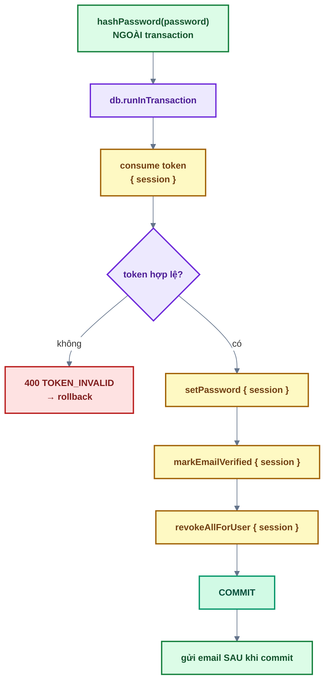
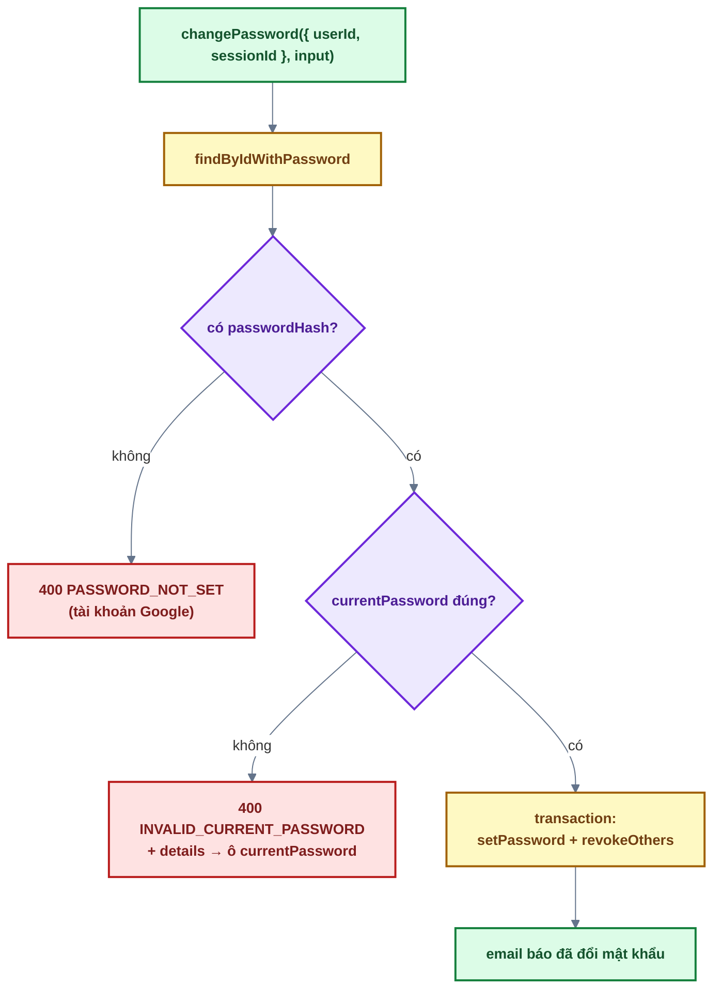

# Bài 08 — Quên / đặt lại / đổi mật khẩu

> Trước: [Bài 07](bai-07-quan-ly-phien-dang-nhap.md) · Mục lục: [README](README.md) · Tiếp: [Bài 09 — System settings & magic link](bai-09-system-settings-va-magic-link.md)

|               |                                                                                                              |
| ------------- | ------------------------------------------------------------------------------------------------------------ |
| **Mục tiêu**  | Quên mật khẩu thì lấy lại được qua email; đang đăng nhập thì đổi được mật khẩu — và mọi thiết bị lạ bị đá ra |
| **Thời gian** | 3–4 giờ                                                                                                      |
| **Độ khó**    | ★★                                                                                                           |
| **Kiến thức** | Transaction MongoDB · thu hồi phiên · `details` cho lỗi theo trường · không lộ email · 400 chứ không 401     |
| **Test BE**   | `npm test -w backend -- -t "bai-08"` — **11 test**, **tất cả cần bạn làm**                                   |
| **Test FE**   | `npm test -w frontend -- -t "bai-08"` — **6 test**, trong đó **5 test cần bạn làm**                          |

Bài này dùng lại `emailTokensService` của bài 03 và `revokeAllForUser` / `revokeOthers` của bài
07 — phần mới là **transaction**.

## 1. Mô tả tính năng

Ba luồng, khác nhau ở **thu hồi phiên nào**:

| Luồng          | Ai dùng                        | Xác minh bằng               | Thu hồi phiên      |
| -------------- | ------------------------------ | --------------------------- | ------------------ |
| Quên → đặt lại | Người **không** đăng nhập được | Token trong email (60 phút) | **MỌI** phiên      |
| Đổi mật khẩu   | Người **đang** đăng nhập       | Mật khẩu hiện tại           | Mọi phiên **KHÁC** |

Khác biệt đó không phải chi tiết vụn: ở luồng "đặt lại", ta **không biết ai đang giữ phiên nào** —
rất có thể chính kẻ chiếm tài khoản đã tạo ra tình huống này. Ở luồng "đổi", chính chủ đang ngồi
trước màn hình, không có lý do gì đá họ ra khỏi tab đang dùng.

### 1.1. Đặt lại mật khẩu — bên trong một transaction



**Vì sao cần transaction ở đây mà bài 03 thì không?** Vì có **bốn** thao tác ghi phải cùng sống
cùng chết. Ví dụ hỏng nếu thiếu:

- Tiêu thụ token xong nhưng đặt mật khẩu lỗi → người dùng mất link (dùng một lần) **và** vẫn giữ
  mật khẩu cũ. Không có đường thoát ngoài việc xin link mới.
- Đặt mật khẩu xong nhưng thu hồi phiên lỗi → kẻ tấn công vẫn còn phiên đang hoạt động, trong khi
  chính chủ tin rằng mình vừa khoá cửa.

Ba quy tắc khi viết transaction ở dự án này:

1. **Việc chậm làm ngoài**: `hashPassword` (~200ms) đứng trước `runInTransaction`. Transaction giữ
   khoá trên document — mở càng lâu càng dễ xung đột.
2. **`{ session }` ở MỌI thao tác** bên trong. Quên một chỗ là chỗ đó nằm ngoài transaction và
   không được rollback.
3. **Email gửi sau khi commit**. `send` (hàm gửi nền của `email.service.js`) không rollback được —
   transaction lỗi mà email "mật khẩu đã đổi" vẫn bay đi thì người dùng hoảng vô cớ.

### 1.2. Đổi mật khẩu — ba lỗi, ba mã khác nhau



> **Sai mật khẩu hiện tại là 400, không phải 401.** Xem lại [bài 01, câu 5](bai-01-doc-hieu-kien-truc.md#7-đáp-án) —
> 401 sẽ khiến http client đi refresh token rồi cuối cùng đăng xuất người dùng chỉ vì họ gõ nhầm.

Lỗi này kèm **`details`** `[{ field: 'currentPassword', message: ... }]`, nhờ vậy
`applyServerErrors` gắn được thông báo xuống đúng ô thay vì hiện lỗi chung trên đầu form.

## 2. Kiến thức cần nắm trước

| Chủ đề                    | Điểm cốt lõi                                                                                                   |
| ------------------------- | -------------------------------------------------------------------------------------------------------------- |
| **`db.runInTransaction`** | Nhận callback `(session) => {...}`; callback ném lỗi → rollback toàn bộ; trả gì thì `runInTransaction` trả nấy |
| **`{ session }`**         | Phải truyền xuống **mọi** thao tác bên trong, nếu không thao tác đó nằm ngoài transaction                      |
| **Thứ tự**                | Việc chậm (bcrypt) và việc không rollback được (gửi email) nằm **ngoài** transaction                           |
| **`details`**             | `AppError` nhận `details: [{ field, message }]` → frontend gắn lỗi vào đúng ô                                  |
| **Không lộ email**        | `forgotPassword` im lặng khi email lạ; controller luôn trả cùng một thông điệp                                 |
| **`reset()` của RHF**     | Xoá trắng form sau khi đổi mật khẩu thành công                                                                 |

## 3. Các file cần sửa

Tìm nhanh: `grep -rn "bai-08" backend/src frontend/src`

| Phía | File                                              | Hàm                                                  |
| ---- | ------------------------------------------------- | ---------------------------------------------------- |
| BE   | `modules/auth/auth.service.js`                    | `forgotPassword`, `resetPassword`, `changePassword`  |
| BE   | `modules/users/users.service.js`                  | `setPassword`                                        |
| BE   | `modules/email/email.service.js`                  | `sendResetPasswordEmail`, `sendPasswordChangedEmail` |
| BE   | `modules/auth/auth.controller.js`                 | `forgotPassword`, `resetPassword`                    |
| BE   | `modules/users/users.controller.js`               | `changeMyPassword`                                   |
| FE   | `features/auth/api/auth.api.js`                   | `forgotPassword`, `resetPassword`, `changePassword`  |
| FE   | `features/auth/hooks/usePasswordMutations.js`     | `onSuccess` của `useResetPassword`                   |
| FE   | `features/auth/components/ForgotPasswordForm.jsx` | `onSubmit`                                           |
| FE   | `features/auth/components/ResetPasswordForm.jsx`  | `onSubmit`                                           |
| FE   | `features/auth/components/ChangePasswordForm.jsx` | `onSubmit`                                           |

**Đọc thêm (không sửa):** `shared/config/db.js` (`runInTransaction`), `emailTokensService`
(bài 03), `sessionsService.revokeAllForUser` / `revokeOthers` (bài 07), `newPasswordSchema`.

## 4. Đặc tả API

| Endpoint                            | Thành công                                                                 | Lỗi                                                                                                            |
| ----------------------------------- | -------------------------------------------------------------------------- | -------------------------------------------------------------------------------------------------------------- |
| `POST /api/v1/auth/forgot-password` | 200 `'Nếu email có tài khoản, chúng tôi đã gửi liên kết đặt lại mật khẩu'` | 400 · 429                                                                                                      |
| `POST /api/v1/auth/reset-password`  | 200 `'Đặt lại mật khẩu thành công. Vui lòng đăng nhập bằng mật khẩu mới'`  | 400 `VALIDATION_ERROR` · 400 `TOKEN_INVALID`                                                                   |
| `PATCH /api/v1/users/me/password`   | 200 `'Đổi mật khẩu thành công. Các thiết bị khác đã bị đăng xuất'`         | 400 `VALIDATION_ERROR` · 400 `PASSWORD_NOT_SET` · 400 `INVALID_CURRENT_PASSWORD` (+ `details`) · 401 · **429** |

> `PATCH /users/me/password` có rate limit **5 lần / 15 phút / user** (không theo IP) — kẻ có
> access token bị lộ đổi được IP, nhưng không đổi được userId.

Mật khẩu mới **không hợp lệ** → 400 `VALIDATION_ERROR` và **token vẫn dùng lại được** (nó chưa bị
tiêu thụ, vì `validate` chặn từ tầng route). Có test cho điều này.

## 5. Các bước thực hiện

### Phần A — Backend

**A1. `usersService.setPassword`** và **A2.** hai hàm email — làm trước, ngắn.

**A3. `authService.forgotPassword`** — giống `resendVerification` bài 03.

**A4. `authService.resetPassword`** — theo sơ đồ 1.1. Đọc lại ba quy tắc transaction.

**A5. `authService.changePassword`** — theo sơ đồ 1.2.

**A6.** Ba hàm controller.

✅ Cả 11 test `[bai-08]` xanh.

✅ Thử bằng `curl` — email in ra terminal backend:

```bash
curl -s -X POST localhost:4000/api/v1/auth/forgot-password \
  -H 'Content-Type: application/json' -d '{"email":"an@example.com"}'

# Copy token từ link trong terminal:
curl -s -X POST localhost:4000/api/v1/auth/reset-password \
  -H 'Content-Type: application/json' \
  -d '{"token":"<token>","password":"mat-khau-moi-cua-an"}'
```

Kiểm chứng ba điều: email lạ cũng trả **cùng** thông điệp; sau khi đặt lại, collection `sessions`
của user đó **rỗng**; dùng lại token lần hai → 400 `TOKEN_INVALID`.

Thử nhánh rollback: gửi `reset-password` với mật khẩu **quá ngắn** → 400 `VALIDATION_ERROR`, và
token **vẫn dùng được** cho lần sau.

### Phần B — Frontend

**B1.** Ba hàm API → **B2.** `useResetPassword` → **B3–B5.** ba `onSubmit`.

✅ 5 test đỏ chuyển xanh (6/6).

✅ Trên trình duyệt:

- `/forgot-password` → nhập email bất kỳ → luôn hiện thông báo chung.
- Mở link trong terminal → đặt mật khẩu mới → **bị đăng xuất khỏi mọi tab** (kể cả tab đang mở ở
  trình duyệt khác), và được chỉ đường về trang đăng nhập.
- Trang **Bảo mật** → đổi mật khẩu với mật khẩu hiện tại **sai** → lỗi hiện ngay dưới ô "Mật khẩu
  hiện tại", **không** bị đăng xuất.
- Đổi đúng → toast thành công, form trắng, vẫn đang đăng nhập ở tab này; tab khác bị đá ra.

## 6. Tiêu chí hoàn thành

- [ ] `npm test -w backend -- -t "bai-08"` → 11/11 xanh; frontend → 6/6 xanh
- [ ] Test bài 01–07 vẫn xanh
- [ ] `npm run build && npm run format:check && npm run check` sạch
- [ ] Email không tồn tại → cùng thông điệp, không có email nào được in ra terminal
- [ ] Sau `reset-password`: `sessions` của user đó rỗng; token dùng lần hai → `TOKEN_INVALID`
- [ ] Mật khẩu mới không hợp lệ → 400, token **vẫn dùng lại được**
- [ ] Sai mật khẩu hiện tại → lỗi tại ô `currentPassword`, **không** bị đăng xuất
- [ ] Đổi mật khẩu thành công → tab hiện tại vẫn đăng nhập, tab khác bị đá ra
- [ ] Đánh dấu `[x] Bài 08` trong [CHECKLIST.md](../../CHECKLIST.md) rồi commit

## 7. Câu hỏi & thử thách mở rộng

1. Thử thách: trong `resetPassword`, bỏ `{ session }` ở lời gọi `revokeAllForUser`. Test nào đỏ?
   Vì sao lỗi này đặc biệt khó phát hiện khi thử bằng tay?
2. Vì sao `hashPassword` được gọi **trước** `runInTransaction` thay vì bên trong?
3. Vì sao email gửi **sau** khi transaction commit? Điều gì xảy ra nếu gửi bên trong và
   transaction bị rollback?
4. `resetPassword` thu hồi **mọi** phiên, `changePassword` chỉ thu hồi phiên **khác**. Giải thích
   bằng một tình huống cụ thể vì sao không thể làm giống nhau.
5. Thử thách: bỏ `details` khỏi lỗi `INVALID_CURRENT_PASSWORD`. Chạy test FE của bài. Cái gì hỏng,
   và vì sao `applyServerErrors` lại cần `details`?
6. `forgotPassword` không gửi link cho tài khoản **bị khoá**. Vì sao, trong khi vẫn trả về cùng
   một thông điệp?

## 8. Gợi ý

<details>
<summary><b>Cấp 1 — Định hướng</b></summary>

- **`setPassword`**: một `findByIdAndUpdate`, nhớ `session`.
- **Email**: copy khuôn `sendMagicLinkEmail` / `sendWelcomeEmail` trong cùng file.
- **`forgotPassword`**: 3 bước, giống `resendVerification` (bài 03) nhưng điều kiện thoát sớm là
  `!user || user.lockedAt`.
- **`resetPassword`**: `hashPassword` → `const { user, activatedUser } = await
db.runInTransaction(async (session) => {...})` → hai lời gọi email.
- **`changePassword`**: hai câu `if` (nhớ `details` ở cái thứ hai) → `hashPassword` →
  `runInTransaction` với hai thao tác → gửi email.
- **Controller**: mỗi hàm 2 dòng. `changeMyPassword` truyền **cả `req.auth`**.
- **FE**: ba hàm API theo khuôn cũ; `useResetPassword` thêm `onSuccess`; ba `onSubmit` theo
  TODO trong file.

</details>

<details>
<summary><b>Cấp 2 — Pseudo-code</b></summary>

```text
setPassword(userId, passwordHash, { session }):
  return User.findByIdAndUpdate(userId, { $set: { passwordHash } },
                                { returnDocument: 'after', runValidators: true, session })

forgotPassword({ email }):
  user = await findByEmail(email)
  nếu !user HOẶC user.lockedAt → return
  token = await emailTokensService.issue({ userId: user._id, type: RESET_PASSWORD,
                                           ttlMs: RESET_PASSWORD_TTL_MS })
  emailService.sendResetPasswordEmail({ user, token, expiresInMinutes: RESET_PASSWORD_TTL_MINUTES })

resetPassword({ token, password }):
  passwordHash = await hashPassword(password)          // NGOÀI transaction
  { user, activatedUser } = await db.runInTransaction(async (session) => {
      emailToken = await emailTokensService.consume({ token, type: RESET_PASSWORD, session })
      nếu !emailToken → throw AppError(400, TOKEN_INVALID, 'Liên kết đặt lại mật khẩu không hợp lệ hoặc đã hết hạn')
      updatedUser  = await usersService.setPassword(emailToken.userId, passwordHash, { session })
      newlyActivated = await usersService.markEmailVerified(emailToken.userId, { session })
      await sessionsService.revokeAllForUser(emailToken.userId, { session })
      return { user: updatedUser, activatedUser: newlyActivated }
  })
  emailService.sendPasswordChangedEmail({ user })      // SAU commit
  nếu activatedUser → emailService.sendWelcomeEmail({ user: activatedUser })

changePassword({ userId, sessionId }, { currentPassword, newPassword }):
  user = await findByIdWithPassword(userId)
  nếu !user.passwordHash → throw AppError(400, PASSWORD_NOT_SET, '...dùng "Quên mật khẩu"...')
  nếu !(await verifyPassword(currentPassword, user.passwordHash))
     → throw AppError(400, INVALID_CURRENT_PASSWORD, 'Mật khẩu hiện tại không đúng',
                      details: [{ field: 'currentPassword', message: 'Mật khẩu hiện tại không đúng' }])
  passwordHash = await hashPassword(newPassword)
  await db.runInTransaction(async (session) => {
      await usersService.setPassword(userId, passwordHash, { session })
      await sessionsService.revokeOthers({ userId, currentSessionId: sessionId, session })
  })
  emailService.sendPasswordChangedEmail({ user })

useResetPassword: useMutation({ mutationFn: resetPassword, onSuccess: () => expireSession() })
```

</details>

<details>
<summary><b>Cấp 3 — Code tham khảo (backend)</b></summary>

```js
// users.service.js
async function setPassword(userId, passwordHash, { session } = {}) {
  return User.findByIdAndUpdate(
    userId,
    { $set: { passwordHash } },
    { returnDocument: 'after', runValidators: true, session },
  );
}
```

```js
// email.service.js
function sendResetPasswordEmail({ user, token, expiresInMinutes }) {
  send({
    to: user.email,
    subject: 'Đặt lại mật khẩu',
    element: h(ResetPasswordEmail, {
      name: user.name,
      resetUrl: buildAppUrl(APP_PATHS.RESET_PASSWORD, { token }),
      expiresInMinutes,
    }),
  });
}

function sendPasswordChangedEmail({ user }) {
  send({
    to: user.email,
    subject: 'Mật khẩu của bạn vừa được thay đổi',
    element: h(PasswordChangedEmail, {
      name: user.name,
      forgotPasswordUrl: buildAppUrl(APP_PATHS.FORGOT_PASSWORD),
    }),
  });
}
```

```js
// auth.service.js
async function forgotPassword({ email }) {
  const user = await usersService.findByEmail(email);
  if (!user || user.lockedAt) return;

  const token = await emailTokensService.issue({
    userId: user._id,
    type: EMAIL_TOKEN_TYPES.RESET_PASSWORD,
    ttlMs: RESET_PASSWORD_TTL_MS,
  });
  emailService.sendResetPasswordEmail({
    user,
    token,
    expiresInMinutes: RESET_PASSWORD_TTL_MINUTES,
  });
}

async function resetPassword({ token, password }) {
  const passwordHash = await hashPassword(password);

  const { user, activatedUser } = await db.runInTransaction(async (session) => {
    const emailToken = await emailTokensService.consume({
      token,
      type: EMAIL_TOKEN_TYPES.RESET_PASSWORD,
      session,
    });
    if (!emailToken) {
      throw new AppError({
        statusCode: 400,
        code: ERROR_CODES.TOKEN_INVALID,
        message: 'Liên kết đặt lại mật khẩu không hợp lệ hoặc đã hết hạn',
      });
    }

    const updatedUser = await usersService.setPassword(emailToken.userId, passwordHash, {
      session,
    });
    const newlyActivated = await usersService.markEmailVerified(emailToken.userId, { session });
    await sessionsService.revokeAllForUser(emailToken.userId, { session });
    return { user: updatedUser, activatedUser: newlyActivated };
  });

  emailService.sendPasswordChangedEmail({ user });
  if (activatedUser) emailService.sendWelcomeEmail({ user: activatedUser });
}

async function changePassword({ userId, sessionId }, { currentPassword, newPassword }) {
  const user = await usersService.findByIdWithPassword(userId);

  if (!user.passwordHash) {
    throw new AppError({
      statusCode: 400,
      code: ERROR_CODES.PASSWORD_NOT_SET,
      message:
        'Tài khoản chưa có mật khẩu (đăng nhập bằng Google). Dùng "Quên mật khẩu" để tạo mật khẩu',
    });
  }
  // Sai mật khẩu hiện tại là lỗi nghiệp vụ (400), KHÔNG phải 401 — 401 để frontend tự refresh token.
  if (!(await verifyPassword(currentPassword, user.passwordHash))) {
    throw new AppError({
      statusCode: 400,
      code: ERROR_CODES.INVALID_CURRENT_PASSWORD,
      message: 'Mật khẩu hiện tại không đúng',
      details: [{ field: 'currentPassword', message: 'Mật khẩu hiện tại không đúng' }],
    });
  }

  const passwordHash = await hashPassword(newPassword);
  await db.runInTransaction(async (session) => {
    await usersService.setPassword(userId, passwordHash, { session });
    await sessionsService.revokeOthers({ userId, currentSessionId: sessionId, session });
  });

  emailService.sendPasswordChangedEmail({ user });
}
```

```js
// auth.controller.js
async function forgotPassword(req, res) {
  await authService.forgotPassword(req.validated.body);
  sendSuccess(res, null, 'Nếu email có tài khoản, chúng tôi đã gửi liên kết đặt lại mật khẩu');
}

async function resetPassword(req, res) {
  await authService.resetPassword(req.validated.body);
  sendSuccess(res, null, 'Đặt lại mật khẩu thành công. Vui lòng đăng nhập bằng mật khẩu mới');
}
```

```js
// users.controller.js
async function changeMyPassword(req, res) {
  await authService.changePassword(req.auth, req.validated.body);
  sendSuccess(res, null, 'Đổi mật khẩu thành công. Các thiết bị khác đã bị đăng xuất');
}
```

</details>

<details>
<summary><b>Cấp 3 — Code tham khảo (frontend)</b></summary>

```js
// features/auth/api/auth.api.js
export async function forgotPassword(body) {
  const response = await http.post('/auth/forgot-password', body);
  return response.data;
}

export async function resetPassword(body) {
  const response = await http.post('/auth/reset-password', body);
  return response.data;
}

export async function changePassword(body) {
  const response = await http.patch('/users/me/password', body);
  return response.data;
}
```

```js
// features/auth/hooks/usePasswordMutations.js
return useMutation({ mutationFn: resetPassword, onSuccess: () => expireSession() });
```

```jsx
// features/auth/components/ForgotPasswordForm.jsx
const onSubmit = (values) => {
  forgotMutation.mutate(values, {
    onError: (error) => applyServerErrors(error, setError, ['email']),
  });
};
```

```jsx
// features/auth/components/ResetPasswordForm.jsx
const onSubmit = ({ password }) => {
  resetMutation.mutate(
    { token, password },
    { onError: (error) => applyServerErrors(error, setError, ['password']) },
  );
};
```

```jsx
// features/auth/components/ChangePasswordForm.jsx
const onSubmit = ({ currentPassword, newPassword }) => {
  changeMutation.mutate(
    { currentPassword, newPassword },
    {
      onSuccess: (body) => {
        toast.success(body.message);
        reset(EMPTY_VALUES);
      },
      onError: (error) => applyServerErrors(error, setError, FIELD_NAMES),
    },
  );
};
```

</details>

<details>
<summary><b>Đáp án câu hỏi mục 7</b></summary>

**1.** Test **"lỗi giữa chừng → transaction rollback: token, mật khẩu, phiên đều giữ nguyên"** sẽ
đỏ.

Khó phát hiện bằng tay vì **đường thành công hoạt động hoàn hảo**: thiếu `{ session }` thì thao tác
đó vẫn chạy, vẫn ghi vào database, vẫn đúng kết quả. Sự khác biệt chỉ lộ ra khi có lỗi **ở giữa** —
tình huống bạn gần như không bao giờ dựng lại được khi bấm thử trên trình duyệt.

Hậu quả nếu lọt ra production: một lỗi hiếm ở bước sau khiến mật khẩu được đặt lại **nhưng phiên
cũ vẫn sống** (hoặc ngược lại). Đúng lúc người dùng cần hệ thống đáng tin nhất — họ vừa nghi ngờ
tài khoản bị chiếm — thì nó im lặng làm nửa việc. Đây là lý do test rollback phải có, chứ không
thể trông vào kiểm thử thủ công.

**2.** Vì bcrypt cố tình chậm (~200ms với cost 12), còn transaction thì giữ khoá trên document
trong suốt thời gian nó mở.

Đặt `hashPassword` bên trong tức là mỗi lần đặt lại mật khẩu sẽ giữ khoá thêm 200ms mà **không làm
gì với database cả**. Ở quy mô nhỏ thì không ai thấy; khi nhiều request chạm cùng document, thời
gian giữ khoá dài làm tăng xung đột ghi (`WriteConflict`) và MongoDB phải thử lại transaction.

Quy tắc chung: transaction chỉ nên chứa các thao tác **database**. Mọi tính toán, gọi mạng, hash…
làm trước hoặc sau.

**3.** Vì `send` **không thể rollback**. Nó đẩy email vào hàng gửi nền và trả về ngay; khi
transaction bị rollback, email đã đi rồi.

Hậu quả: người dùng nhận thư "Mật khẩu của bạn đã được thay đổi" trong khi mật khẩu **không** hề
đổi. Đúng nghĩa đen là báo động giả — và với email cảnh báo bảo mật, báo động giả còn tệ hơn không
báo, vì lần sau người ta sẽ bỏ qua nó.

Quy tắc chung: mọi tác dụng phụ **ra ngoài hệ thống** (email, webhook, thông báo đẩy, gọi API bên
thứ ba) phải nằm **sau** commit. Chỉ những thứ rollback được mới vào trong transaction.

**4.** Vì hai luồng có giả định khác nhau về **ai đang cầm phiên**.

_Đặt lại mật khẩu_: người dùng tới đây vì không đăng nhập được — rất có thể vì kẻ khác đã đổi mật
khẩu của họ. Kẻ đó **đang có một phiên hoạt động**. Nếu chỉ thu hồi "phiên khác", ta không biết
"phiên hiện tại" là của ai, vì luồng này **không có** phiên hiện tại (người dùng chưa đăng nhập).
Thu hồi tất cả là cách duy nhất chắc chắn cắt được kẻ tấn công.

_Đổi mật khẩu_: người dùng đã đăng nhập, đang ngồi trước màn hình, và vừa chứng minh họ biết mật
khẩu cũ. Phiên hiện tại chắc chắn là của họ. Đá họ ra khỏi chính tab đang dùng chỉ gây khó chịu mà
không tăng an toàn chút nào — trong khi vẫn cần thu hồi các phiên khác, phòng khi một thiết bị cũ
hoặc kẻ lạ còn đăng nhập ở đâu đó.

**5.** Test FE **"sai mật khẩu hiện tại (400, không phải 401) → lỗi ngay tại ô, không đăng xuất"**
sẽ đỏ.

`applyServerErrors` duyệt `error.details`, lọc những `field` có trong form, rồi gọi `setError` cho
từng cái. Không có `details` thì danh sách rỗng → nó rơi vào nhánh "lỗi không theo trường" và đặt
lỗi chung (`root.server`) hiện ở đầu form.

Về mặt chức năng thì vẫn "có báo lỗi", nhưng trải nghiệm kém hẳn: form có ba ô mật khẩu, người
dùng phải tự đoán ô nào sai. `details` là cách backend nói cho frontend biết **lỗi thuộc về ô
nào** — và nó dùng chung một định dạng với lỗi Zod, nên frontend chỉ cần một hàm xử lý cho cả hai.

**6.** Vì đặt lại mật khẩu xong họ **vẫn không đăng nhập được** — `assertCanSignIn` (bài 04) chặn
tài khoản bị khoá ngay sau bước kiểm mật khẩu. Gửi link chỉ dẫn người dùng đi hết một quy trình để
rồi nhận lỗi ở cuối.

Vẫn trả **cùng một thông điệp** vì lý do khác: thông điệp ở đây không nói về tài khoản này, nó nói
về **hệ thống**. "Nếu email có tài khoản, chúng tôi đã gửi liên kết" đúng với mọi trường hợp — email
lạ, email có tài khoản, email của tài khoản bị khoá — nên không ai suy ra được trạng thái của một
địa chỉ cụ thể.

Người bị khoá biết được điều họ cần biết qua kênh khác: email thông báo khoá tài khoản (bài 11) đã
nói rõ, kèm hướng dẫn liên hệ quản trị viên.

</details>

---

> Trước: [Bài 07](bai-07-quan-ly-phien-dang-nhap.md) · Mục lục: [README](README.md) · Tiếp: [Bài 09 — System settings & magic link](bai-09-system-settings-va-magic-link.md)
