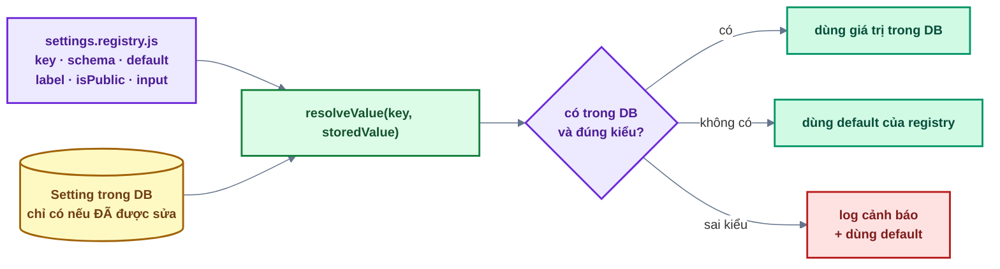
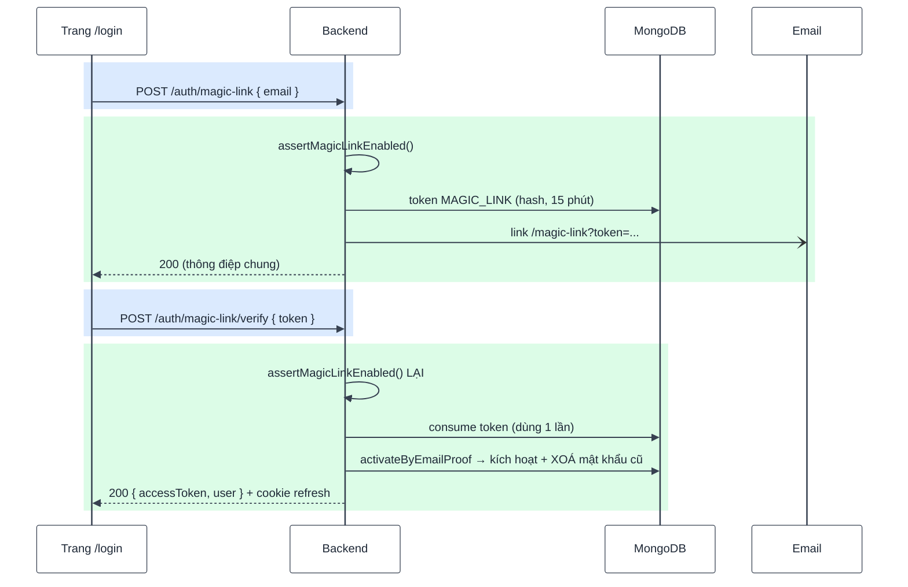

# Bài 09 — System settings & magic link

> Trước: [Bài 08](bai-08-quen-dat-lai-doi-mat-khau.md) · Mục lục: [README](README.md) · Tiếp: [Bài 10 — Google OAuth](bai-10-google-oauth.md)

|               |                                                                                                                             |
| ------------- | --------------------------------------------------------------------------------------------------------------------------- |
| **Mục tiêu**  | Super Admin bật / tắt được tính năng mà không cần deploy lại; người dùng đăng nhập bằng liên kết email, không cần mật khẩu  |
| **Thời gian** | 4–5 giờ                                                                                                                     |
| **Độ khó**    | ★★                                                                                                                          |
| **Kiến thức** | Registry làm nguồn sự thật · giá trị mặc định · `upsert` · `setQueryData` vs `invalidateQueries` · đăng nhập không mật khẩu |
| **Test BE**   | `npm test -w backend -- -t "bai-09"` — **19 test**, trong đó **15 test cần bạn làm**                                        |
| **Test FE**   | `npm test -w frontend -- -t "bai-09"` — **7 test**, trong đó **5 test cần bạn làm**                                         |

Bài này ghép hai tính năng vì chúng gắn với nhau: magic link là tính năng **đầu tiên** bật / tắt
được bằng setting.

> **4 test BE đã xanh sẵn**: `settingsService.get` và `GET /settings/public` **không** bị xoá —
> `register` của bài 02 đã gọi `get` để kiểm setting "cho phép đăng ký", nên chúng phải hoạt động
> từ bài 02. Đọc hai hàm đó trước khi viết `listForAdmin`: bạn sẽ dùng lại `resolveValue` và
> `findStored` của chúng.

## 1. Mô tả tính năng

> _Là Super Admin, tôi muốn tạm dừng đăng ký hoặc tắt đăng nhập bằng liên kết email ngay trên
> giao diện, không phải sửa code và deploy lại._
>
> _Là người dùng, tôi muốn đăng nhập mà không phải nhớ mật khẩu._

### 1.1. Setting — registry là nguồn sự thật



Ba hệ quả của thiết kế này, đều quan trọng khi bạn viết `listForAdmin`:

1. **Database có thể rỗng.** Setting chưa ai sửa thì **không có** document. Vì vậy `listForAdmin`
   duyệt theo `Object.keys(SETTING_DEFINITIONS)` chứ không theo kết quả truy vấn — và `update`
   phải dùng `upsert: true`.
2. **Giá trị sai kiểu không làm sập app.** Ai đó sửa tay trong Compass thành chuỗi `"false"` →
   `resolveValue` ghi log cảnh báo và trả về default.
3. **Thêm setting mới = thêm một mục vào registry.** Không sửa service, không sửa controller,
   không sửa form (form frontend tự sinh ô nhập từ `input` và `label`). Đây là **điểm mở rộng** —
   xem bảng điểm mở rộng ở [docs/07 §1](../07-tao-du-an-moi-va-deploy.md#1-tạo-dự-án-mới-từ-source-base).

### 1.2. Magic link — đăng nhập bằng thứ bạn _có_, không phải thứ bạn _nhớ_



Hai chỗ dễ sai:

- **Kiểm setting ở CẢ hai bước.** Super Admin tắt tính năng lúc 10:00 thì link gửi lúc 9:55 cũng
  phải chết. Kiểm mỗi lúc gửi là không đủ.
- **Dùng `activateByEmailProof`, không phải `markEmailVerified`.** Hàm đó xoá luôn `passwordHash`
  cũ. Lý do ở mục 1.3.

### 1.3. Vì sao magic link phải xoá mật khẩu cũ

Nhắc lại kịch bản _pre-account takeover_ của [bài 03](bai-03-email-va-xac-thuc-tai-khoan.md#12-ba-nhánh-của-register--và-vì-sao-chúng-khác-nhau):

1. Kẻ gian đăng ký `nan-nhan@mail.com` với mật khẩu **P**, không kích hoạt được.
2. Nạn nhân vào trang đăng nhập, chọn "Đăng nhập bằng liên kết email" — **họ không hề biết** mình
   đã "có tài khoản", vì response luôn giống nhau.
3. Bấm link → tài khoản được kích hoạt.

Nếu bước 3 chỉ đặt `emailVerifiedAt` mà giữ nguyên `passwordHash`, kẻ gian đăng nhập bằng **P** và
đọc được mọi thứ nạn nhân tạo ra sau đó.

| Luồng                    | Ai bấm link                                      | Mật khẩu cũ | Hàm dùng               |
| ------------------------ | ------------------------------------------------ | ----------- | ---------------------- |
| `verify-email` (bài 03)  | Chính người vừa đăng ký                          | **Giữ**     | `markEmailVerified`    |
| Magic link (bài này)     | Chủ hộp thư, có thể **không phải** người đăng ký | **Xoá**     | `activateByEmailProof` |
| Liên kết Google (bài 10) | Chủ hộp thư (Google xác nhận)                    | **Xoá**     | `linkGoogleAccount`    |

Sau khi kích hoạt bằng magic link, người dùng đặt mật khẩu qua luồng "Quên mật khẩu" (bài 08) nếu
muốn. Chi tiết: `docs/03` §7.

## 2. Kiến thức cần nắm trước

| Chủ đề                     | Điểm cốt lõi                                                                                  |
| -------------------------- | --------------------------------------------------------------------------------------------- |
| **Registry**               | Nơi **duy nhất** khai báo setting. Service duyệt theo registry, không theo DB                 |
| **`upsert: true`**         | Tạo mới nếu chưa có — bắt buộc vì setting chưa sửa thì chưa có document                       |
| **Tránh N+1**              | Lấy tên người sửa bằng **một** `findNamesByIds`, không gọi trong vòng lặp                     |
| **`setQueryData`**         | Đã có dữ liệu mới trong tay → ghi thẳng vào cache                                             |
| **`invalidateQueries`**    | Chỉ biết "dữ liệu cũ rồi" → đánh dấu để query tự tải lại                                      |
| **`activateByEmailProof`** | Kích hoạt **và** xoá `passwordHash` — dùng khi người bấm link có thể không phải người đăng ký |

## 3. Các file cần sửa

Tìm nhanh: `grep -rn "bai-09" backend/src frontend/src`

| Phía | File                                                 | Hàm                                                                |
| ---- | ---------------------------------------------------- | ------------------------------------------------------------------ |
| BE   | `modules/settings/settings.service.js`               | `listForAdmin`, `update`                                           |
| BE   | `modules/settings/settings.controller.js`            | `listForAdmin`, `update`                                           |
| BE   | `modules/auth/auth.service.js`                       | `assertMagicLinkEnabled`, `requestMagicLink`, `loginWithMagicLink` |
| BE   | `modules/email/email.service.js`                     | `sendMagicLinkEmail`                                               |
| BE   | `modules/auth/auth.controller.js`                    | `requestMagicLink`, `loginWithMagicLink`                           |
| FE   | `features/settings/api/settings.api.js`              | `getAdminSettings`, `updateSettings`                               |
| FE   | `features/settings/hooks/useSettings.js`             | `onSuccess` của `useUpdateSettings`                                |
| FE   | `features/settings/components/AdminSettingsForm.jsx` | `handleSubmit`                                                     |
| FE   | `features/auth/api/auth.api.js`                      | `requestMagicLink`, `verifyMagicLink`                              |
| FE   | `features/auth/hooks/useMagicLink.js`                | `useMagicLinkLogin`                                                |
| FE   | `features/auth/components/MagicLinkForm.jsx`         | `onSubmit`                                                         |

**Đọc thêm (không sửa):** `settings.registry.js`, `resolveValue` / `findStored` / `get` /
`getPublic` (**đã viết sẵn**), `assertRegistrationEnabled` (bài 02), `useConsumeTokenOnce`
(bài 03), `usePublicSetting`, `LoginMethods.jsx`.

## 4. Đặc tả API

| Endpoint                              | Ai gọi được     | Thành công                                                          | Lỗi                                                                 |
| ------------------------------------- | --------------- | ------------------------------------------------------------------- | ------------------------------------------------------------------- |
| `GET /api/v1/admin/settings`          | **SUPER_ADMIN** | 200 mảng setting kèm mô tả                                          | 401 · 403                                                           |
| `PATCH /api/v1/admin/settings`        | **SUPER_ADMIN** | 200 danh sách mới + `'Đã lưu cấu hình'`                             | 400 · 401 · 403                                                     |
| `POST /api/v1/auth/magic-link`        | Khách           | 200 `'Nếu email có tài khoản, chúng tôi đã gửi liên kết đăng nhập'` | 400 · 403 `FEATURE_DISABLED` · 429                                  |
| `POST /api/v1/auth/magic-link/verify` | Khách           | 200 `{ accessToken, user }` + cookie                                | 400 `TOKEN_INVALID` · 403 `FEATURE_DISABLED` · 403 `ACCOUNT_LOCKED` |

ADMIN (không phải SUPER_ADMIN) gọi `/admin/settings` → **403 `FORBIDDEN`**, chặn ngay ở route bằng
`authorize(USER_ROLES.SUPER_ADMIN)` — bạn không phải viết, nhưng nên mở `settings.routes.js` xem.

## 5. Các bước thực hiện

### Phần A — Settings (backend)

**A1. `settingsService.listForAdmin`** — duyệt theo registry, tránh N+1. Nhớ trường `options`:
registry có một setting kiểu `select` là `email.provider` ("Kênh gửi email") — `options()` trả danh
sách kênh để trang Cấu hình vẽ ô chọn; setting kiểu `boolean` thì `options: null`. Setting này
thuộc [bài 15](bai-15-gui-email-qua-smtp.md), ở bài này bạn chỉ cần trả `options` đúng như JSDoc.

**A2. `settingsService.update`** — transaction + `upsert`.

**A3.** Hai hàm controller.

✅ 6 test `/admin/settings` chuyển xanh.

```bash
# Lấy token của Super Admin (tài khoản seed ở bài 00)
curl -s localhost:4000/api/v1/admin/settings -H "Authorization: Bearer $TOKEN"
curl -s -X PATCH localhost:4000/api/v1/admin/settings \
  -H "Authorization: Bearer $TOKEN" -H 'Content-Type: application/json' \
  -d '{"values":{"auth.registrationEnabled":false}}'
```

Sau lệnh thứ hai, thử `POST /auth/register` → **403 `REGISTRATION_DISABLED`** (nhờ
`assertRegistrationEnabled` bạn đã viết ở bài 02). Nhớ bật lại.

### Phần B — Magic link (backend)

**B1. `assertMagicLinkEnabled`** → **B2. `sendMagicLinkEmail`** → **B3. `requestMagicLink`** →
**B4. `loginWithMagicLink`** (đọc kỹ mục 1.3) → **B5.** hai hàm controller.

✅ Cả 19 test `[bai-09]` xanh.

✅ Thử bằng `curl` — email in ra terminal:

```bash
curl -s -X POST localhost:4000/api/v1/auth/magic-link \
  -H 'Content-Type: application/json' -d '{"email":"an@example.com"}'

curl -s -X POST localhost:4000/api/v1/auth/magic-link/verify \
  -H 'Content-Type: application/json' -d '{"token":"<token trong terminal>"}'
```

Kiểm chứng: token dùng lần hai → `TOKEN_INVALID`; tắt magic link bằng `/admin/settings` rồi gọi
lại với token **còn hạn** → `403 FEATURE_DISABLED`.

### Phần C — Frontend

**C1–C3.** Settings: hai hàm API, `useUpdateSettings`, `AdminSettingsForm.handleSubmit`.

**C4–C6.** Magic link: hai hàm API, `useMagicLinkLogin`, `MagicLinkForm.onSubmit`.

✅ 5 test đỏ chuyển xanh (7/7).

✅ Trên trình duyệt:

- Đăng nhập Super Admin → **Quản trị → Cấu hình** → tắt "Cho phép đăng ký" → **mở tab mới**, nút
  "Đăng ký" trên header biến mất và `/register` báo tạm dừng. (Nếu vẫn thấy nút cũ trong tab đang
  mở, bạn quên `invalidateQueries` ở C2.)
- Tắt "Bật magic link" → trang `/login` không còn tab chọn cách đăng nhập.
- Mục "Kênh gửi email" hiện ô chọn (Console / Resend / SMTP). Nút "Gửi email thử" bên dưới chưa
  có tác dụng (console trình duyệt báo "Chức năng chưa được hoàn thành") — đó là việc của bài 15.
- Bật lại → `/login` → tab "Liên kết email" → nhập email → bấm link trong terminal → vào thẳng
  dashboard.

## 6. Tiêu chí hoàn thành

- [ ] `npm test -w backend -- -t "bai-09"` → 19/19 xanh; frontend → 7/7 xanh
- [ ] Test bài 01–08 vẫn xanh
- [ ] `npm run build && npm run format:check && npm run check` sạch
- [ ] Tắt đăng ký → `POST /auth/register` trả 403 `REGISTRATION_DISABLED`
- [ ] Tắt magic link → link **đã gửi trước đó** cũng trả 403 `FEATURE_DISABLED`
- [ ] Đăng nhập bằng magic link vào được dashboard; token dùng lần hai → `TOKEN_INVALID`
- [ ] Tài khoản đăng ký bằng mật khẩu P (chưa kích hoạt) → kích hoạt bằng magic link → đăng nhập
      bằng P trả `INVALID_CREDENTIALS`
- [ ] Đổi setting ở tab A → tab B mở sau đó thấy ngay thay đổi
- [ ] Đánh dấu `[x] Bài 09` trong [CHECKLIST.md](../../CHECKLIST.md) rồi commit

## 7. Câu hỏi & thử thách mở rộng

1. Thử thách: bỏ `upsert: true` trong `settingsService.update`, xoá hết document trong collection
   `settings`, rồi thử đổi một setting. Chuyện gì xảy ra, và vì sao test có thể **vẫn xanh**?
2. Vì sao `listForAdmin` duyệt `Object.keys(SETTING_DEFINITIONS)` chứ không duyệt kết quả truy vấn
   database?
3. Thử thách: trong `loginWithMagicLink`, đổi `activateByEmailProof` thành `markEmailVerified`.
   Test nào đỏ? Viết lại kịch bản tấn công bằng lời của bạn.
4. `assertMagicLinkEnabled` được gọi ở **cả** `requestMagicLink` lẫn `loginWithMagicLink`. Bỏ cái
   thứ hai đi thì lỗ hổng gì xuất hiện?
5. Trong `useUpdateSettings`, vì sao bản quản trị dùng `setQueryData` còn bản công khai dùng
   `invalidateQueries`? Đổi cả hai thành `invalidateQueries` được không?
6. `AdminSettingsForm` chỉ gửi những key **đã đổi**. Nếu gửi hết thì hỏng chỗ nào?

## 8. Gợi ý

<details>
<summary><b>Cấp 1 — Định hướng</b></summary>

- **`listForAdmin`**: `keys` → `findStored(keys)` → gom `updatedBy` → `findNamesByIds` →
  `keys.map(...)`. Đọc `getPublic` ngay phía trên để thấy khuôn.
- **`update`**: `runInTransaction` + vòng `for...of Object.entries(values)` +
  `findOneAndUpdate` có `upsert`. Kết thúc bằng `return listForAdmin()`.
- **`assertMagicLinkEnabled`**: copy `assertRegistrationEnabled`, đổi key và thông điệp.
- **`requestMagicLink`**: giống `forgotPassword` (bài 08) + một dòng `assert` ở đầu.
- **`loginWithMagicLink`**: 5 bước như JSDoc. Chú ý `activatedUser ?? (await findById(...))`.
- **FE**: hai hàm API theo khuôn cũ (`verifyMagicLink` có `skipAuthRefresh` và trả
  `response.data.data` — giống `login` bài 04); hook thêm `onSuccess`; hai handler theo TODO.

</details>

<details>
<summary><b>Cấp 2 — Pseudo-code</b></summary>

```text
listForAdmin():
  keys = Object.keys(SETTING_DEFINITIONS)
  stored = await findStored(keys)
  editorIds = [...stored.values()].map(d => d.updatedBy).filter(Boolean)
  editorNames = await usersService.findNamesByIds(editorIds)
  return keys.map(key => {
     definition = SETTING_DEFINITIONS[key]; document = stored.get(key)
     return { key, value: resolveValue(key, document?.value), default: definition.default,
              isPublic, input, label, description từ definition,
              options: definition.options ? definition.options() : null,
              updatedAt: document?.updatedAt ?? null,
              updatedBy: document?.updatedBy ? { id, name từ editorNames } : null }
  })

update(values, actorId):
  await db.runInTransaction(async (session) => {
     for ([key, value] of Object.entries(values)):
        await Setting.findOneAndUpdate({ key },
              { $set: { value, updatedBy: actorId } },
              { upsert: true, runValidators: true, session })
  })
  return listForAdmin()

assertMagicLinkEnabled():
  nếu !(await settingsService.get(SETTING_KEYS.MAGIC_LINK_ENABLED))
     → throw AppError(403, FEATURE_DISABLED, 'Đăng nhập bằng liên kết email đang tắt')

requestMagicLink({ email }):
  await assertMagicLinkEnabled()
  user = await findByEmail(email); nếu !user hoặc user.lockedAt → return
  token = await emailTokensService.issue({ userId, type: MAGIC_LINK, ttlMs: MAGIC_LINK_TTL_MS })
  emailService.sendMagicLinkEmail({ user, token, expiresInMinutes: MAGIC_LINK_TTL_MINUTES })

loginWithMagicLink({ token }, client):
  await assertMagicLinkEnabled()
  emailToken = await emailTokensService.consume({ token, type: MAGIC_LINK })
  nếu !emailToken → throw AppError(400, TOKEN_INVALID, 'Liên kết đăng nhập không hợp lệ hoặc đã hết hạn')
  activatedUser = await usersService.activateByEmailProof(emailToken.userId)
  nếu activatedUser → emailService.sendWelcomeEmail({ user: activatedUser })
  user = activatedUser ?? (await usersService.findById(emailToken.userId))
  assertCanSignIn(user)
  return startSession(user, client)

useUpdateSettings → onSuccess(body):
  queryClient.setQueryData(settingsKeys.admin(), body.data)
  queryClient.invalidateQueries({ queryKey: settingsKeys.public() })
```

</details>

<details>
<summary><b>Cấp 3 — Code tham khảo (backend)</b></summary>

```js
// settings.service.js
async function listForAdmin() {
  const keys = Object.keys(SETTING_DEFINITIONS);
  const stored = await findStored(keys);
  const editorIds = [...stored.values()].map((document) => document.updatedBy).filter(Boolean);
  const editorNames = await usersService.findNamesByIds(editorIds);

  return keys.map((key) => {
    const definition = SETTING_DEFINITIONS[key];
    const document = stored.get(key);
    return {
      key,
      value: resolveValue(key, document?.value),
      default: definition.default,
      isPublic: definition.isPublic,
      input: definition.input,
      options: definition.options ? definition.options() : null,
      label: definition.label,
      description: definition.description,
      updatedAt: document?.updatedAt ?? null,
      updatedBy: document?.updatedBy
        ? { id: String(document.updatedBy), name: editorNames.get(String(document.updatedBy)) }
        : null,
    };
  });
}

async function update(values, actorId) {
  await db.runInTransaction(async (session) => {
    for (const [key, value] of Object.entries(values)) {
      await Setting.findOneAndUpdate(
        { key },
        { $set: { value, updatedBy: actorId } },
        { upsert: true, runValidators: true, session },
      );
    }
  });
  return listForAdmin();
}
```

```js
// settings.controller.js
async function listForAdmin(_req, res) {
  sendSuccess(res, await settingsService.listForAdmin());
}

async function update(req, res) {
  const settings = await settingsService.update(req.validated.body.values, req.auth.userId);
  sendSuccess(res, settings, 'Đã lưu cấu hình');
}
```

```js
// email.service.js
function sendMagicLinkEmail({ user, token, expiresInMinutes }) {
  send({
    to: user.email,
    subject: 'Liên kết đăng nhập',
    element: h(MagicLinkEmail, {
      name: user.name,
      magicLinkUrl: buildAppUrl(APP_PATHS.MAGIC_LINK, { token }),
      expiresInMinutes,
    }),
  });
}
```

```js
// auth.service.js
async function assertMagicLinkEnabled() {
  if (!(await settingsService.get(SETTING_KEYS.MAGIC_LINK_ENABLED))) {
    throw new AppError({
      statusCode: 403,
      code: ERROR_CODES.FEATURE_DISABLED,
      message: 'Đăng nhập bằng liên kết email đang tắt',
    });
  }
}

async function requestMagicLink({ email }) {
  await assertMagicLinkEnabled();
  const user = await usersService.findByEmail(email);
  if (!user || user.lockedAt) return;

  const token = await emailTokensService.issue({
    userId: user._id,
    type: EMAIL_TOKEN_TYPES.MAGIC_LINK,
    ttlMs: MAGIC_LINK_TTL_MS,
  });
  emailService.sendMagicLinkEmail({ user, token, expiresInMinutes: MAGIC_LINK_TTL_MINUTES });
}

async function loginWithMagicLink({ token }, client) {
  await assertMagicLinkEnabled();
  const emailToken = await emailTokensService.consume({
    token,
    type: EMAIL_TOKEN_TYPES.MAGIC_LINK,
  });
  if (!emailToken) {
    throw new AppError({
      statusCode: 400,
      code: ERROR_CODES.TOKEN_INVALID,
      message: 'Liên kết đăng nhập không hợp lệ hoặc đã hết hạn',
    });
  }

  const activatedUser = await usersService.activateByEmailProof(emailToken.userId);
  if (activatedUser) emailService.sendWelcomeEmail({ user: activatedUser });

  const user = activatedUser ?? (await usersService.findById(emailToken.userId));
  assertCanSignIn(user);
  return startSession(user, client);
}
```

```js
// auth.controller.js
async function requestMagicLink(req, res) {
  await authService.requestMagicLink(req.validated.body);
  sendSuccess(res, null, 'Nếu email có tài khoản, chúng tôi đã gửi liên kết đăng nhập');
}

async function loginWithMagicLink(req, res) {
  const { accessToken, refreshToken, user } = await authService.loginWithMagicLink(
    req.validated.body,
    getClientInfo(req),
  );
  setRefreshTokenCookie(res, refreshToken);
  sendSuccess(res, { accessToken, user }, 'Đăng nhập thành công');
}
```

</details>

<details>
<summary><b>Cấp 3 — Code tham khảo (frontend)</b></summary>

```js
// features/settings/api/settings.api.js
export async function getAdminSettings() {
  const response = await http.get('/admin/settings');
  return response.data.data;
}

export async function updateSettings(values) {
  const response = await http.patch('/admin/settings', { values });
  return response.data;
}
```

```js
// features/settings/hooks/useSettings.js
return useMutation({
  mutationFn: updateSettings,
  onSuccess: (body) => {
    queryClient.setQueryData(settingsKeys.admin(), body.data);
    queryClient.invalidateQueries({ queryKey: settingsKeys.public() });
  },
});
```

```jsx
// features/settings/components/AdminSettingsForm.jsx
const handleSubmit = (event) => {
  event.preventDefault();
  const values = Object.fromEntries(changedKeys.map((key) => [key, draft[key]]));
  updateMutation.mutate(values, {
    onSuccess: (body) => {
      toast.success(body.message);
      setDraft({});
    },
    onError: (error) => toast.error(error.message),
  });
};
```

```js
// features/auth/api/auth.api.js
export async function requestMagicLink(body) {
  const response = await http.post('/auth/magic-link', body);
  return response.data;
}

export async function verifyMagicLink(body) {
  const response = await http.post('/auth/magic-link/verify', body, { skipAuthRefresh: true });
  return response.data.data;
}
```

```js
// features/auth/hooks/useMagicLink.js
export function useMagicLinkLogin(token) {
  return useConsumeTokenOnce(async (body) => {
    const session = await verifyMagicLink(body);
    useAuthStore.getState().setSession(session);
    return session;
  }, token);
}
```

```jsx
// features/auth/components/MagicLinkForm.jsx
const onSubmit = (values) => {
  magicLinkMutation.mutate(values, {
    onError: (error) => applyServerErrors(error, setError, ['email']),
  });
};
```

</details>

<details>
<summary><b>Đáp án câu hỏi mục 7</b></summary>

**1.** Không có `upsert`, `findOneAndUpdate` **không tìm thấy** document nào khớp `{ key }` nên
không ghi gì cả — và **không báo lỗi**. API trả 200 kèm danh sách setting, giao diện hiện toast
"Đã lưu cấu hình", nhưng giá trị vẫn là default. Lỗi im lặng, dạng khó chịu nhất.

Test **có thể vẫn xanh** nếu nó chạy `update` hai lần, hoặc nếu dữ liệu chuẩn bị của test đã tạo
sẵn document. Đây là lý do bài kiểm tra thủ công ở mục 5 yêu cầu **xoá sạch collection `settings`
trước**: chỉ ở trạng thái "chưa ai sửa gì" — đúng trạng thái của một hệ thống vừa deploy — lỗi mới
lộ ra.

**2.** Vì DB **không chứa đủ** thông tin. Setting chưa ai sửa thì chưa có document, nên duyệt theo
kết quả truy vấn sẽ làm trang Cấu hình **trống trơn** ở lần deploy đầu tiên — đúng lúc Super Admin
cần nó nhất.

Sâu hơn: DB chỉ lưu **giá trị đã ghi đè**. Mọi thứ khác — danh sách key, kiểu dữ liệu, giá trị mặc
định, nhãn hiển thị, loại ô nhập, `isPublic` — chỉ có trong registry. Registry là nguồn sự thật;
DB là lớp ghi đè tùy chọn nằm trên nó.

**3.** Test **"kích hoạt qua magic link → xoá mật khẩu người đăng ký đặt (chống chiếm trước tài
khoản)"** sẽ đỏ.

Kịch bản: kẻ gian đăng ký bằng email của bạn với mật khẩu hắn tự chọn. Hắn không vào được hộp thư
của bạn nên không kích hoạt được — nhưng **bản ghi tài khoản đã tồn tại** và đang mang mật khẩu của
hắn. Một thời gian sau bạn vào trang, chọn "Đăng nhập bằng liên kết email" (bạn không hề biết mình
"đã có tài khoản" vì response luôn giống nhau), bấm link trong hộp thư của mình và vào được. Tài
khoản giờ đã kích hoạt — kèm mật khẩu của kẻ gian. Từ lúc đó hắn đăng nhập bình thường và đọc mọi
thứ bạn tạo ra.

Điểm mấu chốt: bấm được link chứng minh bạn sở hữu **hộp thư**, không chứng minh bạn là người đã
đặt mật khẩu đang lưu. Vì vậy phải bỏ mật khẩu đó đi.

**4.** Super Admin tắt magic link nhưng **mọi link đã gửi vẫn dùng được** trong 15 phút tiếp theo.

Điều đó phá hỏng chính mục đích của công tắc. Người ta tắt một cơ chế đăng nhập khi đang có sự cố —
nghi ngờ hộp thư bị xâm nhập, phát hiện ai đó gửi hàng loạt link, hoặc chỉ muốn đóng cửa tạm thời.
Trong tình huống đó, một cửa sổ 15 phút vẫn mở là quá đủ cho kẻ tấn công.

Quy tắc chung: cờ bật / tắt tính năng phải được kiểm ở **điểm cuối cùng trước khi hành động xảy
ra**, không chỉ ở điểm bắt đầu quy trình.

**5.** Vì hai chỗ có lượng thông tin khác nhau.

Bản **quản trị**: server vừa trả về danh sách setting mới, đầy đủ và chính xác, ngay trong
`body.data`. `setQueryData` ghi thẳng vào cache — giao diện cập nhật tức thì, **không** thêm một
request nào.

Bản **công khai**: `body.data` là dữ liệu cho trang quản trị (có `label`, `description`,
`updatedBy`…), **khác cấu trúc** với `{ settings, features }` của `/settings/public`, nên không thể
ghi thẳng vào. Ta chỉ biết chắc "nó đã cũ" → `invalidateQueries`.

Đổi cả hai thành `invalidateQueries` thì **vẫn chạy đúng**, chỉ tốn thêm một request và giao diện
nháy nhẹ. Ngược lại — dùng `setQueryData` cho bản công khai — thì **sai**, vì sẽ nhét dữ liệu sai
cấu trúc vào cache.

**6.** Hỏng ở **lịch sử "ai sửa gì lúc nào"**. Mỗi `findOneAndUpdate` đều ghi `updatedBy` và
`updatedAt`. Gửi cả những setting không đổi sẽ đóng dấu tên bạn lên **toàn bộ** setting, kể cả
những cái người khác đã cấu hình từ trước và bạn chưa hề động tới.

Với một trang quản trị hiển thị "Sửa lần cuối bởi X lúc Y", điều đó làm thông tin trở nên vô dụng:
sau vài lần bấm Lưu, mọi setting đều mang tên người bấm gần nhất. Khi cần truy ai đã tắt đăng ký,
không còn manh mối nào.

Ngoài ra còn hai cái lợi nhỏ: transaction ghi ít document hơn (ít xung đột hơn), và request nhỏ
hơn.

</details>

---

> Trước: [Bài 08](bai-08-quen-dat-lai-doi-mat-khau.md) · Mục lục: [README](README.md) · Tiếp: [Bài 10 — Google OAuth](bai-10-google-oauth.md)
