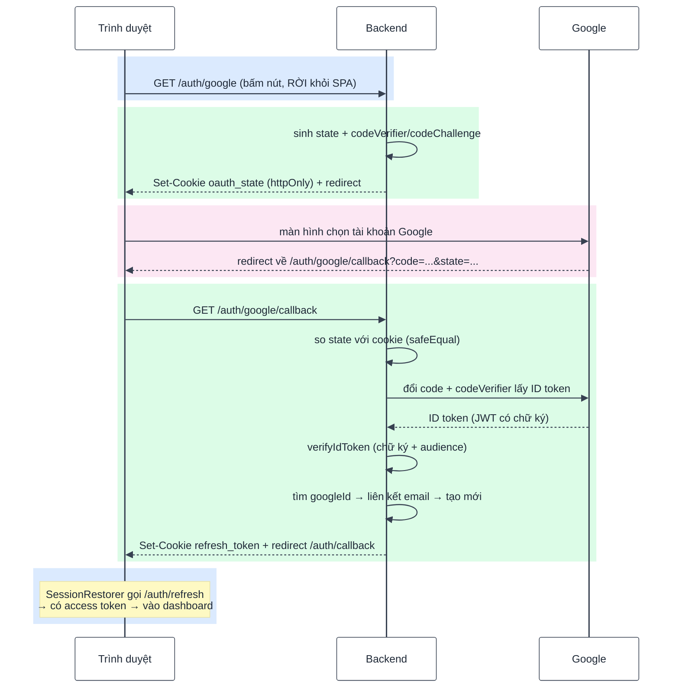
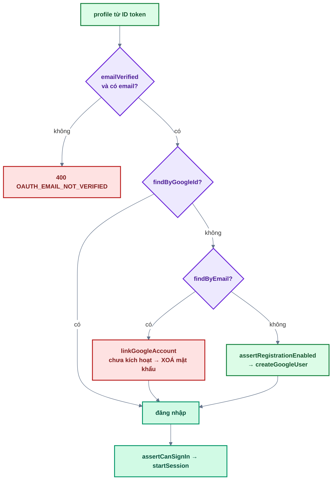

# Bài 10 — Google OAuth

> Trước: [Bài 09](bai-09-system-settings-va-magic-link.md) · Mục lục: [README](README.md) · Tiếp: [Bài 11 — Quản lý người dùng & phân quyền](bai-11-quan-ly-nguoi-dung-va-phan-quyen.md)

|                                |                                                                                                                             |
| ------------------------------ | --------------------------------------------------------------------------------------------------------------------------- |
| **Mục tiêu**                   | Đăng nhập bằng tài khoản Google: tài khoản mới được tạo, tài khoản cùng email được liên kết an toàn                         |
| **Thời gian**                  | 4–5 giờ                                                                                                                     |
| **Độ khó**                     | ★★★                                                                                                                         |
| **Kiến thức**                  | Authorization Code + PKCE · tham số `state` chống CSRF · xác minh ID token · liên kết tài khoản · so sánh timing-safe       |
| **Test BE**                    | `npm test -w backend -- -t "bai-10"` — **14 test**, trong đó **13 test cần bạn làm**                                        |
| **Test FE**                    | `npm test -w frontend -- -t "bai-10"` — **6 test**, trong đó **3 test cần bạn làm**                                         |
| **Không cần tài khoản Google** | Test mock `googleOAuth` bằng `vi.spyOn` — làm xong cả bài mà **không** phải tạo OAuth Client. Muốn thử thật thì xem mục 5.3 |

## 1. Mô tả tính năng

> _Là người dùng, tôi muốn đăng nhập bằng tài khoản Google, không phải tạo thêm một mật khẩu nữa._

### 1.1. Toàn luồng — hai lần điều hướng trang



Hai điểm khác mọi bài trước:

- **Đây là điều hướng trang, không phải gọi API.** Vì vậy controller dùng `res.redirect`, và lỗi
  **không** đi qua `errorHandler` (nó trả JSON — người dùng sẽ thấy JSON thô giữa trình duyệt).
  Lỗi được mã hoá thành `?error=CODE` trên URL để frontend hiển thị.
- **Access token không đi qua URL.** Backend chỉ đặt cookie refresh; frontend tự gọi
  `/auth/refresh` (bài 06). Token trên URL sẽ nằm lại trong lịch sử trình duyệt, log proxy và
  header `Referer`.

### 1.2. `state` và PKCE — hai cơ chế, hai mối đe doạ khác nhau

|                    | `state`                                                                                          | PKCE (`codeVerifier` / `codeChallenge`)                                   |
| ------------------ | ------------------------------------------------------------------------------------------------ | ------------------------------------------------------------------------- |
| Chống              | **CSRF đăng nhập**                                                                               | **Đánh cắp authorization code**                                           |
| Kẻ tấn công làm gì | Bắt đầu luồng bằng tài khoản Google của _hắn_, rồi lừa nạn nhân mở URL callback kèm code của hắn | Chặn được `code` trên đường redirect (log, extension, mạng)               |
| Hậu quả nếu thiếu  | Nạn nhân "đăng nhập" vào tài khoản của kẻ gian; mọi thứ họ tạo sau đó nằm trong tài khoản ấy     | Kẻ tấn công đổi code lấy token và vào tài khoản nạn nhân                  |
| Cơ chế             | Chuỗi ngẫu nhiên, lưu trong **cookie httpOnly** của chính trình duyệt đó, so lại ở callback      | `codeVerifier` **không bao giờ rời server**; Google chỉ nhận bản băm S256 |

Cả hai đều nằm trong **một cookie tạm** `oauth_state` dạng `<state>.<codeVerifier>`, bị xoá ngay
sau callback (dù thành công hay thất bại).

> So `state` bằng **`safeEqual`**, không phải `===`. `===` thoát ngay ở byte đầu khác nhau, để lộ
> độ dài tiền tố trùng khớp qua thời gian phản hồi.

### 1.3. Ba nhánh của `loginWithGoogle`



Ba điều dễ làm sai, cả ba đều có test:

1. **Tìm theo `googleId` TRƯỚC, theo email sau.** Người dùng đổi được email trên tài khoản Google;
   `googleId` (`sub`) thì vĩnh viễn. Đảo thứ tự sẽ tạo tài khoản mới cho người vừa đổi email.
2. **Liên kết với tài khoản chưa kích hoạt phải XOÁ mật khẩu cũ.** Đây lại là _pre-account
   takeover_ (bài 03, bài 09): Google xác nhận người này sở hữu hộp thư, nhưng mật khẩu đang lưu
   có thể do kẻ gian đặt khi đăng ký trước bằng email đó.
3. **`assertRegistrationEnabled` chỉ chặn nhánh tạo mới.** Super Admin tắt đăng ký không được chặn
   người đã có tài khoản đăng nhập.

## 2. Kiến thức cần nắm trước

| Chủ đề                 | Điểm cốt lõi                                                                                |
| ---------------------- | ------------------------------------------------------------------------------------------- |
| **Authorization Code** | Google trả về một `code` dùng một lần; server đổi code lấy token qua kênh server-to-server  |
| **PKCE**               | `codeChallenge` = SHA-256 của `codeVerifier`. Gửi challenge đi, giữ verifier lại            |
| **ID token**           | JWT do Google ký. **Phải** `verifyIdToken` (chữ ký **và** `audience`), không tự giải mã     |
| **`state`**            | Chống CSRF đăng nhập; so bằng `safeEqual`                                                   |
| **Cờ tính năng**       | Thiếu `GOOGLE_*` → route trả 404 `FEATURE_NOT_CONFIGURED`, frontend ẩn nút                  |
| **`vi.spyOn`**         | Test thay `googleOAuth.createAuthorizationRequest` / `exchangeCode` — không gọi Google thật |

## 3. Các file cần sửa

Tìm nhanh: `grep -rn "bai-10" backend/src frontend/src`

| Phía | File                                               | Hàm                                                       |
| ---- | -------------------------------------------------- | --------------------------------------------------------- |
| BE   | `shared/lib/googleOAuth.js`                        | `createAuthorizationRequest`, `exchangeCode`              |
| BE   | `modules/users/users.service.js`                   | `findByGoogleId`, `linkGoogleAccount`, `createGoogleUser` |
| BE   | `modules/auth/auth.service.js`                     | `loginWithGoogle`, `completeGoogleLogin`                  |
| BE   | `modules/auth/auth.controller.js`                  | `startGoogleLogin`, `handleGoogleCallback`                |
| FE   | `features/auth/components/OAuthCallbackStatus.jsx` | điều hướng khi thành công + map mã lỗi                    |

**Đọc thêm (không sửa):** `parseOAuthState` và `startGoogleLogin` của service (**đã viết sẵn**),
`auth.schema.js` (`googleCallbackQuerySchema`), `shared/utils/cookies.js`,
`shared/config/features.js`, `shared/utils/token.js` (`safeEqual`), `GoogleLoginButton.jsx`.

## 4. Đặc tả API

| Endpoint                           | Kiểu         | Thành công                                        | Thất bại                                          |
| ---------------------------------- | ------------ | ------------------------------------------------- | ------------------------------------------------- |
| `GET /api/v1/auth/google`          | **Redirect** | 302 sang Google + cookie `oauth_state`            | 404 `FEATURE_NOT_CONFIGURED` khi thiếu `GOOGLE_*` |
| `GET /api/v1/auth/google/callback` | **Redirect** | 302 về `<APP_URL>/auth/callback` + cookie refresh | 302 về `<APP_URL>/auth/callback?error=CODE`       |

Mã lỗi có thể xuất hiện trong `?error=`: `OAUTH_CANCELLED` (người dùng bấm Huỷ),
`OAUTH_STATE_INVALID` (cookie hết hạn / state không khớp), `OAUTH_EMAIL_NOT_VERIFIED`,
`REGISTRATION_DISABLED`, `ACCOUNT_LOCKED`, `OAUTH_FAILED` (lỗi không lường trước).

> Callback **luôn** trả 302, **không bao giờ** trả 4xx/5xx — kể cả khi hỏng. Đây là điều hướng
> trang, không phải lời gọi API.

## 5. Các bước thực hiện

### 5.1. Backend

**A1.** `googleOAuth.createAuthorizationRequest` và **A2.** `exchangeCode`.

**A3.** Ba hàm Google trong `usersService`.

**A4. `authService.loginWithGoogle`** — theo sơ đồ 1.3, đúng thứ tự.

**A5. `authService.completeGoogleLogin`** — kiểm `state` trước, đổi code sau.

**A6.** Hai hàm controller. `handleGoogleCallback` **luôn** kết thúc bằng `res.redirect`.

✅ Cả 14 test `[bai-10]` xanh.

### 5.2. Frontend

**B1. `OAuthCallbackStatus`** — hai TODO trong file.

✅ 3 test đỏ chuyển xanh (6/6).

> Test **"Google chuyển về thành công → phiên được khôi phục từ cookie → vào dashboard"** cần cả
> `renewSession` của bài 06. Nếu nó vẫn đỏ, xem lại bài 06.

### 5.3. (Tuỳ chọn) Thử với Google thật

Test đã mock Google nên **không bắt buộc**. Muốn thử thật:

1. <https://console.cloud.google.com> → tạo project → **APIs & Services → Credentials** →
   **Create Credentials → OAuth client ID** → loại **Web application**.
2. **Authorized redirect URIs**: `http://localhost:4000/api/v1/auth/google/callback` (đúng từng ký
   tự, kể cả cổng).
3. Điền `GOOGLE_CLIENT_ID`, `GOOGLE_CLIENT_SECRET`, `GOOGLE_REDIRECT_URI` vào `backend/.env`, khởi
   động lại backend.
4. `/login` → nút "Tiếp tục với Google" xuất hiện → bấm thử.

Thử luôn nhánh lỗi: ở màn hình Google bấm **Quay lại / Huỷ** → quay về `/auth/callback` kèm
`?error=OAUTH_CANCELLED` và trang hiện "Bạn đã huỷ đăng nhập bằng Google".

> Chưa cấu hình `GOOGLE_*` thì nút không hiện và `GET /auth/google` trả 404
> `FEATURE_NOT_CONFIGURED` — đó là hành vi đúng, không phải lỗi của bạn.

## 6. Tiêu chí hoàn thành

- [ ] `npm test -w backend -- -t "bai-10"` → 14/14 xanh; frontend → 6/6 xanh
- [ ] Test bài 01–09 vẫn xanh
- [ ] `npm run build && npm run format:check && npm run check` sạch
- [ ] `GET /auth/google` đặt cookie `oauth_state` **httpOnly** rồi 302 sang `accounts.google.com`
- [ ] Callback với `state` sai → 302 về `/auth/callback?error=OAUTH_STATE_INVALID` (**không** phải
      lỗi JSON)
- [ ] Callback thành công → có cookie refresh, **không** có token nào trên URL
- [ ] Tài khoản local **chưa kích hoạt**, liên kết Google → `passwordHash` biến mất khỏi database
- [ ] Trang `/auth/callback?error=MA_LA` (mã không có trong bảng) → hiện thông điệp mặc định
- [ ] Đánh dấu `[x] Bài 10` trong [CHECKLIST.md](../../CHECKLIST.md) rồi commit

## 7. Câu hỏi & thử thách mở rộng

1. Thử thách: trong `loginWithGoogle`, đổi thứ tự — tìm theo email **trước**, theo `googleId`
   sau. Test nào đỏ? Mô tả điều người dùng thật gặp phải.
2. Thử thách: trong `exchangeCode`, bỏ `audience: env.GOOGLE_CLIENT_ID`. Test có đỏ không? Nếu
   không, hãy mô tả cuộc tấn công mà việc bỏ nó mở ra.
3. Vì sao `completeGoogleLogin` so `state` bằng `safeEqual` chứ không `===`?
4. Thử thách: trong `handleGoogleCallback`, bỏ `try/catch` và để lỗi rơi xuống `errorHandler`. Mở
   `/auth/google/callback?error=access_denied` trên trình duyệt. Bạn thấy gì?
5. Vì sao `assertRegistrationEnabled` chỉ gọi ở nhánh **tạo mới**, không gọi ở đầu hàm?
6. Backend chỉ đặt cookie refresh rồi redirect, **không** gửi access token về frontend. Frontend
   lấy access token bằng cách nào, và vì sao không đính kèm nó vào URL cho nhanh?

## 8. Gợi ý

<details>
<summary><b>Cấp 1 — Định hướng</b></summary>

- **`createAuthorizationRequest`**: 3 dòng — `generateToken()`,
  `client.generateCodeVerifierAsync()`, `client.generateAuthUrl({...})`.
- **`exchangeCode`**: `getToken` → `verifyIdToken` → `getPayload()` → trả 4 trường.
- **`linkGoogleAccount`**: dựng biến `update` bằng toán tử ba ngôi theo `user.emailVerifiedAt`,
  rồi một lần `findByIdAndUpdate`.
- **`loginWithGoogle`**: `if` đầu cho email chưa xác minh; `let user = await findByGoogleId(...)`;
  `if (!user) { ... }` với hai nhánh con; kết thúc bằng `assertCanSignIn` + `startSession`.
- **`completeGoogleLogin`**: `safeParse` → `if` error → `parseOAuthState` → `if` state không khớp
  → `exchangeCode` → `loginWithGoogle`.
- **`handleGoogleCallback`**: dựng `redirectUrl` trước, `try/catch`, và **hai dòng cuối chạy dù
  thành công hay thất bại**.
- **FE**: một dòng `Navigate` và một lần tra `ERROR_MESSAGES[errorCode] ?? DEFAULT_ERROR_MESSAGE`.

</details>

<details>
<summary><b>Cấp 2 — Pseudo-code</b></summary>

```text
createAuthorizationRequest():
  state = generateToken()
  { codeVerifier, codeChallenge } = await client.generateCodeVerifierAsync()
  url = client.generateAuthUrl({ scope: SCOPES, state,
                                 code_challenge_method: CodeChallengeMethod.S256,
                                 code_challenge: codeChallenge, prompt: 'select_account' })
  return { url, state, codeVerifier }

exchangeCode({ code, codeVerifier }):
  { tokens } = await client.getToken({ code, codeVerifier })
  ticket = await client.verifyIdToken({ idToken: tokens.id_token, audience: env.GOOGLE_CLIENT_ID })
  payload = ticket.getPayload()
  return { googleId: payload.sub, email: payload.email?.toLowerCase(),
           emailVerified: payload.email_verified === true, name: payload.name || payload.email }

linkGoogleAccount(user, googleId):
  update = user.emailVerifiedAt
     ? { $set: { googleId } }
     : { $set: { googleId, emailVerifiedAt: bây giờ }, $unset: { passwordHash: 1 } }
  return User.findByIdAndUpdate(user._id, update, { returnDocument: 'after', runValidators: true })

loginWithGoogle(profile, client):
  nếu !profile.emailVerified hoặc !profile.email
     → throw AppError(400, OAUTH_EMAIL_NOT_VERIFIED, 'Email Google chưa được xác minh')
  user = await findByGoogleId(profile.googleId)
  nếu !user:
     existingUser = await findByEmail(profile.email)
     nếu existingUser:
        user = await linkGoogleAccount(existingUser, profile.googleId)
        nếu !existingUser.emailVerifiedAt → sendWelcomeEmail({ user })
     ngược lại:
        await assertRegistrationEnabled()
        user = await createGoogleUser(profile); sendWelcomeEmail({ user })
  assertCanSignIn(user)
  return startSession(user, client)

completeGoogleLogin({ query, stateCookie }, client):
  parsedQuery = googleCallbackQuerySchema.safeParse(query)
  nếu parsedQuery.success và parsedQuery.data.error
     → throw AppError(400, OAUTH_CANCELLED, 'Bạn đã huỷ đăng nhập bằng Google')
  saved = parseOAuthState(stateCookie)
  { code, state } = parsedQuery.success ? parsedQuery.data : {}
  nếu !saved hoặc !code hoặc !safeEqual(state, saved.state)
     → throw AppError(400, OAUTH_STATE_INVALID, '...')
  profile = await googleOAuth.exchangeCode({ code, codeVerifier: saved.codeVerifier })
  return loginWithGoogle(profile, client)

handleGoogleCallback(req, res):
  redirectUrl = new URL(GOOGLE_CALLBACK_PAGE, env.APP_URL)
  try:
     { refreshToken } = await completeGoogleLogin({ query, stateCookie }, client)
     setRefreshTokenCookie(res, refreshToken)
  catch err:
     nếu không phải AppError → logger.error(...)
     redirectUrl.searchParams.set('error', AppError ? err.code : OAUTH_FAILED)
  clearOAuthStateCookie(res)
  res.redirect(redirectUrl.toString())
```

</details>

<details>
<summary><b>Cấp 3 — Code tham khảo (backend)</b></summary>

```js
// shared/lib/googleOAuth.js
async function createAuthorizationRequest() {
  const state = generateToken();
  const { codeVerifier, codeChallenge } = await client.generateCodeVerifierAsync();

  const url = client.generateAuthUrl({
    scope: SCOPES,
    state,
    code_challenge_method: CodeChallengeMethod.S256,
    code_challenge: codeChallenge,
    prompt: 'select_account',
  });
  return { url, state, codeVerifier };
}

async function exchangeCode({ code, codeVerifier }) {
  const { tokens } = await client.getToken({ code, codeVerifier });
  const ticket = await client.verifyIdToken({
    idToken: tokens.id_token,
    audience: env.GOOGLE_CLIENT_ID,
  });
  const payload = ticket.getPayload();

  return {
    googleId: payload.sub,
    email: payload.email?.toLowerCase(),
    emailVerified: payload.email_verified === true,
    name: payload.name || payload.email,
  };
}
```

```js
// users.service.js
async function findByGoogleId(googleId) {
  return User.findOne({ googleId });
}

async function linkGoogleAccount(user, googleId) {
  const update = user.emailVerifiedAt
    ? { $set: { googleId } }
    : { $set: { googleId, emailVerifiedAt: new Date() }, $unset: { passwordHash: 1 } };

  return User.findByIdAndUpdate(user._id, update, { returnDocument: 'after', runValidators: true });
}

async function createGoogleUser({ googleId, email, name }) {
  return User.create({ email, name, googleId, emailVerifiedAt: new Date() });
}
```

```js
// auth.service.js
async function loginWithGoogle(profile, client) {
  if (!profile.emailVerified || !profile.email) {
    throw new AppError({
      statusCode: 400,
      code: ERROR_CODES.OAUTH_EMAIL_NOT_VERIFIED,
      message: 'Email Google chưa được xác minh',
    });
  }

  let user = await usersService.findByGoogleId(profile.googleId);
  if (!user) {
    const existingUser = await usersService.findByEmail(profile.email);
    if (existingUser) {
      user = await usersService.linkGoogleAccount(existingUser, profile.googleId);
      if (!existingUser.emailVerifiedAt) emailService.sendWelcomeEmail({ user });
    } else {
      await assertRegistrationEnabled();
      user = await usersService.createGoogleUser(profile);
      emailService.sendWelcomeEmail({ user });
    }
  }

  assertCanSignIn(user);
  return startSession(user, client);
}

async function completeGoogleLogin({ query, stateCookie }, client) {
  const parsedQuery = googleCallbackQuerySchema.safeParse(query);
  if (parsedQuery.success && parsedQuery.data.error) {
    throw new AppError({
      statusCode: 400,
      code: ERROR_CODES.OAUTH_CANCELLED,
      message: 'Bạn đã huỷ đăng nhập bằng Google',
    });
  }

  const saved = parseOAuthState(stateCookie);
  const { code, state } = parsedQuery.success ? parsedQuery.data : {};
  if (!saved || !code || !safeEqual(state, saved.state)) {
    throw new AppError({
      statusCode: 400,
      code: ERROR_CODES.OAUTH_STATE_INVALID,
      message: 'Phiên đăng nhập Google không hợp lệ hoặc đã hết hạn, vui lòng thử lại',
    });
  }

  const profile = await googleOAuth.exchangeCode({ code, codeVerifier: saved.codeVerifier });
  return loginWithGoogle(profile, client);
}
```

```js
// auth.controller.js
async function startGoogleLogin(_req, res) {
  const { url, state, codeVerifier } = await authService.startGoogleLogin();
  setOAuthStateCookie(res, { state, codeVerifier });
  res.redirect(url);
}

async function handleGoogleCallback(req, res) {
  const redirectUrl = new URL(GOOGLE_CALLBACK_PAGE, env.APP_URL);

  try {
    const { refreshToken } = await authService.completeGoogleLogin(
      { query: req.query, stateCookie: req.cookies[OAUTH_STATE_COOKIE] },
      getClientInfo(req),
    );
    setRefreshTokenCookie(res, refreshToken);
  } catch (err) {
    if (!(err instanceof AppError)) logger.error({ err }, 'Đăng nhập Google thất bại');
    redirectUrl.searchParams.set(
      'error',
      err instanceof AppError ? err.code : ERROR_CODES.OAUTH_FAILED,
    );
  }

  clearOAuthStateCookie(res);
  res.redirect(redirectUrl.toString());
}
```

</details>

<details>
<summary><b>Cấp 3 — Code tham khảo (frontend)</b></summary>

```jsx
// features/auth/components/OAuthCallbackStatus.jsx
if (!errorCode && currentUser) return <Navigate to={ROUTES.DASHBOARD} replace />;

return (
  <div className="space-y-4">
    <ErrorState
      title="Đăng nhập bằng Google không thành công"
      message={ERROR_MESSAGES[errorCode] ?? DEFAULT_ERROR_MESSAGE}
    />
```

</details>

<details>
<summary><b>Đáp án câu hỏi mục 7</b></summary>

**1.** Test **"đã liên kết (tìm theo googleId) → đăng nhập đúng tài khoản dù email Google đã đổi"**
sẽ đỏ.

Tình huống thật: bạn đăng nhập lần đầu bằng `an@congty.cu`, hệ thống tạo tài khoản với
`googleId = 123`. Vài tháng sau bạn đổi email chính trên tài khoản Google thành `an@congty.moi`.
Lần đăng nhập tiếp theo, Google vẫn gửi `sub = 123` nhưng `email` đã khác.

Tìm theo email trước: không thấy ai dùng `an@congty.moi` → hệ thống **tạo tài khoản mới**. Bạn
đăng nhập vào một tài khoản trống, mất hết dữ liệu cũ — mà tài khoản cũ vẫn còn đó, không cách nào
vào lại. `googleId` là định danh **ổn định**, email chỉ là một thuộc tính có thể đổi.

**2.** Test **không** đỏ — vì test mock `exchangeCode` nên không hề chạy tới `verifyIdToken` thật.
Đây là một lỗ hổng mà bộ test của dự án **không** bắt được, và bạn phải tự biết.

Cuộc tấn công: `audience` (`aud`) trong ID token cho biết token được cấp cho **ứng dụng nào**. Kẻ
tấn công đăng ký OAuth client của riêng hắn trên Google Cloud, dựng một trang web vô hại, dụ nạn
nhân đăng nhập Google ở đó. Hắn nhận được một ID token **hợp lệ, có chữ ký Google thật**, chứa
email của nạn nhân — chỉ khác là `aud` trỏ về client của hắn. Nếu hệ thống của bạn không kiểm
`audience`, hắn gửi token đó sang và đăng nhập được vào tài khoản của nạn nhân.

Đây là lý do kiểm chữ ký là **chưa đủ**: phải kiểm cả "token này được cấp cho ai".

**3.** Vì `===` trên chuỗi thoát ra ngay khi gặp byte đầu tiên khác nhau. Thời gian so sánh vì thế
tỉ lệ với độ dài **tiền tố trùng khớp** — kẻ tấn công đo thời gian phản hồi qua nhiều lần thử có
thể dò ra `state` từng ký tự một.

Ở bài này giá trị thực tế của cuộc tấn công đó thấp (`state` sống rất ngắn, và mỗi lần đoán sai là
cookie bị xoá). Nhưng quy tắc đáng giữ như một thói quen: **mọi so sánh chuỗi bí mật đều dùng hàm
timing-safe**. Cùng lý do, `safeEqual` được dùng cho `JOBS_TRIGGER_SECRET` ở bài 14.

**4.** Trình duyệt hiện **JSON thô** giữa màn hình trắng:
`{"success":false,"error":{"code":"OAUTH_CANCELLED","message":"Bạn đã huỷ đăng nhập bằng Google"}}`.

Vì đây là một lần **điều hướng trang** — trình duyệt đang ở giữa chuỗi chuyển hướng Google → API →
frontend, và nó hiển thị **bất cứ thứ gì** endpoint trả về. `errorHandler` sinh ra JSON, hoàn toàn
đúng với một lời gọi API, nhưng hoàn toàn sai với một trang.

Nguyên tắc: endpoint nào mà **trình duyệt điều hướng tới** (không phải `fetch`/`axios` gọi) thì
phải tự xử lý lỗi và luôn kết thúc bằng một `redirect`. Endpoint duy nhất như vậy trong dự án là
callback này.

**5.** Vì "tắt đăng ký" nghĩa là **không nhận thành viên mới**, không phải "khoá cửa với người đã
có tài khoản".

Gọi ở đầu hàm sẽ chặn cả những người đã đăng nhập bằng Google từ trước — họ bỗng không vào được hệ
thống, dù chẳng có gì thay đổi với tài khoản của họ. Đó là lý do lời gọi nằm **bên trong** nhánh
`else` (không tìm thấy user nào), ngay trước `createGoogleUser`.

Để ý luồng đăng ký bằng mật khẩu (bài 02) thì ngược lại: ở đó `assertRegistrationEnabled` nằm ngay
đầu `register`, vì toàn bộ endpoint ấy **chỉ để** tạo tài khoản mới.

**6.** Frontend lấy access token qua `SessionRestorer` (bài 06): vì callback là một lần **tải
trang mới**, `SessionRestorer` chạy trước khi route render và gọi `/auth/refresh` bằng cookie vừa
được đặt. Đến lúc `OAuthCallbackStatus` render thì store đã có user — nên nó chỉ cần `<Navigate>`.

Không đính token vào URL vì URL **rò rỉ ở rất nhiều nơi**: lịch sử trình duyệt (còn lại trên máy
dùng chung), log của server và proxy, header `Referer` gửi sang mọi trang mà người dùng bấm tiếp,
và các tiện ích mở rộng đọc được thanh địa chỉ. Cookie `httpOnly` thì JavaScript không đọc được và
không bao giờ hiện ra trên màn hình.

Đổi lại: thêm một vòng gọi `/auth/refresh` sau khi redirect — cái giá rất nhỏ so với việc token
nằm lại trong lịch sử trình duyệt.

</details>

---

> Trước: [Bài 09](bai-09-system-settings-va-magic-link.md) · Mục lục: [README](README.md) · Tiếp: [Bài 11 — Quản lý người dùng & phân quyền](bai-11-quan-ly-nguoi-dung-va-phan-quyen.md)
