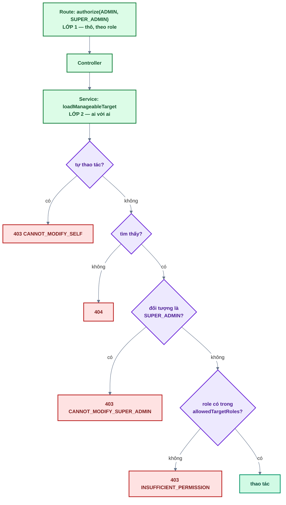
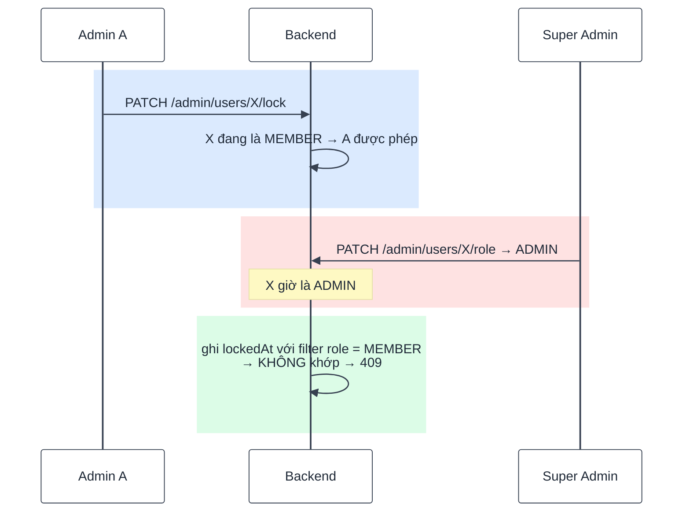

# Bài 11 — Quản lý người dùng & phân quyền

> Trước: [Bài 10](bai-10-google-oauth.md) · Mục lục: [README](README.md) · Tiếp: [Bài 12 — Storage R2](bai-12-storage-r2.md)

|               |                                                                                                                                |
| ------------- | ------------------------------------------------------------------------------------------------------------------------------ |
| **Mục tiêu**  | Quản trị viên tìm / lọc / phân trang danh sách người dùng, khoá — mở khoá — đổi vai trò, với ma trận quyền chặt ở tầng service |
| **Thời gian** | 5–6 giờ                                                                                                                        |
| **Độ khó**    | ★★★                                                                                                                            |
| **Kiến thức** | Phân quyền 2 lớp · escape regex (ReDoS) · phân trang · trạng thái suy ra · cập nhật có điều kiện chống tranh chấp              |
| **Test BE**   | `npm test -w backend -- -t "bai-11"` — **24 test**, **tất cả cần bạn làm**                                                     |
| **Test FE**   | `npm test -w frontend -- -t "bai-11"` — **14 test**, trong đó **11 test cần bạn làm**                                          |

Bài nhiều test nhất từ đầu tới giờ, vì **ma trận quyền** được kiểm từng ô một — bằng test gọi
**thẳng vào service**, không qua HTTP.

## 1. Mô tả tính năng

> _Là quản trị viên, tôi muốn tìm một người dùng, xem trạng thái của họ, và khoá tài khoản nếu có
> vấn đề — nhưng tôi không được phép động tới đồng nghiệp ngang cấp hay Super Admin._

### 1.1. Ma trận quyền — ai làm gì với ai

| Người thao tác ↓ / Đối tượng → | MEMBER                           | ADMIN                            | SUPER_ADMIN | Chính mình |
| ------------------------------ | -------------------------------- | -------------------------------- | ----------- | ---------- |
| **ADMIN**                      | Khoá / mở khoá                   | ✗                                | ✗           | ✗          |
| **SUPER_ADMIN**                | Khoá / mở khoá **+ đổi vai trò** | Khoá / mở khoá **+ đổi vai trò** | ✗           | ✗          |

Bốn quy tắc rút ra, tất cả đều có test:

1. **Không ai động được vào SUPER_ADMIN** — kể cả một SUPER_ADMIN khác (hệ thống chỉ có đúng một,
   do seed tạo).
2. **Không ai tự thao tác trên chính mình** — nếu không, Super Admin có thể tự khoá và khoá luôn
   cả hệ thống.
3. **Không ai gán được vai trò SUPER_ADMIN**, kể cả khi gọi thẳng service.
4. **ADMIN không đổi vai trò của ai cả** — route đã chặn bằng `authorize(SUPER_ADMIN)`, service
   chặn lại lần nữa.

### 1.2. Hai lớp phân quyền, và vì sao cần cả hai



Lớp 1 (`authorize`, bài 05) chỉ trả lời **"role này có được vào endpoint không"** — nó không biết
gì về đối tượng bị thao tác. Câu hỏi "ADMIN này có được khoá ADMIN kia không" **chỉ trả lời được ở
service**, nơi có cả `req.auth` lẫn bản ghi đích.

Vì thế test của bài này **gọi thẳng service** (`usersAdmin.service.test.js`), không qua HTTP: nếu
mai này có ai thêm một route mới quên `authorize`, lớp 2 vẫn phải tự đứng vững.

> **Thứ tự kiểm tra trong `loadManageableTarget` quan trọng.** "Tự thao tác" kiểm **trước tiên** —
> nếu kiểm sau, Super Admin tự khoá chính mình sẽ lọt qua (vì `allowedTargetRoles` của Super Admin
> có chứa ADMIN/MEMBER, nhưng chính họ lại là SUPER_ADMIN nên rơi vào nhánh 3… và thông điệp lỗi
> sẽ sai).

### 1.3. Cập nhật có điều kiện — chống tranh chấp

Giữa lúc kiểm quyền và lúc ghi có một khoảng trống. Ví dụ thật:



Không có `role: target.role` trong filter, Admin A sẽ khoá được một ADMIN — đúng thứ bước kiểm
quyền vừa cấm. Có điều kiện đó, lệnh ghi không khớp và service ném **409 `USER_STATE_CHANGED`**
("dữ liệu vừa đổi, tải lại đi").

Đây là **optimistic concurrency**: không khoá dữ liệu, chỉ ghi kèm điều kiện "mọi thứ vẫn như lúc
tôi đọc". Cùng kỹ thuật đã gặp ở bài 03 (`consume`) và bài 06 (`rotate`).

### 1.4. Trạng thái là **suy ra**, không phải một cột

`status` không tồn tại trong database. Nó được tính từ hai trường:

| `lockedAt` | `emailVerifiedAt` | → `status`   |
| ---------- | ----------------- | ------------ |
| có         | —                 | `LOCKED`     |
| trống      | trống             | `UNVERIFIED` |
| trống      | có                | `ACTIVE`     |

Vì vậy lọc theo status cần `buildStatusFilter` dịch ngược lại thành điều kiện truy vấn (cả hai hàm
đã viết sẵn cho bạn — đọc chúng trước khi viết `list`).

## 2. Kiến thức cần nắm trước

| Chủ đề                               | Điểm cốt lõi                                                               |
| ------------------------------------ | -------------------------------------------------------------------------- |
| **Phân quyền 2 lớp**                 | Lớp 1 = role vào được endpoint; lớp 2 = ai được thao tác trên ai           |
| **`escapeRegExp`**                   | Bắt buộc với từ khoá tìm kiếm — chống khớp bừa và chống ReDoS              |
| **Whitelist sort**                   | `sort` và `limit` do Zod chặn ở route, không nhận chuỗi tuỳ ý              |
| **`sendPaginated`**                  | Định dạng riêng cho danh sách: `{ success, data, meta }`                   |
| **Cập nhật có điều kiện**            | Đưa trạng thái đã đọc vào filter → không khớp nghĩa là có người chen ngang |
| **Idempotent**                       | Khoá người đã bị khoá → không đổi gì, **không** gửi email lần hai          |
| **`invalidateQueries` theo tiền tố** | `usersKeys.all` làm mới mọi danh sách đang cache                           |

## 3. Các file cần sửa

Tìm nhanh: `grep -rn "bai-11" backend/src frontend/src`

| Phía | File                                     | Hàm                                                            |
| ---- | ---------------------------------------- | -------------------------------------------------------------- |
| BE   | `modules/users/usersAdmin.service.js`    | `list`, `loadManageableTarget`, `lock`, `unlock`, `changeRole` |
| BE   | `modules/users/usersAdmin.controller.js` | `list`, `lock`, `unlock`, `changeRole`                         |
| FE   | `features/users/api/users.api.js`        | `listUsers`, `lockUser`, `unlockUser`, `changeUserRole`        |
| FE   | `features/users/hooks/useAdminUsers.js`  | `onSuccess` của `useUserMutation`                              |
| FE   | `features/users/permissions.js`          | `getAllowedActions`                                            |

**Đọc thêm (không sửa):** `deriveStatus`, `buildStatusFilter`, `stateChangedError`,
`LOCKABLE_TARGET_ROLES` (**đã viết sẵn**), `usersAdmin.schema.js` (whitelist sort / limit),
`shared/utils/pagination.js`, `shared/utils/regex.js`, `UsersTable.jsx`, `UserFilters.jsx`.

## 4. Đặc tả API

| Endpoint                               | Ai gọi được     | Thành công                  | Lỗi                              |
| -------------------------------------- | --------------- | --------------------------- | -------------------------------- |
| `GET /api/v1/admin/users`              | ADMIN+          | 200 `{ data: [...], meta }` | 400 (sort/limit sai) · 401 · 403 |
| `PATCH /api/v1/admin/users/:id/lock`   | ADMIN+          | 200 user                    | 400 · 401 · 403 · 404 · 409      |
| `PATCH /api/v1/admin/users/:id/unlock` | ADMIN+          | 200 user                    | như trên                         |
| `PATCH /api/v1/admin/users/:id/role`   | **SUPER_ADMIN** | 200 user                    | như trên                         |

Query của `GET /admin/users`: `q`, `role`, `status`, `sort`, `page`, `limit` (≤ **100**).
Mã lỗi 403 có ba loại: `FORBIDDEN` (lớp 1), `CANNOT_MODIFY_SELF`, `CANNOT_MODIFY_SUPER_ADMIN`,
`INSUFFICIENT_PERMISSION` (lớp 2).

> **Không có API xoá user.** Xoá tài khoản kéo theo file, ảnh, phiên, token — dự án chọn khoá thay
> vì xoá. Chỉ job hệ thống (bài 14) mới xoá, và chỉ với tài khoản **chưa kích hoạt** quá hạn.

## 5. Các bước thực hiện

### Phần A — Backend

**A1. `list`** — dựng filter, chạy song song, map `status`.

**A2. `loadManageableTarget`** — bốn bước, đúng thứ tự (sơ đồ 1.2).

**A3. `lock`** — transaction + điều kiện `role`.

**A4. `unlock`** và **A5. `changeRole`**.

**A6.** Bốn hàm controller — `list` dùng `sendPaginated`.

✅ Cả 24 test `[bai-11]` xanh.

✅ Thử bằng `curl`, dùng token của **Super Admin** (tài khoản seed):

```bash
curl -s "localhost:4000/api/v1/admin/users?q=an&status=ACTIVE&limit=5" \
  -H "Authorization: Bearer $TOKEN"

# Tìm với ký tự đặc biệt — phải KHÔNG khớp mọi người
curl -s "localhost:4000/api/v1/admin/users?q=.%2A" -H "Authorization: Bearer $TOKEN"
```

Thử ba nhánh bị chặn: khoá chính mình → `CANNOT_MODIFY_SELF`; khoá Super Admin →
`CANNOT_MODIFY_SUPER_ADMIN`; đặt `?limit=1000` → 400.

Thử **thu hồi phiên khi khoá**: đăng nhập tài khoản MEMBER ở trình duyệt khác, khoá nó từ đây, rồi
thao tác tiếp ở trình duyệt kia → bị đá ra ngay (nhờ `authenticate` tra database mỗi request).

### Phần B — Frontend

**B1.** Bốn hàm API → **B2.** `useUserMutation` → **B3.** `getAllowedActions`.

✅ 11 test đỏ chuyển xanh (14/14).

✅ Trên trình duyệt (**Quản trị → Người dùng**):

- Đăng nhập **ADMIN**: menu ⋯ ở dòng MEMBER có "Khoá", **không** có menu ở dòng ADMIN khác,
  **không** có mục đổi vai trò.
- Đăng nhập **SUPER_ADMIN**: menu ⋯ đủ mục, trừ dòng của chính mình và dòng Super Admin.
- Gõ từ khoá (tự áp dụng khi ngừng gõ), chọn bộ lọc → **URL đổi theo**; copy URL sang tab mới ra
  đúng kết quả đó.
- Đổi bộ lọc khi đang ở trang 2 → quay về trang 1.

## 6. Tiêu chí hoàn thành

- [ ] `npm test -w backend -- -t "bai-11"` → 24/24 xanh; frontend → 14/14 xanh
- [ ] Test bài 01–10 vẫn xanh
- [ ] `npm run build && npm run format:check && npm run check` sạch
- [ ] Tìm với `.*` → **không** trả về mọi người
- [ ] ADMIN khoá ADMIN khác → 403 `INSUFFICIENT_PERMISSION`; khoá chính mình → `CANNOT_MODIFY_SELF`
- [ ] Khoá MEMBER → người đó bị đăng xuất **ngay** ở thiết bị khác
- [ ] Khoá người đã bị khoá → không lỗi, **không** gửi email lần hai
- [ ] Gán `SUPER_ADMIN` cho ai đó → 403, kể cả khi gọi thẳng service
- [ ] Bộ lọc nằm trên URL; đổi bộ lọc quay về trang 1
- [ ] Đánh dấu `[x] Bài 11` trong [CHECKLIST.md](../../CHECKLIST.md) rồi commit

## 7. Câu hỏi & thử thách mở rộng

1. Thử thách: bỏ `escapeRegExp` trong `list`, rồi tìm với từ khoá `.*`. Test nào đỏ? Ngoài việc
   "khớp mọi người", một từ khoá như `(a+)+$` còn gây ra chuyện gì?
2. Vì sao test ma trận quyền gọi **thẳng service** thay vì gọi HTTP như các bài trước?
3. Thử thách: bỏ `role: target.role` khỏi filter của `lock`. Test nào đỏ? Dựng lại kịch bản hai
   quản trị viên thao tác cùng lúc.
4. Vì sao `lock` cần transaction còn `unlock` thì không?
5. `changeRole` **không** thu hồi phiên của người bị đổi vai trò. Vì sao như vậy vẫn an toàn?
6. `getAllowedActions` ở frontend lặp lại ma trận quyền của backend. Vì sao chấp nhận trùng lặp
   này, và điều gì giữ cho hai nơi không lệch nhau?

## 8. Gợi ý

<details>
<summary><b>Cấp 1 — Định hướng</b></summary>

- **`list`**: dựng `filter` bằng ba câu `if`, rồi `Promise.all` hai truy vấn, rồi `return
{ items, meta }`.
- **`loadManageableTarget`**: bốn câu `if` liên tiếp rồi `return target`.
- **`lock`**: kiểm quyền → `if (target.lockedAt) return target` → `runInTransaction` →
  gửi email → trả.
- **`unlock`**: như `lock` nhưng không có transaction, điều kiện `lockedAt` ngược lại.
- **`changeRole`**: tính `allowedTargets` bằng toán tử ba ngôi → kiểm quyền → chặn `SUPER_ADMIN` →
  `if` role không đổi → ghi có điều kiện → email.
- **Controller**: `list` dùng `sendPaginated`; ba hàm còn lại truyền `req.auth` làm tham số đầu.
- **FE**: `listUsers` lọc tham số rỗng và đọc thêm `meta`; hook thêm `onSuccess`;
  `getAllowedActions` là ba dòng.

</details>

<details>
<summary><b>Cấp 2 — Pseudo-code</b></summary>

```text
list({ q, role, status, sort, page, limit }):
  filter = {}
  nếu q: pattern = new RegExp(escapeRegExp(q), 'i')
         filter.$or = [{ name: pattern }, { email: pattern }]
  nếu role: filter.role = role
  nếu status: Object.assign(filter, buildStatusFilter(status))
  [users, total] = await Promise.all([
     User.find(filter).select(LIST_FIELDS).sort(sort)
         .skip(getSkip({ page, limit })).limit(limit).lean(),
     User.countDocuments(filter) ])
  return { items: mapLeanDocument(users).map(u => ({ ...u, status: deriveStatus(u) })),
           meta: buildPaginationMeta({ page, limit, total }) }

loadManageableTarget(actor, targetId, allowedTargetRoles):
  nếu actor.userId === targetId → throw AppError(403, CANNOT_MODIFY_SELF, ...)
  target = await User.findById(targetId)
  nếu !target → throw AppError(404, RESOURCE_NOT_FOUND, 'Không tìm thấy người dùng')
  nếu target.role === SUPER_ADMIN → throw AppError(403, CANNOT_MODIFY_SUPER_ADMIN, ...)
  nếu !allowedTargetRoles.includes(target.role) → throw AppError(403, INSUFFICIENT_PERMISSION, ...)
  return target

lock(actor, targetId):
  target = await loadManageableTarget(actor, targetId, LOCKABLE_TARGET_ROLES[actor.role])
  nếu target.lockedAt → return target
  lockedUser = await db.runInTransaction(async (session) => {
     updated = await User.findOneAndUpdate(
        { _id: targetId, role: target.role, lockedAt: null },
        { $set: { lockedAt: bây giờ } },
        { returnDocument: 'after', runValidators: true, session })
     nếu !updated → throw stateChangedError()
     await sessionsService.revokeAllForUser(targetId, { session })
     return updated })
  emailService.sendAccountLockedEmail({ user: lockedUser }); return lockedUser

unlock(actor, targetId):  // như lock, không transaction
  ... filter { _id, role: target.role, lockedAt: trusted({ $ne: null }) }, $set lockedAt: null

changeRole(actor, targetId, newRole):
  allowedTargets = actor.role === SUPER_ADMIN ? [MEMBER, ADMIN] : []
  target = await loadManageableTarget(actor, targetId, allowedTargets)
  nếu newRole === SUPER_ADMIN → throw AppError(403, CANNOT_MODIFY_SUPER_ADMIN, 'Không thể gán vai trò Super Admin')
  nếu target.role === newRole → return target
  updated = await User.findOneAndUpdate({ _id: targetId, role: target.role },
                                        { $set: { role: newRole } }, {...})
  nếu !updated → throw stateChangedError()
  emailService.sendRoleChangedEmail({ user: updated }); return updated

getAllowedActions(actor, target):
  isSelf = actor.id === target.id
  nếu isSelf HOẶC target.role === SUPER_ADMIN → { canLock: false, canChangeRole: false }
  isSuperAdmin = actor.role === SUPER_ADMIN
  return { canLock: isSuperAdmin || target.role === MEMBER, canChangeRole: isSuperAdmin }
```

</details>

<details>
<summary><b>Cấp 3 — Code tham khảo (backend)</b></summary>

```js
// usersAdmin.service.js
async function list({ q, role, status, sort, page, limit }) {
  const filter = {};
  if (q) {
    const pattern = new RegExp(escapeRegExp(q), 'i');
    filter.$or = [{ name: pattern }, { email: pattern }];
  }
  if (role) filter.role = role;
  if (status) Object.assign(filter, buildStatusFilter(status));

  const [users, total] = await Promise.all([
    User.find(filter)
      .select(LIST_FIELDS)
      .sort(sort)
      .skip(getSkip({ page, limit }))
      .limit(limit)
      .lean(),
    User.countDocuments(filter),
  ]);

  return {
    items: mapLeanDocument(users).map((user) => ({ ...user, status: deriveStatus(user) })),
    meta: buildPaginationMeta({ page, limit, total }),
  };
}

async function loadManageableTarget(actor, targetId, allowedTargetRoles) {
  if (actor.userId === targetId) {
    throw new AppError({
      statusCode: 403,
      code: ERROR_CODES.CANNOT_MODIFY_SELF,
      message: 'Không thể tự thao tác trên tài khoản của chính mình',
    });
  }

  const target = await User.findById(targetId);
  if (!target) {
    throw new AppError({
      statusCode: 404,
      code: ERROR_CODES.RESOURCE_NOT_FOUND,
      message: 'Không tìm thấy người dùng',
    });
  }
  if (target.role === USER_ROLES.SUPER_ADMIN) {
    throw new AppError({
      statusCode: 403,
      code: ERROR_CODES.CANNOT_MODIFY_SUPER_ADMIN,
      message: 'Không thể thao tác trên Super Admin',
    });
  }
  if (!allowedTargetRoles.includes(target.role)) {
    throw new AppError({
      statusCode: 403,
      code: ERROR_CODES.INSUFFICIENT_PERMISSION,
      message: 'Bạn không có quyền thao tác trên tài khoản này',
    });
  }
  return target;
}

async function lock(actor, targetId) {
  const target = await loadManageableTarget(actor, targetId, LOCKABLE_TARGET_ROLES[actor.role]);
  if (target.lockedAt) return target;

  const lockedUser = await db.runInTransaction(async (session) => {
    const updated = await User.findOneAndUpdate(
      { _id: targetId, role: target.role, lockedAt: null },
      { $set: { lockedAt: new Date() } },
      { returnDocument: 'after', runValidators: true, session },
    );
    if (!updated) throw stateChangedError();
    await sessionsService.revokeAllForUser(targetId, { session });
    return updated;
  });

  emailService.sendAccountLockedEmail({ user: lockedUser });
  return lockedUser;
}

async function unlock(actor, targetId) {
  const target = await loadManageableTarget(actor, targetId, LOCKABLE_TARGET_ROLES[actor.role]);
  if (!target.lockedAt) return target;

  const unlockedUser = await User.findOneAndUpdate(
    { _id: targetId, role: target.role, lockedAt: mongoose.trusted({ $ne: null }) },
    { $set: { lockedAt: null } },
    { returnDocument: 'after', runValidators: true },
  );
  if (!unlockedUser) throw stateChangedError();

  emailService.sendAccountUnlockedEmail({ user: unlockedUser });
  return unlockedUser;
}

async function changeRole(actor, targetId, newRole) {
  const allowedTargets =
    actor.role === USER_ROLES.SUPER_ADMIN ? [USER_ROLES.MEMBER, USER_ROLES.ADMIN] : [];
  const target = await loadManageableTarget(actor, targetId, allowedTargets);
  if (newRole === USER_ROLES.SUPER_ADMIN) {
    throw new AppError({
      statusCode: 403,
      code: ERROR_CODES.CANNOT_MODIFY_SUPER_ADMIN,
      message: 'Không thể gán vai trò Super Admin',
    });
  }
  if (target.role === newRole) return target;

  const updated = await User.findOneAndUpdate(
    { _id: targetId, role: target.role },
    { $set: { role: newRole } },
    { returnDocument: 'after', runValidators: true },
  );
  if (!updated) throw stateChangedError();

  emailService.sendRoleChangedEmail({ user: updated });
  return updated;
}
```

```js
// usersAdmin.controller.js
async function list(req, res) {
  const { items, meta } = await usersAdminService.list(req.validated.query);
  sendPaginated(res, items, meta);
}

async function lock(req, res) {
  const user = await usersAdminService.lock(req.auth, req.validated.params.id);
  sendSuccess(res, user, 'Đã khoá tài khoản và đăng xuất mọi thiết bị của người dùng');
}

async function unlock(req, res) {
  const user = await usersAdminService.unlock(req.auth, req.validated.params.id);
  sendSuccess(res, user, 'Đã mở khoá tài khoản');
}

async function changeRole(req, res) {
  const user = await usersAdminService.changeRole(
    req.auth,
    req.validated.params.id,
    req.validated.body.role,
  );
  sendSuccess(res, user, 'Đã cập nhật vai trò');
}
```

</details>

<details>
<summary><b>Cấp 3 — Code tham khảo (frontend)</b></summary>

```js
// features/users/api/users.api.js
export async function listUsers(params) {
  const query = Object.fromEntries(Object.entries(params).filter(([, value]) => value !== ''));
  const response = await http.get('/admin/users', { params: query });
  return { items: response.data.data, meta: response.data.meta };
}

export async function lockUser(userId) {
  const response = await http.patch(`/admin/users/${userId}/lock`);
  return response.data;
}

export async function unlockUser(userId) {
  const response = await http.patch(`/admin/users/${userId}/unlock`);
  return response.data;
}

export async function changeUserRole({ userId, role }) {
  const response = await http.patch(`/admin/users/${userId}/role`, { role });
  return response.data;
}
```

```js
// features/users/hooks/useAdminUsers.js
return useMutation({
  mutationFn,
  onSuccess: () => queryClient.invalidateQueries({ queryKey: usersKeys.all }),
});
```

```js
// features/users/permissions.js
export function getAllowedActions(actor, target) {
  const isSelf = actor.id === target.id;
  if (isSelf || target.role === USER_ROLES.SUPER_ADMIN)
    return { canLock: false, canChangeRole: false };

  const isSuperAdmin = actor.role === USER_ROLES.SUPER_ADMIN;
  return {
    canLock: isSuperAdmin || target.role === USER_ROLES.MEMBER,
    canChangeRole: isSuperAdmin,
  };
}
```

</details>

<details>
<summary><b>Đáp án câu hỏi mục 7</b></summary>

**1.** Test **"ký tự đặc biệt trong từ khoá được escape ('.\*' không khớp mọi người)"** sẽ đỏ.

Ngoài chuyện khớp bừa, từ khoá `(a+)+$` gây **ReDoS** (Regular expression Denial of Service). Biểu
thức đó có cấu trúc lồng lượng từ, khiến bộ máy regex phải thử số cách chia chuỗi tăng theo hàm mũ
khi không khớp. Một request duy nhất với chuỗi kiểm tra đủ dài sẽ chiếm CPU hàng giây tới hàng
phút — và Node.js chạy **một luồng**, nên trong lúc đó **toàn bộ API đứng hình** với mọi người
dùng.

Đây là lý do "escape từ khoá" không chỉ là chuyện đúng/sai kết quả tìm kiếm: nó là một lỗ hổng
từ chối dịch vụ. Quy tắc: **không bao giờ đưa chuỗi của người dùng thẳng vào `new RegExp`**.

**2.** Vì hai lớp phân quyền có thể hỏng **độc lập** với nhau, và ta muốn biết lớp 2 tự đứng vững.

Gọi qua HTTP thì mọi request đều đi qua `authorize` trước. Nếu `authorize` chặn đúng, test sẽ xanh
**kể cả khi** logic trong service hoàn toàn rỗng — ta không biết mình đang kiểm lớp nào. Gọi thẳng
service sẽ bỏ qua lớp 1 và buộc lớp 2 phải tự trả lời.

Điều đó quan trọng vì lớp 1 là thứ dễ quên nhất: ai đó thêm một route mới, copy nhầm middleware,
hoặc gọi service từ một job chạy nền (không có route nào cả). Lúc ấy lớp 2 là thứ duy nhất còn
lại. Bộ test của bài này vì vậy có **cả hai**: `usersAdmin.service.test.js` (lớp 2, gọi thẳng) và
`usersAdmin.test.js` (qua HTTP, kiểm lớp 1 + tích hợp).

**3.** Test **"role của đối tượng vừa bị đổi bởi người khác (race) → 409, không ghi đè"** sẽ đỏ.

Kịch bản: Admin A mở trang, thấy X là MEMBER, bấm "Khoá". Request chạy `loadManageableTarget` và
kết luận "A được phép, X là MEMBER". Ngay khoảnh khắc đó, Super Admin nâng X lên ADMIN. Request của
A đi tiếp và ghi `lockedAt` — **A vừa khoá một ADMIN**, điều mà chính bước kiểm quyền vài mili-giây
trước đã cấm.

Cửa sổ này rất hẹp nên gần như không bao giờ gặp khi thử tay, nhưng nó có thật và không thể đóng
bằng cách "kiểm kỹ hơn": mọi lần kiểm đều diễn ra **trước** lần ghi. Cách đóng là đưa điều kiện đã
kiểm **vào chính câu lệnh ghi** — `{ _id, role: target.role, lockedAt: null }`. MongoDB đảm bảo
filter và update xảy ra như một thao tác duy nhất.

**4.** Vì `lock` có **hai** thao tác ghi phải cùng sống cùng chết: đặt `lockedAt` **và** thu hồi
mọi phiên. Khoá mà không thu hồi phiên thì người bị khoá vẫn thao tác tiếp bằng access token còn
hạn tới 15 phút — đúng khoảng thời gian mà quản trị viên nghĩ rằng mình đã chặn họ.

`unlock` chỉ có **một** thao tác ghi (`lockedAt = null`), nên nó đã nguyên tử sẵn — thêm transaction
chỉ tốn chi phí mà không mua thêm gì. Nguyên tắc: transaction cho **nhiều** thao tác ghi liên quan,
không phải cho mọi thao tác ghi.

**5.** Vì `resolveAccessToken` (bài 05) **đọc role từ database ở mỗi request**, không đọc từ token.
Vai trò mới có hiệu lực ngay ở request kế tiếp, không cần chờ token hết hạn và không cần thu hồi
phiên.

Đây chính là phần thưởng cho quyết định "không nhét role vào JWT" ở bài 04. Nếu role nằm trong
token, `changeRole` sẽ **buộc** phải thu hồi mọi phiên — nghĩa là hạ quyền một người cũng đá họ ra
khỏi mọi thiết bị, một trải nghiệm tệ hơn nhiều so với việc chỉ mất bớt vài mục menu.

**6.** Chấp nhận trùng lặp vì hai nơi giải quyết hai vấn đề khác nhau: backend giữ **an toàn**,
frontend giữ **trải nghiệm**. Không có `getAllowedActions`, bảng sẽ hiện nút "Khoá" ở mọi dòng và
người dùng bấm vào chỉ để nhận một toast đỏ 403 — giao diện mời họ làm việc mà hệ thống sẽ từ chối.

Giữ hai nơi không lệch là nhóm test **"getAllowedActions — ẩn/hiện nút theo quyền (khớp backend)"**:
nó đi qua từng ô của ma trận (ADMIN trên MEMBER, ADMIN trên ADMIN, SUPER_ADMIN trên ADMIN,
SUPER_ADMIN trên SUPER_ADMIN, và chính mình) — đúng những ô mà `usersAdmin.service.test.js` kiểm ở
backend. Sửa ma trận một bên mà quên bên kia thì một trong hai bộ test sẽ đỏ.

Và nếu chúng **vẫn** lệch nhau vì một lý do nào đó, hậu quả chỉ là giao diện hiện thừa hoặc thiếu
nút — **không** phải lỗ hổng bảo mật, vì backend không bao giờ tin frontend.

</details>

---

> Trước: [Bài 10](bai-10-google-oauth.md) · Mục lục: [README](README.md) · Tiếp: [Bài 12 — Storage R2](bai-12-storage-r2.md)
