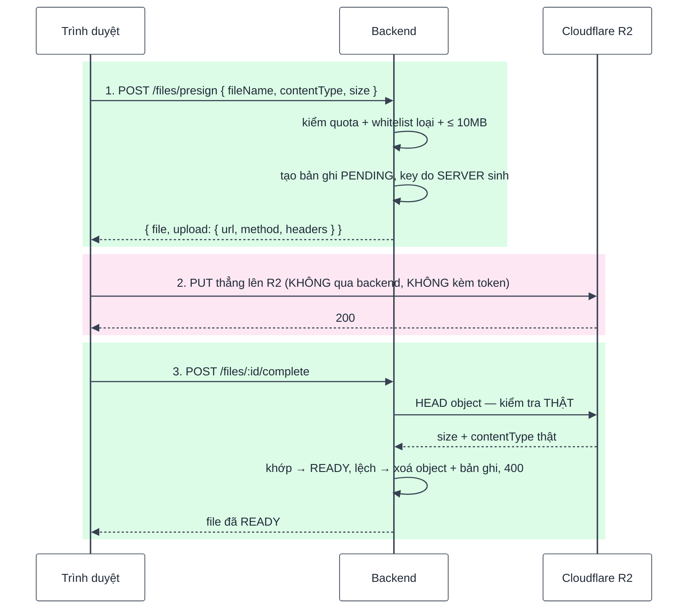

# Bài 12 — Storage R2 (tệp cá nhân)

> Trước: [Bài 11](bai-11-quan-ly-nguoi-dung-va-phan-quyen.md) · Mục lục: [README](README.md) · Tiếp: [Bài 13 — Media hệ thống & ảnh đại diện](bai-13-media-he-thong-va-anh-dai-dien.md)

|                            |                                                                                                            |
| -------------------------- | ---------------------------------------------------------------------------------------------------------- |
| **Mục tiêu**               | Người dùng tải file lên **thẳng** kho lưu trữ, xem danh sách, tải về và xoá — với quota và chống IDOR      |
| **Thời gian**              | 5–6 giờ                                                                                                    |
| **Độ khó**                 | ★★★                                                                                                        |
| **Kiến thức**              | Presigned URL · upload 3 bước · không tin client · quota · thứ tự xoá · aggregate                          |
| **Test BE**                | `npm test -w backend -- -t "bai-12"` — **19 test**, trong đó **17 test cần bạn làm**                       |
| **Test FE**                | `npm test -w frontend -- -t "bai-12"` — **6 test**, trong đó **5 test cần bạn làm**                        |
| **Không cần tài khoản R2** | Test mock `storage` bằng `vi.spyOn` — làm xong cả bài mà **không** phải tạo bucket. Muốn thử thật: mục 5.3 |

> **2 test BE đã xanh sẵn**: `storage — presigned URL cho R2` kiểm phần **ký URL** (`shared/lib/storage.js`,
> viết tay bằng `aws4fetch`). Phần đó là hạ tầng, không bị xoá — nhưng nên đọc để biết một
> presigned URL gồm những gì.

## 1. Mô tả tính năng

> _Là người dùng, tôi muốn tải tệp của mình lên và lấy lại sau — nhanh, kể cả với tệp lớn._

### 1.1. Vì sao upload phải có **ba** bước



Ba câu hỏi, ba câu trả lời:

**Vì sao không upload qua backend?** Một tệp 10MB đi qua backend nghĩa là backend phải nhận đủ
10MB vào bộ nhớ / đĩa rồi đẩy tiếp sang R2 — tốn băng thông gấp đôi, chiếm tiến trình Node (một
luồng!) và giới hạn kích thước theo cấu hình server. Presigned URL cho trình duyệt nói chuyện
thẳng với R2; backend chỉ **ký giấy phép**.

**Vì sao cần bước 3?** Vì bước 2 backend không nhìn thấy. Client hoàn toàn có thể gọi `complete`
mà chưa PUT gì, hoặc PUT một tệp khác hẳn. Bước 3 gọi `HEAD` để hỏi R2 **sự thật**: object có tồn
tại không, kích thước và loại có khớp với lúc khai báo không.

**Vì sao bản ghi tạo ở bước 1 chứ không phải bước 3?** Vì cần `key` trước khi ký URL, và cần một
chỗ để đếm quota. Bản ghi ở trạng thái `PENDING`; nếu người dùng bỏ ngang, job bài 14 dọn nó.

### 1.2. Bốn lớp kiểm soát, ở bốn chỗ khác nhau

| Lớp    | Ở đâu                         | Chặn gì                                                      |
| ------ | ----------------------------- | ------------------------------------------------------------ |
| Form   | `hooks/useFileUploader.js`    | Loại file và kích thước — báo lỗi **trước khi** gọi API      |
| Zod    | `files.schema.js` (route)     | Whitelist `contentType`, `size` ≤ 10MB, tên không rỗng       |
| Quota  | `assertWithinQuota` (service) | 100 file và 200MB **mỗi user**                               |
| Chữ ký | Presigned URL                 | R2 từ chối nếu `Content-Type` / `Content-Length` khác lúc ký |

Lớp cuối cùng đáng chú ý: nó nằm ở **phía R2**, độc lập với backend. Ngay cả khi ai đó lấy được
URL đã ký, họ cũng chỉ PUT được đúng loại và đúng kích thước đã khai báo.

### 1.3. Hai chi tiết nhỏ nhưng quan trọng

**Key do server sinh**: `users/<ownerId>/<uuid>`. Nhận key từ client thì người ta ghi đè được file
của người khác, hoặc thoát khỏi thư mục của mình bằng `../`.

**Thứ tự xoá**: object trên R2 **trước**, bản ghi **sau**.

```js
await storage.deleteObject(file.key); // nếu lỗi → dừng ở đây, bản ghi còn nguyên
await File.deleteOne({ _id: file._id });
```

Làm ngược lại: R2 lỗi thì object nằm lại bucket vĩnh viễn, không còn bản ghi nào trỏ tới nó — không
ai biết để dọn, và vẫn tính tiền. Cách trên tệ nhất là người dùng phải bấm xoá lại.

## 2. Kiến thức cần nắm trước

| Chủ đề                    | Điểm cốt lõi                                                                   |
| ------------------------- | ------------------------------------------------------------------------------ |
| **Presigned URL**         | URL có chữ ký + hạn dùng, cho phép đúng một thao tác trên đúng một key         |
| **`HEAD` object**         | Hỏi metadata mà không tải nội dung — dùng để đối chiếu ở bước 3                |
| **`aggregate`**           | `$match` + `$group` để cộng `size`. **Phải tự ép** `ObjectId`, khác với `find` |
| **Quota tính cả PENDING** | Nếu không, xin URL liên tục rồi bỏ ngang là lách được                          |
| **IDOR**                  | Mọi truy vấn có `ownerId` trong filter (bài 07)                                |
| **Upload trực tiếp**      | Dùng axios **riêng** (`directUpload.js`), không gửi cookie/token sang R2       |

## 3. Các file cần sửa

Tìm nhanh: `grep -rn "bai-12" backend/src frontend/src`

| Phía | File                                | Hàm                                                                                                            |
| ---- | ----------------------------------- | -------------------------------------------------------------------------------------------------------------- |
| BE   | `modules/files/files.service.js`    | `getUsage`, `assertWithinQuota`, `requestUpload`, `completeUpload`, `listForOwner`, `getDownloadUrl`, `remove` |
| BE   | `modules/files/files.controller.js` | `requestUpload`, `completeUpload`, `list`, `getDownloadUrl`, `remove`                                          |
| FE   | `features/files/api/files.api.js`   | 5 hàm                                                                                                          |
| FE   | `features/files/hooks/useFiles.js`  | `useUploadFile`, `useDeleteFile`, `useDownloadFile`                                                            |

**Đọc thêm (không sửa):** `shared/lib/storage.js` (**ký URL — đã viết sẵn**), `files.model.js`,
`files.constants.js` (whitelist + quota), `files.schema.js`, `shared/lib/directUpload.js`,
`hooks/useFileUploader.js`, `FileUploader.jsx`, `shared/config/features.js`.

## 4. Đặc tả API

| Endpoint                          | Thành công                 | Lỗi                                                                               |
| --------------------------------- | -------------------------- | --------------------------------------------------------------------------------- |
| `POST /api/v1/files/presign`      | **201** `{ file, upload }` | 400 · 401 · **403 `STORAGE_QUOTA_EXCEEDED`** · 404 `FEATURE_NOT_CONFIGURED` · 429 |
| `POST /api/v1/files/:id/complete` | 200 file READY             | 400 `UPLOAD_NOT_FOUND` · 400 `UPLOAD_MISMATCH` · 404                              |
| `GET /api/v1/files`               | 200 `{ data, meta }`       | 401                                                                               |
| `GET /api/v1/files/:id/download`  | 200 `{ url }`              | 404                                                                               |
| `DELETE /api/v1/files/:id`        | 200 `'Đã xoá file'`        | 404 · 500 (R2 lỗi)                                                                |

- **Chưa cấu hình `R2_*`** → mọi route `/files` trả **404 `FEATURE_NOT_CONFIGURED`** (middleware
  `requireFeature` đã gắn sẵn ở route), và frontend ẩn nút tải lên.
- Presign có rate limit **30 lần / 15 phút / user**.
- Whitelist: JPEG, PNG, WebP, GIF, PDF; tối đa **10MB** mỗi file.

## 5. Các bước thực hiện

### 5.1. Backend

**A1. `getUsage`** + **A2. `assertWithinQuota`** — làm trước, `requestUpload` cần chúng.

**A3. `requestUpload`** → **A4. `completeUpload`** (đọc kỹ mục 1.1) → **A5. `listForOwner`** →
**A6. `getDownloadUrl`** → **A7. `remove`** (chú ý thứ tự, mục 1.3).

**A8.** Năm hàm controller.

✅ Cả 19 test `[bai-12]` xanh.

### 5.2. Frontend

**B1.** Năm hàm API → **B2.** ba hook.

✅ 5 test đỏ chuyển xanh (6/6).

### 5.3. (Tuỳ chọn) Thử với R2 thật

Test đã mock `storage` nên **không bắt buộc**. Muốn thử thật:

1. <https://dash.cloudflare.com> → **R2** → tạo bucket (giữ **private**, không bật public access).
2. **Manage R2 API Tokens** → tạo token quyền **Object Read & Write** → lấy Access Key ID và
   Secret.
3. Điền `R2_ACCOUNT_ID`, `R2_ACCESS_KEY_ID`, `R2_SECRET_ACCESS_KEY`, `R2_BUCKET` vào
   `backend/.env`, khởi động lại.
4. **Cấu hình CORS của bucket** — bắt buộc, xem [docs/05](../05-storage-va-email.md). Thiếu bước
   này thì bước PUT ở trình duyệt báo lỗi mạng dù backend hoàn toàn đúng.

✅ Trên trình duyệt (**Tài khoản → Tệp của tôi**):

- Tải lên một ảnh → thanh tiến trình chạy → danh sách xuất hiện file mới.
- Mở tab **Network**: request `PUT` đi thẳng tới `r2.cloudflarestorage.com` và **không** có header
  `Authorization` — đó là điều test `"PUT thẳng lên R2 (không kèm access token)"` kiểm.
- Bấm **Tải về** → tệp tải xuống với đúng tên gốc.
- Chọn một tệp `.exe` → báo lỗi ngay, **không** có request nào đi ra.

## 6. Tiêu chí hoàn thành

- [ ] `npm test -w backend -- -t "bai-12"` → 19/19 xanh; frontend → 6/6 xanh
- [ ] Test bài 01–11 vẫn xanh
- [ ] `npm run build && npm run format:check && npm run check` sạch
- [ ] Trong database: `key` dạng `users/<ownerId>/<uuid>`, bản ghi mới có `status: "PENDING"`
- [ ] Gọi `complete` mà **chưa** PUT gì → 400 `UPLOAD_NOT_FOUND`, bản ghi vẫn PENDING
- [ ] Tải file của **người khác** (đổi id trên URL) → **404**, không phải 403
- [ ] Vượt quota (tự sửa hằng số xuống cho dễ thử) → 403 `STORAGE_QUOTA_EXCEEDED`
- [ ] Xoá khi R2 lỗi → bản ghi **vẫn còn** để thử lại
- [ ] Đánh dấu `[x] Bài 12` trong [CHECKLIST.md](../../CHECKLIST.md) rồi commit

## 7. Câu hỏi & thử thách mở rộng

1. Thử thách: trong `completeUpload`, bỏ phần `headObject` và cho `status` thành READY luôn. Test
   nào đỏ? Người dùng "độc hại" làm được gì với API này?
2. Thử thách: trong `remove`, đổi thứ tự — xoá bản ghi trước, xoá object sau. Test nào đỏ? Vì sao
   thứ tự sai gây hậu quả **không thể sửa được**?
3. Vì sao `getUsage` phải đếm cả bản ghi `PENDING`?
4. `getUsage` dùng `new mongoose.Types.ObjectId(String(ownerId))` còn `listForOwner` chỉ viết
   `{ ownerId }`. Vì sao khác nhau?
5. Vì sao `uploadToPresignedUrl` dùng một instance axios **riêng** thay vì http client chung?
6. Presigned URL tải về chỉ sống 5 phút. Nếu đặt 7 ngày cho tiện thì rủi ro là gì?

## 8. Gợi ý

<details>
<summary><b>Cấp 1 — Định hướng</b></summary>

- **`getUsage`**: `const [usage] = await File.aggregate([...])` rồi `usage?.totalSize ?? 0`.
- **`assertWithinQuota`**: destructure `getUsage`, hai câu `if`, mỗi cái ném `AppError` 403.
- **`requestUpload`**: 3 dòng sau lời gọi `assertWithinQuota`.
- **`completeUpload`**: 4 khối — tìm PENDING, `headObject`, so khớp (xoá cả hai nếu lệch),
  `findOneAndUpdate` sang READY.
- **`listForOwner`**: giống `list` của bài 11 nhưng đơn giản hơn (không có bộ lọc).
- **`getDownloadUrl`** và **`remove`**: mỗi hàm 3–4 dòng.
- **Controller**: `requestUpload` dùng `sendCreated`, `list` dùng `sendPaginated`.
- **FE**: `useUploadFile` viết `mutationFn` ba bước; hai hook còn lại chỉ thêm `onSuccess`.

</details>

<details>
<summary><b>Cấp 2 — Pseudo-code</b></summary>

```text
getUsage(ownerId):
  [usage] = await File.aggregate([
     { $match: { ownerId: new mongoose.Types.ObjectId(String(ownerId)) } },
     { $group: { _id: null, totalSize: { $sum: '$size' }, count: { $sum: 1 } } } ])
  return { totalSize: usage?.totalSize ?? 0, count: usage?.count ?? 0 }

assertWithinQuota(ownerId, size):
  { totalSize, count } = await getUsage(ownerId)
  nếu count >= MAX_FILES_PER_USER → throw AppError(403, STORAGE_QUOTA_EXCEEDED, '...giới hạn N file...')
  nếu totalSize + size > MAX_TOTAL_SIZE_BYTES_PER_USER
     → throw AppError(403, STORAGE_QUOTA_EXCEEDED, '...hết dung lượng...')

requestUpload(ownerId, { fileName, contentType, size }):
  await assertWithinQuota(ownerId, size)
  file = await File.create({ ownerId, key: `users/${ownerId}/${randomUUID()}`,
                             originalName: fileName, contentType, size })
  upload = await storage.createUploadUrl({ key: file.key, contentType, contentLength: size })
  return { file, upload }

completeUpload(ownerId, fileId):
  file = await File.findOne({ _id: fileId, ownerId, status: PENDING })
  nếu !file → throw fileNotFoundError()
  uploaded = await storage.headObject(file.key)
  nếu !uploaded → throw AppError(400, UPLOAD_NOT_FOUND, '...')
  nếu uploaded.size !== file.size HOẶC uploaded.contentType !== file.contentType:
     await storage.deleteObject(file.key); await File.deleteOne({ _id: file._id })
     throw AppError(400, UPLOAD_MISMATCH, '...')
  readyFile = await File.findOneAndUpdate({ _id: file._id, status: PENDING },
                                          { $set: { status: READY } },
                                          { returnDocument: 'after', runValidators: true })
  nếu !readyFile → throw fileNotFoundError()
  return readyFile

listForOwner(ownerId, { page, limit }):   // như bài 11, filter = { ownerId, status: READY }
getDownloadUrl(ownerId, fileId):          // findOne có ownerId + READY → createDownloadUrl
remove(ownerId, fileId):                  // findOne có ownerId → deleteObject → deleteOne

useUploadFile → mutationFn(file):
  setProgress(0)
  { file: pendingFile, upload } = await presignFile({ fileName: file.name,
                                                      contentType: file.type, size: file.size })
  await uploadToPresignedUrl({ upload, file, onProgress: setProgress })
  return completeFile(pendingFile.id)
```

</details>

<details>
<summary><b>Cấp 3 — Code tham khảo (backend)</b></summary>

```js
// files.service.js
async function getUsage(ownerId) {
  const [usage] = await File.aggregate([
    { $match: { ownerId: new mongoose.Types.ObjectId(String(ownerId)) } },
    { $group: { _id: null, totalSize: { $sum: '$size' }, count: { $sum: 1 } } },
  ]);
  return { totalSize: usage?.totalSize ?? 0, count: usage?.count ?? 0 };
}

async function assertWithinQuota(ownerId, size) {
  const { totalSize, count } = await getUsage(ownerId);

  if (count >= MAX_FILES_PER_USER) {
    throw new AppError({
      statusCode: 403,
      code: ERROR_CODES.STORAGE_QUOTA_EXCEEDED,
      message: `Bạn đã đạt giới hạn ${MAX_FILES_PER_USER} file. Vui lòng xoá bớt file cũ`,
    });
  }
  if (totalSize + size > MAX_TOTAL_SIZE_BYTES_PER_USER) {
    throw new AppError({
      statusCode: 403,
      code: ERROR_CODES.STORAGE_QUOTA_EXCEEDED,
      message: 'Bạn đã dùng hết dung lượng lưu trữ. Vui lòng xoá bớt file cũ',
    });
  }
}

async function requestUpload(ownerId, { fileName, contentType, size }) {
  await assertWithinQuota(ownerId, size);

  const file = await File.create({
    ownerId,
    key: `users/${ownerId}/${randomUUID()}`,
    originalName: fileName,
    contentType,
    size,
  });
  const upload = await storage.createUploadUrl({ key: file.key, contentType, contentLength: size });
  return { file, upload };
}

async function completeUpload(ownerId, fileId) {
  const file = await File.findOne({ _id: fileId, ownerId, status: FILE_STATUSES.PENDING });
  if (!file) throw fileNotFoundError();

  const uploaded = await storage.headObject(file.key);
  if (!uploaded) {
    throw new AppError({
      statusCode: 400,
      code: ERROR_CODES.UPLOAD_NOT_FOUND,
      message: 'Chưa nhận được file trên kho lưu trữ, vui lòng tải lên lại',
    });
  }
  if (uploaded.size !== file.size || uploaded.contentType !== file.contentType) {
    await storage.deleteObject(file.key);
    await File.deleteOne({ _id: file._id });
    throw new AppError({
      statusCode: 400,
      code: ERROR_CODES.UPLOAD_MISMATCH,
      message: 'File tải lên không khớp thông tin đã khai báo',
    });
  }

  const readyFile = await File.findOneAndUpdate(
    { _id: file._id, status: FILE_STATUSES.PENDING },
    { $set: { status: FILE_STATUSES.READY } },
    { returnDocument: 'after', runValidators: true },
  );
  if (!readyFile) throw fileNotFoundError();
  return readyFile;
}

async function listForOwner(ownerId, { page, limit }) {
  const filter = { ownerId, status: FILE_STATUSES.READY };
  const [files, total] = await Promise.all([
    File.find(filter)
      .select('originalName contentType size createdAt')
      .sort({ createdAt: -1 })
      .skip(getSkip({ page, limit }))
      .limit(limit)
      .lean(),
    File.countDocuments(filter),
  ]);
  return { items: mapLeanDocument(files), meta: buildPaginationMeta({ page, limit, total }) };
}

async function getDownloadUrl(ownerId, fileId) {
  const file = await File.findOne({ _id: fileId, ownerId, status: FILE_STATUSES.READY });
  if (!file) throw fileNotFoundError();

  const url = await storage.createDownloadUrl({ key: file.key, downloadName: file.originalName });
  return { url };
}

async function remove(ownerId, fileId) {
  const file = await File.findOne({ _id: fileId, ownerId });
  if (!file) throw fileNotFoundError();

  await storage.deleteObject(file.key);
  await File.deleteOne({ _id: file._id });
}
```

```js
// files.controller.js
async function requestUpload(req, res) {
  const result = await filesService.requestUpload(req.auth.userId, req.validated.body);
  sendCreated(res, result);
}

async function completeUpload(req, res) {
  const file = await filesService.completeUpload(req.auth.userId, req.validated.params.id);
  sendSuccess(res, file, 'Tải lên thành công');
}

async function list(req, res) {
  const { items, meta } = await filesService.listForOwner(req.auth.userId, req.validated.query);
  sendPaginated(res, items, meta);
}

async function getDownloadUrl(req, res) {
  sendSuccess(res, await filesService.getDownloadUrl(req.auth.userId, req.validated.params.id));
}

async function remove(req, res) {
  await filesService.remove(req.auth.userId, req.validated.params.id);
  sendSuccess(res, null, 'Đã xoá file');
}
```

</details>

<details>
<summary><b>Cấp 3 — Code tham khảo (frontend)</b></summary>

```js
// features/files/api/files.api.js
export async function listFiles(page) {
  const response = await http.get('/files', { params: { page } });
  return { items: response.data.data, meta: response.data.meta };
}

export async function presignFile(body) {
  const response = await http.post('/files/presign', body);
  return response.data.data;
}

export async function completeFile(fileId) {
  const response = await http.post(`/files/${fileId}/complete`);
  return response.data.data;
}

export async function getFileDownloadUrl(fileId) {
  const response = await http.get(`/files/${fileId}/download`);
  return response.data.data.url;
}

export async function deleteFile(fileId) {
  const response = await http.delete(`/files/${fileId}`);
  return response.data;
}
```

```js
// features/files/hooks/useFiles.js
const mutation = useMutation({
  mutationFn: async (file) => {
    setProgress(0);
    const { file: pendingFile, upload } = await presignFile({
      fileName: file.name,
      contentType: file.type,
      size: file.size,
    });
    await uploadToPresignedUrl({ upload, file, onProgress: setProgress });
    return completeFile(pendingFile.id);
  },
  onSuccess: () => queryClient.invalidateQueries({ queryKey: filesKeys.all }),
});
```

```js
// features/files/hooks/useFiles.js — hai hook còn lại
return useMutation({
  mutationFn: deleteFile,
  onSuccess: () => queryClient.invalidateQueries({ queryKey: filesKeys.all }),
});

return useMutation({
  mutationFn: getFileDownloadUrl,
  onSuccess: (url) => window.location.assign(url),
});
```

</details>

<details>
<summary><b>Đáp án câu hỏi mục 7</b></summary>

**1.** Hai test đỏ: **"chưa có object trên R2 → 400 UPLOAD_NOT_FOUND, bản ghi giữ PENDING"** và
**"dung lượng/loại lệch → xoá object + bản ghi, 400 UPLOAD_MISMATCH"**.

Người dùng độc hại làm được hai việc. Thứ nhất, **nói dối về dung lượng**: khai báo `size: 1` để
qua quota, rồi PUT một tệp 10MB (R2 sẽ từ chối vì chữ ký khoá `Content-Length`, nhưng nếu hệ thống
không kiểm lại thì bản ghi vẫn thành READY với `size: 1` — quota tính sai vĩnh viễn). Thứ hai,
**tạo bản ghi ma**: gọi `presign` rồi `complete` liên tục mà không PUT gì, sinh ra hàng nghìn bản
ghi READY trỏ vào hư không; danh sách file đầy mục bấm vào là lỗi.

Nguyên tắc: mọi thứ xảy ra **ngoài tầm quan sát của server** (ở đây là bước PUT) đều phải được
**xác minh lại** bằng một nguồn server tin được — chính R2.

**2.** Test **"R2 lỗi khi xoá → 500, bản ghi còn nguyên để thử lại"** sẽ đỏ.

"Không thể sửa được" theo nghĩa đen: khi bản ghi đã bị xoá mà object còn lại, **không còn thông
tin nào** trỏ tới object đó. `key` chỉ tồn tại trong bản ghi vừa xoá. Object trở thành rác vô hình
— chiếm dung lượng, tính tiền hàng tháng, và cách duy nhất tìm ra nó là quét toàn bộ bucket rồi
đối chiếu với database.

Thứ tự đúng để lại trạng thái **tệ nhất là lặp lại được**: object đã mất nhưng bản ghi còn → người
dùng bấm xoá lần nữa, `headObject`/`deleteObject` trên key không tồn tại không gây lỗi, bản ghi
biến mất. Luôn sắp xếp sao cho lỗi giữa chừng để lại trạng thái **có thể sửa**.

**3.** Vì `PENDING` nghĩa là "đã xin URL", và URL đó **có thể đã được dùng** — object có khi đã
nằm trên R2 rồi, chỉ là bước `complete` chưa chạy.

Nếu quota chỉ tính READY, cách lách quá dễ: gọi `presign` 1000 lần, PUT đủ 1000 tệp lên R2, và
**không bao giờ** gọi `complete`. Quota vẫn báo 0, nhưng bucket đã chứa 10GB. Bản ghi PENDING sẽ
được job bài 14 dọn sau 24 giờ — nhưng trong 24 giờ đó không có gì chặn cả, và chỉ cần lặp lại là
duy trì được vô hạn.

**4.** Vì `find`/`findOne` của Mongoose **tự ép kiểu** filter theo schema: thấy `ownerId` khai báo
là `ObjectId`, nó tự chuyển chuỗi thành `ObjectId`. `aggregate` thì **không** — nó gửi pipeline
thẳng xuống MongoDB, không qua lớp schema.

Hậu quả nếu quên: `$match: { ownerId: '65f...' }` so một **chuỗi** với một **ObjectId** → không
bao giờ khớp → `getUsage` luôn trả `{ totalSize: 0, count: 0 }` → **quota không bao giờ chặn ai**.
Và nó hỏng **im lặng**: không lỗi, không cảnh báo, chỉ là một hàm luôn trả về 0.

Quy tắc: trong `aggregate`, mọi id phải tự ép bằng `new mongoose.Types.ObjectId(...)`.

**5.** Vì http client chung được cấu hình cho **API của mình**: nó gắn `Authorization: Bearer
<accessToken>`, gửi cookie (`withCredentials`), thêm header `X-Requested-With`, và có interceptor
tự refresh khi gặp 401.

Gửi những thứ đó sang **Cloudflare R2** là rò rỉ thông tin xác thực sang một bên thứ ba — R2 không
cần và không nên thấy access token của bạn. Tệ hơn: nếu R2 trả 401 (URL hết hạn), interceptor sẽ
tưởng phiên đăng nhập hỏng và đi refresh token, rồi có thể đăng xuất người dùng.

Vì vậy `directUpload.js` dùng một instance axios **trắng**, và đây là **ngoại lệ duy nhất** trong
dự án không đi qua http client chung — chú thích ngay trong file nói rõ điều đó. Có test kiểm:
_"PUT thẳng lên R2 (không kèm access token)"_.

**6.** URL đã ký là **quyền truy cập ở dạng chuỗi**: ai cầm nó cũng tải được tệp, không cần đăng
nhập. Nó sẽ nằm trong lịch sử trình duyệt, log của proxy, và dễ bị dán vào chat khi ai đó muốn
"gửi nhanh cho đồng nghiệp".

Với hạn 5 phút, một URL rò rỉ gần như vô hại — nó chết trước khi kịp lan. Với hạn 7 ngày, nó là
một liên kết công khai sống một tuần cho một tệp riêng tư, và **không có cách nào thu hồi** (chữ
ký đã phát ra rồi, trừ khi đổi khoá của cả bucket).

Đánh đổi: hạn ngắn nghĩa là mỗi lần tải phải xin URL mới — đúng những gì `useDownloadFile` làm, và
cái giá là một request nhỏ.

</details>

---

> Trước: [Bài 11](bai-11-quan-ly-nguoi-dung-va-phan-quyen.md) · Mục lục: [README](README.md) · Tiếp: [Bài 13 — Media hệ thống & ảnh đại diện](bai-13-media-he-thong-va-anh-dai-dien.md)
