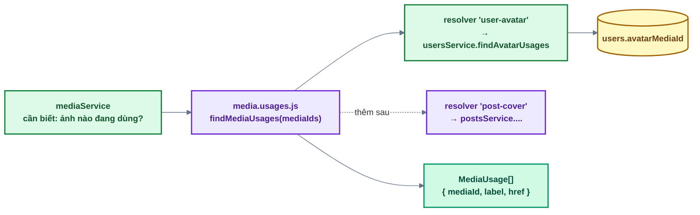
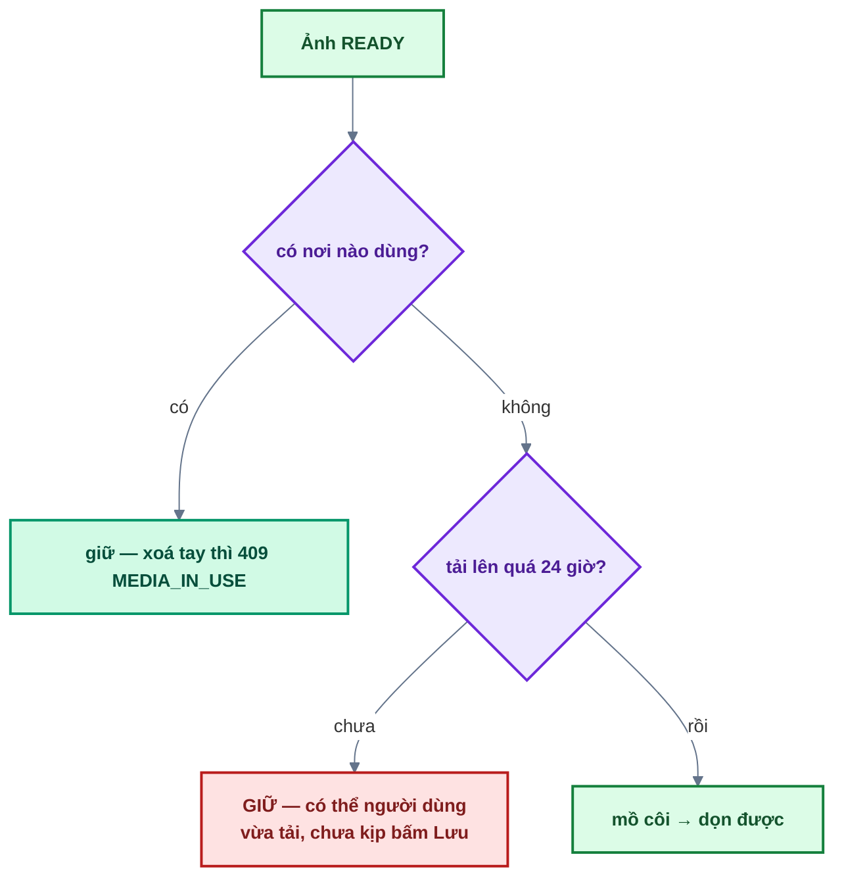

# Bài 13 — Media hệ thống & ảnh đại diện

> Trước: [Bài 12](bai-12-storage-r2.md) · Mục lục: [README](README.md) · Tiếp: [Bài 14 — Lịch tự động & trang thống kê](bai-14-lich-tu-dong-va-thong-ke.md)

|               |                                                                                                                                    |
| ------------- | ---------------------------------------------------------------------------------------------------------------------------------- |
| **Mục tiêu**  | Người dùng đổi ảnh đại diện; quản trị viên quản lý thư viện ảnh hệ thống, **không xoá được ảnh đang dùng**, và dọn được ảnh mồ côi |
| **Thời gian** | 6–8 giờ (nên chia 2 buổi: phần A–B backend, phần C frontend)                                                                       |
| **Độ khó**    | ★★★                                                                                                                                |
| **Kiến thức** | "Nơi dùng" thay khoá ngoại · điểm mở rộng · ảnh mồ côi + khoảng ân hạn · redirect 302 · CORP                                       |
| **Test BE**   | `npm test -w backend -- -t "bai-13"` — **19 test**, trong đó **15 test cần bạn làm** (4 test tạo / xoá thư mục là phần có sẵn)     |
| **Test FE**   | `npm test -w frontend -- -t "bai-13"` — **14 test**, trong đó **12 test cần bạn làm**                                              |

Bài này dùng lại toàn bộ kỹ thuật upload của bài 12. Cái **mới** là câu hỏi: _làm sao biết một
ảnh đang được dùng ở đâu, khi database không có khoá ngoại?_

## 1. Mô tả tính năng

> _Là người dùng, tôi muốn đặt ảnh đại diện._
>
> _Là quản trị viên, tôi muốn xem mọi ảnh của hệ thống, biết ảnh nào đang được dùng ở đâu, và dọn
> những ảnh không ai dùng — mà **không bao giờ** làm vỡ ảnh đang hiển thị._

Hai bảng tách biệt: `media` (ảnh **hệ thống** — avatar, banner…) và `files` (tệp **cá nhân**, bài
12). Mỗi ảnh nằm trong một thư mục đơn cấp, key R2 là `media/<folder>/<uuid>`.

Thư mục là **bản ghi thật** (collection `media_folders`, **đã viết sẵn**): quản trị viên tạo thư
mục rỗng trước rồi mới tải ảnh vào; thư mục hệ thống `avatars` luôn có và không tải tay được.
Phần tạo / xoá / liệt kê thư mục ở backend là của bạn để **đọc**, không phải viết.

### 1.1. "Nơi dùng" — thứ thay thế khoá ngoại

MongoDB không có ràng buộc tham chiếu: xoá một ảnh đang là avatar của ai đó thì **không gì ngăn
lại**, và avatar của họ thành ảnh vỡ.

Dự án giải quyết bằng một **registry resolver**:



Module `media` **không biết** ai dùng ảnh của nó. Mỗi module "có dùng ảnh" tự khai báo một hàm trả
lời câu hỏi đó, và `media.usages.js` gom chúng lại. Đây là một **điểm mở rộng** (xem [docs/07 §1](../07-tao-du-an-moi-va-deploy.md#1-tạo-dự-án-mới-từ-source-base)):
thêm "ảnh bìa bài viết" = thêm một resolver, **không sửa** `mediaService`.

`label` và `href` không phải trang trí: khi quản trị viên bị chặn xoá, giao diện hiện **đúng
đường dẫn** tới nơi đang dùng ảnh để họ gỡ trước.

### 1.2. Ảnh mồ côi và khoảng ân hạn 24 giờ



**Ảnh vừa tải lên luôn là "mồ côi"** — nó chưa được gán vào đâu cả. Không có khoảng ân hạn, job
dọn chạy đúng lúc ấy sẽ xoá mất ảnh người dùng vừa tải, ngay trước khi họ bấm Lưu.

Cũng vì thế, **gỡ avatar không xoá ảnh**: nó chỉ đặt `avatarMediaId = null`. Ảnh cũ thành mồ côi
và biến mất sau 24 giờ — đủ lâu để gán lại nếu gỡ nhầm.

### 1.3. Hiển thị ảnh từ bucket **private**

Bucket không có URL công khai. Ảnh hiển thị qua một endpoint **công khai** của API:

```
/content">
   → 302 → presigned GET trên R2 (5 phút)
```

Hai header bắt buộc ở bước redirect:

| Header                                       | Vì sao                                                                                           |
| -------------------------------------------- | ------------------------------------------------------------------------------------------------ |
| `Cache-Control: public, max-age=240`         | Cache **ngắn hơn** hạn của presigned URL (5 phút), để trình duyệt không dùng lại một URL đã chết |
| `Cross-Origin-Resource-Policy: cross-origin` | helmet mặc định đặt `same-origin` → frontend ở origin khác **không nhúng được** ảnh              |

Backend **redirect**, không proxy: nó không tải ảnh về rồi gửi lại, chỉ chỉ đường.

### 1.4. Avatar — bốn điều kiện, cả bốn đều cần

`mediaId` đến từ body của người dùng. `assertUsableAsAvatar` kiểm **đồng thời**:

| Điều kiện                      | Thiếu nó thì                                         |
| ------------------------------ | ---------------------------------------------------- |
| `uploadedBy: userId`           | Gán ảnh của **người khác** làm avatar của mình       |
| `folder: AVATAR_FOLDER`        | Trỏ vào một ảnh hệ thống bất kỳ trong thư viện admin |
| `status: READY`                | Avatar trỏ vào object chưa tồn tại                   |
| `size ≤ MAX_AVATAR_SIZE_BYTES` | Ảnh 10MB nằm ở mọi trang có header                   |

Và **một thông điệp lỗi chung** cho cả bốn — nói rõ "ảnh này của người khác" là xác nhận `mediaId`
đó có thật.

## 2. Kiến thức cần nắm trước

| Chủ đề                         | Điểm cốt lõi                                                   |
| ------------------------------ | -------------------------------------------------------------- |
| **Không có khoá ngoại**        | Phải tự hỏi từng module "ảnh nào đang được dùng"               |
| **Điểm mở rộng**               | Thêm nơi dùng ảnh = thêm resolver, không sửa `mediaService`    |
| **Tránh N+1**                  | `groupUsages` gọi **một** lần cho cả trang, không hỏi từng ảnh |
| **`details` trong `AppError`** | Mảng `{ label, href }` → frontend hiện link tới nơi dùng       |
| **Khoảng ân hạn**              | Ảnh mới tải luôn "mồ côi" — phải chờ 24 giờ mới dọn            |
| **Thư mục là bản ghi thật**    | Thư mục rỗng tồn tại được; tải ảnh chỉ vào thư mục đã tạo      |
| **302 + CORP**                 | Redirect sang presigned URL; header cho phép nhúng khác origin |

## 3. Các file cần sửa

Tìm nhanh: `grep -rn "bai-13" backend/src frontend/src`

| Phía | File                                  | Hàm                                                                                                                                                 |
| ---- | ------------------------------------- | --------------------------------------------------------------------------------------------------------------------------------------------------- |
| BE   | `modules/media/media.service.js`      | `requestUpload`, `completeUpload`, `list`, `remove`, `cleanupOrphans`, `cleanupPendingUploads`, `getContentUrl`, `assertUsableAsAvatar`, `getStats` |
| BE   | `modules/media/media.controller.js`   | 8 hàm                                                                                                                                               |
| BE   | `modules/users/users.service.js`      | `findAvatarUsages`, `setAvatar`                                                                                                                     |
| BE   | `modules/users/users.controller.js`   | `updateMyAvatar`                                                                                                                                    |
| FE   | `features/media/api/media.api.js`     | 8 hàm                                                                                                                                               |
| FE   | `features/media/hooks/useMedia.js`    | `onSuccess` của `useMediaMutation`                                                                                                                  |
| FE   | `features/account/api/account.api.js` | `presignAvatar`, `completeAvatarUpload`, `updateAvatar`                                                                                             |
| FE   | `features/account/hooks/useAvatar.js` | `useChangeAvatar`, `useRemoveAvatar`                                                                                                                |

**Đọc thêm (không sửa):** `media.usages.js` (**registry resolver — đã viết sẵn**),
`groupUsages`, `mediaNotFoundError`, `media.constants.js`, `media.model.js`,
`mediaFolder.model.js` + `listFolders` / `createFolder` / `deleteFolder` / `requestLibraryUpload`
(**thư mục — đã viết sẵn**), `AvatarUploader.jsx`, `MediaLibrary.jsx` (lưới thư mục),
`MediaBrowser.jsx` (trang thư mục), `MediaGrid.jsx`, `shared/lib/media.js`.

## 4. Đặc tả API

| Endpoint                                   | Ai gọi được   | Ghi chú                                                            |
| ------------------------------------------ | ------------- | ------------------------------------------------------------------ |
| `GET /api/v1/media/:id/content`            | **Công khai** | 302 → presigned GET; 404 nếu chưa READY                            |
| `POST /api/v1/media/avatar/presign`        | Đã đăng nhập  | Luôn vào folder `avatars`, ≤ **2MB**                               |
| `POST /api/v1/media/:id/complete`          | Người tải lên | 400 `UPLOAD_NOT_FOUND` / `UPLOAD_MISMATCH`                         |
| `PATCH /api/v1/users/me/avatar`            | Đã đăng nhập  | `{ mediaId }` hoặc `{ mediaId: null }` để gỡ; 400 `INVALID_AVATAR` |
| `GET /api/v1/admin/media`                  | ADMIN+        | Lọc `folder`, `q`, `type`, `usage` (`in-use` / `orphan`)           |
| `GET /api/v1/admin/media/folders`          | ADMIN+        | Tổng quan thư mục (service có sẵn — controller một dòng)           |
| `POST /api/v1/admin/media/folders`         | ADMIN+        | Tạo thư mục rỗng, 409 `FOLDER_EXISTS` (có sẵn)                     |
| `DELETE /api/v1/admin/media/folders/:name` | ADMIN+        | Chỉ khi rỗng, 409 `FOLDER_NOT_EMPTY` (có sẵn)                      |
| `POST /api/v1/admin/media/presign`         | ADMIN+        | Chỉ vào thư mục đã tạo (chưa có → 404), ≤ 10MB                     |
| `DELETE /api/v1/admin/media/:id`           | ADMIN+        | **409 `MEDIA_IN_USE`** kèm `details` nơi dùng                      |
| `POST /api/v1/admin/media/cleanup-orphans` | ADMIN+        | `{ deletedCount }`                                                 |

## 5. Các bước thực hiện

### Phần A — Ảnh đại diện (backend)

**A1. `usersService.findAvatarUsages`** — resolver của `media.usages.js` gọi vào đây.

**A2. `usersService.setAvatar`** và **A3. `mediaService.assertUsableAsAvatar`** (mục 1.4).

**A4. `mediaService.requestUpload`** + **`completeUpload`** — giống bài 12.

**A5. `mediaService.getContentUrl`**.

**A6.** Các hàm controller liên quan: `redirectToContent`, `requestAvatarUpload`,
`completeUpload`, và `usersController.updateMyAvatar`.

✅ 4 test `Ảnh đại diện` + 2 test `GET /media/:id/content` chuyển xanh.

### Phần B — Thư viện ảnh (backend)

**B1. `list`** (nhớ `groupUsages` **một** lần) → **B2.** controller `listFolders` (service có
sẵn) → **B3. `remove`** (mục
1.1) → **B4. `cleanupOrphans`** + **`cleanupPendingUploads`** (mục 1.2) → **B5. `getStats`** →
**B6.** các hàm controller còn lại.

✅ Cả 19 test `[bai-13]` backend xanh.

✅ Thử bằng `curl` (cần `R2_*` như bài 12, hoặc bỏ qua và tin test):

```bash
curl -s "localhost:4000/api/v1/admin/media?usage=orphan" -H "Authorization: Bearer $TOKEN"
curl -s -X POST localhost:4000/api/v1/admin/media/cleanup-orphans -H "Authorization: Bearer $TOKEN"
```

Thử nhánh chặn: đặt một ảnh làm avatar, rồi xoá đúng ảnh đó từ `/admin/media/:id` → **409
`MEDIA_IN_USE`**, và `error.details` chứa `{ label: "Ảnh đại diện của …", href: "/admin/users?q=…" }`.

### Phần C — Frontend

**C1.** 3 hàm API avatar + 2 hook avatar → **C2.** 8 hàm API media (kể cả `createMediaFolder`,
`deleteMediaFolder`) + `useMediaMutation`.

✅ 12 test đỏ chuyển xanh (14/14).

✅ Trên trình duyệt:

- **Tài khoản → Hồ sơ**: chọn ảnh → avatar đổi ngay trên header (không F5). Chọn ảnh > 2MB → báo
  lỗi ngay, **không** gọi API.
- **Gỡ ảnh** → header về chữ cái đầu của tên.
- **Quản trị → Thư viện ảnh**: tạo thư mục mới (gõ "Sự kiện 2026" → thành `su-kien-2026`), kéo
  thả vài ảnh vào → mỗi ảnh có tiến trình riêng.
- Mở thư mục `avatars`: ảnh avatar vừa đặt có nhãn "Đang dùng"; menu ⋯ → Xoá → hộp thoại báo
  không xoá được và **chỉ đường** tới người đang dùng.
- "Ảnh mồ côi" → bấm **Dọn ảnh mồ côi** → báo số ảnh đã dọn.

## 6. Tiêu chí hoàn thành

- [ ] `npm test -w backend -- -t "bai-13"` → 19/19 xanh; frontend → 14/14 xanh
- [ ] Test bài 01–12 vẫn xanh
- [ ] `npm run build && npm run format:check && npm run check` sạch
- [ ] Xoá ảnh đang là avatar → 409 `MEDIA_IN_USE`, `details` có `label` **và** `href`
- [ ] Gán ảnh của **người khác** làm avatar → 400 `INVALID_AVATAR`
- [ ] Gỡ avatar → ảnh **vẫn còn** trong `media` (chỉ `avatarMediaId` thành `null`)
- [ ] Ảnh mới tải (chưa gán) **không** bị `cleanup-orphans` xoá
- [ ] `GET /media/:id/content` trả **302** kèm `Cross-Origin-Resource-Policy: cross-origin`
- [ ] Đánh dấu `[x] Bài 13` trong [CHECKLIST.md](../../CHECKLIST.md) rồi commit

## 7. Câu hỏi & thử thách mở rộng

1. Thử thách: trong `cleanupOrphans`, bỏ điều kiện `createdAt` (khoảng ân hạn). Test nào đỏ? Mô
   tả chuỗi sự kiện làm người dùng mất ảnh vừa tải.
2. Vì sao `remove` trả **409** kèm `details` thay vì cứ xoá và để avatar thành ảnh vỡ?
3. Thử thách: trong `assertUsableAsAvatar`, bỏ điều kiện `uploadedBy: userId`. Test nào đỏ? Người
   dùng làm được gì?
4. Vì sao `list` gọi `groupUsages` **một lần cho cả trang** thay vì hỏi nơi dùng của từng ảnh
   trong `.map()`?
5. Gỡ avatar chỉ đặt `avatarMediaId = null` chứ không xoá ảnh. Được gì và mất gì?
6. `GET /media/:id/content` là endpoint **công khai** — ai biết id cũng xem được ảnh. Vì sao chấp
   nhận được, và nếu cần ảnh riêng tư thật thì phải đổi gì?

## 8. Gợi ý

<details>
<summary><b>Cấp 1 — Định hướng</b></summary>

- **`findAvatarUsages`**: dựng `filter` bằng toán tử ba ngôi, `find().select().lean()`, rồi
  `.map()` sang 4 trường. Nhớ `String(...)` cho id.
- **`requestUpload` / `completeUpload`**: copy khuôn bài 12, đổi `ownerId` → `uploadedBy`, `File`
  → `Media`, thông điệp "file" → "ảnh".
- **`list`**: giống `usersAdminService.list` (bài 11), thêm hai việc — lọc `usage` và gắn
  `usages` sau khi có `items`.
- **`remove`**: `findById` → `groupUsages([id]).get(id)` → `if (usages?.length) throw` →
  xoá object → xoá bản ghi.
- **`cleanupOrphans`** và **`cleanupPendingUploads`**: `find(...).select('key')` rồi vòng `for`
  xoá từng cái.
- **`assertUsableAsAvatar`**: một `findOne` bốn điều kiện + một `if` gộp hai trường hợp.
- **`updateMyAvatar`**: `if (mediaId)` trước khi gọi `assertUsableAsAvatar`, message theo ba ngôi.
- **FE**: các hàm API theo khuôn cũ; `useChangeAvatar` bốn bước; hai hook thêm `onSuccess`.

</details>

<details>
<summary><b>Cấp 2 — Pseudo-code</b></summary>

```text
findAvatarUsages(mediaIds):
  filter = mediaIds ? { avatarMediaId: trusted({ $in: mediaIds }) }
                    : { avatarMediaId: trusted({ $ne: null }) }
  users = await User.find(filter).select('avatarMediaId name email').lean()
  return users.map(u => ({ mediaId: String(u.avatarMediaId), userId: String(u._id),
                           name: u.name, email: u.email }))

list({ folder, q, type, usage, sort, page, limit }):
  filter = { status: READY }
  nếu folder → filter.folder = folder
  nếu type   → filter.contentType = type
  nếu q      → filter.name = new RegExp(escapeRegExp(q), 'i')
  nếu usage:
     usedIds = [...new Set((await findMediaUsages()).map(i => i.mediaId))]
     filter._id = trusted(usage === 'in-use' ? { $in: usedIds } : { $nin: usedIds })
  [documents, total] = await Promise.all([ Media.find(filter)... , Media.countDocuments(filter) ])
  items = mapLeanDocument(documents)
  usagesByMedia = await groupUsages(items.map(i => i.id))
  return { items: items.map(i => ({ ...i, usages: usagesByMedia.get(i.id) ?? [] })),
           meta: buildPaginationMeta({ page, limit, total }) }

remove(mediaId):
  media = await Media.findById(mediaId); nếu !media → throw mediaNotFoundError()
  usages = (await groupUsages([String(media._id)])).get(String(media._id))
  nếu usages?.length → throw AppError(409, MEDIA_IN_USE, '...', details: usages)
  await storage.deleteObject(media.key); await Media.deleteOne({ _id: media._id })

cleanupOrphans({ now }):
  usedIds = [...new Set((await findMediaUsages()).map(i => i.mediaId))]
  orphans = await Media.find({ status: READY,
                               createdAt: trusted({ $lt: now - ORPHAN_GRACE_PERIOD_MS }),
                               _id: trusted({ $nin: usedIds }) }).select('key')
  for orphan of orphans: await storage.deleteObject(orphan.key)
                         await Media.deleteOne({ _id: orphan._id })
  return orphans.length

assertUsableAsAvatar(userId, mediaId):
  media = await Media.findOne({ _id: mediaId, uploadedBy: userId,
                                folder: AVATAR_FOLDER, status: READY }).select('size')
  nếu !media HOẶC media.size > MAX_AVATAR_SIZE_BYTES
     → throw AppError(400, INVALID_AVATAR, 'Ảnh đại diện không hợp lệ — hãy tải ảnh lên lại')

getStats():
  usedIds = ...
  [total, inUse] = await Promise.all([ countDocuments({ status: READY }),
                                       countDocuments({ status: READY, _id: trusted({ $in: usedIds }) }) ])
  return { total, orphans: total - inUse }

useChangeAvatar → mutationFn(file):
  { media, upload } = await presignAvatar({ fileName, contentType, size })
  await uploadToPresignedUrl({ upload, file })
  await completeAvatarUpload(media.id)
  return updateAvatar(media.id)
```

</details>

<details>
<summary><b>Cấp 3 — Code tham khảo (backend)</b></summary>

```js
// users.service.js
async function findAvatarUsages(mediaIds) {
  const filter = mediaIds
    ? { avatarMediaId: mongoose.trusted({ $in: mediaIds }) }
    : { avatarMediaId: mongoose.trusted({ $ne: null }) };
  const users = await User.find(filter).select('avatarMediaId name email').lean();
  return users.map((user) => ({
    mediaId: String(user.avatarMediaId),
    userId: String(user._id),
    name: user.name,
    email: user.email,
  }));
}

async function setAvatar(userId, mediaId) {
  return User.findByIdAndUpdate(
    userId,
    { $set: { avatarMediaId: mediaId } },
    { returnDocument: 'after', runValidators: true },
  );
}
```

```js
// media.service.js
async function requestUpload(uploaderId, { folder, fileName, contentType, size }) {
  const media = await Media.create({
    folder,
    key: `media/${folder}/${randomUUID()}`,
    name: fileName,
    contentType,
    size,
    uploadedBy: uploaderId,
  });
  const upload = await storage.createUploadUrl({
    key: media.key,
    contentType,
    contentLength: size,
  });
  return { media, upload };
}

async function completeUpload(uploaderId, mediaId) {
  const media = await Media.findOne({
    _id: mediaId,
    uploadedBy: uploaderId,
    status: MEDIA_STATUSES.PENDING,
  });
  if (!media) throw mediaNotFoundError();

  const uploaded = await storage.headObject(media.key);
  if (!uploaded) {
    throw new AppError({
      statusCode: 400,
      code: ERROR_CODES.UPLOAD_NOT_FOUND,
      message: 'Chưa nhận được ảnh trên kho lưu trữ, vui lòng tải lên lại',
    });
  }
  if (uploaded.size !== media.size || uploaded.contentType !== media.contentType) {
    await storage.deleteObject(media.key);
    await Media.deleteOne({ _id: media._id });
    throw new AppError({
      statusCode: 400,
      code: ERROR_CODES.UPLOAD_MISMATCH,
      message: 'Ảnh tải lên không khớp thông tin đã khai báo',
    });
  }

  const readyMedia = await Media.findOneAndUpdate(
    { _id: media._id, status: MEDIA_STATUSES.PENDING },
    { $set: { status: MEDIA_STATUSES.READY } },
    { returnDocument: 'after', runValidators: true },
  );
  if (!readyMedia) throw mediaNotFoundError();
  return readyMedia;
}

async function list({ folder, q, type, usage, sort, page, limit }) {
  const filter = { status: MEDIA_STATUSES.READY };
  if (folder) filter.folder = folder;
  if (type) filter.contentType = type;
  if (q) filter.name = new RegExp(escapeRegExp(q), 'i');
  if (usage) {
    const usedIds = [...new Set((await findMediaUsages()).map((item) => item.mediaId))];
    filter._id = mongoose.trusted(usage === 'in-use' ? { $in: usedIds } : { $nin: usedIds });
  }

  const [documents, total] = await Promise.all([
    Media.find(filter)
      .select(LIST_FIELDS)
      .sort(sort)
      .skip(getSkip({ page, limit }))
      .limit(limit)
      .lean(),
    Media.countDocuments(filter),
  ]);

  const items = mapLeanDocument(documents);
  const usagesByMedia = await groupUsages(items.map((item) => item.id));
  return {
    items: items.map((item) => ({ ...item, usages: usagesByMedia.get(item.id) ?? [] })),
    meta: buildPaginationMeta({ page, limit, total }),
  };
}

async function remove(mediaId) {
  const media = await Media.findById(mediaId);
  if (!media) throw mediaNotFoundError();

  const usages = (await groupUsages([String(media._id)])).get(String(media._id));
  if (usages?.length) {
    throw new AppError({
      statusCode: 409,
      code: ERROR_CODES.MEDIA_IN_USE,
      message: 'Ảnh đang được sử dụng, hãy gỡ khỏi các nơi dùng trước khi xoá',
      details: usages,
    });
  }

  await storage.deleteObject(media.key);
  await Media.deleteOne({ _id: media._id });
}

async function cleanupOrphans({ now = new Date() } = {}) {
  const usedIds = [...new Set((await findMediaUsages()).map((item) => item.mediaId))];
  const orphans = await Media.find({
    status: MEDIA_STATUSES.READY,
    createdAt: mongoose.trusted({ $lt: new Date(now.getTime() - ORPHAN_GRACE_PERIOD_MS) }),
    _id: mongoose.trusted({ $nin: usedIds }),
  }).select('key');

  for (const orphan of orphans) {
    await storage.deleteObject(orphan.key);
    await Media.deleteOne({ _id: orphan._id });
  }
  return orphans.length;
}

async function getContentUrl(mediaId) {
  const media = await Media.findOne({ _id: mediaId, status: MEDIA_STATUSES.READY }).select('key');
  if (!media) throw mediaNotFoundError();
  return storage.createDownloadUrl({ key: media.key });
}

async function assertUsableAsAvatar(userId, mediaId) {
  const media = await Media.findOne({
    _id: mediaId,
    uploadedBy: userId,
    folder: AVATAR_FOLDER,
    status: MEDIA_STATUSES.READY,
  }).select('size');

  if (!media || media.size > MAX_AVATAR_SIZE_BYTES) {
    throw new AppError({
      statusCode: 400,
      code: ERROR_CODES.INVALID_AVATAR,
      message: 'Ảnh đại diện không hợp lệ — hãy tải ảnh lên lại',
    });
  }
}

async function getStats() {
  const usedIds = [...new Set((await findMediaUsages()).map((item) => item.mediaId))];
  const [total, inUse] = await Promise.all([
    Media.countDocuments({ status: MEDIA_STATUSES.READY }),
    Media.countDocuments({ status: MEDIA_STATUSES.READY, _id: mongoose.trusted({ $in: usedIds }) }),
  ]);
  return { total, orphans: total - inUse };
}
```

```js
// media.controller.js
async function redirectToContent(req, res) {
  const url = await mediaService.getContentUrl(req.validated.params.id);
  res.set('Cache-Control', `public, max-age=${CONTENT_CACHE_SECONDS}`);
  res.set('Cross-Origin-Resource-Policy', 'cross-origin');
  res.redirect(302, url);
}

async function requestAvatarUpload(req, res) {
  const result = await mediaService.requestUpload(req.auth.userId, {
    ...req.validated.body,
    folder: AVATAR_FOLDER,
  });
  sendCreated(res, result);
}

async function cleanupOrphans(_req, res) {
  const deletedCount = await mediaService.cleanupOrphans();
  sendSuccess(res, { deletedCount }, `Đã dọn ${deletedCount} ảnh mồ côi`);
}
```

```js
// users.controller.js
async function updateMyAvatar(req, res) {
  const { mediaId } = req.validated.body;
  if (mediaId) await mediaService.assertUsableAsAvatar(req.auth.userId, mediaId);
  const user = await usersService.setAvatar(req.auth.userId, mediaId);
  sendSuccess(res, user, mediaId ? 'Đã cập nhật ảnh đại diện' : 'Đã gỡ ảnh đại diện');
}
```

</details>

<details>
<summary><b>Cấp 3 — Code tham khảo (frontend)</b></summary>

```js
// features/account/hooks/useAvatar.js
return useMutation({
  mutationFn: async (file) => {
    const { media, upload } = await presignAvatar({
      fileName: file.name,
      contentType: file.type,
      size: file.size,
    });
    await uploadToPresignedUrl({ upload, file });
    await completeAvatarUpload(media.id);
    return updateAvatar(media.id);
  },
  onSuccess: (body) => setUser(body.data),
});
```

```js
// features/account/hooks/useAvatar.js — gỡ avatar
return useMutation({
  mutationFn: () => updateAvatar(null),
  onSuccess: (body) => setUser(body.data),
});
```

```js
// features/media/hooks/useMedia.js
return useMutation({
  mutationFn,
  onSuccess: () => queryClient.invalidateQueries({ queryKey: mediaKeys.all }),
});
```

</details>

<details>
<summary><b>Đáp án câu hỏi mục 7</b></summary>

**1.** Test **"cleanupOrphans: chỉ xoá ảnh không ai dùng VÀ đã quá 24 giờ"** sẽ đỏ.

Chuỗi sự kiện: người dùng vào trang Hồ sơ, chọn ảnh mới. Ảnh được tải lên R2 và bản ghi chuyển
READY — nhưng **chưa ai dùng nó**, vì bước gán avatar (`PATCH /users/me/avatar`) chưa chạy. Ngay
khoảnh khắc đó, job dọn ảnh mồ côi chạy (mặc định 03:00 hằng ngày, nhưng quản trị viên cũng có thể
bấm "Chạy ngay"). Nó thấy một ảnh READY không ai dùng → xoá. Người dùng bấm Lưu và nhận lỗi, hoặc
tệ hơn: avatar được gán vào một object vừa bị xoá và hiện thành ảnh vỡ.

Khoảng ân hạn thừa nhận một sự thật: **"mồ côi" và "vừa được tạo, chưa kịp dùng" nhìn giống hệt
nhau** trong database. Thời gian là thứ duy nhất phân biệt được.

**2.** Vì hệ thống **biết** ảnh đang được dùng — im lặng xoá là cố tình tạo ra dữ liệu hỏng.

Sau khi xoá, avatar của ai đó trỏ vào một object không còn tồn tại. Không có lỗi nào ở backend,
không có log nào; chỉ có một ảnh vỡ trên giao diện, và người chịu hậu quả không phải người bấm
nút. Sửa lại còn khó: không ai biết avatar đó **từng** là ảnh nào.

409 kèm `details` biến một hỏng hóc âm thầm thành một quyết định có ý thức: quản trị viên thấy
chính xác ảnh đang nằm ở đâu, bấm vào `href` để tới đó, gỡ ra, rồi quay lại xoá. `MEDIA_IN_USE`
chính là thứ thay cho ràng buộc `ON DELETE RESTRICT` mà MongoDB không có.

**3.** Test **"không lấy được ảnh của người khác / ảnh ngoài folder avatars làm avatar → 400
INVALID_AVATAR"** sẽ đỏ.

`mediaId` nằm trong **body** của request, người dùng gửi gì cũng được. Không có `uploadedBy`, chỉ
cần biết id một ảnh bất kỳ trong folder `avatars` là gán được nó làm avatar của mình — và id đó
không khó lấy: nó nằm ngay trong `src` của thẻ `` ở mọi chỗ hiển thị avatar người khác.

Hậu quả thực tế nhẹ hơn các lỗ hổng trước (ảnh avatar vốn công khai), nhưng nó phá vỡ một quy tắc
quan trọng: **id do client gửi lên luôn phải kèm điều kiện sở hữu** — cùng nguyên tắc chống IDOR
của bài 07 và bài 12.

**4.** Để tránh **N+1**: một truy vấn cho danh sách, rồi thêm N truy vấn cho N ảnh trên trang. Với
`limit = 20` là 21 lượt đi database thay vì 2, và con số đó tăng tuyến tính theo kích thước trang.

`groupUsages(items.map(i => i.id))` hỏi **một lần** cho toàn bộ id của trang rồi gom kết quả vào
một `Map`. Đây cũng là lý do `findAvatarUsages` nhận **mảng** `mediaIds` chứ không nhận một id:
API của nó được thiết kế để gọi theo lô ngay từ đầu.

Lưu ý phần lọc `usage` vẫn nạp **toàn bộ** id đang dùng vào bộ nhớ — chấp nhận được ở quy mô này,
và bản review source base (giảng viên phát cùng lời giải) đã ghi ngưỡng để chuyển sang cờ `inUse`
khi cần.

**5.** **Được**: gỡ nhầm thì gán lại được trong 24 giờ; thao tác gỡ nhanh và không bao giờ thất
bại vì R2; và `PATCH /users/me/avatar` giữ đúng một trách nhiệm (đổi con trỏ), không kéo theo việc
xoá file.

**Mất**: ảnh vẫn chiếm dung lượng cho tới khi job dọn chạy. Đó là cái giá rất rẻ so với rủi ro của
phương án ngược lại — xoá ngay khi gỡ có nghĩa là mỗi lần đổi avatar là một lần xoá không hoàn
tác, và nếu việc gán avatar mới thất bại giữa chừng thì người dùng mất cả ảnh cũ lẫn ảnh mới.

Nguyên tắc: **tách "không còn dùng" khỏi "xoá vĩnh viễn"**, và để một tiến trình nền làm việc thứ
hai sau một khoảng an toàn.

**6.** Chấp nhận được vì id là **ObjectId 24 ký tự hex**, không đoán được trong thực tế, và nội
dung ở đây là avatar / ảnh minh hoạ — những thứ vốn đã hiển thị công khai trên giao diện. Đổi lại,
ta được một thứ rất giá trị: thẻ `` hoạt động bình thường, không cần JavaScript
gắn token, và trình duyệt cache được ảnh.

Nếu cần ảnh **riêng tư thật** (hồ sơ y tế, tài liệu nội bộ), phải đổi hai thứ: thêm `authenticate`

- kiểm quyền vào endpoint này, và bỏ `Cache-Control: public` (chuyển sang `private`) để proxy
  chung không giữ lại bản sao. Lúc đó thẻ `` thường không dùng được nữa — phải tải qua `fetch`
  có `Authorization` rồi tạo blob URL. Chính vì sự phức tạp đó mà dự án tách hai bảng: `files` cho
  nội dung riêng tư (luôn kiểm quyền, bài 12) và `media` cho nội dung hiển thị công khai.

</details>

---

> Trước: [Bài 12](bai-12-storage-r2.md) · Mục lục: [README](README.md) · Tiếp: [Bài 14 — Lịch tự động & trang thống kê](bai-14-lich-tu-dong-va-thong-ke.md)
