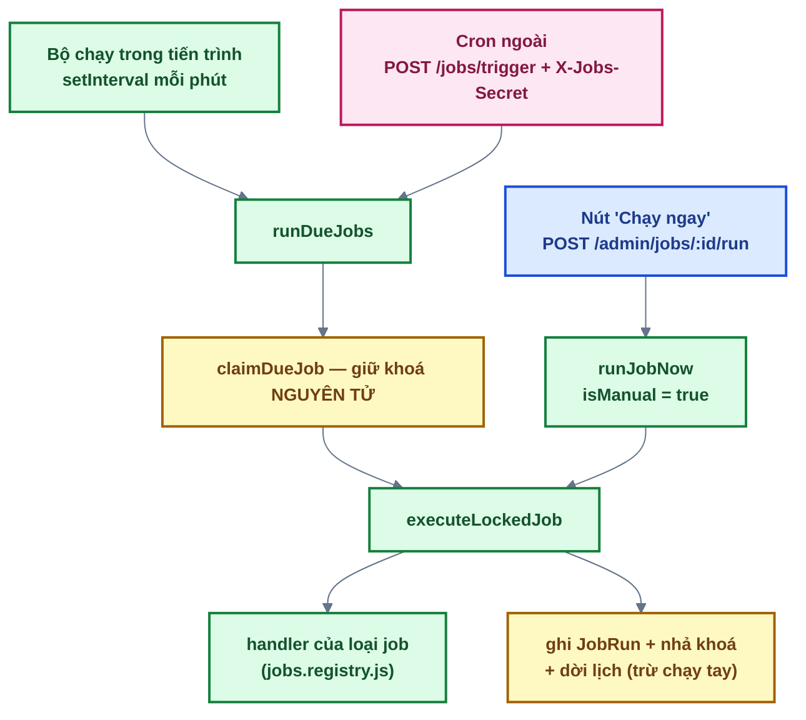
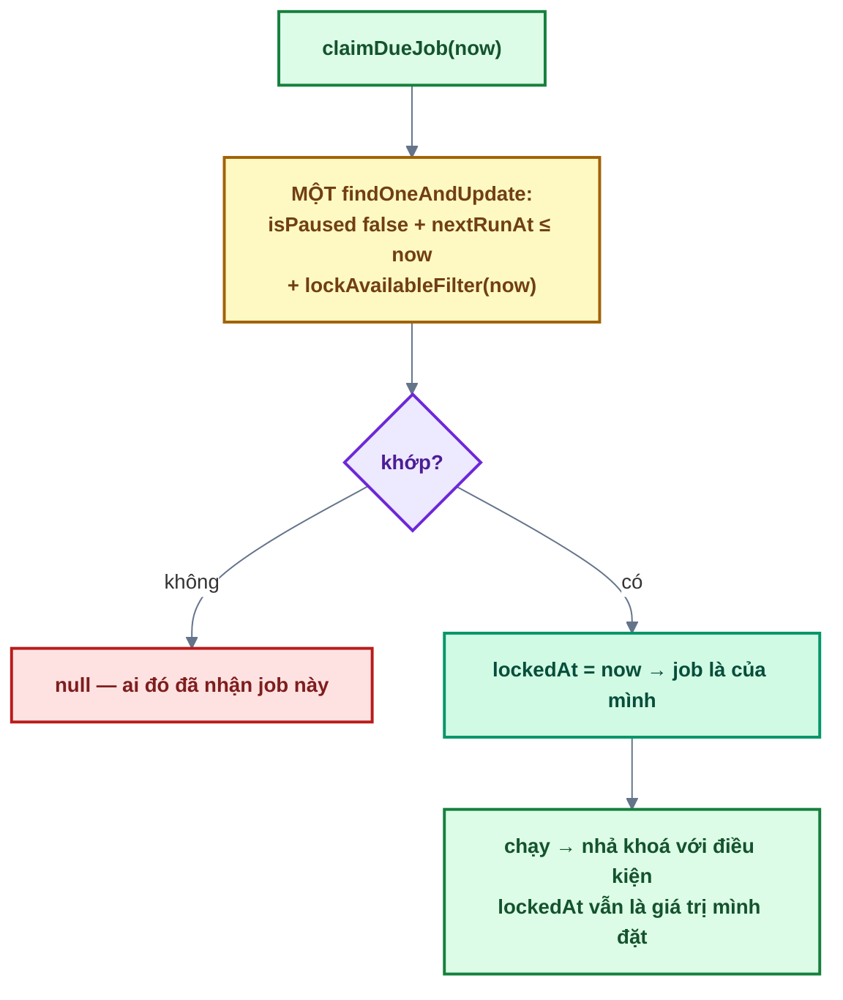

# Bài 14 — Lịch tự động & trang thống kê

> Trước: [Bài 13](bai-13-media-he-thong-va-anh-dai-dien.md) · Mục lục: [README](README.md) · Tiếp: [Bài 15 — Gửi email qua SMTP](bai-15-gui-email-qua-smtp.md)

|               |                                                                                                                          |
| ------------- | ------------------------------------------------------------------------------------------------------------------------ |
| **Mục tiêu**  | Hệ thống tự chạy các việc định kỳ đúng giờ, không chạy trùng, không trôi giờ; quản trị viên xem và điều khiển được chúng |
| **Thời gian** | 7–9 giờ (nên chia 2–3 buổi)                                                                                              |
| **Độ khó**    | ★★★                                                                                                                      |
| **Kiến thức** | Tính lịch theo múi giờ · khoá nguyên tử chống chạy trùng · khoá chết · lịch sử chạy · `$facet`                           |
| **Test BE**   | `npm test -w backend -- -t "bai-14"` — **32 test**, trong đó **25 test cần bạn làm**                                     |
| **Test FE**   | `npm test -w frontend -- -t "bai-14"` — **7 test**, **tất cả cần bạn làm**                                               |
| **Bài cuối**  | Xong bài này là bạn đã dựng lại toàn bộ source base 🎉                                                                   |

> **7 test BE đã xanh sẵn**: `computeFirstRun` (4) và `Chuyển giờ địa phương ↔ UTC` (2) —
> `computeFirstRun` và các hàm đổi múi giờ **không bị xoá**, vì `npm run db:seed` (bài 00) gọi
> tới chúng để tạo job hệ thống. Đọc chúng trước khi viết `computeNextRunAfter`: bạn sẽ dùng lại
> `getZonedParts`, `occurrenceAt` và `firstOccurrenceFrom`. Test thứ bảy là `POST /jobs/trigger`
> khi **sai secret** (middleware đã viết sẵn).

## 1. Mô tả tính năng

> _Là hệ thống, tôi muốn tự dọn rác và gửi thông báo theo lịch — đúng giờ địa phương, không chạy
> trùng, và không âm thầm bỏ qua lỗi._
>
> _Là Super Admin, tôi muốn thấy các job, sửa lịch, tạm dừng, chạy thử và xem vì sao lần chạy
> trước thất bại._

### 1.1. Ba cách một job được chạy



Vì sao có **hai** nguồn kích hoạt tự động? Trên nền tảng miễn phí (Render free), server **ngủ** khi
không có request — và `setInterval` ngủ theo. Một dịch vụ cron bên ngoài gọi `/jobs/trigger` vừa
đánh thức server vừa chạy các job đến hạn.

### 1.2. Khoá — chống chạy trùng và chống khoá chết



Ba ý trong sơ đồ:

1. **Giữ khoá phải là MỘT thao tác nguyên tử.** Tách "tìm job đến hạn" và "đặt `lockedAt`" thành
   hai bước thì hai tiến trình cùng nhận một job và chạy nó hai lần — email gửi đôi, dữ liệu xoá
   hai lượt. Cùng nguyên tắc với `consume` (bài 03) và `rotate` (bài 06).
2. **Khoá có thể chết.** Tiến trình bị kill giữa chừng sẽ để `lockedAt` mắc kẹt mãi.
   `lockAvailableFilter` (đã viết sẵn) vì thế nhận cả job có khoá **quá 15 phút** — coi như tiến
   trình cũ đã chết.
3. **Nhả khoá cũng có điều kiện.** Nếu job chạy quá 15 phút và một tiến trình khác đã lấy lại
   khoá, ta **không** được ghi đè trạng thái của họ — điều kiện `lockedAt` trong filter lo việc
   này.

### 1.3. Tính lịch — hai cái bẫy về thời gian

**Bẫy 1 — trôi giờ.** Job hẹn 03:00, bộ chạy quét mỗi phút nên thực tế chạy lúc 03:00:42. Tính mốc
kế tiếp từ _lúc chạy thực tế_ thì mỗi ngày trôi thêm vài chục giây; sau vài tháng job chạy vào
giữa trưa. Vì vậy `computeNextRunAfter` **neo theo mốc đã lên lịch** (`job.nextRunAt`), không theo
`now`.

**Bẫy 2 — chạy bù dồn.** Server tắt 5 ngày rồi bật lại: job đã lỡ 5 mốc. Chạy bù cả 5 nghĩa là gửi
5 email giống nhau liên tiếp. Thiết kế ở đây: **lần vừa chạy là lần chạy bù duy nhất**, rồi nhảy
thẳng tới mốc đầu tiên trong tương lai.

Và một chi tiết nữa: lịch hiểu theo **múi giờ cấu hình** (`JOBS_TIMEZONE`), không phải giờ UTC của
server. "03:00" phải là 03:00 giờ Việt Nam kể cả khi server đặt ở Mỹ — và vẫn đúng 03:00 sau ngày
đổi giờ mùa hè ở những múi giờ có DST. Phần đổi giờ dùng `Intl` và **đã viết sẵn**; việc của bạn
là dùng đúng nó.

### 1.4. Registry loại job — lại một điểm mở rộng

`jobs.registry.js` là nơi **duy nhất** khai báo loại job. Mỗi mục gồm: `label`, `description`,
`isSystemOnly`, `configSchema` (Zod), `configFields` (frontend **tự sinh form** từ đây), và
`handler`.

Thêm loại job mới = thêm một mục. Không sửa service, không sửa controller, không sửa form.

Quy tắc cho `handler`: gọi **service export** của module khác (`mediaService.cleanupOrphans`,
`usersService.findActiveRecipients`…), **không bao giờ** import model của module khác.

## 2. Kiến thức cần nắm trước

| Chủ đề              | Điểm cốt lõi                                                             |
| ------------------- | ------------------------------------------------------------------------ |
| **Khoá nguyên tử**  | `findOneAndUpdate` một lệnh; không khớp = ai đó đã nhận                  |
| **Khoá chết**       | Quá 15 phút coi như tiến trình cũ đã chết, cho phép lấy lại              |
| **Neo lịch**        | Tính mốc kế tiếp từ **mốc đã lên lịch**, không từ lúc chạy               |
| **Chạy bù một lần** | Ngủ lâu → bỏ qua mốc quá khứ, hẹn mốc tương lai gần nhất                 |
| **`$facet`**        | Nhiều phép đếm trong **một** lượt đi database, cùng một ảnh chụp dữ liệu |
| **TTL index**       | `JobRun` tự xoá sau 90 ngày — không cần job dọn                          |
| **`safeEqual`**     | So `X-Jobs-Secret` timing-safe (như `state` ở bài 10)                    |

## 3. Các file cần sửa

Tìm nhanh: `grep -rn "bai-14" backend/src frontend/src`

| Phía | File                                  | Hàm                                                                                           |
| ---- | ------------------------------------- | --------------------------------------------------------------------------------------------- |
| BE   | `modules/jobs/jobs.schedule.js`       | `computeNextRunAfter`                                                                         |
| BE   | `modules/jobs/jobs.runner.js`         | `executeLockedJob`, `claimDueJob`, `runDueJobs`, `runJobNow`                                  |
| BE   | `modules/jobs/jobs.service.js`        | `list`, `create`, `update`, `setPaused`, `remove`, `runNow`, `listRuns`, `getStats`           |
| BE   | `modules/jobs/jobs.registry.js`       | 4 `handler`                                                                                   |
| BE   | `modules/jobs/jobs.controller.js`     | 9 hàm                                                                                         |
| BE   | `modules/users/users.service.js`      | `findUnverifiedIdsCreatedBefore`, `deleteUnverifiedByIds`, `findActiveRecipients`, `getStats` |
| BE   | `modules/auth/emailTokens.service.js` | `revokeAllForUsers`                                                                           |
| BE   | `modules/stats/`                      | `getOverview` (service + controller)                                                          |
| FE   | `features/jobs/api/jobs.api.js`       | 8 hàm                                                                                         |
| FE   | `features/jobs/hooks/useJobs.js`      | `onSuccess` của `useJobMutation`                                                              |
| FE   | `features/stats/api/stats.api.js`     | `getAdminOverview`                                                                            |

**Đọc thêm (không sửa):** `computeFirstRun` + các hàm đổi múi giờ (**đã viết sẵn**),
`lockAvailableFilter`, `ensureSystemJobs`, `listTypes`, `assertScheduleInFuture`,
`jobs.middleware.js`, `jobs.model.js`, `JobForm.jsx` (form sinh từ `configFields`),
`features/jobs/schedule.js`.

## 4. Đặc tả API

| Endpoint                                        | Ai gọi được                | Ghi chú                                                         |
| ----------------------------------------------- | -------------------------- | --------------------------------------------------------------- |
| `GET /api/v1/admin/jobs/types`                  | **SUPER_ADMIN**            | Đã viết sẵn — form frontend sinh từ đây                         |
| `GET /api/v1/admin/jobs`                        | SUPER_ADMIN                | Kèm `isSystem`, `isRunning`                                     |
| `POST /api/v1/admin/jobs`                       | SUPER_ADMIN                | **201**; lịch `ONCE` ở quá khứ → 400; loại `isSystemOnly` → 400 |
| `PATCH /api/v1/admin/jobs/:id`                  | SUPER_ADMIN                | Đổi lịch → tính lại `nextRunAt`                                 |
| `POST /api/v1/admin/jobs/:id/pause` · `/resume` | SUPER_ADMIN                | Dùng được cả với job hệ thống                                   |
| `POST /api/v1/admin/jobs/:id/run`               | SUPER_ADMIN                | 409 `JOB_RUNNING` nếu đang chạy                                 |
| `DELETE /api/v1/admin/jobs/:id`                 | SUPER_ADMIN                | 403 `SYSTEM_JOB_PROTECTED` · 409 `JOB_RUNNING`                  |
| `GET /api/v1/admin/jobs/:id/runs`               | SUPER_ADMIN                | Phân trang                                                      |
| `POST /api/v1/jobs/trigger`                     | **Header `X-Jobs-Secret`** | 404 nếu chưa cấu hình secret · 403 nếu sai                      |
| `GET /api/v1/admin/stats`                       | ADMIN+                     | `{ users, media, jobs }`                                        |

## 5. Các bước thực hiện

### Phần A — Tính lịch và bộ chạy

**A1. `computeNextRunAfter`** — đọc kỹ mục 1.3.

✅ 4 test `computeNextRunAfter` chuyển xanh (10/10 của `jobs.schedule.test.js`).

**A2. `claimDueJob`** → **A3. `executeLockedJob`** → **A4. `runDueJobs`** → **A5. `runJobNow`**.

✅ 7 test `jobsRunner` chuyển xanh.

### Phần B — Loại job và service

**B1.** Bốn `handler` trong registry. Chúng cần các hàm ở **B2**: `findUnverifiedIdsCreatedBefore`,
`deleteUnverifiedByIds`, `findActiveRecipients` (users) và `revokeAllForUsers` (emailTokens).

**B3.** Tám hàm `jobsService` → **B4.** Chín hàm controller.

**B5.** `usersService.getStats`, `statsService.getOverview`, `statsController.getOverview`.

✅ Cả 32 test `[bai-14]` xanh.

✅ Thử bằng `curl` với token Super Admin:

```bash
curl -s localhost:4000/api/v1/admin/jobs -H "Authorization: Bearer $TOKEN"
curl -s -X POST localhost:4000/api/v1/admin/jobs/<id>/run -H "Authorization: Bearer $TOKEN"
curl -s localhost:4000/api/v1/admin/stats -H "Authorization: Bearer $TOKEN"

# Cron ngoài — secret lấy từ JOBS_TRIGGER_SECRET trong backend/.env
curl -s -X POST localhost:4000/api/v1/jobs/trigger -H "X-Jobs-Secret: <secret>"
curl -s -X POST localhost:4000/api/v1/jobs/trigger                      # 403
```

Thử ba nhánh bị chặn: xoá job hệ thống → 403 `SYSTEM_JOB_PROTECTED`; tạo job loại
`CLEANUP_ORPHAN_MEDIA` → 400; tạo job `ONCE` với `runAt` ở quá khứ → 400.

### Phần C — Frontend

**C1.** Tám hàm API jobs + `useJobMutation` → **C2.** `getAdminOverview`.

✅ 7 test đỏ chuyển xanh.

✅ Trên trình duyệt (**Quản trị → Lịch tự động**, chỉ Super Admin):

- Ba job hệ thống hiện ra với badge "Hệ thống" và **không có** nút Xoá.
- Bấm **Chạy ngay** → toast báo kết quả; mở menu ⋯ của job → **Lịch sử chạy** → thấy lần chạy vừa rồi kèm `result`.
- **Tạo job** loại "Gửi email thông báo" → form **tự sinh** ô Tiêu đề / Nội dung / Vai trò từ
  `configFields`. Để trống Tiêu đề → lỗi hiện đúng ô đó (nhờ tiền tố `config.` của
  `parseJobConfig`).
- **Quản trị → Tổng quan**: số người dùng theo vai trò, số ảnh + ảnh mồ côi, số job đang bật và
  các lần chạy lỗi gần nhất.

## 6. Tiêu chí hoàn thành

- [ ] `npm test -w backend -- -t "bai-14"` → 32/32 xanh; frontend → 7/7 xanh
- [ ] **Toàn bộ** `npm test` xanh — cả 15 bài
- [ ] `npm run build && npm run format:check && npm run check` sạch
- [ ] Gọi `/jobs/trigger` **hai lần cùng lúc** → mỗi job chỉ chạy một lần
- [ ] Job chạy trễ vài phút → `nextRunAt` kế tiếp vẫn đúng giờ đã hẹn (không trôi)
- [ ] Handler ném lỗi → `JobRun` ghi `FAILED` kèm thông điệp, job **vẫn nhả khoá** và dời lịch
- [ ] Xoá job hệ thống → 403; xoá job đang chạy → 409 `JOB_RUNNING`
- [ ] "Chạy ngay" **không** làm đổi `nextRunAt`
- [ ] Đánh dấu `[x] Bài 14` trong [CHECKLIST.md](../../CHECKLIST.md) rồi commit

## 7. Câu hỏi & thử thách mở rộng

1. Thử thách: trong `claimDueJob`, tách thành `Job.findOne(...)` rồi `Job.updateOne(...)`. Test
   nào đỏ? Vì sao lỗi này gần như không bao giờ gặp khi thử tay?
2. Thử thách: trong `computeNextRunAfter`, đổi `anchor` từ `scheduledAt` sang `now`. Test nào đỏ?
   Tính xem sau một năm job chạy lệch bao nhiêu.
3. Vì sao `lockAvailableFilter` chấp nhận job có khoá **quá 15 phút** thay vì chỉ nhận job không
   khoá?
4. Vì sao `executeLockedJob` nhả khoá với điều kiện `lockedAt` đúng giá trị mình đặt?
5. Server ngủ 5 ngày rồi bật lại. Vì sao chỉ chạy bù **một** lần thay vì 5 lần? Trường hợp nào
   thiết kế này lại **không** phù hợp?
6. `usersService.getStats` dùng `$facet` thay vì ba lần `countDocuments`. Được gì?
7. Khi đã có bộ chạy `setInterval` trong tiến trình, vì sao vẫn cần `POST /jobs/trigger`?

## 8. Gợi ý

<details>
<summary><b>Cấp 1 — Định hướng</b></summary>

- **`computeNextRunAfter`**: 4 dòng — `if ONCE`, `anchor`, `next` + `if` còn tương lai,
  `firstOccurrenceFrom(..., true)`.
- **`claimDueJob`**: **một** `findOneAndUpdate` — chú ý `sort: { nextRunAt: 1 }` (job trễ nhất
  chạy trước).
- **`executeLockedJob`**: nhớ `const lockedAt = job.lockedAt` **trước** khi làm gì khác;
  `try/catch` chỉ bọc lời gọi handler.
- **`runDueJobs`**: `while` + `break`.
- **Registry handler**: mỗi handler chỉ gọi service của module khác rồi trả object kết quả.
- **`jobsService`**: các hàm ngắn; `remove` cần transaction + `lockAvailableFilter`.
- **`getStats` của users**: một `aggregate` với `$facet`, rồi gộp kết quả.
- **FE**: 9 hàm API theo khuôn cũ; một `onSuccess`.

</details>

<details>
<summary><b>Cấp 2 — Pseudo-code</b></summary>

```text
computeNextRunAfter(schedule, scheduledAt, now, timeZone):
  nếu schedule.kind === ONCE → return null
  anchor = getZonedParts(scheduledAt, timeZone)
  next = occurrenceAt(anchor, schedule, 1, timeZone)
  nếu next > now → return next
  return firstOccurrenceFrom(anchor, schedule, now, timeZone, true)

claimDueJob(now):
  return Job.findOneAndUpdate(
     { isPaused: false, nextRunAt: trusted({ $lte: now }), ...lockAvailableFilter(now) },
     { $set: { lockedAt: now } },
     { sort: { nextRunAt: 1 }, returnDocument: 'after', runValidators: true })

executeLockedJob(job, { now, isManual }):
  lockedAt = job.lockedAt
  run = await JobRun.create({ jobId: job._id, startedAt: bây giờ, isManual })
  definition = JOB_DEFINITIONS[job.type]
  try:
     nếu !definition → throw new Error(`Loại job "${job.type}" không còn tồn tại`)
     run.result = (await definition.handler(job.config, { now })) ?? null
     run.status = SUCCESS
  catch err:
     logger.error(...); run.status = FAILED; run.error = err.message
  run.finishedAt = bây giờ; await run.save()
  update = { lockedAt: null, lastRunAt: run.startedAt, lastRunStatus: run.status }
  nếu !isManual → update.nextRunAt = computeNextRunAfter(job.schedule, job.nextRunAt, now, env.JOBS_TIMEZONE)
  await Job.updateOne({ _id: job._id, lockedAt }, { $set: update }, { runValidators: true })
  return run

runDueJobs({ now }):
  executedCount = 0
  while executedCount < MAX_JOBS_PER_TICK:
     job = await claimDueJob(now); nếu !job → break
     await executeLockedJob(job, { now }); executedCount += 1
  return executedCount

handler CLEANUP_UNVERIFIED_USERS({ olderThanDays }, { now }):
  createdBefore = new Date(now.getTime() - olderThanDays * DAY_MS)
  userIds = await usersService.findUnverifiedIdsCreatedBefore(createdBefore)
  nếu userIds.length === 0 → return { deletedCount: 0 }
  deletedCount = await db.runInTransaction(async (session) => {
     await emailTokensService.revokeAllForUsers(userIds, { session })
     return usersService.deleteUnverifiedByIds(userIds, { session }) })
  return { deletedCount }
```

</details>

<details>
<summary><b>Cấp 3 — Code tham khảo (backend)</b></summary>

```js
// jobs.schedule.js
export function computeNextRunAfter(schedule, scheduledAt, now, timeZone) {
  if (schedule.kind === SCHEDULE_KINDS.ONCE) return null;

  const anchor = getZonedParts(scheduledAt, timeZone);
  const next = occurrenceAt(anchor, schedule, 1, timeZone);
  if (next.getTime() > now.getTime()) return next;
  return firstOccurrenceFrom(anchor, schedule, now, timeZone, true);
}
```

```js
// jobs.runner.js
async function executeLockedJob(job, { now, isManual = false }) {
  const lockedAt = job.lockedAt;
  const run = await JobRun.create({ jobId: job._id, startedAt: new Date(), isManual });
  const definition = JOB_DEFINITIONS[job.type];

  try {
    if (!definition) throw new Error(`Loại job "${job.type}" không còn tồn tại`);
    run.result = (await definition.handler(job.config, { now })) ?? null;
    run.status = JOB_RUN_STATUSES.SUCCESS;
  } catch (err) {
    logger.error({ err, jobId: String(job._id), type: job.type }, 'Job chạy thất bại');
    run.status = JOB_RUN_STATUSES.FAILED;
    run.error = err.message;
  }
  run.finishedAt = new Date();
  await run.save();

  const update = { lockedAt: null, lastRunAt: run.startedAt, lastRunStatus: run.status };
  if (!isManual) {
    update.nextRunAt = computeNextRunAfter(job.schedule, job.nextRunAt, now, env.JOBS_TIMEZONE);
  }
  await Job.updateOne({ _id: job._id, lockedAt }, { $set: update }, { runValidators: true });
  return run;
}

async function claimDueJob(now) {
  return Job.findOneAndUpdate(
    { isPaused: false, nextRunAt: mongoose.trusted({ $lte: now }), ...lockAvailableFilter(now) },
    { $set: { lockedAt: now } },
    { sort: { nextRunAt: 1 }, returnDocument: 'after', runValidators: true },
  );
}

async function runDueJobs({ now = new Date() } = {}) {
  let executedCount = 0;
  while (executedCount < MAX_JOBS_PER_TICK) {
    const job = await claimDueJob(now);
    if (!job) break;
    await executeLockedJob(job, { now });
    executedCount += 1;
  }
  return executedCount;
}

async function runJobNow(jobId, { now = new Date() } = {}) {
  const job = await Job.findOneAndUpdate(
    { _id: jobId, ...lockAvailableFilter(now) },
    { $set: { lockedAt: now } },
    { returnDocument: 'after', runValidators: true },
  );
  if (!job) return null;
  return executeLockedJob(job, { now, isManual: true });
}
```

```js
// jobs.service.js
async function list() {
  const jobs = await Job.find().sort({ systemKey: -1, createdAt: -1 }).lean();
  return mapLeanDocument(jobs).map(({ systemKey, lockedAt, ...job }) => ({
    ...job,
    isSystem: Boolean(systemKey),
    isRunning: Boolean(lockedAt),
  }));
}

async function create({ name, type, config, schedule }, actorId, { now = new Date() } = {}) {
  assertScheduleInFuture(schedule, now);
  return Job.create({
    name,
    type,
    config: parseJobConfig(type, config),
    schedule,
    nextRunAt: computeFirstRun(schedule, now, env.JOBS_TIMEZONE),
    createdBy: actorId,
  });
}

async function setPaused(jobId, isPaused) {
  const job = await Job.findByIdAndUpdate(
    jobId,
    { $set: { isPaused } },
    { returnDocument: 'after', runValidators: true },
  );
  if (!job) throw jobNotFoundError();
  return job;
}

async function remove(jobId, { now = new Date() } = {}) {
  const job = await Job.findById(jobId).select('systemKey');
  if (!job) throw jobNotFoundError();
  if (job.systemKey) {
    throw new AppError({
      statusCode: 403,
      code: ERROR_CODES.SYSTEM_JOB_PROTECTED,
      message: 'Không thể xoá job hệ thống — chỉ có thể tạm dừng',
    });
  }

  await db.runInTransaction(async (session) => {
    // Xoá có điều kiện "không ai đang giữ khoá": lượt đang chạy sẽ ghi lịch sử cho job đã xoá
    // (bản ghi mồ côi) — bắt chờ chạy xong rồi xoá.
    const { deletedCount } = await Job.deleteOne(
      { _id: jobId, ...lockAvailableFilter(now) },
      { session },
    );
    if (deletedCount === 0) throw jobRunningError();
    await JobRun.deleteMany({ jobId }, { session });
  });
}

async function runNow(jobId) {
  if (!(await Job.exists({ _id: jobId }))) throw jobNotFoundError();
  const run = await jobsRunner.runJobNow(jobId);
  if (!run) throw jobRunningError();
  return run;
}
```

```js
// users.service.js
async function findUnverifiedIdsCreatedBefore(createdBefore) {
  const users = await User.find({
    emailVerifiedAt: null,
    createdAt: mongoose.trusted({ $lt: createdBefore }),
  })
    .select('_id')
    .lean();
  return users.map((user) => user._id);
}

async function findActiveRecipients({ roles = [], userIds = [] }) {
  return User.find({
    $or: [{ role: mongoose.trusted({ $in: roles }) }, { _id: mongoose.trusted({ $in: userIds }) }],
    emailVerifiedAt: mongoose.trusted({ $ne: null }),
    lockedAt: null,
  })
    .select('email name')
    .lean();
}
```

```js
// stats.service.js
async function getOverview() {
  const [users, media, jobs] = await Promise.all([
    usersService.getStats(),
    mediaService.getStats(),
    jobsService.getStats(),
  ]);
  return { users, media, jobs };
}
```

</details>

<details>
<summary><b>Đáp án câu hỏi mục 7</b></summary>

**1.** Test **"2 lần kích hoạt cùng lúc → mỗi job chỉ chạy 1 lần (khoá nguyên tử)"** sẽ đỏ.

Gần như không gặp khi thử tay vì cửa sổ nguy hiểm chỉ là **vài mili-giây** — khoảng giữa lúc đọc
job và lúc ghi `lockedAt`. Bấm "Chạy ngay" hai lần bằng chuột thì hai cú bấm cách nhau hàng trăm
mili-giây, lần sau luôn thấy khoá của lần trước. Lỗi chỉ lộ ra khi **thật sự song song**: hai
instance server, hoặc cron ngoài gọi đúng lúc `setInterval` cũng chạy.

Hậu quả thì không hề nhỏ: job gửi email chạy hai lần là mỗi người nhận hai thư giống nhau; job dọn
dẹp chạy hai lần có thể xoá nhầm những thứ lượt đầu vừa tạo ra.

**2.** Test **"neo theo mốc đã lên lịch, không theo lúc chạy thực tế (chạy trễ 5 phút không làm
trôi giờ)"** sẽ đỏ.

Bộ chạy quét mỗi phút, nên độ trễ trung bình khoảng 30 giây. Mỗi ngày mốc kế tiếp bị đẩy thêm
chừng đó → sau 365 ngày là **khoảng 3 giờ**. Job "dọn dẹp lúc 03:00 đêm" dần chạy vào 06:00 sáng,
rồi giữa buổi làm việc. Và nó **trôi âm thầm** — không lỗi, không cảnh báo, chỉ là lịch cứ lệch
dần cho tới khi ai đó để ý.

Neo theo mốc đã lên lịch giữ lịch đúng vĩnh viễn, bất kể mỗi lần chạy trễ bao lâu.

**3.** Vì tiến trình có thể **chết giữa chừng**: server bị kill, hết bộ nhớ, deploy lại đúng lúc
job đang chạy. Khi đó `lockedAt` còn nguyên trong database nhưng **không ai** đang chạy job cả.

Nếu chỉ nhận job có `lockedAt: null`, job đó **kẹt vĩnh viễn** — không bao giờ chạy lại, và không
có lỗi nào báo cho ai biết. Ngưỡng 15 phút là một đánh đổi: đủ dài để không cướp khoá của một job
đang chạy thật, đủ ngắn để hệ thống tự phục hồi mà không cần can thiệp tay.

**4.** Để **không ghi đè trạng thái của tiến trình khác**. Kịch bản: job của bạn chạy quá 15 phút;
một tiến trình khác coi khoá là chết, lấy lại và bắt đầu chạy job đó; rồi job của bạn xong và ghi
`lockedAt: null` + `nextRunAt` mới — vừa **nhả khoá của người khác** (job giờ có thể bị nhận lần
ba) vừa ghi đè lịch bằng kết quả tính từ dữ liệu cũ.

Điều kiện `{ _id, lockedAt }` biến lệnh ghi thành "chỉ cập nhật nếu khoá **vẫn là của tôi**". Nếu
không, lệnh im lặng không khớp — đúng điều ta muốn. Đây lại là optimistic concurrency, giống bài 11.

**5.** Vì các job trong dự án đều **idempotent theo trạng thái**, không phải "mỗi lần chạy xử lý
một lô riêng". "Dọn ảnh mồ côi" chạy một lần sau 5 ngày sẽ dọn **mọi** ảnh mồ côi tích tụ trong 5
ngày đó — chạy thêm 4 lần nữa cũng không tìm thấy gì. Còn job gửi email thì chạy 5 lần nghĩa là 5
thư giống hệt nhau trong hộp thư người dùng.

**Không phù hợp** khi mỗi lần chạy gắn với một khoảng thời gian riêng: báo cáo doanh thu **hằng
ngày**, đối soát giao dịch theo ngày, tổng hợp số liệu theo giờ. Bỏ qua 5 mốc ở đó là mất hẳn 5
bản báo cáo. Hệ thống như vậy cần lưu "đã xử lý tới mốc nào" và chạy bù **lần lượt** từng mốc —
phức tạp hơn nhiều, và source base này cố ý không làm.

**6.** Hai thứ. **Hiệu năng**: một lượt đi database thay vì ba, với dữ liệu chỉ quét một lần.
**Tính nhất quán**: cả ba con số đến từ **cùng một ảnh chụp** dữ liệu. Với ba lần `countDocuments`
riêng lẻ, có người đăng ký xen vào giữa lần đếm thứ nhất và thứ ba — và trang thống kê hiện những
con số **không cộng khớp với nhau** (`ACTIVE + LOCKED + UNVERIFIED ≠ total`). Người đọc sẽ nghi
ngờ toàn bộ trang chỉ vì một chênh lệch bằng 1.

**7.** Vì `setInterval` chỉ chạy khi **tiến trình còn sống**. Trên gói miễn phí của Render (và
nhiều nền tảng khác), server bị **ngủ** sau một thời gian không có request — timer ngủ theo, và
job đến hạn lúc 03:00 đêm sẽ không bao giờ chạy.

Một dịch vụ cron bên ngoài (cron-job.org, GitHub Actions, Cloudflare Workers…) gọi `/jobs/trigger`
làm **hai** việc cùng lúc: đánh thức server và kích hoạt các job đến hạn.

Hai cơ chế cùng tồn tại không gây hại, vì `claimDueJob` là nguyên tử: cả hai cùng quét thì mỗi job
vẫn chỉ được một bên nhận. Endpoint bảo vệ bằng `X-Jobs-Secret` (so sánh timing-safe) chứ không
bằng access token — cron bên ngoài không có tài khoản người dùng để đăng nhập.

</details>

---

## 🎉 Hết bộ bài

Bạn vừa dựng lại **toàn bộ** phần lõi của một source base MERN: auth đầy đủ (mật khẩu, email,
magic link, Google OAuth), phiên đăng nhập có xoay vòng token, phân quyền hai lớp, cấu hình hệ
thống, lưu trữ file, media, và lịch tự động.

Vài việc đáng làm tiếp:

1. Chạy **toàn bộ** cổng kiểm tra lần cuối:
   `npm test && npm run build && npm run format:check && npm run check`.
2. Khi nhận lời giải từ giảng viên, so với code của bạn: chỗ nào bạn làm khác? Cách nào tốt hơn,
   và vì sao?
3. Đọc bản review source base (giảng viên phát cùng lời giải) — những vấn đề còn mở và lộ trình
   cải thiện.
4. Thử thêm **một tính năng mới** để kiểm tra xem bạn đã thật sự nắm kiến trúc chưa. Gợi ý theo
   độ khó tăng dần: thêm một setting mới (bài 09) → thêm một loại job (bài 14) → thêm một nơi
   dùng ảnh mới (bài 13) → thêm hẳn một module (bài viết, bình luận…) theo đúng khuôn
   route → controller → service → model.

> Trước: [Bài 13](bai-13-media-he-thong-va-anh-dai-dien.md) · Mục lục: [README](README.md)
