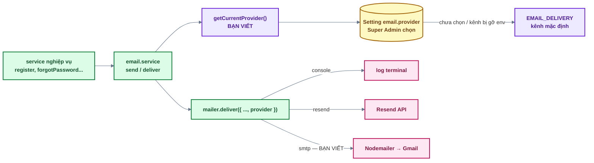
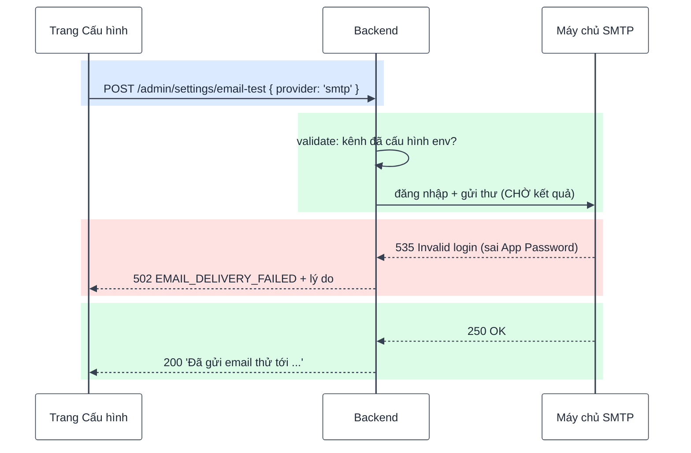

# Bài 15 — Gửi email qua SMTP & chọn kênh gửi

> Trước: [Bài 14](bai-14-lich-tu-dong-va-thong-ke.md) · Mục lục: [README](README.md)

|               |                                                                                                                           |
| ------------- | ------------------------------------------------------------------------------------------------------------------------- |
| **Mục tiêu**  | Gửi email thật **miễn phí, không cần domain** qua SMTP của Gmail; Super Admin đổi kênh gửi và gửi thử ngay trên giao diện |
| **Thời gian** | 2–3 giờ (chưa tính tạo tài khoản SMTP)                                                                                    |
| **Độ khó**    | ★★                                                                                                                        |
| **Kiến thức** | SMTP & Nodemailer · STARTTLS vs TLS · App Password · chọn cấu hình lúc chạy · lỗi dịch vụ phía sau (502) · timeout        |
| **Test BE**   | `npm test -w backend -- -t "bai-15"` — **13 test**, trong đó **5 test cần bạn làm**                                       |
| **Test FE**   | `npm test -w frontend -- -t "bai-15"` — **3 test**, trong đó **2 test cần bạn làm**                                       |

> **Làm được ngay sau bài 09** (cần bài 03 — email, bài 05 — phân quyền, bài 09 — settings). Đặt
> ở cuối lộ trình vì là phần mở rộng: các bài trước in email ra terminal là đủ.
>
> **8 test BE + 1 test FE xanh sẵn** khi bạn đã xong bài 05 và bài 09: chúng kiểm phần registry,
> validate và `listForAdmin` / `update` (bài 09) cho setting mới. Nếu chúng đỏ, xem lại bài 09 —
> nhất là trường `options` của `listForAdmin`.

## 1. Mô tả tính năng

> _Là người học chưa mua domain, tôi muốn app gửi email thật (xác thực, quên mật khẩu) tới hộp thư
> của mình mà không tốn tiền._
>
> _Là Super Admin, tôi muốn đổi kênh gửi email và gửi thử ngay trên giao diện, không phải sửa code
> hay deploy lại._

### 1.1. Ba kênh gửi

| Kênh      | Gửi thế nào                                        | Cần gì                                    | Dùng khi                                        |
| --------- | -------------------------------------------------- | ----------------------------------------- | ----------------------------------------------- |
| `console` | In nội dung (kèm link) ra terminal, không gửi thật | Không cần gì                              | Học, phát triển local — các bài 03–14 đang dùng |
| `smtp`    | Máy chủ SMTP của Gmail qua thư viện **Nodemailer** | Tài khoản Gmail + App Password (miễn phí) | **Chưa có domain**, muốn nhận email thật        |
| `resend`  | HTTP API của Resend                                | Domain riêng đã xác minh + API key        | Sản phẩm thật                                   |

**Resend cần domain**: nó chỉ cho gửi từ địa chỉ thuộc domain bạn đã chứng minh sở hữu (bản ghi
DNS SPF, DKIM). Mọi dịch vụ gửi email giao dịch khác cũng vậy — địa chỉ `@gmail.com` không thể xác
thực ở đó. **SMTP của Gmail không cần domain**: bạn đăng nhập bằng chính tài khoản Gmail, và thư đi
ra dưới địa chỉ Gmail đó. Chưa có domain thì Gmail SMTP là lựa chọn duy nhất.

Kênh nào cũng chạy **đủ** mọi tính năng email của app (email tự động, job gửi hàng loạt, lịch tự
động) — code không phân biệt kênh. Khác nhau ở hạn mức và độ chuyên nghiệp:

| Gmail SMTP                                                           | Resend (có domain)                        |
| -------------------------------------------------------------------- | ----------------------------------------- |
| ~500 người nhận / ngày (tài khoản cá nhân), vượt thì bị tạm khoá gửi | Hạn mức theo gói, mở rộng được            |
| Người gửi `ban@gmail.com`                                            | Người gửi `no-reply@ten-mien-cua-ban.com` |
| Không có thống kê / báo thư trả về                                   | Có dashboard, webhook                     |
| **Bị chặn trên Render gói free** (mục 1.3)                           | Gửi qua HTTPS 443 — không bị chặn         |

### 1.2. Biến môi trường chứa _thông tin đăng nhập_, setting chọn _kênh_



Tách như vậy vì hai thứ thay đổi theo hai nhịp khác nhau:

- **Mật khẩu SMTP, API key** là bí mật → chỉ nằm trong `backend/.env` trên server, không bao giờ
  lưu vào database hay gửi xuống trình duyệt. Đổi = sửa env + khởi động lại.
- **Kênh nào đang dùng** là quyết định vận hành → Super Admin đổi trên giao diện, có hiệu lực ngay.
  Kênh nào **chưa điền đủ biến** thì không chọn được: schema của setting trong `settings.registry.js`
  có `.refine(features.isEmailProviderAvailable)` → lưu sẽ bị 400.

Trường hợp đáng chú ý: Super Admin chọn SMTP, sau đó ai đó xoá biến `SMTP_*` trên server. Giá trị
`'smtp'` trong DB giờ **không qua được schema** → `settingsService.get` (bài 09) ghi cảnh báo và trả
**kênh mặc định**. Không có email nào bị gửi vào một kênh chưa cấu hình. Bạn không phải viết gì cho
chuyện này — chỉ cần gọi đúng `settingsService.get`.

### 1.3. SMTP trong 1 phút

SMTP (_Simple Mail Transfer Protocol_) là giao thức gửi thư giữa các máy chủ. App của bạn đóng vai
**client**: mở kết nối TCP tới máy chủ SMTP của nhà cung cấp, đăng nhập, rồi đẩy thư lên. Nodemailer
lo toàn bộ phần hội thoại đó; bạn chỉ khai báo _kết nối tới đâu, bằng tài khoản nào_.

| Cổng  | `secure` | Nghĩa                                                                         |
| ----- | -------- | ----------------------------------------------------------------------------- |
| `587` | `false`  | Kết nối thường rồi **nâng lên TLS** bằng lệnh `STARTTLS` — mặc định của dự án |
| `465` | `true`   | **TLS ngay từ đầu** (SMTPS)                                                   |

`secure: false` **không** có nghĩa là gửi không mã hoá: với 587, Nodemailer vẫn nâng lên TLS nếu
máy chủ hỗ trợ (Gmail có hỗ trợ). `env.js` tự suy `SMTP_SECURE` từ cổng.

**App Password**: Gmail không cho ứng dụng đăng nhập SMTP bằng mật khẩu Gmail thường. Bạn tạo một
**mật khẩu ứng dụng** 16 ký tự (cần bật xác minh 2 bước), chỉ dùng cho SMTP, thu hồi riêng được.

**Khi deploy**: SMTP cần mở kết nối ra cổng 587 / 465. **Render gói free chặn các cổng này** — Gmail
SMTP chạy tốt ở máy bạn nhưng trên Render free thì "Gửi email thử" báo `Connection timeout`. Chưa
có domain thì trên Render free không có cách gửi email thật: đặt `EMAIL_DELIVERY=console` để app
vẫn chạy (email in ra log — chỉ dùng cho demo). Chạy local, VPS hoặc gói trả phí thì Gmail SMTP
dùng bình thường. Chi tiết: [docs 05 §3.3](../05-storage-va-email.md#33-cấu-hình-kênh-gửi).

### 1.4. "Gửi email thử" — vì sao phải chờ, vì sao 502



- Các email khác gửi **nền** (bài 03): người dùng không chờ, lỗi chỉ ghi log. Email thử thì ngược
  lại: mục đích của nó chính là **biết kết quả** → phải `await`.
- **502 Bad Gateway**, không phải 500: server của bạn không hỏng, **dịch vụ phía sau** từ chối.
  Mã lỗi riêng `EMAIL_DELIVERY_FAILED` + lý do gốc (`Invalid login`, `Connection timeout`) để Super
  Admin biết sửa gì.
- Gửi thử dùng kênh **trong request** (kênh đang chọn trên form, có thể chưa lưu) → thử được trước
  khi áp dụng cho mọi email.

## 2. Kiến thức cần nắm trước

| Chủ đề                           | Điểm cốt lõi                                                                                                                                                      |
| -------------------------------- | ----------------------------------------------------------------------------------------------------------------------------------------------------------------- |
| **`nodemailer.createTransport`** | Dựng "đường gửi" từ cấu hình `{ host, port, secure, auth }`; `transport.sendMail({ from, to, subject, html, text })` trả Promise, **ném lỗi** khi máy chủ từ chối |
| **Khởi tạo lười (`??=`)**        | `x ??= taoMoi()` — chỉ tạo lần đầu, các lần sau dùng lại. Kênh chưa cấu hình thì không bao giờ tạo                                                                |
| **Timeout**                      | Mặc định Nodemailer chờ tới 2 phút khi cổng bị chặn. `SMTP_TIMEOUTS` hạ xuống 10–20 giây                                                                          |
| **Cấu hình lúc chạy**            | Đọc setting **mỗi lần gửi** (`settingsService.get`) → đổi kênh có hiệu lực ngay, không cần khởi động lại                                                          |
| **Gửi nền vs chờ**               | `send` (nền, lỗi chỉ log) cho email giao dịch; `mailer.deliver` có `await` khi người gọi cần kết quả                                                              |
| **502 vs 500**                   | 502 = dịch vụ phía sau lỗi; 500 = code của mình lỗi                                                                                                               |

Tài liệu: [Nodemailer — SMTP transport](https://nodemailer.com/smtp/), và
[docs 05 §3.3](../05-storage-va-email.md#33-cấu-hình-kênh-gửi) của dự án (cách lấy từng biến).

## 3. Các file cần sửa

Tìm nhanh: `grep -rn "bai-15" backend/src frontend/src`

| Phía | File                                                 | Hàm                                                               |
| ---- | ---------------------------------------------------- | ----------------------------------------------------------------- |
| BE   | `shared/lib/mailer.js`                               | `getSmtpTransport`, mục `[EMAIL_PROVIDERS.SMTP]` của `TRANSPORTS` |
| BE   | `modules/email/email.service.js`                     | `getCurrentProvider`, `sendTestEmail`                             |
| BE   | `modules/settings/settings.controller.js`            | `sendTestEmail`                                                   |
| FE   | `features/settings/api/settings.api.js`              | `sendTestEmail`                                                   |
| FE   | `features/settings/components/AdminSettingsForm.jsx` | `handleClick` của `SendTestEmailButton`                           |

> **Ngoại lệ**: `shared/lib/` là hạ tầng "không cần sửa" ở mọi bài khác. Bài này là lần duy nhất
> bạn sửa `mailer.js` — viết một kênh gửi là đúng trọng tâm của bài.

**Đọc thêm (không sửa):**

- `shared/config/env.js` — `EMAIL_PROVIDERS`, nhóm biến `SMTP_*`, `resolveEmailDelivery` (kênh mặc
  định), `resolveEmailFrom`, `SMTP_SECURE` suy từ cổng.
- `shared/config/features.js` — `isEmailProviderAvailable` (vì sao `console` bị khoá ở production).
- `shared/lib/mailer.js` — `deliver` (kiểm kênh → render → gọi `TRANSPORTS[provider]`), kênh
  `console` và `resend` làm mẫu.
- `settings.registry.js` — setting `email.provider` (input `select`, `options()`).
- `settings.schema.js` — `sendTestEmailBodySchema` **dùng lại** schema của registry.
- `settings.routes.js` — `testEmailRateLimiter` (5 lần / 15 phút / user) đặt **sau** `authenticate`.
- `email.service.js` — hàm nội bộ `deliver` / `send` gọi `getCurrentProvider()` của bạn.

## 4. Đặc tả API

| Endpoint                                 | Ai gọi được     | Thành công                                                | Lỗi                                                                             |
| ---------------------------------------- | --------------- | --------------------------------------------------------- | ------------------------------------------------------------------------------- |
| `POST /api/v1/admin/settings/email-test` | **SUPER_ADMIN** | 200 `{ to, provider }` + `'Đã gửi email thử tới <email>'` | 400 kênh lạ / chưa cấu hình · 401 · 403 · 429 · **502 `EMAIL_DELIVERY_FAILED`** |
| `PATCH /api/v1/admin/settings` (bài 09)  | **SUPER_ADMIN** | `{ "values": { "email.provider": "smtp" } }` → lưu        | 400 nếu kênh chưa cấu hình biến môi trường                                      |

Ví dụ lỗi 502:

```json
{
  "success": false,
  "error": {
    "code": "EMAIL_DELIVERY_FAILED",
    "message": "Gửi email thử qua smtp thất bại: Invalid login: 535 Authentication failed"
  }
}
```

## 5. Các bước thực hiện

### Phần A — Tài khoản SMTP (tuỳ chọn, để nhận email thật)

Test **không** cần phần này (Nodemailer được mock). Làm khi muốn thấy email về hộp thư:

1. Gmail: bật **xác minh 2 bước** → <https://myaccount.google.com/apppasswords> → tạo App Password.
2. Điền `backend/.env`:

   ```bash
   SMTP_HOST=smtp.gmail.com
   SMTP_USER=ban@gmail.com
   SMTP_PASS=abcdefghijklmnop   # App Password 16 ký tự, không phải mật khẩu Gmail
   ```

3. Khởi động lại backend. Log không báo lỗi biến môi trường là được.

Chi tiết (hạn mức Gmail, lỗi thường gặp, deploy): [docs 05 §3.3](../05-storage-va-email.md#33-cấu-hình-kênh-gửi).

### Phần B — Backend

**B1. `mailer.js` — kênh SMTP.** `getSmtpTransport` (tạo lười, đủ 4 nhóm tham số + timeout) và
mục `[EMAIL_PROVIDERS.SMTP]` của `TRANSPORTS` (gọi `sendMail`). Nhìn kênh `resend` ngay phía trên
làm mẫu.

✅ 2 test `[bai-15] mailer.deliver — kênh SMTP` xanh.

**B2. `emailService.getCurrentProvider`** — một dòng.

✅ Test "đã chọn SMTP ở trang Cấu hình → mọi email đi qua SMTP" xanh.

**B3. `emailService.sendTestEmail`** — `try` / `await` / `catch` → `AppError` 502.

**B4. `settingsController.sendTestEmail`.**

✅ Cả 13 test `[bai-15]` BE xanh.

✅ Thử bằng `curl` (lấy `$TOKEN` của Super Admin như bài 09):

```bash
# Gửi thử qua console → email in ra terminal backend
curl -s -X POST localhost:4000/api/v1/admin/settings/email-test \
  -H "Authorization: Bearer $TOKEN" -H 'Content-Type: application/json' \
  -d '{"provider":"console"}'

# Gửi thử qua SMTP (đã làm phần A) → kiểm tra hộp thư, cả thư mục Spam
curl -s -X POST localhost:4000/api/v1/admin/settings/email-test \
  -H "Authorization: Bearer $TOKEN" -H 'Content-Type: application/json' \
  -d '{"provider":"smtp"}'
```

Kiểm chứng lỗi: sửa `SMTP_PASS` thành chuỗi sai → khởi động lại → gọi lại → **502** kèm
`Invalid login`. Chưa làm phần A (không có `SMTP_*`) → gọi với `smtp` → **400** (kênh chưa cấu hình).

### Phần C — Frontend

**C1. `sendTestEmail`** trong `settings.api.js`.

**C2. `handleClick`** của `SendTestEmailButton`.

✅ 3/3 test `[bai-15]` FE xanh.

✅ Trên trình duyệt: **Quản trị → Cấu hình → Kênh gửi email**:

- Kênh chưa điền biến môi trường hiện mờ kèm "(chưa cấu hình)", không chọn được.
- Chọn **SMTP** (chưa cần lưu) → **Gửi email thử** → toast "Đã gửi email thử tới ..." → thư về hộp
  thư.
- **Lưu cấu hình** → đăng xuất → "Quên mật khẩu" với email của bạn → thư đặt lại mật khẩu về hộp
  thư thật, terminal không còn in email.
- Chọn lại **Console** → lưu → email lại in ra terminal.

## 6. Tiêu chí hoàn thành

- [ ] `npm test -w backend -- -t "bai-15"` → 13/13 xanh; frontend → 3/3 xanh
- [ ] Test bài 01–14 vẫn xanh
- [ ] `npm run build && npm run format:check && npm run check` sạch
- [ ] "Gửi email thử" qua console in email ra terminal; qua SMTP (nếu làm phần A) thư về hộp thư
- [ ] Sai App Password → toast hiện lý do (`Invalid login`), không phải thông báo chung chung
- [ ] Lưu kênh SMTP → email quên mật khẩu đi qua SMTP; đổi về Console → lại in ra terminal, **không**
      cần khởi động lại backend
- [ ] `grep -rn "SMTP_PASS\|smtp.gmail" backend/src frontend/src` không thấy mật khẩu nào trong code
      (chỉ có trong `backend/.env`, và `.env` không bị commit)
- [ ] Đánh dấu `[x] Bài 15` trong [CHECKLIST.md](../../CHECKLIST.md) rồi commit

## 7. Câu hỏi & thử thách mở rộng

1. Vì sao `getSmtpTransport` tạo transport **lười** (lần gửi đầu tiên) thay vì tạo ngay ở đầu file
   `mailer.js`?
2. Thử thách: xoá `...SMTP_TIMEOUTS`, đặt `SMTP_HOST=10.255.255.1` (địa chỉ không ai trả lời) rồi
   bấm "Gửi email thử". Nút xoay bao lâu? Chuyện gì xảy ra với người dùng thật khi deploy lên nền
   tảng chặn cổng SMTP?
3. `sendTestEmail` gọi thẳng `mailer.deliver` với `provider` trong request, còn các email khác đi
   qua `deliver` nội bộ (đọc setting). Nếu `sendTestEmail` cũng đi qua `deliver` nội bộ thì hỏng
   chỗ nào?
4. Vì sao lỗi gửi thử trả **502** mà không phải 500? Còn 400 dành cho trường hợp nào?
5. `getCurrentProvider` đọc setting từ DB **mỗi lần** gửi email. Có nên cache lại trong biến không?
   Đánh đổi là gì?
6. Vì sao ở production, lựa chọn `console` bị khoá (trừ khi đặt `EMAIL_DELIVERY=console`)? Gợi ý:
   email quên mật khẩu chứa gì?
7. Thử thách: thêm kênh thứ tư (ví dụ một nhà cung cấp gửi email qua HTTP API khác). Theo
   [docs 05 §3.5](../05-storage-va-email.md#35-thêm-một-kênh-gửi-mới), bạn phải sửa những file nào?
   File nào **không** phải sửa?

## 8. Gợi ý

<details>
<summary><b>Cấp 1 — Định hướng</b></summary>

- **`getSmtpTransport`**: `smtpTransport ??= nodemailer.createTransport({...})`. Mọi giá trị đều có
  sẵn trong `env` (`SMTP_HOST`, `SMTP_PORT`, `SMTP_SECURE`, `SMTP_USER`, `SMTP_PASS`) + trải
  `SMTP_TIMEOUTS`.
- **Kênh SMTP trong `TRANSPORTS`**: giống kênh `resend` ngay phía trên nhưng gọn hơn — `sendMail`
  tự ném lỗi, không phải kiểm `error`.
- **`getCurrentProvider`**: `settingsService.get(...)` với key trong `SETTING_KEYS`.
- **`sendTestEmail`**: `try { await mailer.deliver(...) } catch { log + throw AppError 502 }`,
  cuối cùng trả `{ to, provider }`.
- **Controller**: như mọi controller — gọi service, `sendSuccess`. Người dùng hiện tại ở
  `req.auth.user`.
- **FE**: API theo khuôn `updateSettings`; `handleClick` theo khuôn `handleSubmit` của bài 09 (bỏ
  phần bản nháp).

</details>

<details>
<summary><b>Cấp 2 — Pseudo-code</b></summary>

```text
getSmtpTransport():
  smtpTransport ??= nodemailer.createTransport({
     host, port, secure từ env, auth: { user: SMTP_USER, pass: SMTP_PASS }, ...SMTP_TIMEOUTS })
  return smtpTransport

TRANSPORTS[SMTP]({ to, subject, html, text }):
  await getSmtpTransport().sendMail({ from: env.EMAIL_FROM, to, subject, html, text })

getCurrentProvider():
  return settingsService.get(SETTING_KEYS.EMAIL_PROVIDER)

sendTestEmail({ user, provider }):
  try:
     await mailer.deliver({ to: user.email, subject: 'Email thử từ trang Cấu hình',
                            element: h(TestEmail, { name: user.name, provider }), provider })
  catch err:
     logger.warn({ err, provider }, 'Gửi email thử thất bại')
     throw AppError(502, EMAIL_DELIVERY_FAILED, `Gửi email thử qua ${provider} thất bại: ${err.message}`)
  return { to: user.email, provider }

controller sendTestEmail(req, res):
  result = await emailService.sendTestEmail({ user: req.auth.user, provider: req.validated.body.provider })
  sendSuccess(res, result, `Đã gửi email thử tới ${result.to}`)

FE sendTestEmail(provider):
  response = await http.post('/admin/settings/email-test', { provider })
  return response.data

handleClick():
  sendTestMutation.mutate(provider, { onSuccess: toast.success(body.message),
                                      onError: toast.error(error.message) })
```

</details>

<details>
<summary><b>Cấp 3 — Code tham khảo (backend)</b></summary>

```js
// shared/lib/mailer.js
function getSmtpTransport() {
  smtpTransport ??= nodemailer.createTransport({
    host: env.SMTP_HOST,
    port: env.SMTP_PORT,
    // true = TLS ngay từ đầu (cổng 465); false = kết nối thường rồi nâng lên TLS bằng STARTTLS.
    secure: env.SMTP_SECURE,
    auth: { user: env.SMTP_USER, pass: env.SMTP_PASS },
    ...SMTP_TIMEOUTS,
  });
  return smtpTransport;
}

// trong TRANSPORTS
  [EMAIL_PROVIDERS.SMTP]: async ({ to, subject, html, text }) => {
    await getSmtpTransport().sendMail({ from: env.EMAIL_FROM, to, subject, html, text });
  },
```

```js
// modules/email/email.service.js
function getCurrentProvider() {
  return settingsService.get(SETTING_KEYS.EMAIL_PROVIDER);
}

async function sendTestEmail({ user, provider }) {
  try {
    await mailer.deliver({
      to: user.email,
      subject: 'Email thử từ trang Cấu hình',
      element: h(TestEmail, { name: user.name, provider }),
      provider,
    });
  } catch (err) {
    logger.warn({ err, provider }, 'Gửi email thử thất bại');
    throw new AppError({
      statusCode: 502,
      code: ERROR_CODES.EMAIL_DELIVERY_FAILED,
      message: `Gửi email thử qua ${provider} thất bại: ${err.message}`,
    });
  }
  return { to: user.email, provider };
}
```

```js
// modules/settings/settings.controller.js
async function sendTestEmail(req, res) {
  const result = await emailService.sendTestEmail({
    user: req.auth.user,
    provider: req.validated.body.provider,
  });
  sendSuccess(res, result, `Đã gửi email thử tới ${result.to}`);
}
```

</details>

<details>
<summary><b>Cấp 3 — Code tham khảo (frontend)</b></summary>

```js
// features/settings/api/settings.api.js
export async function sendTestEmail(provider) {
  const response = await http.post('/admin/settings/email-test', { provider });
  return response.data;
}
```

```jsx
// features/settings/components/AdminSettingsForm.jsx — trong SendTestEmailButton
const handleClick = () => {
  sendTestMutation.mutate(provider, {
    onSuccess: (body) => toast.success(body.message),
    onError: (error) => toast.error(error.message),
  });
};
```

</details>

<details>
<summary><b>Đáp án câu hỏi mục 7</b></summary>

**1.** Tạo ở đầu file nghĩa là tạo **lúc import**, kể cả khi không cấu hình SMTP (các biến
`undefined`) — một transport rác tồn tại suốt đời app. Quy ước dự án cũng cấm chạy logic lúc import.
Tạo lười thì kênh không dùng tới không bao giờ được tạo, và test mock được `nodemailer` trước khi
transport ra đời. `??=` còn giúp **dùng lại** transport cho các lần gửi sau.

**2.** Không có timeout riêng, Nodemailer chờ kết nối tới **2 phút** → nút xoay 2 phút rồi mới báo
lỗi. Với email gửi nền, người dùng không thấy gì nhưng mỗi email "treo" giữ một kết nối và một
Promise trong `pendingDeliveries` suốt 2 phút; tắt server thì `waitForPending` phải chờ chừng đó.
Render gói free chặn cổng 25/465/587 đúng theo kiểu này: gói tin bị bỏ, không có phản hồi → chỉ
timeout mới phát hiện được.

**3.** `deliver` nội bộ gửi qua kênh **đang lưu**, bỏ qua `provider` trong request. Super Admin chọn
SMTP trên form (chưa lưu), bấm gửi thử → thư lại đi qua console → toast báo "đã gửi" trong khi SMTP
chưa hề được thử. Tệ hơn: Super Admin tin là SMTP chạy, bấm lưu, và mọi email thật bắt đầu hỏng.

**4.** 500 nghĩa là "code của server có lỗi" — Super Admin không làm được gì ngoài báo lập trình
viên. Ở đây code chạy đúng; **máy chủ SMTP** từ chối (sai mật khẩu) hoặc không trả lời. 502 _Bad
Gateway_ đúng nghĩa: server đóng vai cổng trung gian và dịch vụ phía sau trả lỗi. 400 dành cho lỗi
**của request**: kênh không tồn tại, hoặc kênh chưa cấu hình biến môi trường (Zod chặn trước khi
gửi).

**5.** Cache trong biến sẽ tiết kiệm một truy vấn nhỏ mỗi email, nhưng: (a) đổi kênh trên giao diện
không có hiệu lực cho tới khi cache hết hạn; (b) chạy nhiều instance thì mỗi instance giữ một bản
cache khác nhau. Email là thao tác hiếm (vài chục / giờ), một truy vấn theo khoá có index là rẻ →
chưa đáng để cache. (Job gửi hàng loạt ở bài 14 đọc kênh một lần ở đầu lượt để tính thời gian nghỉ
giữa hai email; mỗi email vẫn đọc lại kênh qua `deliver`.)

**6.** Email quên mật khẩu, magic link, xác thực đều chứa **token** trong link. Kênh `console` in
nguyên văn ra log. Log production thường được đẩy sang dịch vụ khác, nhiều người đọc được, giữ lâu
→ ai đọc được log là đăng nhập được vào tài khoản người khác. Chỉ cho dùng khi chủ động đặt
`EMAIL_DELIVERY=console` (vd. bản demo không cần email).

**7.** Sửa: `env.js` (thêm giá trị vào `EMAIL_PROVIDERS` + biến của kênh), `features.js`
(`isEmailProviderAvailable`), `mailer.js` (một mục trong `TRANSPORTS`), `settings.registry.js`
(nhãn trong `EMAIL_PROVIDER_LABELS`). **Không** sửa: `email.service.js`, mọi service nghiệp vụ,
controller, route, frontend — trang Cấu hình tự có lựa chọn mới vì nó vẽ từ `options()`.

</details>
